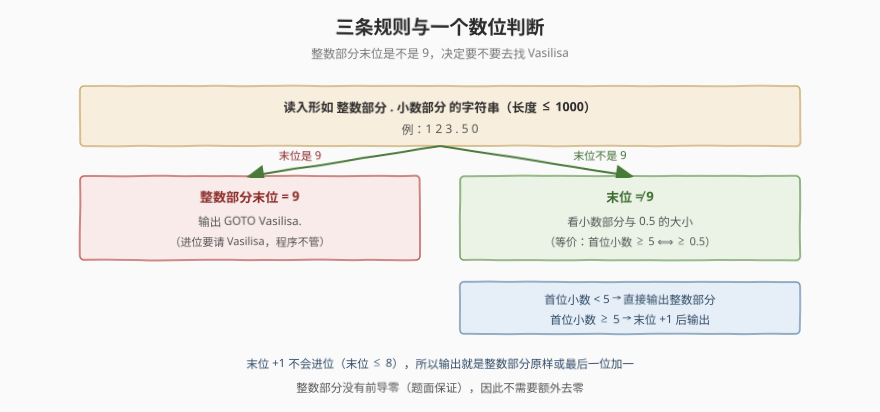
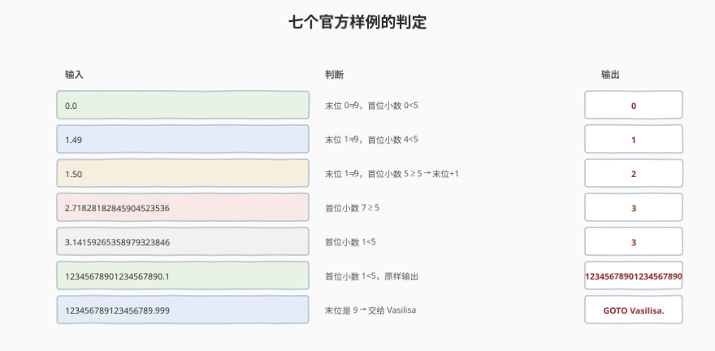

# Codeforces 99A 王国四舍五入 题解

## 1. 题目概述

- **题目链接**：https://codeforces.com/problemset/problem/99/A
- **比赛来源**：Codeforces Beta Round 78 (Div. 2 Only) · Problem A（UTC 2011-07-22）
- **难度**：800
- **标签**：字符串、模拟、分类讨论
- **评测类型**：普通
- **限制**：时间 2 s / 内存 256 MB

**题意**：王国颁布了一道"四舍五入到最近整数"的命令，但规则有个怪条件：

- 若整数部分末位不是 $9$ 且小数部分**严格小于** $0.5$，结果就是整数部分；
- 若整数部分末位不是 $9$ 且小数部分**不小于** $0.5$，结果给整数部分末位加 $1$；
- 若整数部分末位是 $9$，需要进位，而全国只有 Vasilisa 会做，所以输出 `GOTO Vasilisa.`。

输入是一个十进制小数字符串（整数部分 + 小数点 + 非空小数部分，总长 $\le 1000$），输出按上述规则处理后的整数（不带前导零）。

**约束**：

- 字符串长度 $\le 1000$：整数部分可能有近千位，**不能转成 `long long` / `int`**，必须用字符串处理。
- 整数部分不含前导零（除非它本身就是单个 `0`），小数部分非空。
- 末位加 $1$ 时因为末位 $\ne 9$，**不会产生进位**，所以不需要处理进位链。
- 单组数据。

## 2. 示例与观察

官方样例一：

```text
输入：
0.0
输出：
0
```

官方样例二：

```text
输入：
1.49
输出：
1
```

官方样例三：

```text
输入：
1.50
输出：
2
```

官方样例四：

```text
输入：
2.71828182845904523536
输出：
3
```

官方样例五：

```text
输入：
3.14159265358979323846
输出：
3
```

官方样例六：

```text
输入：
12345678901234567890.1
输出：
12345678901234567890
```

官方样例七：

```text
输入：
123456789123456789.999
输出：
GOTO Vasilisa.
```

**样例走查**：

- `1.49`：末位 $1 \ne 9$，小数 $0.49 < 0.5$ → 输出整数部分 `1`；
- `1.50`：末位 $1 \ne 9$，小数 $0.50 \ge 0.5$ → 末位 $+1$ 得 `2`；
- `2.718…`：首位小数 $7 \ge 5$ → `3`；`3.141…`：首位小数 $1 < 5$ → `3`；
- `12345678901234567890.1`：末位 $0 \ne 9$，首位小数 $1 < 5$ → 原样输出（$20$ 位，`long long` 装不下）；
- `123456789123456789.999`：整数部分末位是 $9$ → `GOTO Vasilisa.`（即使小数部分 $0.999 \ge 0.5$ 也一样，因为规则先看末位）。



**观察一**：判断"小数部分是否 $\ge 0.5$"不需要读完整个小数部分——只要看**第一位小数**是不是 $\ge 5$。

**观察二**：末位加 $1$ 不会进位，所以输出要么是原整数部分，要么是把它最后一位 $+1$，不存在"位数增加"或"前导零"的问题。

## 3. 解题思路

### 3.1 朴素做法与瓶颈

把字符串转成 `double` 再四舍五入：整数部分可能有 $999$ 位，`double` 只有约 $15$ 位有效数字，会直接错。用大整数（Python 的 `int` 可以）也行，但最省事的是纯字符串操作。

### 3.2 核心观察：一位小数决定一切



设小数部分为 $0.d_1 d_2 \cdots$（$d_1$ 是首位）。因为

$$0.d_1 d_2\cdots \ge 0.5 \iff d_1 \ge 5,$$

（$d_1 \le 4$ 时小数 $< 0.5$；$d_1 \ge 5$ 时小数 $\ge 0.5$），所以只需比较 `s[dot+1]` 与 `'5'`。

再注意规则顺序：**先看整数部分末位**。末位是 $9$ 时无论小数多少都输出 `GOTO Vasilisa.`。

### 3.3 算法流程

1. 读入字符串 $s$，找到小数点位置 `dot`；
2. 整数部分 `ip = s[0..dot-1]`，小数部分 `fp = s[dot+1..]`；
3. 若 `ip.back() == '9'`：输出 `GOTO Vasilisa.`，结束；
4. 若 `fp[0] >= '5'`：把 `ip` 的末位 $+1$；
5. 输出 `ip`。

### 3.4 样例走查

| 输入 | 末位 | 首位小数 | 动作 | 输出 |
|---|---|---|---|---|
| `0.0` | 0 | 0 | 不变 | `0` |
| `1.49` | 1 | 4 | 不变 | `1` |
| `1.50` | 1 | 5 | 末位 +1 | `2` |
| `2.718…` | 2 | 7 | 末位 +1 | `3` |
| `3.141…` | 3 | 1 | 不变 | `3` |
| `12345678901234567890.1` | 0 | 1 | 不变 | `12345678901234567890` |
| `123456789123456789.999` | 9 | — | GOTO | `GOTO Vasilisa.` |

## 4. 正确性证明

**引理 1**：小数部分 $0.d_1d_2\cdots$ 小于 $0.5$ 当且仅当 $d_1 \le 4$；不小于 $0.5$ 当且仅当 $d_1 \ge 5$。

**证明**：$0.d_1d_2\cdots = d_1/10 + r$，其中 $0 \le r < 1/10$。若 $d_1 \le 4$，则值 $< 5/10 = 0.5$；若 $d_1 \ge 5$，则值 $\ge 5/10 = 0.5$。∎

**引理 2**：若整数部分末位 $d \ne 9$，则"末位加 $1$"后整数部分仍是合法的十进制表示，且不会产生前导零或长度变化。

**证明**：$d \le 8$，$d+1 \le 9$，不产生进位；其余位不变，首位不变（输入无前导零），故长度与首位都不变。∎

**引理 3**：题面的三条规则互斥且穷尽。

**证明**：按"整数部分末位是否为 $9$"分成两类；末位非 $9$ 时再按"小数是否 $<0.5$"分成两类（由引理 1 可判定）。三类覆盖全部输入。∎

**定理**：算法输出与题面规则一致。

**证明**：算法先判末位是否为 $9$（规则 3），否则用首位小数判定大小关系（引理 1）并按规则 1、2 处理；末位加 $1$ 的合法性由引理 2 保证。由引理 3，所有情况都被覆盖且处理互斥。∎

## 5. 复杂度分析

- **时间**：$O(|s|)$，只做一次查找与一次末位修改；$|s| \le 1000$。
- **空间**：$O(|s|)$ 存字符串。
- **数值范围**：整数部分可达近千位，用字符串避免任何精度/溢出问题。
- **与时限的关系**：2 s 下实测约 $2.2$ ms（C++），Python 约 $19$ ms。

## 6. 参考代码

### C++17

```cpp
#include <bits/stdc++.h>
using namespace std;

int main() {
    string s;
    if (!(cin >> s)) return 0;
    size_t dot = s.find('.');
    string ip = s.substr(0, dot);          // 整数部分（题目保证没有前导 0，除非就是 "0"）
    string fp = s.substr(dot + 1);         // 小数部分
    if (ip.back() == '9') { printf("GOTO Vasilisa.\n"); return 0; }
    // 小数部分是否 >= 0.5：等价于第一位小数 >= '5'
    if (fp[0] >= '5') ip.back() = (char)(ip.back() + 1);
    printf("%s\n", ip.c_str());
    return 0;
}
```

### Python3

```python
import sys


def main() -> None:
    data = sys.stdin.buffer.read().split()
    if not data:
        return
    s = data[0].decode()
    dot = s.index('.')
    ip = s[:dot]
    fp = s[dot + 1:]
    if ip[-1] == '9':
        sys.stdout.write("GOTO Vasilisa.\n")
        return
    if fp[0] >= '5':
        ip = ip[:-1] + chr(ord(ip[-1]) + 1)
    sys.stdout.write(ip + "\n")


main()
```

## 7. 边界情况与易错点

1. **整数部分可能是 $20$ 位甚至 $999$ 位**：任何整数类型都会溢出，必须用字符串。样例六就是 $20$ 位。
2. **规则顺序**：先判末位是否为 $9$。`19.5` 应输出 `GOTO Vasilisa.`，不是 `20`；写成"先四舍五入再看末位"会错。
3. **"严格小于 $0.5$"的边界**：`1.49` → `1`，`1.50` → `2`；首位小数恰好是 `5` 时属于"不小于"，要加一。
4. **小数部分只看第一位**：`0.4999999` → `0`（不能因为后面还有很多 9 就进位）。
5. **末位加一不进位**：末位 $\ne 9$，所以直接改字符即可；不要写"字符串大数加一"的复杂逻辑（虽然也对，但容易引入错误）。
6. **`0.5` 的情形**：整数部分是单个 `0`，末位 $0 \ne 9$，首位小数 $5 \ge 5$ → 输出 `1`（不是 `01`）。
7. **输出不带前导零**：输入保证整数部分无前导零，末位加一也不会产生，所以直接输出即可。
8. **`GOTO Vasilisa.` 的大小写与标点**：必须逐字一致（`GOTO` 全大写、末尾有句点）。
9. **读入**：字符串中只有数字与一个小数点，`cin >> s` / `split()` 即可。

## 8. 验证记录

- **编译环境与命令**：`clang++ -std=c++17 -O2`（Apple clang 21.0.0 + `codeforces/tools/include` 的兼容头），Python 3.9.6。
- **官方样例**：7 / 7 通过（`0`、`1`、`2`、`3`、`3`、`12345678901234567890`、`GOTO Vasilisa.`），C++ 与 Python 输出一致。
- **独立暴力对拍**：暴力用 `fractions.Fraction(int(小数部分), 10^长度)` **精确**计算小数部分并与 $1/2$ 比较（完全不依赖"首位小数"这一观察），再套用规则。对随机整数部分（$0 \sim 10^6$ 与 $0 \sim 10^6$ 两种规模）、随机长度 $1 \sim 12$ 的小数部分、并特意让首位小数为 $4/5$ 的 **320 组**数据与参考程序比对，**全部一致**。
- **边界手测**：`9.5` → `GOTO Vasilisa.`、`19.5` → `GOTO Vasilisa.`、`0.5` → `1`、`0.4999` → `0`、`10.5` → `11`、`1000000.5` → `1000001`、`1.0` → `1`，均符合规则；整数部分 $999$ 位、小数 `.5` 的长输入也能正确输出（长度 $1000$）。
- **最大约束性能**：$1000$ 字符输入时 C++ 端到端约 $2.2$ ms，Python 约 $19$ ms；相对 2 s 余量在数百倍以上。
- **图片校验**：`cf99a_rule.svg`、`cf99a_samples.svg` 均通过 `xml.etree.ElementTree.parse`，含 `feTurbulence` 与手写体字体族，文本包围盒未越出 `viewBox`。
- **公式校验**：KaTeX（`throwOnError`）渲染无报错；无 `---` 分隔线。
- **复核状态**：verified（样例、对拍、性能、图片、公式均实跑通过）。

## 相关题目与扩展

- [Codeforces 99B Help Chef Gerasim](https://codeforces.com/problemset/problem/99/B)：同场 B 题。
- [Codeforces 98A Help Victoria the Wise](https://codeforces.com/problemset/problem/98/A)：同轮 Div.1 的 A 题（与本题不是同一题，见交付说明）。
- [Codeforces 71A Way Too Long Words](https://codeforces.com/problemset/problem/71/A)：字符串处理入门。
- [LeetCode 415. 字符串相加](https://leetcode.cn/problems/add-strings/)：本题"末位加一"的通用版（需要处理进位）。

**延伸思考**：

1. **如果规则改成"末位是 $9$ 时进位"**：输出会多一位（如 `19.5` → `20`），需要写一个"大整数加一"的字符串进位过程。
2. **如果小数部分有几千位**：本解仍 $O(1)$ 判定（只看首位），而"读完整小数再比较"的写法会退化到 $O(|s|)$。
3. **如果要求四舍五入到最近的 $10^k$**：需要看第 $k+1$ 位数字，思路完全相同，只是位置换成固定下标。
4. **如果输入允许科学计数法**：需要先解析指数，问题性质改变，属于另一类题。

