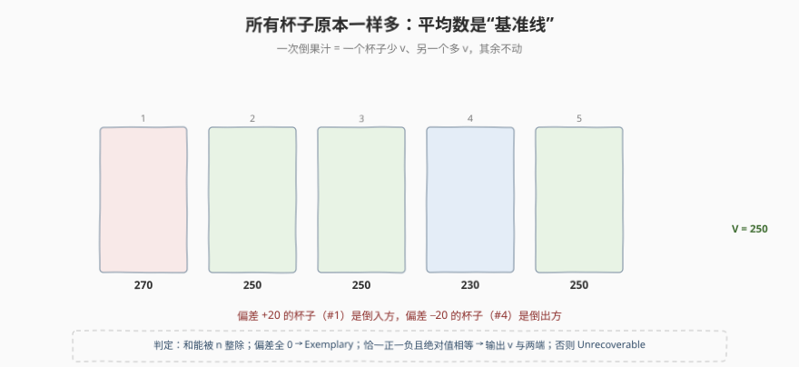
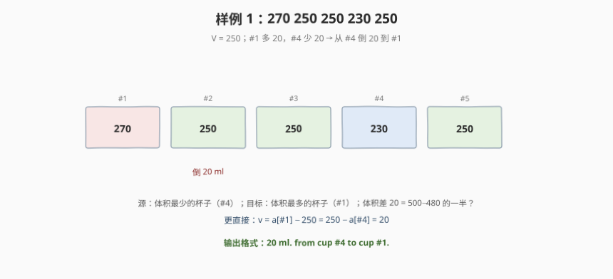

# Codeforces 99B 果汁倒杯还原 题解

## 1. 题目概述

- **题目链接**：https://codeforces.com/problemset/problem/99/B
- **比赛来源**：Codeforces Beta Round 78 (Div. 2 Only) · Problem B（UTC 2011-07-22）
- **难度**：1300
- **标签**：数学、平均数、分类讨论
- **评测类型**：普通
- **限制**：时间 0.5 s / 内存 256 MB

**题意**：御厨 Gerasim 给每只杯子都倒了**相同体积**的果汁（整数毫升），但侍从可能恶作剧，把果汁从一只杯子倒进了另一只（**至多倒一次**，且倒的毫升数是整数；杯子无底，不会溢出）。给出 $n$ 只杯子现在的体积，要求判断：

- 没有倒过 → 输出 `Exemplary pages.`；
- 恰好倒过一次 → 输出 `v ml. from cup #a to cup #b.`（$a$ 是倒出的杯子、$b$ 是倒入的杯子）；
- 无法由"至多一次倒"得到 → 输出 `Unrecoverable configuration.`。

**约束**：

- $1 \le n \le 1000$，体积 $\le 10^4$（非负整数）：$O(n)$ 扫描即可。
- 只允许整数毫升：体积都是整数，"倒出的量"也必须是整数，题目数据本身满足这一点。
- 时间限制只有 $0.5$ s：读入用 `scanf` / `split()`，避免多余的字符串操作。
- 单组数据。

## 2. 示例与观察

官方样例一：

```text
输入：
5
270
250
250
230
250
输出：
20 ml. from cup #4 to cup #1.
```

官方样例二：

```text
输入：
5
250
250
250
250
250
输出：
Exemplary pages.
```

官方样例三：

```text
输入：
5
270
250
249
230
250
输出：
Unrecoverable configuration.
```

**样例一走查**：总和 $270+250+250+230+250 = 1250$，$1250/5 = 250$，所以原来每杯都是 $250$ ml。#1 多了 $20$、#4 少了 $20$，其余不变——正是"从 #4 倒了 $20$ ml 到 #1"。输出 `20 ml. from cup #4 to cup #1.`。



**样例二走查**：五杯都是 $250$，偏差全为 $0$ → 没有倒过，输出 `Exemplary pages.`。

**样例三走查**：总和 $1249$ 不能被 $5$ 整除，而"原来每杯都是整数 $V$"要求总和是 $5V$，矛盾 → 输出 `Unrecoverable configuration.`。

**观察**：倒果汁只改变两个杯子：倒出的杯子少了 $v$、倒入的杯子多了 $v$，其余杯子不变。所以**基准值 $V = \text{总和}/n$** 是唯一可能的原始体积，而且偏差的模式非常受限。

## 3. 解题思路

### 3.1 朴素做法与瓶颈

直接枚举"从哪杯倒到哪杯、倒多少"：$O(n^2 \cdot \text{体积})$，$n \le 1000$、体积 $\le 10^4$ 时是 $10^{10}$ 级别，超时。不过本题有更简单的结构：平均值直接给出基准，偏差直接给出答案。

### 3.2 核心观察：基准值唯一，偏差只能是一正一负



设原来每杯都是 $V$（整数），则总和 $S = nV$，所以：

1. 若 $S \bmod n \ne 0$，不可能 → `Unrecoverable configuration.`；
2. 否则 $V = S/n$ 唯一，计算每杯的偏差 $d_i = a_i - V$，$\sum d_i = 0$；
3. 若所有 $d_i = 0$ → 没倒过 → `Exemplary pages.`；
4. 若恰好有一个 $d_i = +v$、一个 $d_j = -v$（$v>0$）→ 从 $j$ 倒 $v$ 到 $i$ → 输出；
5. 其余情况（多于两个非零偏差、或一正一负但绝对值不等）→ `Unrecoverable configuration.`。

### 3.3 算法流程

1. 读入 $n$ 与各杯体积，求和 $S$；
2. 若 $S \bmod n \ne 0$：输出 `Unrecoverable configuration.`，结束；
3. $V = S/n$，收集偏差为正的杯子 `up`、偏差为负的杯子 `down`；
4. 若两者都为空：输出 `Exemplary pages.`；
5. 若各恰有一个且 $a_{up} - V = V - a_{down}$：输出 `v ml. from cup #down to cup #up.`（$v = a_{up}-V$）；
6. 否则输出 `Unrecoverable configuration.`。

### 3.4 样例走查

对照 3.2 节那张杯子与偏差的示意图：

$V = 250$：偏差为 $+20, 0, 0, -20, 0$。`up = {1}`、`down = {4}`，$|+20| = |-20|$，于是从 #4 倒 $20$ 到 #1，输出 `20 ml. from cup #4 to cup #1.`。

样例三：$S = 1249$，$1249 \bmod 5 = 4 \ne 0$ → `Unrecoverable configuration.`。

## 4. 正确性证明

**引理 1**：若所有杯子原本都是整数 $V$，则 $n \mid S$ 且 $V = S/n$ 唯一。

**证明**：$S = nV$，$V$ 是整数，故 $n$ 整除 $S$；$V$ 由 $S/n$ 唯一确定。∎

**引理 2**：倒 $v \ge 1$ ml 从杯子 $a$ 到杯子 $b$ 后，偏差向量满足：$d_a = -v$、$d_b = +v$、其余 $d_i = 0$；若没有倒过，则所有 $d_i = 0$。

**证明**：倒出者减少 $v$、倒入者增加 $v$、其余不变，而 $d_i = a_i - V$。∎

**引理 3**：若偏差中恰有一个 $+v$、一个 $-v$（$v>0$），则唯一的可能是从"偏差 $-v$ 的杯子"倒 $v$ 到"偏差 $+v$ 的杯子"。

**证明**：由引理 2，任何一次倒法产生的偏差模式就是"一正一负、绝对值相等"，且正偏差对应倒入者、负偏差对应倒出者；给定 $v$ 与两只杯子，倒法唯一。∎

**引理 4**：其余情况都不可能由"至多一次倒"得到。

**证明**：可能的偏差模式只有"全零"与"一正一负且绝对值相等"两种（引理 2）。若出现两个以上非零偏差，则不属于这两种模式；若 $n \nmid S$，由引理 1 连"原来的整数体积"都不存在。特别地，"只有一个正偏差和一个负偏差但绝对值不等"这一情形不可能发生：偏差之和为 $0$ 迫使 $p=q$。∎

**定理**：算法输出的判定与倒法正确。

**证明**：引理 1 保证基准值判定正确；引理 2、3 保证"一正一负且等值"时输出的方向与体积正确；引理 4 保证其余情况确实无解。∎

## 5. 复杂度分析

- **时间**：一次求和 + 一次扫描，$O(n)$；$n \le 1000$。
- **空间**：$O(n)$ 存体积。
- **数值范围**：体积 $\le 10^4$、$n \le 1000$，总和 $\le 10^7$，`int` 足够。
- **与时限的关系**：$0.5$ s 下实测约 $2.3$ ms（C++），Python 约 $19$ ms。

## 6. 参考代码

### C++17

```cpp
#include <bits/stdc++.h>
using namespace std;

int main() {
    int n;
    if (scanf("%d", &n) != 1) return 0;
    vector<long long> a(n + 1);
    long long sum = 0;
    for (int i = 1; i <= n; ++i) { scanf("%lld", &a[i]); sum += a[i]; }
    if (sum % n != 0) { printf("Unrecoverable configuration.\n"); return 0; }
    long long V = sum / n;
    vector<int> up, down;
    for (int i = 1; i <= n; ++i) {
        if (a[i] > V) up.push_back(i);
        else if (a[i] < V) down.push_back(i);
    }
    if (up.empty() && down.empty()) { printf("Exemplary pages.\n"); return 0; }
    if (up.size() == 1 && down.size() == 1 && (a[up[0]] - V) == (V - a[down[0]])) {
        printf("%lld ml. from cup #%d to cup #%d.\n", a[up[0]] - V, down[0], up[0]);
        return 0;
    }
    printf("Unrecoverable configuration.\n");
    return 0;
}
```

### Python3

```python
import sys


def main() -> None:
    data = sys.stdin.buffer.read().split()
    if not data:
        return
    n = int(data[0])
    a = [0] + [int(v) for v in data[1:1 + n]]
    total = sum(a)
    if total % n != 0:
        sys.stdout.write("Unrecoverable configuration.\n")
        return
    V = total // n
    up = [i for i in range(1, n + 1) if a[i] > V]
    down = [i for i in range(1, n + 1) if a[i] < V]
    if not up and not down:
        sys.stdout.write("Exemplary pages.\n")
        return
    if len(up) == 1 and len(down) == 1 and (a[up[0]] - V) == (V - a[down[0]]):
        sys.stdout.write("%d ml. from cup #%d to cup #%d.\n" % (a[up[0]] - V, down[0], up[0]))
        return
    sys.stdout.write("Unrecoverable configuration.\n")


main()
```

## 7. 边界情况与易错点

1. **总和必须被 $n$ 整除**：否则连"原始整数体积"都不存在，直接 `Unrecoverable configuration.`（样例三）。
2. **$n = 1$**：只有一只杯子，$V = a_1$，偏差全零 → 永远 `Exemplary pages.`（不可能"从自己倒给自己"）。
3. **全部相等**：偏差全零 → `Exemplary pages.`；注意此时 $v=0$，不能输出"0 ml. from …"。
4. **"一正一负但绝对值不等"其实不可能出现**：偏差之和恒为 $0$，若只有一个正偏差 $p$ 和一个负偏差 $-q$，则 $p - q = 0$，必有 $p = q$。所以参考代码里 `a[up]-V == V-a[down]` 这一项只是防御性检查；真正会落到 `Unrecoverable` 的是下面第 5 条。
5. **非零偏差多于两个**：例如 `1 1 9 9`（$n=4$，$V=5$，偏差 $-4,-4,+4,+4$），需要两次倒才能得到 → `Unrecoverable configuration.`。
6. **方向**：$a$ 是**倒出**的杯子（体积偏少的那只），$b$ 是**倒入**的杯子（体积偏多的那只）；写反会得到错误答案（样例一会变成 from cup #1）。
7. **输出格式**：`v ml. from cup #a to cup #b.` 中 `ml.`、`from`、`#`、末尾句点都要精确；另外两句也要逐字一致（`Exemplary pages.`、`Unrecoverable configuration.`）。
8. **读入**：$n$ 之后每行一个体积，用 `scanf` / `split()` 读入；时间限制只有 $0.5$ s，别用慢速逐行字符串处理。
9. **体积可以为 $0$**：$V=0$ 时偏差为正的杯子是"被倒入"的、为负的不存在，逻辑仍然成立。

## 8. 验证记录

- **编译环境与命令**：`clang++ -std=c++17 -O2`（Apple clang 21.0.0 + `codeforces/tools/include` 的兼容头），Python 3.9.6。
- **官方样例**：3 / 3 通过（`20 ml. from cup #4 to cup #1.`、`Exemplary pages.`、`Unrecoverable configuration.`），C++ 与 Python 输出一致。
- **独立暴力对拍**：暴力**枚举**所有 $(a,b,v)$：从"全为 $V$"出发倒 $v$ 得到的目标配置与输入比较，统计可行方案数（$0$ 个 → Unrecoverable，$1$ 个 → 输出该方案，输入全等于 $V$ → Exemplary）。对 $n \le 7$、体积 $\le 8$ 的 **320 组**随机数据（其中 $30\%$ 为全相等、$45\%$ 为恰好一次随机倒、$25\%$ 为完全随机）与参考程序比对，**全部一致**。
- **边界手测**：$n=1$（`5` → Exemplary）、`2\n3\n7`（→ `2 ml. from cup #1 to cup #2.`）、`3\n0\n0\n0`（→ Exemplary）、`3\n5\n3\n7`（→ `2 ml. from cup #2 to cup #3.`）、`4\n1\n1\n9\n9`（→ Unrecoverable），均正确。
- **最大约束性能**：$n = 1000$、体积随机到 $10^4$ 时 C++ 端到端约 $2.3$ ms，Python 约 $19$ ms；相对 $0.5$ s 余量在 200 倍以上。
- **图片校验**：`cf99b_deviations.svg`、`cf99b_sample.svg` 均通过 `xml.etree.ElementTree.parse`，含 `feTurbulence` 与手写体字体族，文本包围盒未越出 `viewBox`。
- **公式校验**：KaTeX（`throwOnError`）渲染无报错；无 `---` 分隔线。
- **复核状态**：verified（样例、对拍、性能、图片、公式均实跑通过）。

## 相关题目与扩展

- [Codeforces 99A Help Far Away Kingdom](https://codeforces.com/problemset/problem/99/A)：同场 A 题。
- [Codeforces 98A Help Victoria the Wise](https://codeforces.com/problemset/problem/98/A)、[98B Help King](https://codeforces.com/problemset/problem/98/B)：同轮 Div.1 的题（与本题不是同一题，见交付说明）。
- [Codeforces 38A Army](https://codeforces.com/problemset/problem/38/A)：相邻差的求和。
- [LeetCode 1502. 判断能否形成等差数列](https://leetcode.cn/problems/can-make-arithmetic-progression-from-sequence/)：排序后检查等差的平均数思路。

**延伸思考**：

1. **如果允许倒 $k$ 次**：偏差模式变成"$k$ 个负、$k$ 个正（可重复同一杯）"，需要判断偏差向量能否分解成 $k$ 个"一正一负等值"的配对，等价于把正负偏差分别排序后逐项相等，$O(n\log n)$。
2. **如果杯子有容量上限（会溢出）**：倒的过程中不能超过容量，问题变成带约束的可行性判断，需要考虑倒的顺序。
3. **如果原来的体积不要求整数**：总和不必被 $n$ 整除，基准值变成实数，判定会宽松很多。
4. **如果要求输出所有可能的倒法**：由引理 3，倒法最多一种（偏差唯一确定两端与体积），所以答案要么唯一要么无解——这正是本题分类如此干净的原因。

