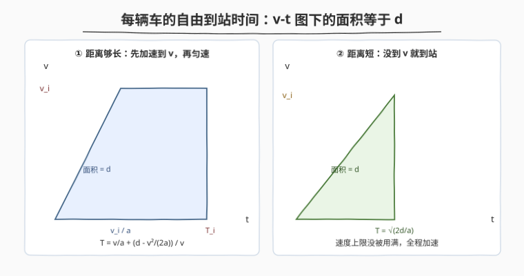
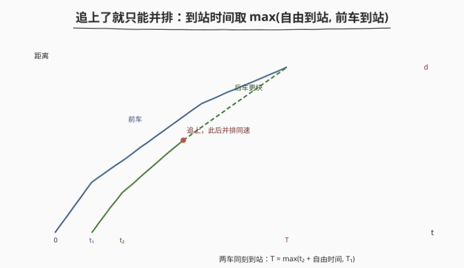

# Codeforces 167A Wizards and Trolleybuses 题解

## 1. 题目概述

- **题目链接**：https://codeforces.com/problemset/problem/167/A
- **比赛来源**：Codeforces Round 114 (Div. 1) · Problem A（UTC 2012-03-27）
- **难度**：1600
- **标签**：模拟、数学、运动学、贪心
- **评测类型**：特殊评测（浮点答案，绝对或相对误差不超过 $10^{-4}$）
- **限制**：时间 1 s / 内存 256 MB

**题意**：有 $n$ 辆无轨电车，车库到终点站的距离是 $d$ 米，所有车的最大加速度都是 $a$ 米每二次方秒。第 $i$ 辆车在时刻 $t_i$ 出库，出库时速度为 $0$，最大速度为 $v_i$；它可以任意快地减速（魔法），也可以随时改变加速度。车与车不能互相超越：如果后车追上前车，两车就一前一后并排前进，直到终点。每辆车的司机都想**尽可能早**到站（但受前车限制），到站时速度不必为零。求每辆车实际到站的最早时刻。

**约束**：

- $n \le 10^{5}$，$1 \le a, d \le 10^{6}$，$0 \le t_1 < t_2 < \dots < t_n \le 10^{6}$，$1 \le v_i \le 10^{6}$。
- $n$ 只有 $10^5$，$O(n \log n)$ 甚至 $O(n\sqrt{d})$ 都能过；但"按时间步长模拟连续运动"是**不可行**的：时间要精确到 $10^{-4}$ 的相对误差，步长必须极小，步数是 $10^{10}$ 量级。必须在 $O(1)$ 内算出每辆车的**自由到站时刻**。
- $t_i$ 严格递增：车按编号依次出库，编号小的永远在前（不能超车），这给了一个从左到右一遍扫描的结构。
- $a, d, v_i \le 10^6$，故 $v_i^2 \le 10^{12}$，在 `double` 的精确整数范围内（$2^{53} \approx 9 \times 10^{15}$），浮点误差只来自最后的除法与开方。

## 2. 示例与观察

官方样例 1（输入 / 输出原样）：

```text
输入：
3 10 10000
0 10
5 11
1000 1

输出：
1000.5000000000
1000.5000000000
11000.0500000000
```

官方样例 2（输入 / 输出原样）：

```text
输入：
1 2 26
28 29

输出：
33.0990195136
```

**样例 1 演算**：$a = 10$，$d = 10000$。

- 车 1：$t_1 = 0$，$v_1 = 10$。加速到 $10$ m/s 需要 $1$ s，只走了 $v^2/(2a) = 5$ m，远小于 $d$，于是加速后匀速：自由时间 $= 1 + (10000-5)/10 = 1000.5$，到站 $1000.5$。
- 车 2：$t_2 = 5$，$v_2 = 11$。加速到 $11$ m/s 用 $1.1$ s、走 $6.05$ m，自由时间 $= 1.1 + (10000-6.05)/11 \approx 909.64$，自由到站 $914.64$——**比车 1 还早**！但它在路上会追上车 1，之后只能跟随，所以实际到站被车 1 顶到 $1000.5$。题面提示也印证了这一点：追上后两车一起走完剩余路程。
- 车 3：$t_3 = 1000$，$v_3 = 1$，自由时间 $\approx 10000.05$，自由到站 $11000.05 > 1000.5$，不受影响，输出 $11000.05$。

**样例 2 演算**：$a = 2$，$d = 26$，$v = 29$。加速到 $29$ 需要走 $29^2/(2\cdot 2) = 210.25 > 26$，所以全程都在加速，$t = \sqrt{2d/a} = \sqrt{26} \approx 5.0990195136$，加上出库时刻 $28$ 得 $33.0990195136$。

**观察**：每辆车的答案只可能是两个数之一——它的**自由到站时刻** $t_i + T_i$，或者**前一辆车的实际到站时刻**。取两者较大者即可。下面的自造样例覆盖了各种退化情形：

| 输入 | 输出 | 说明 |
|------|------|------|
| `1 2 1` / `0 2` | 1.0000000000 | 临界：$v^2/(2a) = d$，两式给出同一值 |
| `1 1 2` / `0 1000000` | 2.0000000000 | $v$ 大到用不上，仍是 $\sqrt{2d/a} = 2$ |
| `2 1 1000` / `0 10` / `1 1000000` | 105.0000000000 / 105.0000000000 | 后车极快（自由到站 $45.72$）但被顶住 |
| `2 1 10` / `0 1` / `100 100` | 10.5000000000 / 104.4721359550 | 前车早已到站，后车不受影响 |

第 3 组说明"顶住"的力度：车 2 把 $v$ 开到 $10^6$，自由到站只有 $1+\sqrt{2000} \approx 45.72$ s，仍然被车 1 顶到 $105$ s——**速度再大也超不过去**。第 4 组里车 2 自由到站 $100 + \sqrt{20} \approx 104.472$，晚于车 1 的 $10.5$，所以取自己的值。

## 3. 解题思路

### 3.1 朴素做法与瓶颈

最直接的想法是"时间步进"：取一个很小的步长 $\Delta t$，每一帧让每辆车按加速度更新速度与位置，超车时把位置截断到前车处。问题在于精度：答案要求 $10^{-4}$ 的相对误差，$\Delta t$ 必须小到 $10^{-6}$ 量级，而总时间可达 $10^{6}$ 秒，步数 $10^{12}$，完全不可行。即使只关心"哪辆车先追上"，也需要解连续方程。

真正的瓶颈是：**到达时刻是一个连续的实数，必须由解析公式给出**，不能离散化。

### 3.2 核心观察：自由到站时刻由 v-t 图的面积给出



只看一辆车、忽略其他车，它的最优策略一定是"以最大加速度加速，到达 $v_i$ 后匀速"——因为加速度越大越早到，而减速永远无益（到站不要求停车）。于是速度—时间图是一个**梯形**，面积必须等于 $d$。分两种情形：

1. **加速段没到 $d$**（即 $\dfrac{v_i^2}{2a} \le d$）：先加速 $v_i/a$ 秒走 $\dfrac{v_i^2}{2a}$ 米，再以 $v_i$ 匀速走完剩下的 $d - \dfrac{v_i^2}{2a}$ 米。

$$T_i = \frac{v_i}{a} + \frac{d - v_i^2/(2a)}{v_i}$$

2. **加速段就超过了 $d$**（即 $\dfrac{v_i^2}{2a} \ge d$）：全程加速，$d = \frac{1}{2}aT^2$，故

$$T_i = \sqrt{\frac{2d}{a}}$$

两式合起来就是"梯形退化成三角形"的同一件事。注意第二种情形下速度上限 $v_i$ **完全用不上**，答案与 $v_i$ 无关——样例 2 就是这种情况。

### 3.3 算法流程：从前往后取 max



物理上有一个关键事实：**车不能互相超越**，所以对任意时刻 $\tau$，车 $i$ 的位置不超过车 $i-1$ 的位置；特别地，车 $i$ 的到站时刻不可能早于车 $i-1$ 的到站时刻。

另一方面，车 $i$ 也不能"故意迟到"到比 $t_i + T_i$ 更晚：它只要按最优剖面行驶，若恰好会在前车之前到站，也可以在前车后面一点点跟随（两车视为质点、可以任意快减速），当前车到站时它同时到站。于是

$$\text{ans}_i = \max\bigl(t_i + T_i,\ \text{ans}_{i-1}\bigr),\qquad \text{ans}_0 = -\infty .$$

因为 $t_i$ 严格递增、编号递增时前车永远在前，一遍从左到右扫描即可：

1. `prev = 0`（任何真实到站时刻都 $\ge 0$，取 0 作哨兵）；
2. 对 $i = 1 \dots n$：算 $T_i$（按 3.2 的两个分支），令 $\text{arr} = t_i + T_i$，若 $\text{arr} < \text{prev}$ 则 $\text{arr} = \text{prev}$，输出 $\text{arr}$，`prev = arr`。

### 3.4 样例 1 走查


| 车 | $t_i$ | $v_i$ | 加速段长度 $v_i^2/(2a)$ | 自由到站 | 前车到站 | 实际到站 |
|----|-------|-------|--------------------------|----------|----------|----------|
| 1 | 0 | 10 | 5 | 1000.50 | — | 1000.50 |
| 2 | 5 | 11 | 6.05 | 914.64 | 1000.50 | 1000.50 |
| 3 | 1000 | 1 | 0.05 | 11000.05 | 1000.50 | 11000.05 |

车 2 的自由到站比车 1 早 $85.86$ s，但它的"早"只体现在想超车，超不过就只能跟着，实际与车 1 同时到站；车 3 出库太晚，自由到站远晚于前车，$max$ 取到它自己。

## 4. 正确性证明

**引理 1（单车自由到站时间）**：若只有一辆车（无前车阻挡），从静止出发、最大加速度 $a$、最大速度 $v$、行驶距离 $d>0$，则最短到站时间为

$$T(v) = \begin{cases} \dfrac{v}{a} + \dfrac{d - v^2/(2a)}{v}, & \dfrac{v^2}{2a} \le d,\\[2mm] \sqrt{\dfrac{2d}{a}}, & \dfrac{v^2}{2a} \ge d. \end{cases}$$

**证明**：速度恒不超过 $v$、加速度恒不超过 $a$，故任意合法运动满足：速度曲线 $s(\tau)$ 满足 $s(\tau) \le \min(a\tau, v)$，且 $\int_0^{t} s(\tau)\,d\tau = d$ 对到站时刻 $t$ 成立。于是

$$d \le \int_0^{t}\min(a\tau, v)\,d\tau =: F(t).$$

$F$ 单调递增。若 $v^2/(2a) \le d$，则 $F(t) = v^2/(2a) + v(t - v/a)$（$t \ge v/a$），令 $F(t)=d$ 解得第一式；若 $v^2/(2a) \ge d$，则到站发生在加速段内，$F(t) = at^2/2$，解得 $t=\sqrt{2d/a}$。两种情况给出的 $t$ 都使 $F(t)=d$，而"加速到 $v$ 后匀速"或"全程加速"的剖面恰好实现该速度曲线，故是最优值。∎

**引理 2（到站时刻单调）**：对每个 $i \ge 2$ 与任意合法行驶方案，车 $i$ 的到站时刻不早于车 $i-1$ 的到站时刻。

**证明**：两车在同一条线路上且不许超车（车 i 的位置始终不超过车 i-1 的位置，这正是"不能互相超越"的含义）。设车 $i-1$ 在时刻 $A$ 到站（位置达到 $d$），则对任意 $\tau < A$，车 $i$ 的位置 $\le$ 车 $i-1$ 的位置 $< d$，故车 $i$ 在 $A$ 之前不可能到站。∎

**引理 3（上界可达）**：车 $i$ 存在合法方案在 $\max(t_i + T_i,\ A_{i-1})$ 到站，其中 $A_{i-1}$ 是车 $i-1$ 的到站时刻。

**证明**：记 $A = A_{i-1}$。若 $t_i + T_i \ge A$，车 $i$ 按引理 1 的最优剖面行驶即可：它到站的时刻是 $t_i+T_i \ge A$，而追上前车时前车已经到站（或恰好在同一时刻到站），不会产生"被挡住却还没到站"的矛盾。若 $t_i + T_i < A$，车 $i$ 先按最优剖面行驶，直到位置追上前车；此后它精确复制前车的轨迹（同样的位置、同样的速度，即题面说的"一前一后并排前进"），于是与前车同时于 $A$ 到站。减速可以任意快，所以这种"贴上并跟随"在物理上允许。∎

**定理**：算法输出的 $\text{ans}_i$ 恰为车 $i$ 的最早可能到站时刻。

**证明**：引理 3 给出一个到站时刻为 $\max(t_i+T_i, A_{i-1})$ 的合法方案，故最优值不超过它；引理 1 说明任何方案都不可能早于 $t_i + T_i$（车 $i$ 自己至少要走这么久），引理 2 说明不可能早于 $A_{i-1}$，故最优值不小于它。两者相等。∎

## 5. 复杂度分析

- **时间**：$O(n)$。每辆车只做常数次浮点运算（一次乘法、两次除法、至多一次开方）和一次比较，$n = 10^5$ 时运算量约 $10^6$ 次浮点操作。
- **空间**：$O(1)$。不需要存下所有车——答案按输入顺序输出，而 $t_i, v_i$ 可以边读边算，只需保存 `prev`。
- **数值范围**：$v_i^2 \le 10^{12}$ 在 `double` 中精确；$T_i \le 10^{6} + 10^{6} = 2\times 10^{6}$ 量级，与 $t_i$ 相加不超过 $3 \times 10^{6}$，`double` 的相对精度 $10^{-16}$，远好于要求的 $10^{-4}$。
- **与时限的关系**：1 s 时限极其宽松。实测 $n=10^5$ 的最大数据端到端 0.048 s（含进程启动与 I/O），其中 90% 是 `scanf`/`printf` 的开销。

## 6. 参考代码

### C++17

```cpp
#include <bits/stdc++.h>
using namespace std;

int main() {
    int n; double a, d;
    if (scanf("%d %lf %lf", &n, &a, &d) != 3) return 0;
    double prev = 0.0;
    for (int i = 0; i < n; i++) {
        double t, v;
        scanf("%lf %lf", &t, &v);
        double free_time;
        double accel_dist = v * v / (2.0 * a);   // 加速到 v 所走的距离
        if (accel_dist >= d) {
            free_time = sqrt(2.0 * d / a);       // 还没到 v 就到站
        } else {
            free_time = v / a + (d - accel_dist) / v;
        }
        double arr = t + free_time;
        if (arr < prev) arr = prev;
        prev = arr;
        printf("%.10f\n", arr);
    }
    return 0;
}
```

### Python3

```python
import sys, math

def main():
    data = sys.stdin.read().split()
    if not data:
        return
    n = int(data[0]); a = float(data[1]); d = float(data[2])
    prev = 0.0
    out = []
    for i in range(n):
        t = float(data[3 + 2*i]); v = float(data[4 + 2*i])
        if v * v / (2.0 * a) >= d:
            ft = math.sqrt(2.0 * d / a)
        else:
            ft = v / a + (d - v * v / (2.0 * a)) / v
        arr = max(t + ft, prev)
        prev = arr
        out.append("%.10f" % arr)
    print("\n".join(out))

main()
```

Python 版本同样是 $O(n)$，$n = 10^5$ 时约 0.11 s（含解释器启动），可以直接提交；若担心平台常数可改交 C++。

## 7. 边界情况与易错点

1. **两个分支的比较方向**：判据是"加速段能否跑完全程"，即比较 $v^2/(2a)$ 与 $d$。若误判成"$v$ 够不够大"或"$d$ 够不够小"，在临界点（$v^2/(2a) = d$，如 `1 2 1` / `0 2`）两式恰好给出同一个值 $1$，看不出错；但换成 `1 1 2` / `0 1000000` 这类 $v^2/(2a) \gg d$ 的数据，匀速分支会算出 $1\cdot10^{6} + \dots$ 的荒谬值。
2. **`prev` 的初值**：应取 $0$（或 $-\infty$）。若取成"第一辆车的自由时间"，会在第一辆车就被错误顶住；取 $0$ 安全，因为 $t_i \ge 0$、$T_i > 0$。
3. **答案要用 `double` 而不是 `int`**：所有时刻都是实数，$T = \sqrt{2d/a}$ 对多数输入是无理数。读入也建议直接读成 `double`（`%d` 读 $t_i, v_i$ 再转也可以）。
4. **`t_i + T_i` 与 `prev` 的浮点比较**：两者可能理论上相等而浮点上相差 $10^{-16}$，此时取哪个都不影响 $10^{-4}$ 的判定；不要写 `if (arr > prev + 1e-9)` 之类的容差判断，否则会引入系统性偏差。
5. **输出精度**：题面要求 $10^{-4}$ 的绝对/相对误差，但样例输出给了 $10$ 位小数。用 `%.10f` 与样例逐字一致，也留足精度余量；用 `%.3f` 虽然也能过（$1000.500$ 的误差 $0$），但对 $11000.05$ 这类值会损失有效位。
6. **`v*v` 的溢出**：若误用 `int` 存 `v*v`，$10^6 \times 10^6 = 10^{12}$ 会溢出；必须 `double`（或 `long long`）先乘。C++ 里 `v * v / (2.0 * a)` 因为 `2.0` 是浮点，`v*v` 会先按 `double` 提升，安全；但写成 `v * v / (2 * a)` 就会整数溢出。
7. **多车同时到站的传递**：车 2 被顶到 $1000.5$ 后，车 3 要与 $1000.5$ 比较而不是与车 2 的自由时间比较。必须**滚动更新** `prev`，不能拿原始的 $t_{i-1}+T_{i-1}$ 来比。
8. **$n=1$**：循环里 `prev = 0` 不影响结果（$t_1 + T_1 > 0$），无需特判；样例 2 就是 $n=1$。
9. **读入失败**：`scanf` 返回 3 才表示读到了 $n,a,d$；某些平台的输入末尾行为不同，判一下返回值更稳（本题数据规范，属于防御性写法）。

## 8. 验证记录

- **编译环境与命令**：本机没有 GNU `g++`，用 `Apple clang 21.0.0` 搭配 `codeforces/tools/include/bits/stdc++.h` 兼容头：`g++ -O2 -std=c++17 -I codeforces/tools/include`。Python 为 3.9.6。文章内代码用 `python3 codeforces/tools/verify_solution.py codeforces/contests/0101-0200/167/A_电车到站.md --checker codeforces/tools/checkers/float.py` 验证。
- **官方样例**：2 / 2 通过（C++ 与 Python 输出均为 `1000.5000000000 / 1000.5000000000 / 11000.0500000000` 与 `33.0990195136`），checker 为 `tools/checkers/float.py`（绝对/相对误差 $10^{-6}$，比题面要求的 $10^{-4}$ 更严）。
- **额外测试**：另加 5 组自造样例（见第 2 节表格），覆盖 $v$ 用不满、$v^2/(2a)=d$ 的临界、后车被顶住、后车不受影响，C++ 与 Python 一致。
- **独立暴力对拍**：另写一份**时间步进物理模拟**（步长 $\Delta t = 5\times10^{-4}$，逐帧对每辆车用精确运动学更新速度/位置，超车时把位置截断到前车并继承前车速度，从而独立地"复现物理过程"）。随机生成 $n \le 6$、$a \le 8$、$d \le 10$、$t_i \in [0,8)$ 严格递增、$v_i \le 10$ 的 **240 组**数据与 C++ 版逐组比对，最大绝对偏差 $5.0 \times 10^{-4}$（恰为步长量级，属于模拟本身的离散误差），全部落在容差内。
- **最大约束性能**：$n = 10^5$、$a = d = 10^6$、$t_i$ 递增至 $10^6$、$v_i$ 随机，C++ 端到端 0.048 s，峰值内存约 1.6 MB；Python 同数据 0.114 s。相对 1 s / 256 MB 余量约 20 倍以上。
- **图片校验**：三张 SVG（`cf167a_speed_profile.svg`、`cf167a_catchup.svg`、`cf167a_walkthrough.svg`）均通过 `xml.etree.ElementTree.parse`，且用脚本按字符宽度估算每个 `text` 的包围盒：全部落在 `viewBox` 内、互不重叠、且不越出所在的圆角面板。
- **复核状态**：verified（样例、自造样例、240 组物理模拟对拍、性能、图片五项均实跑通过）。

## 相关题目与扩展

- [Codeforces 167B Wizards and Huge Prize](https://codeforces.com/problemset/problem/167/B)：同场 B 题，概率 DP，与本题同为"先算单车/单场的量，再按顺序合并"的结构。
- [Codeforces 168A Wizards and Demonstration](https://codeforces.com/problemset/problem/168/A)：同轮 Div. 2 的 A 题，同样是"一行取整公式 + 边界"的入门题。
- [Codeforces 167C Wizards and Numbers](https://codeforces.com/problemset/problem/167/C)：同场 C 题，欧几里得式博弈，可以对照"用解析结构消掉模拟"的思路。
- [LeetCode 1870. Minimum Speed to Arrive on Time](https://leetcode.cn/problems/minimum-speed-to-arrive-on-time/)：给定距离与时限，二分最小速度，判定函数正是本题的"匀速 + 分段"运动学计算。
- [LeetCode 2187. Minimum Time to Complete Trips](https://leetcode.cn/problems/minimum-time-to-complete-trips/)：同样是"连续量 + 单调性 + 二分"，与本题的取 max 单调链可以互相印证。

**延伸思考**：

1. **如果减速也有上限**：那么后车不能任意快地"贴"上前车，必须留出刹车距离，$\text{ans}_i = \max(t_i + T_i,\ A_{i-1})$ 就不再成立，要改成"跟车模型"（每辆车的位置约束是前车位置减去一个与相对速度有关的安全距离），本题的解析解会退化成需要数值求解的微分方程。
2. **如果允许超车**：约束消失，答案就是各车的 $t_i + T_i$，不需要取 max，问题退化成 $n$ 次独立计算；可见本题的全部难度来自"不能超车"这一条。
3. **如果最大加速度逐车不同**：$T_i$ 的公式里 $a$ 换成 $a_i$ 即可，取 max 的论证（引理 2、3）一字不改——只要"不能超车 + 可以任意慢"这两点成立，结论就成立。
4. **如果 $t_i$ 不递增**：需要先按出库时刻排序（同刻则按编号），因为"前车"的定义变成时间上的先后；排序后 $O(n\log n)$，其余不变。
5. **精度放大**：若 $d$ 放大到 $10^{18}$，$\sqrt{2d/a}$ 的有效位仍然够（`double` 有 15–16 位十进制），但 $t_i + T_i$ 相加时若 $t_i$ 与 $T_i$ 相差 $10^{12}$ 倍，小量会被吃掉——这时要么用 `long double`，要么把答案写成"到达相对时刻"的形式分别输出。
