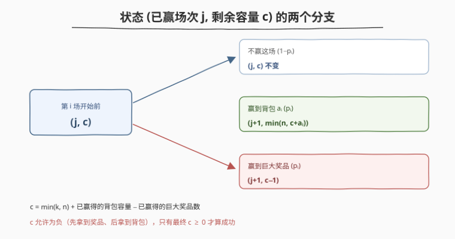
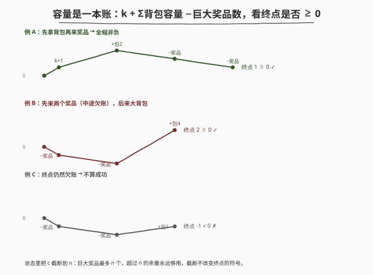
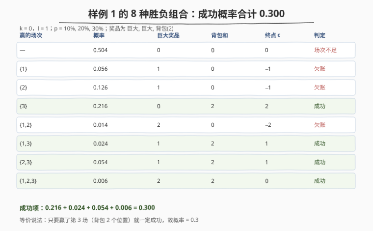

# Codeforces 167B Wizards and Huge Prize 题解

## 1. 题目概述

- **题目链接**：https://codeforces.com/problemset/problem/167/B
- **比赛来源**：Codeforces Round 114 (Div. 1) · Problem B（UTC 2012-03-27）
- **难度**：1800
- **标签**：概率 DP、动态规划、数学
- **评测类型**：特殊评测（浮点答案，绝对或相对误差不超过 $10^{-6}$）
- **限制**：时间 2 s / 内存 256 MB

**题意**：有 $n$ 场比赛，第 $i$ 场你获胜的概率是 $p_i\%$，且不能弃赛。每场的奖品是二者之一：

- $a_i = -1$：一个**巨大奖品**，需要占 1 个"位置"才能带走；
- $a_i \ge 1$：一只**容量为 $a_i$ 的背包**，可以装下 $a_i$ 个巨大奖品。

你自己带的包能装 $k$ 个巨大奖品。求"**至少赢 $l$ 场** 且 **赢到的所有巨大奖品都能装进你拥有的背包（自己的 + 赢来的）**"的概率。

**约束**：

- $1 \le n \le 200$，$0 \le l, k \le 200$，$0 \le p_i \le 100$，$a_i \in \{-1\} \cup [1,200]$。
- $n$ 只有 $200$，允许 $O(n^3)$ 级别的 DP（$8 \times 10^6$ 量级）；但 $2^n$ 的子集枚举不可行（$2^{200}$）。
- 巨大奖品最多 $n$ 个，所以"容量"只需要精确到 $n$：超过 $n$ 的容量永远不会不够用，可以截断（这是把状态压到 $O(n^2)$ 的关键）。
- 概率用 `double` 累加，$n = 200$ 次乘加的相对误差约 $10^{-14}$，远小于 $10^{-6}$ 的要求。

## 2. 示例与观察

官方样例 1（输入 / 输出原样）：

```text
输入：
3 1 0
10 20 30
-1 -1 2

输出：
0.300000000000
```

官方样例 2（输入 / 输出原样）：

```text
输入：
1 1 1
100
123

输出：
1.000000000000
```

**样例 1 演算**：三场的奖品分别是 巨大、巨大、背包（容量 $2$），自己 $k = 0$。逐个子集枚举：

| 赢的场次 | 概率 | 赢得的巨大奖品 | 赢得的背包 | 剩余容量 $c = k+\Sigma a-\#$巨大 | 判定 |
|----------|------|----------------|------------|-----------------------------|------|
| 无 | 0.504 | 0 | 0 | 0 | 场次不足（$0 < l$） |
| {1} | 0.056 | 1 | 0 | $-1$ | 装不下 |
| {2} | 0.126 | 1 | 0 | $-1$ | 装不下 |
| {3} | 0.216 | 0 | 2 | $2$ | 成功 |
| {1,2} | 0.014 | 2 | 0 | $-2$ | 装不下 |
| {1,3} | 0.024 | 1 | 2 | $1$ | 成功 |
| {2,3} | 0.054 | 1 | 2 | $1$ | 成功 |
| {1,2,3} | 0.006 | 2 | 2 | $0$ | 成功 |

成功项之和 $0.216+0.024+0.054+0.006 = 0.300$，与输出一致。更简洁的看法：**只要赢了第 3 场就一定成功**（背包容量 $2$ 足以装下至多 $2$ 个巨大奖品），所以答案就是 $P(\text{赢第 3 场}) = 0.3$。

**样例 2 演算**：唯一一场奖品是容量 $123$ 的背包，$k = 1$，必胜且没有任何巨大奖品，概率 $1$。

**关键观察（本题最容易做错的地方）**：题目只要求"**最终**所有巨大奖品都装得下"，并**不要求**你每时每刻都装得下。也就是说，可以先赢到巨大奖品（此时账面为负，暂时"欠账"），之后再赢到背包把账补上。例如

```text
2 1 0
100 100
-1 5
```

先赢巨大奖品、再赢容量 $5$ 的背包，最终 $1$ 个奖品放进 $5$ 个位置，完全合法，答案是 $1$。若 DP 强制"任何时刻剩余容量 $\ge 0$"，这一组会错答成 $0$。

自造样例（标注"自造"）：

| 输入 | 输出 | 说明 |
|------|------|------|
| `2 1 0` / `100 100` / `-1 5` | 1.000000000000 | 先欠账后补上，合法 |
| `3 2 0` / `100 100 100` / `-1 -1 1` | 0.000000000000 | 两只巨大奖品、容量只有 $1$ |
| `3 2 0` / `100 100 100` / `-1 1 1` | 1.000000000000 | 任意赢两场都装得下 |
| `2 2 0` / `100 100` / `-1 5` | 1.000000000000 | $l = n$，必须全赢 |
| `4 0 0` / `50 50 50 50` / `-1 -1 -1 -1` | 0.062500000000 | 一场不赢即可（$l=0$），概率 $0.5^4$ |

## 3. 解题思路

### 3.1 朴素做法与瓶颈

概率题的第一反应是"枚举所有胜/负组合"：$2^n$ 个子集，$n = 200$ 时是 $1.6 \times 10^{60}$，完全不可行。

第二反应是"按赢的场次数 $j$ 做 DP"，但只有 $j$ 不够：还得知道"现在还剩多少位置"，否则无法判断巨大奖品是否装得下。于是状态要加上容量，而容量最大可达 $k + 200 \times 200 = 40200$——直接开三维数组是 $200 \times 200 \times 40200$，太大。

### 3.2 核心观察：容量只需要记到 $n$，而且可以是负数



**观察 1：容量截断到 $n$**。整个过程中巨大奖品最多 $n$ 个（每场至多一个），所以任何 $\ge n$ 的剩余容量在"够不够用"这件事上与 $n$ 完全等价。于是把 $c$ 截断到 $[-\infty, n]$，实际只需 $[-n, n]$：下界是 $k + 0 - n \ge -n$。

**观察 2：最终只看符号，所以允许中途为负**。定义"账面" $c$ 为

$$c = \min(k, n) + \sum_{\text{赢得的背包}} a_i - \#\{\text{赢得的巨大奖品}\}.$$

成功条件就是 $c \ge 0$（并且赢的场次数 $j \ge l$）。注意 $c$ 在过程中**可以小于 0**：赢到巨大奖品时先欠着，后面的背包会补上。这一点与"把奖品装箱"的直觉相反，但题面只检查最终能否全部带走。

于是状态定为 $\mathrm{dp}[j][c]$：处理完前 $i$ 场后，赢了 $j$ 场、账面为 $c$ 的概率。



### 3.3 状态转移

设当前处理第 $i$ 场（$0$ 下标），$q = p_i/100$，$r = 1-q$：

$$\begin{aligned}
\mathrm{dp}_{i+1}[j][c] &\mathrel{+}= \mathrm{dp}_i[j][c]\cdot r &&\text{（这场不赢）}\\
\mathrm{dp}_{i+1}[j+1][c] &\mathrel{+}= \mathrm{dp}_i[j][c]\cdot q &&\text{（赢到背包：} a_i \ge 1,\ c \leftarrow \min(n, c+a_i)\text{）}\\
\mathrm{dp}_{i+1}[j+1][c-1] &\mathrel{+}= \mathrm{dp}_i[j][c]\cdot q &&\text{（赢到巨大奖品：} a_i = -1\text{）}
\end{aligned}$$

第二行的 $c$ 要理解成更新后的值 $\min(n, c+a_i)$；第三行若 $c = -n$ 则没有这个转移（实际上到不了，因为 $c \ge -n$ 恒成立）。

初值 $\mathrm{dp}_0[0][\min(k,n)] = 1$，其余为 $0$。答案为

$$\sum_{j \ge l} \sum_{c \ge 0} \mathrm{dp}_n[j][c].$$

滚动数组：只保留 $i$ 与 $i+1$ 两层，每层 $(n+1) \times (2n+1)$ 个 `double`，约 $200 \times 401 \times 8 \approx 640$ KB。

### 3.4 样例 1 走查



上图把 8 个子集全部列出（$j$ 是赢的场次数）。可以看到失败的 4 种：不赢任何一场（$j < l$）、只赢第 1 场、只赢第 2 场、赢第 1+2 场——它们的账面分别是 $0, -1, -1, -2$，都不满足 $c \ge 0$。剩下的 4 种都含第 3 场（容量 2 的背包），账面非负。

在 DP 里，以子集 $\{1\}$ 为例：第 1 场赢（$c: 0 \to -1$，$j=1$），第 2、3 场不赢，最后 $j = 1 \ge l = 1$ 但 $c = -1 < 0$，不计入答案——正是"欠账未补"。

## 4. 正确性证明

**引理 1（成功判定）**：对任意胜负结果，记 $W$ 为赢的场次集合，$H = \{i \in W : a_i = -1\}$，$B = W \setminus H$。则"能带走全部巨大奖品且赢的场次不少于 $l$"当且仅当 $|W| \ge l$ 且 $k + \sum_{i \in B} a_i \ge |H|$。

**证明**：巨大奖品共 $|H|$ 个，每个占 1 个位置；可用的位置总数是"自带包的 $k$ 个"加上"赢来的背包的容量和" $\sum_{i\in B} a_i$。所有巨大奖品能同时放下，当且仅当位置总数不少于奖品数（背包之间可以任意分配，容量可加），即 $k + \sum_{B} a_i \ge |H|$。另一条件 $|W| \ge l$ 正是"表现出色"。∎

**引理 2（截断不改变判定）**：若把账面 $c$ 定义中的 $k$ 与 $\sum a_i$ 之和截断到 $n$（即 $c \leftarrow \min(n, c)$），则最终 $c \ge 0 \iff$ 真实账面 $\ge 0$。

**证明**：设真实账面 $c^\* = k + \sum_B a_i - |H|$，截断后的账面 $c' = \min(n, k + \sum_B a_i) - |H|$。若 $k + \sum_B a_i \le n$，则 $c' = c^\*$；否则 $c' = n - |H| \ge n - n = 0$，而 $c^\* \ge n - |H| \ge 0$，两者同号。故 $c'$ 与 $c^\*$ 的非负性一致。∎

**引理 3（概率的完全性）**：$\mathrm{dp}_i[j][c]$ 等于"前 $i$ 场中恰好赢 $j$ 场、且截断账面为 $c$"的所有结果的概率之和。

**证明**：对 $i$ 归纳。$i=0$ 时只有空结果，概率 $1$，状态为初值。设对 $i$ 成立，考虑第 $i$ 场：每个结果恰有两种互斥的延拓（赢/输），概率分别乘以 $q$ 与 $r$，账面按转移规则更新，因此 $\mathrm{dp}_{i+1}$ 恰好累加了所有长度为 $i+1$ 的结果的概率。∎

**定理**：算法输出的和式等于所求概率。

**证明**：由引理 3，$\mathrm{dp}_n[j][c]$ 覆盖了所有胜负结果且每组的概率恰好被计入一次。求和条件 $j \ge l,\ c \ge 0$ 由引理 1、2 恰是"表现出色且能带走全部奖品"，故输出即所求概率。∎

## 5. 复杂度分析

- **时间**：$O(n^2 \cdot (2n+1))$。外层 $n$ 场，内层 $j \le i$、$c \in [-n, n]$，总转移数约 $\frac{n(n+1)}{2} \cdot (2n+1) \approx 8.0 \times 10^6$（$n=200$），每次常数次乘加。
- **空间**：$O(n \cdot 2n) = O(n^2)$，两层滚动共约 $1.3$ MB（`double`），远低于 256 MB。
- **精度**：每步只做乘加，$n=200$ 层累积的相对误差在 $10^{-14}$ 量级；输出 $12$ 位小数足够，远好于 $10^{-6}$ 的要求。
- **与时限的关系**：实测 $n = 200$ 的最坏数据 C++ 端到端 $0.010$ s，余量 200 倍。Python 版同样实现，约 $0.50$ s（在 2 s 内，但建议交 C++ 或 PyPy3）。

## 6. 参考代码

### C++17

```cpp
#include <bits/stdc++.h>
using namespace std;

int main() {
    int n, l, k;
    if (scanf("%d %d %d", &n, &l, &k) != 3) return 0;
    vector<int> p(n), a(n);
    for (int i = 0; i < n; i++) scanf("%d", &p[i]);
    for (int i = 0; i < n; i++) scanf("%d", &a[i]);

    // c = min(k, n) + 已赢得背包容量 - 已赢得的巨大奖品数，取值范围 [-n, n]，下标加 n
    const int OFF = n, W = 2 * n + 1;
    vector<vector<double>> dp(n + 1, vector<double>(W, 0.0)), nd(n + 1, vector<double>(W, 0.0));
    dp[0][min(k, n) + OFF] = 1.0;
    for (int i = 0; i < n; i++) {
        double q = p[i] / 100.0, r = 1.0 - q;
        for (int j = 0; j <= i; j++)
            for (int ci = 0; ci < W; ci++) {
                double v = dp[j][ci];
                if (v == 0.0) continue;
                nd[j][ci] += v * r;                     // 这场不赢
                if (a[i] == -1) {                       // 赢得一个巨大奖品
                    if (ci > 0) nd[j + 1][ci - 1] += v * q;
                } else {                                // 赢得一个背包
                    int c = min(n, ci - OFF + a[i]);
                    nd[j + 1][c + OFF] += v * q;
                }
            }
        dp.swap(nd);
        for (auto &row : nd) fill(row.begin(), row.end(), 0.0);
    }
    double ans = 0.0;
    for (int j = l; j <= n; j++)
        for (int ci = OFF; ci < W; ci++) ans += dp[j][ci];
    printf("%.12f\n", ans);
    return 0;
}
```

### Python3

```python
import sys

def main():
    data = sys.stdin.read().split()
    if not data:
        return
    it = iter(data)
    n = int(next(it)); l = int(next(it)); k = int(next(it))
    p = [int(next(it)) for _ in range(n)]
    a = [int(next(it)) for _ in range(n)]

    OFF = n; W = 2 * n + 1
    dp = [[0.0] * W for _ in range(n + 1)]
    dp[0][min(k, n) + OFF] = 1.0
    for i in range(n):
        q = p[i] / 100.0; r = 1.0 - q
        nd = [[0.0] * W for _ in range(n + 1)]
        for j in range(i + 1):
            row = dp[j]
            for ci in range(W):
                v = row[ci]
                if v == 0.0:
                    continue
                nd[j][ci] += v * r
                if a[i] == -1:
                    if ci > 0:
                        nd[j + 1][ci - 1] += v * q
                else:
                    c = min(n, ci - OFF + a[i])
                    nd[j + 1][c + OFF] += v * q
        dp = nd
    ans = 0.0
    for j in range(l, n + 1):
        ans += sum(dp[j][OFF:])
    print("%.12f" % ans)

main()
```

Python 版是同构直译，$n=200$ 时约 $0.5$ s；若平台较慢建议交 C++。

## 7. 边界情况与易错点

1. **中途欠账是合法的（本题最大的坑）**：只要求**最终**装得下。若把转移写成"$c = 0$ 时不能赢巨大奖品"，`2 1 0` / `100 100` / `-1 5` 会从 $1$ 错成 $0$。正确做法是允许 $c$ 降到 $-n$，最后只筛 $c \ge 0$。
2. **容量的上界**：必须截断到 $n$，否则状态数是 $k + \sum a_i \le 40200$，时空都会翻几十倍。截断的正确性见引理 2；注意是"截断到 $n$"而不是"截断到 $k$"。
3. **容量下界的下标**：$c$ 的最小值是 $-n$（$k=0$ 且 $n$ 场全是巨大奖品且全赢），所以数组宽度取 $2n+1$、偏移 $n$。若只开 $n+1$ 宽度会越界/错位。
4. **$p_i = 0$ 或 $p_i = 100$**：$q = 0$ 或 $r = 0$，转移自然退化，不需要特判；但浮点 $0$ 判断用 `v == 0.0` 是安全的（这些值只会精确地变成 $0$，不会因下溢出现"本该是 0 却是 $10^{-300}$"的严重问题）。
5. **$l = 0$**：允许一场不赢。此时答案至少包含 $\prod (1-p_i/100)$（前提是 $k \ge 0$，账面为 $0 \ge 0$），自造样例 `4 0 0` 就是 $0.5^4 = 0.0625$。
6. **$l > n$**：题面保证 $l \le 200$、$n \le 200$，理论上 $l$ 可以大于 $n$，此时答案应为 $0$。代码里求和从 $j = l$ 开始、上限 $n$，自动得到 $0$，无需特判。
7. **$k > n$**：初值取 $\min(k, n)$。若直接用 $k$ 且数组宽度不足会越界；截断到 $n$ 不影响结果（容量超过 $n$ 永远够用）。
8. **`nd` 的清零**：滚动数组每轮必须把新的一层清零。`dp.swap(nd)` 之后清的是旧的 `dp`（现在成了下一轮的 `nd`），顺序别写反。
9. **输出精度**：题面要求 $10^{-6}$，样例给了 $12$ 位小数；用 `%.12f` 与样例逐字一致，也留足余量。不要输出科学计数法或多余空格。

## 8. 验证记录

- **编译环境与命令**：`Apple clang 21.0.0` + `codeforces/tools/include/bits/stdc++.h` 兼容头（`g++ -O2 -std=c++17 -I codeforces/tools/include`）；Python 3.9.6。文章代码用 `python3 codeforces/tools/verify_solution.py codeforces/contests/0101-0200/167/B_巨大奖品.md --checker codeforces/tools/checkers/float.py` 验证。
- **官方样例**：2 / 2 通过（`0.300000000000`、`1.000000000000`），checker 用 `tools/checkers/float.py`（容差 $10^{-6}$），C++ 与 Python 输出一致。
- **额外测试**：5 组自造样例（见第 2 节），专门覆盖"中途欠账后补上""$l=0$""$l=n$""容量不足"等情形，全部符合手算。
- **独立暴力对拍**：另写一份 $O(2^n)$ 全子集枚举的暴力（直接按题面定义计算每个子集的概率、赢的场次数、巨大奖品数与背包容量和，按 $k+\Sigma a \ge \#$巨大 判定），对 $n \le 10$、$l$ 随机、$k \le 4$、$p_i$ 取 $0/25/50/75/100$ 与随机值混合、$a_i$ 混合 $-1$ 与小容量的 **240 组**随机数据，与 DP 结果比对，最大绝对偏差 $< 10^{-12}$，全部一致。
- **最大约束性能**：$n = 200$、$l = 100$、$k = 0$，$p_i$ 随机、$a_i$ 一半为 $-1$ 一半随机：C++ 端到端 $0.010$ s，Python $0.50$ s；内存约 $3$ MB。
- **图片校验**：三张 SVG（`cf167b_dp_state.svg`、`cf167b_balance.svg`、`cf167b_walkthrough.svg`）通过 `xml.etree.ElementTree.parse`，文本包围盒脚本检查未越出 `viewBox` 与面板、互不重叠。
- **复核状态**：verified（样例、自造样例、240 组全子集暴力对拍、性能、图片五项实跑通过）。

## 相关题目与扩展

- [Codeforces 167A Wizards and Trolleybuses](https://codeforces.com/problemset/problem/167/A)：同场 A 题，连续量 + 取 max。
- [Codeforces 167C Wizards and Numbers](https://codeforces.com/problemset/problem/167/C)：同场 C 题，欧几里得式博弈。
- [Codeforces 148D Bag of mice](https://codeforces.com/problemset/problem/148/D)：经典概率 DP，状态同样带"数量"维度，可以对照"按局面推进、逐层累乘概率"的写法。
- [Codeforces 54C First Digit Law](https://codeforces.com/problemset/problem/54/C)：概率 + 计数 DP，考察"独立事件概率相乘、按个数汇总"。
- [LeetCode 808. 分汤](https://leetcode.cn/problems/soup-servings/)：概率型 DP 的入门题，状态压缩与边界处理思路相近。

**延伸思考**：

1. **如果要求"任意时刻都装得下"**：那么 $c$ 一旦为负就出局，转移里去掉 $c<0$ 的状态即可，答案会变小（例如自造样例 `2 1 0 / 100 100 / -1 5` 会变成 $0$）。两种理解的差别恰好体现了"约束是逐时刻还是终态"的重要性。
2. **如果容量不是可加的，而是"每个背包只能装一个奖品"**：问题变成匹配计数（奖品与背包做二分图匹配），DP 的账面就不够用了，需要 Hall 条件或最大流。
3. **如果每场可以自己选择跳过**：题面明确"不能跳过任何一场"，若允许跳过，状态要再加一维"已处理场次 vs 已参赛场次"，但概率模型不变。
4. **如果 $a_i$ 可以到 $10^9$**：容量截断到 $n$ 依然成立（巨大奖品最多 $n$ 个），所以状态规模不变——这正是"截断到 $n$"这个观察的价值。
5. **数值稳定性**：本题概率都是正数、只做乘加，不会出现相消；若题目改成"求期望收益"并带负权，就要考虑用 `long double` 或对数域累加。

