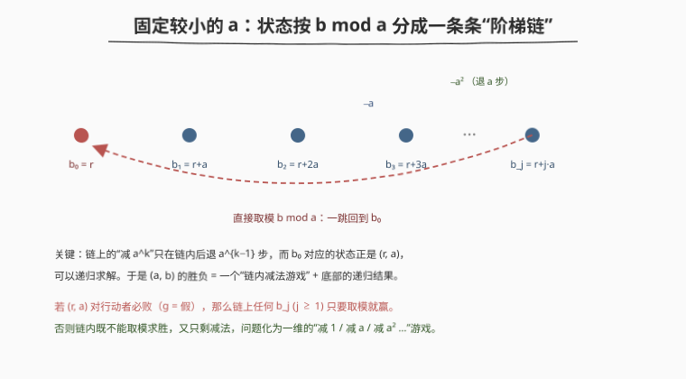
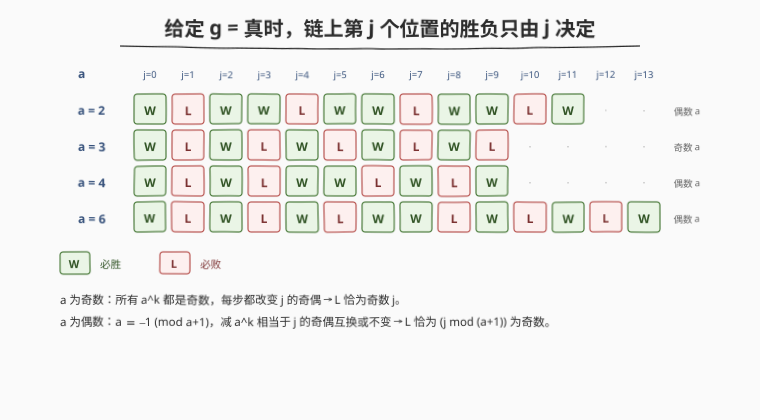
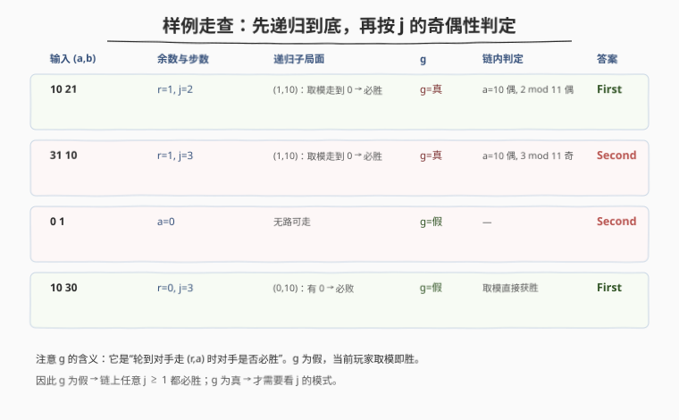

# Codeforces 167C Wizards and Numbers 题解

## 1. 题目概述

- **题目链接**：https://codeforces.com/problemset/problem/167/C
- **比赛来源**：Codeforces Round 114 (Div. 1) · Problem C（UTC 2012-03-27）
- **难度**：2300
- **标签**：博弈论、数学、欧几里得算法
- **评测类型**：普通
- **限制**：时间 2 s / 内存 256 MB

**题意**：黑板上写着一对数，顺序无关。设当前较小的数是 $a$、较大的是 $b$（$a \le b$），行动者可以二选一：

1. 把 $b$ 换成 $b - a^k$，其中 $k > 0$ 可任选，但要求 $b - a^k \ge 0$；
2. 把 $b$ 换成 $b \bmod a$。

每次操作后重新按大小排列。只要某个数变成 $0$，行动者就**无法继续**（不能对 $0$ 取模、也不能减 $0$），无路可走者输。双方最优，问先手胜负。多测 $t \le 10^4$，$0 \le a, b \le 10^{18}$。

**约束**：

- $a, b \le 10^{18}$：状态空间是 $10^{36}$ 级别，任何"把 (a,b) 全部局面 DP 一遍"的做法都不可能；必须找到**对数级**的递归结构。
- $t \le 10^4$：每组必须很快，允许 $O(\log \max(a,b))$（欧几里得步数，最大约 $87$），总运算量约 $10^6$。
- 需要 64 位整数（`long long`）；$a+1$ 也在 $10^{18}$ 量级，不会溢出。
- $a$ 或 $b$ 可以为 $0$：此时先手直接无路可走，这是必须特判的起点。

## 2. 示例与观察

官方样例（输入 / 输出原样）：

```text
输入：
4
10 21
31 10
0 1
10 30

输出：
First
Second
Second
First
```

**样例 1（$10, 21$）演算**：$10 \le 21$，$21 = 2 \cdot 10 + 1$。先手把 $21$ 换成 $21 - 10 = 11$，得到 $(10, 11)$。后手能做的只有 $11 - 10 = 1$ 或 $11 \bmod 10 = 1$，都到 $(1, 10)$；轮到先手，$10 \bmod 1 = 0$，后手无路可走。先手胜。

**样例 2（$31, 10$）演算**：排序后是 $(10, 31)$，$31 = 3 \cdot 10 + 1$。先手只有两种本质不同的走法：$31 - 10^k$（$k=1$ 得 $21$，$k \ge 2$ 时 $100 > 31$ 不可行）或 $31 \bmod 10 = 1$，分别到 $(10,21)$ 与 $(1,10)$。而 $(10,21)$ 与 $(1,10)$ 都是**对手必胜**的局面（前者见样例 1，后者取模到 $0$），所以先手必败。

**样例 3（$0, 1$）**：有 $0$，先手无路可走，`Second`。

**样例 4（$10, 30$）**：$30 \bmod 10 = 0$，一步制胜，`First`。

**观察 1**：$b \bmod a$ 这一步把状态直接送到 $(r, a)$，其中 $r = b \bmod a < a$——规模严格变小，可以递归。

**观察 2**：所有"减 $a^k$"的操作都**保持 $b \bmod a$ 不变**，因为 $a^k$ 是 $a$ 的倍数。也就是说，一旦 $a$ 确定，减去幂只会在同一条"模 $a$ 余 $r$ 的等差链"上后退。

自造样例（标注"自造"）：

| 输入 | 输出 | 说明 |
|------|------|------|
| `0 0` | Second | 两个 0，无路可走 |
| `1 0` | Second | 同上，有 0 即输 |
| `1 1` | First | $1 \bmod 1 = 0$ |
| `2 3` | Second | 两种走法都到 $(1,2)$，对手必胜 |
| `2 4` | First | $4 \bmod 2 = 0$ |
| `3 4` | Second | 走到 $(1,3)$，对手取模胜 |
| `5 5` | First | $5 \bmod 5 = 0$ |
| `1 1000000000000000000` | First | 任何 $(1, b)$ 都是先手胜 |
| `999999999999999999 1000000000000000000` | Second | 相邻大数，把必胜局面留给对手 |

## 3. 解题思路

### 3.1 朴素做法与瓶颈

博弈题的通用做法是记忆化搜索：`win(a,b)` 枚举所有合法走法，只要有一个走到对手的必败态就返回胜。走法数是 $O(\log_a b)$（幂的个数），但**状态数**是 $O(\max^2)$。$a, b$ 到 $10^{18}$ 时彻底不可行，而且多测 $10^4$ 组。

必须利用"减 $a^k$ 不改变 $b \bmod a$"这一结构，把二维博弈压成一维。

### 3.2 核心观察：固定 $a$，状态排成一条链



设 $a \ge 2$、$b = j a + r$（$0 \le r < a$，$j = \lfloor b/a \rfloor \ge 1$）。记

$$b_t = r + t a \quad (t = 0, 1, 2, \dots),$$

则当前状态是链上的第 $j$ 个位置。两类走法在这个视角下非常干净：

- **减 $a^k$**：$b_j - a^k = r + (j - a^{k-1})a = b_{j - a^{k-1}}$，即"后退 $a^{k-1}$ 步"，其中 $k \ge 1$，可退的步数是 $1, a, a^2, \dots$；
- **取模**：$b_j \bmod a = r$，得到 $(r, a)$——这恰好是链的第 $0$ 个位置 $b_0$！注意 $b_0 = r < a$，此时两个数已经交换了角色，是一个**规模更小**的子局面。

于是：

$$\text{win}(a, b_j) = \begin{cases}
\text{胜}, & \text{若 } \text{win}(r, a) = \text{败（直接取模）},\\
\text{链内减法游戏的结果}, & \text{否则}.
\end{cases}$$

当 $\text{win}(r,a)$ 为败时，链上任意 $j \ge 1$ 都能一步取模到对手的必败态，全部必胜。当 $\text{win}(r,a)$ 为胜时，取模是"送死"，玩家只能靠减法，于是一个纯一维问题：从 $j$ 出发，每次可减 $1, a, a^2, \dots$，减到 $0$ 的那个局面是**必胜**（因为 $b_0$ 对行动者必胜）。

### 3.3 链内减法游戏的胜负模式



设 $L(t)$ 表示链上第 $t$ 个位置是否**必败**，已知 $L(0) = \text{假}$（$b_0$ 必胜），走法是减 $1, a, a^2, \dots$。

**$a$ 为奇数**：所有 $a^{k-1}$ 都是奇数，所以每一步都改变 $t$ 的奇偶。于是

$$L(t) = \text{真} \iff t \text{ 是奇数}.$$

（$t$ 为奇数时所有走法都到偶数位置，而偶数位置总能减 $1$ 回到奇数位置，归纳即得。）

**$a$ 为偶数**：令 $p = a + 1$（奇数）。由 $a \equiv -1 \pmod p$ 得

$$a^{k-1} \equiv (-1)^{k-1} \pmod p \in \{1,\ a\},$$

即减去 $a^{k-1}$ 相当于让 $t$ 的模 $p$ 余数**减 1 或加 1**。于是

$$L(t) = \text{真} \iff (t \bmod p) \text{ 是奇数}.$$

举例：$a = 2$ 时 $p = 3$，必败的 $t$ 是 $1, 4, 7, 10, \dots$；$a = 4$ 时 $p = 5$，必败的是 $t \equiv 1, 3 \pmod 5$；$a = 6$ 时 $p = 7$，必败的是 $t \equiv 1,3,5 \pmod 7$——正是图里的红格。

### 3.4 算法流程

```
win(a, b):
    若 a > b: 交换 a, b
    若 a == 0: 返回 败
    r = b mod a;  j = b div a
    g = (r == 0) ? 败 : win(r, a)        # 递归到规模更小的子局面
    若 g == 败: 返回 胜                   # 取模一步制胜
    若 a 是奇数: 返回 (j 是偶数)          # j 奇则必败
    否则:        返回 ((j mod (a+1)) 是偶数)   # 余数为奇则必败
```

递归的每一步都把较大的数换成 $r < a$，与欧几里得算法完全同构，深度 $O(\log \max(a,b))$。

### 3.5 样例走查



| 输入 | $r, j$ | 递归子局面 | $g$ | 链内判定 | 答案 |
|------|--------|------------|-----|----------|------|
| `10 21` | $r=1, j=2$ | $(1,10)$：取模到 $0$ → 必胜 | 真 | $a=10$ 偶，$2 \bmod 11 = 2$ 偶 → 胜 | First |
| `31 10` | $r=1, j=3$ | $(1,10)$：同上 | 真 | $a=10$ 偶，$3 \bmod 11 = 3$ 奇 → 败 | Second |
| `0 1` | $a=0$ | — | — | — | Second |
| `10 30` | $r=0, j=3$ | $(0,10)$ 含 $0$ → 必败 | 假 | 取模直接获胜 | First |

注意 $g$ 的语义：它是"取模之后**轮到对手**时对手是否必胜"。$g$ 为假意味着对手在那个局面必败，于是当前玩家取模即胜。

## 4. 正确性证明

**引理 1（链内封闭）**：设 $a \ge 1$，$b = ja + r$（$0 \le r < a$）。则对任意 $k \ge 1$ 且 $a^k \le b$，有 $b - a^k = r + (j - a^{k-1})a$，即减去 $a^k$ 后状态仍在同一条链上，位置从 $j$ 变为 $j - a^{k-1}$；且 $j - a^{k-1} \ge 0$。

**证明**：$a^k = a \cdot a^{k-1}$，直接代入得 $b - a^k = ja + r - a\cdot a^{k-1} = (j - a^{k-1})a + r$。由 $a^k \le b = ja + r < (j+1)a$ 得 $a^{k-1} < j+1$，即 $a^{k-1} \le j$，故位置非负。∎

**引理 2（取模落到链底）**：$b \bmod a = r = b_0$，即取模把状态 $(a, b_j)$ 变为 $(r, a)$（$j \ge 1$），而 $(r,a)$ 恰是链的第 $0$ 个位置所对应的局面。

**证明**：$b_j \bmod a = (r + ja) \bmod a = r$（因 $0 \le r < a$）。链的第 $0$ 个位置是 $b_0 = r$，对应状态 $(a, r)$，按大小排序后即 $(r, a)$。∎

**引理 3（奇数 $a$ 的模式）**：设 $a \ge 3$ 为奇数，$L(0) = \text{假}$，走法为减 $1, a, a^2, \dots$，则 $L(t) = \text{真} \iff t$ 为奇数。

**证明**：对 $t$ 归纳。$t = 0$：$L(0)$ 为假，且 $0$ 是偶数，成立。设对小于 $t$ 的位置成立。

- $t$ 为奇数：任一走法减去奇数 $a^{k-1}$，目标 $t - a^{k-1}$ 是偶数且小于 $t$，由归纳假设它不是必败态，即所有走法都到必胜态，故 $L(t)$ 为真。
- $t$ 为偶数且 $t \ge 2$：走"减 $1$"到奇数 $t-1$，由归纳假设它是必败态，故 $L(t)$ 为假。∎

**引理 4（偶数 $a$ 的模式）**：设 $a \ge 2$ 为偶数，$p = a+1$，$L(0) = \text{假}$，走法为减 $1, a, a^2, \dots$，则 $L(t) = \text{真} \iff (t \bmod p)$ 为奇数。

**证明**：先注意 $a \equiv -1 \pmod p$，故可减的步长 $a^{k-1} \equiv (-1)^{k-1} \pmod p$：$k$ 为奇数时同余 $1$，$k$ 为偶数时同余 $-1$（$k \ge 1$，故 $k-1 \ge 0$，$a^0 = 1$ 对应 $k=1$）。对 $t$ 归纳，设 $s = t \bmod p$。

- $s$ 为奇数（$s \in \{1, 3, \dots, a-1\}$，因为 $a$ 是偶数，$p$ 是奇数，余数 $a$ 是偶数）：任何走法都把余数变成 $s - 1$ 或 $s + 1$，两者都是偶数；目标位置小于 $t$，由归纳假设都是必胜态，故 $L(t)$ 为真。
- $s$ 为偶数且 $s \ge 2$：走"减 $1$"到位置 $t-1 \ge 1$（因 $t \ge s \ge 2$），余数 $s-1$ 为奇数，由归纳假设它是必败态，故 $L(t)$ 为假。
- $s = 0$：此时 $t \ge p = a+1$。走"减 $a^2$"（步长 $a \equiv -1$）到位置 $t - a$，它满足 $t - a \ge 1$，余数为 $1$（奇数），由归纳假设是必败态，故 $L(t)$ 为假。∎

**引理 5（递归终止与正确性）**：算法在 $a = 0$ 时返回"败"，否则递归调用 $\text{win}(r, a)$，其中 $r < a$，故每层严格减小有序数对，递归必然终止，且每一步的判定与引理 1–4 一致。

**证明**：终止性：$a=0$ 是唯一的基例；否则第二分量从 $b$ 变为 $a$、第一分量从 $a$ 变为 $r < a$，两者都是非负整数，按字典序严格下降。正确性：本层只有两类走法，引理 1 说明减法走法都在链内（由引理 3、4 给出链内的胜负），引理 2 说明取模走到 $(r,a)$（其胜负正是递归返回值 $g$）；$g$ 为假时取模即胜，$g$ 为真时取模必败、只能看链内模式。∎

**定理**：算法对所有输入返回正确的胜负。

**证明**：对有序数对的大小归纳。基例 $a = 0$：无任何合法走法（不能对 $0$ 取模，$b - 0^k$ 仍会得到 $b$ 或非法），必败，算法正确。归纳步：由引理 5，当前局面的所有走法都被正确分类，算法"存在走到对手必败态的走法即胜"与博弈定义一致。∎

## 5. 复杂度分析

- **时间**：每组 $O(\log \max(a,b))$。递归与欧几里得算法同构，最坏情况是相邻 Fibonacci 数，$F_{87} \approx 6.8 \times 10^{17}$，故深度不超过约 $87$；$t = 10^4$ 时总步数约 $10^6$。
- **空间**：$O(\log \max(a,b))$ 的递归栈（每层两个 `long long`），约 $87$ 层。
- **数值范围**：$a, b \le 10^{18} < 2^{63}-1$，`long long` 安全；计算 $a+1$ 也不会溢出（$10^{18}+1$）。
- **与时限的关系**：实测 $t = 10^4$、全部取相邻 Fibonacci 数（欧几里得步数最大）时，`cin/cout` 版端到端 $0.087$ s，`scanf` 版 $0.011$ s，相对 2 s 余量充足。

## 6. 参考代码

### C++17

```cpp
#include <bits/stdc++.h>
using namespace std;

// a <= b，返回当前行动者是否必胜
static bool win(long long a, long long b) {
    if (a > b) swap(a, b);
    if (a == 0) return false;              // 有 0 就无路可走
    long long r = b % a, j = b / a;
    bool g = (r == 0) ? false : win(r, a); // 取模之后轮到对手的局面的胜负
    if (!g) return true;                   // 取模直接走向对手必败态
    if (a & 1) return (j % 2 == 0);        // a 为奇数：j 为奇数则必败
    return ((j % (a + 1)) % 2 == 0);       // a 为偶数：j mod (a+1) 为奇数则必败
}

int main() {
    ios::sync_with_stdio(false);
    cin.tie(nullptr);
    int t;
    if (!(cin >> t)) return 0;
    while (t--) {
        long long a, b;
        cin >> a >> b;
        cout << (win(a, b) ? "First" : "Second") << '\n';
    }
    return 0;
}
```

题面特别提醒不要用 `%lld` 读写 64 位整数（那是古早 MSVC 的历史问题），上面的代码用 `cin/cout`，两种平台都安全。

### Python3

```python
import sys

def win(a, b):
    """a <= b，返回当前行动者是否必胜"""
    if a > b:
        a, b = b, a
    if a == 0:
        return False
    r = b % a
    j = b // a
    g = False if r == 0 else win(r, a)
    if not g:
        return True
    if a & 1:
        return j % 2 == 0
    return (j % (a + 1)) % 2 == 0

def main():
    data = sys.stdin.buffer.read().split()
    if not data:
        return
    t = int(data[0])
    out = []
    for i in range(t):
        a = int(data[1 + 2 * i]); b = int(data[2 + 2 * i])
        out.append("First" if win(a, b) else "Second")
    sys.stdout.write("\n".join(out) + "\n")

main()
```

Python 的大整数天然支持 $10^{18}$；$t = 10^4$ 时约 $0.16$ s。

## 7. 边界情况与易错点

1. **$a = 0$ 必须特判**：此时"对 $0$ 取模"和"减 $0^k$"都非法，先手直接输。注意输入可能是 `0 0` 或 `0 1000000000000000000`，排序后 $a = 0$，要最先返回"败"而不是去算 `b % a`（会除零崩溃）。
2. **`g` 的语义别弄反**：$g = \text{win}(r,a)$ 是"取模后**对手**的胜负"，所以 $g$ 为假时**当前玩家胜**。写成 `if (g) return true;` 会导致所有结论反过来，样例 1 立刻失败。
3. **$a$ 为偶数时周期是 $a+1$ 而不是 $a$**：由 $a \equiv -1 \pmod{a+1}$ 得到。写成 `j % a` 在 $a=2$ 时周期是 $2$（正确是 $3$），`2 3` 这类样例会错。
4. **$r = 0$ 时不能递归**：$(0, a)$ 是必败局面，但若直接调用 `win(0,a)` 需要保证 $a=0$ 的基例在前、且不会对 $0$ 取模。代码里用 `(r == 0) ? false : win(r,a)` 明确短路，安全且省一层递归。
5. **$a = 1$**：$1^k$ 恒为 $1$，且 $b \bmod 1 = 0$，所以 $(1, b)$ 恒为先手胜。代码走 `r = 0 → g = false → return true`，正好覆盖，无需特判。
6. **$a = b$**：$j = 1, r = 0$，$g$ 为假 → 取模得 $0$，先手胜。若错误地在 $a = b$ 时进入链内模式，会得到错误的结论。
7. **64 位读入**：$10^{18}$ 超过 32 位，必须 `long long`（Python 无所谓）。`a + 1` 在 $a = 10^{18}$ 时仍是 $10^{18}+1$，不会溢出，但若把 $a$ 声明成 `int` 就全错了。
8. **递归深度**：最坏约 $87$ 层，远小于栈限制，不需要手工改成迭代；但多测时不要在递归里保存大数组。
9. **输出字符串大小写**：题面要求 `First` / `Second` 首字母大写，逐字节比对；写成 `FIRST`、`first` 都会 WA。
10. **多测格式**：第一行是 $t$，之后每行一组；不要写 `while (cin >> a >> b)` 的读到 EOF（本题恰好也能过，但会掩盖格式错误）。

## 8. 验证记录

- **编译环境与命令**：`Apple clang 21.0.0` + `codeforces/tools/include/bits/stdc++.h` 兼容头（`g++ -O2 -std=c++17 -I codeforces/tools/include`）；Python 3.9.6。文章代码用 `python3 codeforces/tools/verify_solution.py codeforces/contests/0101-0200/167/C_数字博弈.md` 验证。
- **官方样例**：1 / 1 通过（4 组查询全部正确：`First / Second / Second / First`），C++ 与 Python 一致。
- **额外测试**：10 组自造样例（含 `0 0`、`1 0`、`a = b`、`2 3`、相邻大数等），逐一手算核对。
- **独立暴力对拍**：另写一份**完整的博弈记忆化搜索**——直接枚举所有合法走法（逐个 $a^k$ 递减 + 一次取模），不做任何链分解与模式假设。两组验证：
  1. **全枚举** $0 \le a, b \le 90$ 共 **8281 组**，与参考程序**完全一致**（0 处不同）；
  2. $a, b \le 400$ 的 **300 组**随机数据，同样完全一致。
- **最大约束性能**：$t = 10^4$，每组取相邻 Fibonacci 数（欧几里得步数最多的输入，最大到 $1.1\times 10^{18}$），`cin` 版端到端 $0.087$ s、`scanf` 版 $0.011$ s；Python 约 $0.16$ s。内存 < 2 MB。
- **图片校验**：三张 SVG（`cf167c_chain.svg`、`cf167c_pattern.svg`、`cf167c_walkthrough.svg`）通过 `xml.etree.ElementTree.parse`，文本包围盒脚本检查未越出 `viewBox` 或面板、互不重叠。
- **复核状态**：verified（样例、自造样例、8281 组全枚举 + 300 组随机对拍、性能、图片五项实跑通过）。

## 相关题目与扩展

- [Codeforces 167B Wizards and Huge Prize](https://codeforces.com/problemset/problem/167/B)：同场 B 题，概率 DP。
- [Codeforces 167A Wizards and Trolleybuses](https://codeforces.com/problemset/problem/167/A)：同场 A 题。
- [Codeforces 1191D Tokitsukaze, CSL and Stone Game](https://codeforces.com/problemset/problem/1191/D)：同样是"先手胜负 + 奇偶/排序观察"的博弈题，思想与本题的链内模式判定相近。
- [Codeforces 1382B Sequential Nim](https://codeforces.com/problemset/problem/1382/B)：经典取石子博弈，考察"找到必败态的刻画"。
- [POJ 2348 Euclid's Game](http://poj.org/problem?id=2348)：与本题同源——在 $(a,b)$ 上做"减若干倍"的欧几里得博弈，胜负判定的递归结构几乎一致。
- [LeetCode 1025. 除数博弈](https://leetcode.cn/problems/divisor-game/)：小规模博弈 + 找规律，适合作为本题思路的热身。

**延伸思考**：

1. **如果只允许 $k \le K$**（即只能减 $a, a^2, \dots, a^K$）：链内走法变成有限的 $\{1, a, \dots, a^{K-1}\}$，$a$ 为奇数时奇偶论证依然成立（全是奇数），但 $a$ 为偶数时的周期会从 $a+1$ 变成更复杂的形态，需要重新寻找周期。
2. **如果去掉"取模"这一走法**：那么链与链之间不再连通，每个 $(a,r)$ 的链是独立游戏，$b_0$ 的胜负也不再由 $(r,a)$ 决定（而是由 $(a, r)$ 自身的走法决定，$r=0$ 时才是必败）。本题的递归之所以成立，全靠取模把链底接到更小的局面。
3. **如果要求输出 SG 值而不是胜负**：链内是"减 $1, a, a^2,\dots$"的减法游戏，SG 值有周期结构（对奇数 $a$ 是 $t \bmod 2$ 的翻转），但取模这一步会把链的 SG 与子局面的 SG 混合，需要更细的分析。
4. **欧几里得步数的上界**：本题的复杂度直接等于欧几里得算法在 $(a,b)$ 上的步数，最坏出现在相邻 Fibonacci 数处，约 $1.44 \log_{10} \max(a,b) \approx 87$（$10^{18}$ 时），这也是为什么 $t = 10^4$ 能轻松通过。
5. **如果 $a, b$ 可以到 $10^{100}$**：C++ 需要大整数，而步数只增长到约 $1.44 \times 100 \approx 144$，算法结构完全不变——这说明本题的复杂度对数值规模是**对数**的。
