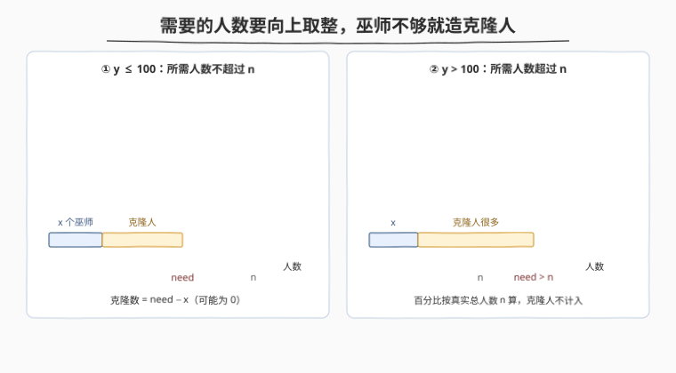
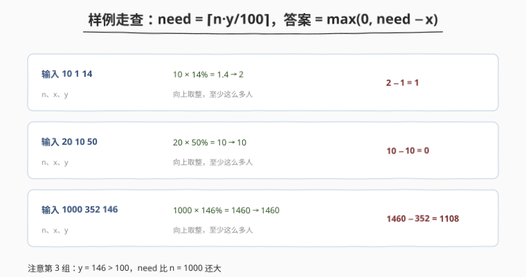

# Codeforces 168A Wizards and Demonstration 题解

## 1. 题目概述

- **题目链接**：https://codeforces.com/problemset/problem/168/A
- **比赛来源**：Codeforces Round 114 (Div. 2) · Problem A（UTC 2012-03-27）
- **难度**：900
- **标签**：数学、向上取整、实现
- **评测类型**：普通
- **限制**：时间 2 s / 内存 256 MB

**题意**：城里共有 $n$ 名居民，其中 $x$ 名是巫师，一定会参加示威；其余 $n-x$ 人不支持巫师。市政当局只会对"参与人数不少于全体居民的 $y\%$"的示威作出反应。巫师可以制造克隆人木偶充数——当局分辨不出木偶与真人，统计比例时仍然认为城里只有 $n$ 人（木偶不计入分母）。求最少要造多少个克隆人。

**约束**：

- $1 \le n, x, y \le 10^{4}$，$x \le n$。
- $y$ 可以大于 $100$：此时当局要求的人数超过真实人口 $n$，只能靠克隆人补足，这是本题唯一的"反直觉"点。
- 约束小到 $O(\text{ans})$ 的枚举都能过（$\text{ans} \le 10^6$），但正确做法是 $O(1)$ 的取整公式；$n \cdot y \le 10^{8}$ 在 32 位整数内，安全的写法仍建议用 64 位。
- 只有一组数据，没有测试组数 $t$。

## 2. 示例与观察

官方样例 1（输入 / 输出原样）：

```text
输入：
10 1 14

输出：
1
```

官方样例 2（输入 / 输出原样）：

```text
输入：
20 10 50

输出：
0
```

官方样例 3（输入 / 输出原样）：

```text
输入：
1000 352 146

输出：
1108
```

**样例 1 演算**：$14\% \times 10 = 1.4$，人数是整数，至少要 $2$ 人参加（$\ge 1.4$ 的最小整数）。城里只有 $1$ 个巫师，所以造 $2 - 1 = 1$ 个克隆人。

**样例 2 演算**：$50\% \times 20 = 10$，恰好 $10$ 个巫师，缺口为 $0$。

**样例 3 演算**：$146\% \times 1000 = 1460$，而城里只有 $352$ 个巫师，需要 $1460 - 352 = 1108$ 个克隆人。这里 $y = 146 > 100$，所需人数 $1460$ 比真实人口 $1000$ 还多，说明"克隆人不计入分母"这一条让 $y > 100$ 完全合法。

**观察**：设 $need = \lceil n y / 100 \rceil$（至少到场的人数），答案就是 $\max(0, need - x)$。注意**先取整再相减**，不能先把 $x$ 换算成百分比再比较。

自造样例（覆盖边界；标"自造"）：

| 输入 | 输出 | 说明 |
|------|------|------|
| `1 1 1` | 0 | 最小规模，$1\% \times 1 = 0.01 \to 1$ 人，已有 1 个巫师 |
| `1 1 100` | 0 | 恰好 $100\%$ |
| `5 5 100` | 0 | 全部都是巫师 |
| `5 1 100` | 4 | 要 5 人，只有 1 个巫师 |
| `10 1 0` | 0 | $y$ 取到下界（题面 $y \ge 1$，此为形式上的边界） |
| `10000 1 10000` | 999999 | $need = 10^6$，答案很大 |
| `3 1 34` | 1 | $34\% \times 3 = 1.02 \to 2$ |

最后一行是最容易错的地方：$1.02$ 向上取整是 $2$ 而不是 $1$，若用 `n*y/100` 的整数除法会得到 $1$，答案错误地变成 $0$。

## 3. 解题思路

### 3.1 朴素做法与瓶颈

朴素做法是从 $c = 0$ 开始逐个尝试"造 $c$ 个克隆人"，检查 $(x + c) \cdot 100 \ge y \cdot n$，第一个满足的 $c$ 就是答案。答案最大为 $\lceil 10^4 \times 10^4 / 100 \rceil - 1 \approx 10^6$，枚举量完全可以接受——但既然有 $O(1)$ 公式，没有任何理由枚举。

真正的"瓶颈"不是时间，而是**取整方向**：百分比约束是"不少于"，所以人数必须**向上取整**。

### 3.2 核心观察：先算"至少到场几人"，再减巫师数



把约束写成不等式。设造 $c$ 个克隆人，到场人数为 $x + c$，要求

$$x + c \ge \frac{y}{100}\, n \iff (x+c) \cdot 100 \ge y n .$$

因为 $x+c$ 是整数，上式等价于 $x + c \ge \left\lceil \dfrac{yn}{100} \right\rceil = need$。于是

$$c \ge need - x,\qquad c_{\min} = \max(0,\ need - x).$$

上限 $c = need - x$ 显然可行（到场人数正好是 $need$），下界由上面的等价性给出，所以这就是最小值。

实现要点：整数向上取整用 $\lceil A/B \rceil = \lfloor (A + B - 1)/B \rfloor$，即

$$need = \left\lfloor \frac{n y + 99}{100} \right\rfloor .$$

不要写成 `n * y / 100 + 1`：整除时（如样例 2 的 $20 \times 50 = 1000$，$1000/100 = 10$）会多算一个人。

### 3.3 算法流程



1. 读入 $n, x, y$；
2. $need \leftarrow (n \cdot y + 99) / 100$（整数除法）；
3. 输出 $\max(0, need - x)$。

三步、一次乘法、一次加法、一次除法、一次比较。图中第 3 组是 $y > 100$ 的情形：$need = 1460 > n = 1000$，公式照样成立，因为当局的分母固定是 $n$，而分子（到场人数）可以任意大。

### 3.4 为什么 $y > 100$ 不需要特判

很多人看到"百分比"就想当然地认为 $y \le 100$，于是加上 `min(n, need)` 之类的截断——这会直接算错样例 3。题面明确写了"$y$ 可以大于 $100$，即政府想看到的人数可能超过实际居民总数"，也就是说约束是"到场人数 $\ge y\% \cdot n$"，$y\% \cdot n$ 完全可以大于 $n$。克隆人不受 $n$ 的限制（他们不是居民，只是木偶），所以答案可以超过 $n - x$。

## 4. 正确性证明

**引理 1（整数化）**：对整数 $m$ 与实数 $R = yn/100$，有 $m \ge R \iff m \ge \lceil R \rceil$。

**证明**：若 $m \ge \lceil R \rceil$，由 $\lceil R \rceil \ge R$ 得 $m \ge R$。反之若整数 $m \ge R$，则 $m$ 是 $\{k \in \mathbb{Z} : k \ge R\}$ 中的元素，而 $\lceil R \rceil$ 是该集合的最小元，故 $m \ge \lceil R \rceil$。∎

**引理 2（可行的克隆数集合）**：造 $c \ge 0$ 个克隆人可行，当且仅当 $c \ge need - x$，其中 $need = \lceil yn/100 \rceil$。

**证明**：到场人数为 $x + c$，可行即 $x + c \ge yn/100$，由引理 1 等价于 $x + c \ge need$，即 $c \ge need - x$。∎

**定理**：$c_{\min} = \max(0, need - x)$ 是最少克隆数。

**证明**：$c$ 必须是非负整数且满足引理 2 的下界，故 $c \ge \max(0, need-x)$；取 $c = \max(0, need-x)$ 时它非负且 $\ge need - x$，由引理 2 可行。故最小值恰为该值。∎

**引理 3（公式与取整实现一致）**：对正整数 $A, B$，$\lfloor (A + B - 1)/B \rfloor = \lceil A/B \rceil$。

**证明**：设 $A = qB + r$，$0 \le r < B$。若 $r = 0$，则 $A + B - 1 = (q+1)B - 1$，整除得 $q = \lceil A/B \rceil$；若 $r > 0$，则 $A + B - 1 = (q+1)B + (r-1)$，$0 \le r - 1 < B$，整除得 $q+1 = \lceil A/B \rceil$。∎

## 5. 复杂度分析

- **时间**：$O(1)$。一次乘法、一次加法、一次整除、一次减法与一次比较，与 $n, x, y$ 的大小无关。
- **空间**：$O(1)$，只有三个输入变量。
- **数值范围**：$n y \le 10^{4} \times 10^{4} = 10^{8}$，加上 $99$ 仍在 32 位有符号整数内（$2.1 \times 10^9$），但为了不在类似题目上翻车，代码用 `long long`；答案最大约 $10^6$。
- **与时限的关系**：2 s 的时限对 $O(1)$ 算法毫无压力，实测端到端 3 ms（几乎全是进程启动）。

## 6. 参考代码

### C++17

```cpp
#include <bits/stdc++.h>
using namespace std;

int main() {
    long long n, x, y;
    if (scanf("%lld %lld %lld", &n, &x, &y) != 3) return 0;
    long long need = (n * y + 99) / 100;   // 至少需要的总人数：ceil(n*y/100)
    long long ans = need > x ? need - x : 0;
    printf("%lld\n", ans);
    return 0;
}
```

### Python3

```python
import sys

def main():
    data = sys.stdin.read().split()
    if not data:
        return
    n, x, y = int(data[0]), int(data[1]), int(data[2])
    need = (n * y + 99) // 100
    print(max(0, need - x))

main()
```

两份代码都只用标准库，可以直接提交（普通评测，输出一个整数）。

## 7. 边界情况与易错点

1. **整除时多算一个人**：`n*y/100 + 1` 在 $100 \mid ny$ 时会多算（如 `20 10 50`：$1000/100 + 1 = 11$，答案会变成 $1$ 而不是 $0$）。正确写法是 `(n*y + 99) / 100`。
2. **截断而不是向上取整**：`n*y/100` 在样例 1 给出 $1$，于是认为不需要克隆人，输出 $0$——正确是 $1$。$34\% \times 3 = 1.02$ 同理。凡是"不少于百分比"的题，一律向上取整。
3. **$y > 100$ 时错误地截断到 $n$**：形如 `need = min(n, ...)` 的写法在样例 3 上会把 $1460$ 截成 $1000$，答案变成 $648$（正确 $1108$）。百分比的分母是 $n$，但分子没有上界。
4. **答案不能为负**：$x$ 已经够多时 $need - x < 0$，要取 $\max(0, \cdot)$，否则会输出负数（如 `20 10 50` 若不取 max 得 $0$，碰巧对；但 `5 5 100` 得 $0$；`10 10 1` 得 $-9$ 就错了）。
5. **`int` 溢出（潜在）**：本题 $ny \le 10^8$ 不溢出，但若约束放大到 $10^9$，`n * y` 会溢出 32 位；养成用 `long long` 的习惯。
6. **浮点写法**：`ceil(n * y / 100.0)` 在本题数据范围内是对的（$10^8$ 远小于 $2^{53}$），但浮点取整在某些平台上会因舍入出现 `ceil(1.0000000000000002)` 类问题；整数公式没有这个风险。
7. **读入格式**：一行三个整数，只有一组数据；不要写 `while (cin >> ...)` 的多测循环（结果虽相同，但会掩盖格式理解错误）。

## 8. 验证记录

- **编译环境与命令**：`Apple clang 21.0.0` + `codeforces/tools/include/bits/stdc++.h` 兼容头，命令 `g++ -O2 -std=c++17 -I codeforces/tools/include`；Python 3.9.6。文章代码用 `python3 codeforces/tools/verify_solution.py codeforces/contests/0101-0200/168/A_巫师示威.md` 验证。
- **官方样例**：3 / 3 通过（`1`、`0`、`1108`），C++ 与 Python 一致。
- **额外测试**：7 组自造样例（见第 2 节表格），含 $n=1$、$x=n$、$y=100$、$y$ 极大（`10000 1 10000` → `999999`）等边界，C++ 与 Python 一致。
- **独立暴力对拍**：另写一份"从 $c=0$ 开始逐个枚举、用 $(x+c)\cdot 100 \ge y n$ 判定"的暴力程序（完全不使用取整公式），对 $n \le 60$、$x \le n$、$y \le 130$ 随机生成 **300 组**数据与参考程序比对，全部一致。
- **最大约束性能**：`10000 10000 10000` → `990000`，C++ 端到端 0.003 s，峰值内存约 1.5 MB；Python 0.019 s。
- **图片校验**：两张 SVG（`cf168a_need_round_up.svg`、`cf168a_walkthrough.svg`）通过 `xml.etree.ElementTree.parse`，并用脚本估算所有 `text` 包围盒：均在 `viewBox` 内、互不重叠、未越出面板。
- **复核状态**：verified（样例、自造样例、300 组暴力对拍、性能、图片五项实跑通过）。

## 相关题目与扩展

- [Codeforces 168B Wizards and Minimal Spell](https://codeforces.com/problemset/problem/168/B)：同场 B 题，字符串处理，与本题构成"同轮 A/B 难度跨度"的对照。
- [Codeforces 167A Wizards and Trolleybuses](https://codeforces.com/problemset/problem/167/A)：同轮 Div. 1 的 A 题，同样是"一行公式 + 边界"。
- [Codeforces 1A Theatre Square](https://codeforces.com/problemset/problem/1/A)：同样是向上取整的经典入门题，可以对照 $\lceil \cdot \rceil$ 的整数写法。
- [LeetCode 1281. 整数的各位积和之差](https://leetcode.cn/problems/subtract-the-product-and-sum-of-digits-of-an-integer/)：虽然题意不同，但同属"先想清楚整数关系，再一行实现"的类型，适合作为热身。

**延伸思考**：

1. **如果克隆人也计入分母**：约束变成 $\dfrac{x + c}{n + c} \ge \dfrac{y}{100}$，$c$ 出现在分母上，解不等式时要按 $100 - y$ 的符号分类讨论；当 $y \ge 100$ 时无解（除非 $x = n$）。可见"分母固定为 $n$"是本题能用一行公式的关键。
2. **如果每造一个克隆人有不同花费**：问题立刻变成背包/贪心（选最便宜的木偶凑够人数），不再是 $O(1)$。
3. **如果要求"严格多于 $y\%$"**：取整从 $\lceil \cdot \rceil$ 变成 $\lfloor \cdot \rfloor + 1$，公式只改一处，但边界（$ny$ 整除 $100$ 时）会差一个人，是很好的自测点。
4. **如果 $y$ 是实数**（比如输入 $14.5$）：整数公式失效，必须先化成 $\lceil n y / 100 \rceil$ 的精确有理数形式（用 $1000$ 通分），否则浮点误差会让边界答案错一位。
5. **枚举与公式的一致性**：本题的暴力（逐个试 $c$）之所以能作为对拍基准，是因为它只依赖题面的原始不等式，不依赖任何推导；这也提醒我们，对拍程序要尽量"笨"。
