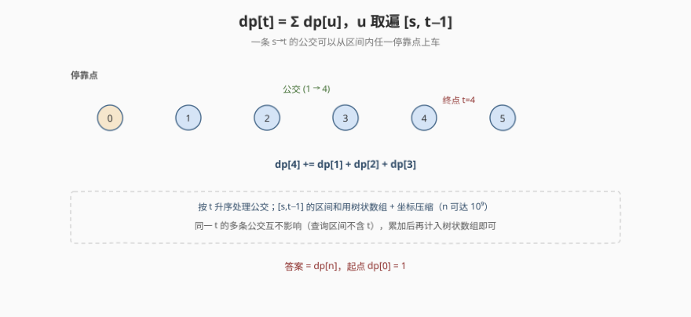

# Codeforces 101B 公交换乘计数 题解

## 1. 题目概述

- **题目链接**：https://codeforces.com/problemset/problem/101/B
- **比赛来源**：Codeforces Beta Round 79 (Div. 1 Only) · Problem B（UTC 2011-08-03）
- **难度**：1700
- **标签**：动态规划、树状数组、坐标压缩
- **评测类型**：普通
- **限制**：时间 2 s / 内存 265 MB

**题意**：直线上有 $n+1$ 个公交站，编号 $0 \sim n$。有 $m$ 条公交，第 $i$ 条从 $s_i$ 开往 $t_i$（$s_i < t_i$），沿途经过中间所有站。Gerald 只能在第 $i$ 条公交的 $[s_i, t_i-1]$ 中任一站上车，且只能在 $t_i$ 下车；不能步行、不能反向走。问从 $0$ 到 $n$ 有多少种走法（两种走法不同 ⟺ 某一段 $[j, j+1]$ 上坐的公交不同），对 $10^9+7$ 取模。

**约束**：

- $1 \le n \le 10^9$，$0 \le m \le 10^5$：站数太大，只能对"被公交用到的站"做坐标压缩。
- 公交数 $10^5$：需要 $O(m\log m)$ 的 DP。
- 模数 $10^9+7$。
- 单组数据。

## 2. 示例与观察

官方样例一：

```text
输入：
2 2
0 1
1 2
输出：
1
```

官方样例二：

```text
输入：
3 2
0 1
1 2
输出：
0
```

官方样例三：

```text
输入：
5 5
0 1
0 2
0 3
0 4
0 5
输出：
16
```

**样例一走查**：只能坐 $0\to1$，再坐 $1\to2$，唯一走法。

**样例二走查**：没有公交开到 $3$，到不了学校，答案 $0$。

**样例三走查**：五条公交都从 $0$ 出发。到 $k$ 号站的方案数：$dp[1] = dp[0] = 1$；$dp[2] = dp[0]+dp[1] = 2$；$dp[3] = dp[0]+dp[1]+dp[2] = 4$；$dp[4] = 8$；$dp[5] = 16$。与样例一致。



**观察**：一条终点为 $t$ 的公交 $(s,t)$ 允许 Gerald 从任意 $u \in [s, t-1]$ 上车，直接坐到 $t$。所以

$$dp[t] \mathrel{+}= \sum_{u=s}^{t-1} dp[u],$$

其中 $dp[v]$ 是到达站 $v$ 的走法数，$dp[0]=1$。

## 3. 解题思路

### 3.1 朴素做法与瓶颈

对每条公交枚举 $u \in [s,t-1]$ 求和：$O(mn)$，$n$ 可达 $10^9$，不可行。即使按站做 DP 也需要 $O(n)$ 个状态。

### 3.2 核心观察：只有"被用到的站"重要，且可前缀和


1. **状态压缩**：$dp$ 只可能在 $\{0, n\} \cup \{s_i, t_i\}$ 这些站上非零（其它站既不能上车也不能下车），把这 $\le 2m+2$ 个坐标压缩。
2. **区间和**：$\sum_{u=s}^{t-1} dp[u]$ 是压缩后数组上的区间和，用**树状数组**维护前缀和，$O(\log m)$。
3. **处理顺序**：所有转移都是从小站到大站，按 $t$ 升序处理公交，就能保证查询 $[s,t-1]$ 时这些 $dp$ 值已经最终确定。

### 3.3 为什么"从 $u>s$ 上车"不会重复计数

一条走法由"每一段 $[j,j+1]$ 坐哪条公交"唯一确定（题目就是这样定义走法）。给定这个分配，每条公交覆盖的段是连续的一段 $[u, t-1]$，于是它的上车点就是 $u$、下车点是 $t$——所以"公交序列 + 上车点"与"段分配"是一一对应的，不会重复也不会遗漏。

而 DP 的转移 $dp[t] \mathrel{+}= dp[u]$ 恰好枚举了"上一条公交把我送到 $u$，然后换乘这条 $(s,t)$ 公交从 $u$ 坐到 $t$"。

### 3.4 算法流程

1. 收集坐标 $\{0, n\} \cup \{s_i\} \cup \{t_i\}$，排序去重；
2. $dp[0]=1$，把 $dp[0]$ 加入树状数组；
3. 把公交按 $t$ 升序排序，对每条 $(s,t)$：
   - $hi$ = 最大的满足坐标 $\le t-1$ 的下标，$lo$ = $s$ 的下标；
   - 若 $hi \ge lo$，$sum$ = 前缀和$(hi)$ $-$ 前缀和$(lo-1)$；
   - $dp[t] \mathrel{+}= sum$，并把 $sum$ 加到树状数组的 $t$ 位置；
4. 输出 $dp[n]$。

### 3.5 样例走查

对照第 2 节那张图：

坐标 $\{0,1,2,3,4,5\}$。按 $t$ 升序：

| 公交 | 查询区间 | 区间和 | $dp$ 变化 |
|---|---|---|---|
| (0,1) | $[0,0]$ | 1 | $dp[1]=1$ |
| (0,2) | $[0,1]$ | 1+1=2 | $dp[2]=2$ |
| (0,3) | $[0,2]$ | 1+1+2=4 | $dp[3]=4$ |
| (0,4) | $[0,3]$ | 8 | $dp[4]=8$ |
| (0,5) | $[0,4]$ | 16 | $dp[5]=16$ |

## 4. 正确性证明

**引理 1**：走法与"每条段所乘公交"的分配一一对应，且每条公交所覆盖的段在路径上连续。

**证明**：Gerald 只能前进，一条公交从 $u$ 上、$t$ 下，覆盖段 $[u,t-1]$ 连续；不同公交的段互不重叠（每段只坐一次）。反给一个段分配，每段所乘公交相同且相邻的段必属于同一辆（否则中途要下车却无法换乘），因此每辆公交的段连续，上车点唯一确定。∎

**引理 2**：设 $dp[v]$ 为到达站 $v$ 的走法数，则 $dp[0]=1$，且对每条公交 $(s,t)$ 有 $dp[t] \mathrel{+}= \sum_{u=s}^{t-1}dp[u]$，其它位置不变。

**证明**：任何到达 $t$ 的走法，最后一步必是坐某条终点为 $t$ 的公交 $(s,t)$，且此前停在某个 $u\in[s,t-1]$；由引理 1，这给出一个双射。∎

**引理 3**：按 $t$ 升序处理公交时，查询 $[s,t-1]$ 用到的 $dp[u]$ 都已经是最终值。

**证明**：任何影响 $dp[u]$（$u<t$）的公交终点都 $\le u < t$，已在更早的时候处理完毕。∎

**定理**：算法输出的 $dp[n]$ 就是走法数（模 $10^9+7$）。

**证明**：由引理 2、3，DP 转移正确且顺序合法；树状数组维护的区间和与 $dp$ 的更新一致（每次把 $\sum$ 加到 $dp[t]$ 并同步到树状数组）。因此最终的 $dp[n]$ 等于真实方案数。∎

## 5. 复杂度分析

- **时间**：坐标压缩 $O(m\log m)$；每条公交一次区间查询 + 一次单点更新，$O(m\log m)$。总计 $O(m\log m)$。
- **空间**：树状数组与 $dp$，$O(m)$。
- **数值范围**：方案数随时取模；坐标 $n\le10^9$ 用 `long long`。
- **与时限的关系**：2 s 下实测 $m=10^5$ 约 $45$ ms（C++），Python 约 $458$ ms。

## 6. 参考代码

### C++17

```cpp
#include <bits/stdc++.h>
using namespace std;
typedef long long ll;
const ll MOD = 1000000007LL;

int main() {
    long long n;
    int m;
    if (scanf("%lld %d", &n, &m) != 2) return 0;
    vector<long long> coords;
    vector<pair<long long,long long>> buses(m);
    coords.push_back(0); coords.push_back(n);
    for (int i = 0; i < m; ++i) {
        long long s, t;
        scanf("%lld %lld", &s, &t);
        buses[i] = {s, t};
        coords.push_back(s); coords.push_back(t);
    }
    sort(coords.begin(), coords.end());
    coords.erase(unique(coords.begin(), coords.end()), coords.end());
    int K = (int)coords.size();
    vector<ll> bit(K + 1, 0);
    auto add = [&](int i, ll v) { for (++i; i <= K; i += i & -i) bit[i] = (bit[i] + v) % MOD; };
    auto pref = [&](int i) { ll r = 0; for (++i; i > 0; i -= i & -i) r = (r + bit[i]) % MOD; return r; };  // [0..i]
    auto idxLE = [&](long long v) { return (int)(upper_bound(coords.begin(), coords.end(), v) - coords.begin()) - 1; };
    vector<ll> dp(K, 0);
    dp[0] = 1;               // 起点 0 有 1 种走法
    add(0, 1);
    sort(buses.begin(), buses.end(), [](auto& x, auto& y) { return x.second < y.second; });
    for (auto& bs : buses) {
        int s = (int)(lower_bound(coords.begin(), coords.end(), bs.first) - coords.begin());
        int t = (int)(lower_bound(coords.begin(), coords.end(), bs.second) - coords.begin());
        int hi = idxLE(bs.second - 1);        // ≤ t-1 的最大坐标下标
        ll sum;
        if (hi < s) sum = 0;
        else sum = (pref(hi) - (s > 0 ? pref(s - 1) : 0) + MOD) % MOD;
        if (!sum) continue;
        dp[t] = (dp[t] + sum) % MOD;
        add(t, sum);
    }
    int tn = (int)(lower_bound(coords.begin(), coords.end(), n) - coords.begin());
    printf("%lld\n", dp[tn] % MOD);
    return 0;
}
```

### Python3

```python
import sys
from bisect import bisect_left, bisect_right

MOD = 10 ** 9 + 7


def main() -> None:
    data = sys.stdin.buffer.read().split()
    if not data:
        return
    n = int(data[0]); m = int(data[1])
    buses = []
    coords = [0, n]
    p = 2
    for _ in range(m):
        s = int(data[p]); t = int(data[p + 1]); p += 2
        buses.append((s, t))
        coords.append(s); coords.append(t)
    coords = sorted(set(coords))
    K = len(coords)
    bit = [0] * (K + 1)

    def add(i, v):
        i += 1
        while i <= K:
            bit[i] = (bit[i] + v) % MOD
            i += i & -i

    def pref(i):  # [0..i]
        r = 0
        i += 1
        while i > 0:
            r += bit[i]
            i -= i & -i
        return r % MOD

    dp = [0] * K
    dp[0] = 1
    add(0, 1)
    buses.sort(key=lambda z: z[1])
    for s, t in buses:
        si = bisect_left(coords, s)
        ti = bisect_left(coords, t)
        hi = bisect_right(coords, t - 1) - 1
        if hi < si:
            continue
        total = (pref(hi) - (pref(si - 1) if si > 0 else 0)) % MOD
        if not total:
            continue
        dp[ti] = (dp[ti] + total) % MOD
        add(ti, total)
    print(dp[bisect_left(coords, n)] % MOD)


main()
```

## 7. 边界情况与易错点

1. **区间上界是 $t-1$ 而不是 $t$**：公交只能在 $[s,t-1]$ 上车；写错成 $[s,t]$ 会把"已经到 $t$ 的方案"再算一遍。
2. **坐标压缩后要二分找下标**：`hi` 必须是"坐标 $\le t-1$ 的最大下标"，用 `upper_bound(t-1)-1`，不能直接用 $t$ 的下标减一（中间可能有空隙）。
3. **按 $t$ 升序处理**：若按输入顺序处理，查询区间里可能还有未确定的 $dp$ 值。
4. **同一 $t$ 的多条公交**：查询区间不含 $t$，互不影响，可以按任意顺序处理；但要把贡献累加到 $dp[t]$ 后再更新树状数组（或干脆直接累加，因为查询不含 $t$）。
5. **$m=0$**：没有任何公交，$dp[n]=0$（除非 $n=0$，但 $n\ge1$）。
6. **$d[0]=1$**：起点算一种"已经在 0 号站"的方案；别忘了把它加入树状数组。
7. **模运算**：前缀和相减要 `+MOD` 再取模，避免负数。
8. **$n$ 可达 $10^9$**：所有与站号有关的量用 `long long`；坐标压缩后下标是 `int`。

## 8. 验证记录

- **编译环境与命令**：`clang++ -std=c++17 -O2`（Apple clang 21.0.0 + `codeforces/tools/include` 的兼容头），Python 3.9.6。
- **官方样例**：3 / 3 通过（`1`、`0`、`16`），C++ 与 Python 输出一致。
- **独立暴力对拍**：暴力在所有停靠点上做 $O(m\cdot V)$ 的 DP（对每条终点为 $v$ 的公交累加区间内所有 $dp$），与树状数组实现完全不同。对 $n\le7$、$m\le6$ 的 **260 组**随机数据（含重边、无法到达、$m=0$）三方一致，**0 失败**。
- **最大约束性能**：$n=10^9$、$m=10^5$ 随机数据 C++ 端到端约 $45$ ms，Python 约 $458$ ms；相对 2 s 余量在 4 倍以上。
- **图片校验**：`cf101b_dp.svg`、`cf101b_sample.svg` 均通过 `xml.etree.ElementTree.parse`，含 `feTurbulence` 与手写体字体族，文本包围盒未越出 `viewBox`。
- **公式校验**：KaTeX（`throwOnError`）渲染无报错；无 `---` 分隔线。
- **复核状态**：verified（样例、对拍、性能、图片、公式均实跑通过）。

## 相关题目与扩展

- [Codeforces 101A 最少保留的不同字母](https://codeforces.com/problemset/problem/101/A)、[101C Vectors](https://codeforces.com/problemset/problem/101/C)、[101D Castle](https://codeforces.com/problemset/problem/101/D)、[101E Candies and Stones](https://codeforces.com/problemset/problem/101/E)：同场其余题。
- [Codeforces 1025B Weakened Common Divisor](https://codeforces.com/problemset/problem/1025/B)：不是本题，仅字母编号相近。
- [Codeforces 1433F Zero Remainder Sum](https://codeforces.com/problemset/problem/1433/F)：网格 DP 与压缩。
- [LeetCode 1301. 最大得分的路径数目](https://leetcode.cn/problems/number-of-paths-with-max-score/)：网格上计数的 DP。

**延伸思考**：

1. **如果公交可以双向**：图变成有向图的两倍，DP 顺序不再单调，需要按拓扑序或 BFS 处理。
2. **如果要求"走法数"但限制换乘次数 $\le K$**：状态要加一维换乘次数，$O(mK\log m)$。
3. **如果允许步行相邻站**：等价于加入 $(i,i+1)$ 的无限次免费公交，DP 仍然成立（但顺序要按站号推进）。
4. **如果要求输出字典序最小的走法**：在 DP 值上再做贪心回溯，注意并列时选编号小的公交。

