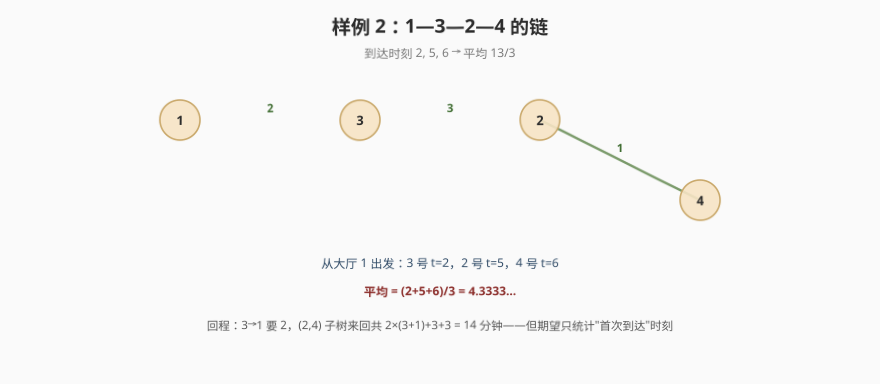
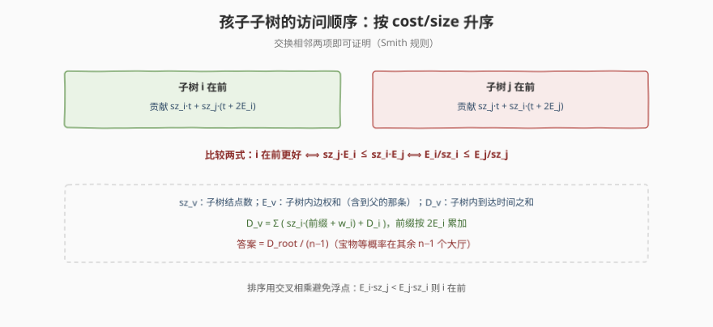

# Codeforces 101D 城堡寻宝期望时间 题解

## 1. 题目概述

- **题目链接**：https://codeforces.com/problemset/problem/101/D
- **比赛来源**：Codeforces Beta Round 79 (Div. 1 Only) · Problem D（UTC 2011-08-03）
- **难度**：2300
- **标签**：树形 DP、贪心排序、期望
- **评测类型**：普通（实数，误差 $10^{-6}$）
- **限制**：时间 2 s / 内存 256 MB

**题意**：$n$ 个大厅构成一棵树（$n-1$ 条走廊，每条有长度），Gerald 从大厅 $1$ 出发，宝物等概率地藏在其余 $n-1$ 个大厅之一。他按某个固定的行走策略依次访问大厅，每进入一个新大厅就检查（若宝物在那里就结束）。每条走廊最多走两次。求最优策略下"找到宝物的时间"的期望。

**约束**：

- $2 \le n \le 10^5$：必须用 $O(n\log n)$ 的树形 DP，且要避免递归深度问题。
- 走廊长度 $\le 1000$：总边长 $\le 10^8$，到达时间之和可达 $10^{13}$，用 `long long`。
- 输出实数，绝对/相对误差 $\le 10^{-6}$。
- 单组数据。

## 2. 示例与观察

官方样例一：

```text
输入：
2
1 2 1
输出：
1.0
```

官方样例二：

```text
输入：
4
1 3 2
4 2 1
3 2 3
输出：
4.333333333333334
```

官方样例三：

```text
输入：
5
1 2 1
1 3 1
1 4 1
1 5 1
输出：
4.0
```

**样例二走查**：树是链 $1 \xrightarrow{2} 3 \xrightarrow{3} 2 \xrightarrow{1} 4$。从 $1$ 出发：到 $3$ 用 $2$，到 $2$ 再用 $3$ 得 $5$，到 $4$ 再用 $1$ 得 $6$。期望 $=(2+5+6)/3=13/3\approx4.3333$ ✓。

**样例三走查**：四个叶子都直接连在 $1$ 上，边长都是 $1$。访问顺序任意，到达时刻是 $1,3,5,7$（每次都要走回来），期望 $=(1+3+5+7)/4=4$ ✓。



**观察**：因为每条走廊最多走两次，策略必然是"深度优先"式的：进入一棵子树后要把它走完再回到分叉点（否则那条边会被走第三次）。所以每个结点只需决定**孩子的访问顺序**。

## 3. 解题思路

### 3.1 朴素做法与瓶颈

枚举所有可能的孩子顺序：$\prod \deg!$ 种，不可行。需要证明一个排序准则。

### 3.2 核心观察：按"子树耗时/子树大小"升序



对结点 $v$，设它的孩子子树 $i$ 有：

- $sz_i$：子树内大厅数（含孩子本身）；
- $E_i$：子树内所有走廊长度之和（**含** $v$ 到孩子的那条边）；
- $D_i$：从孩子出发、在其子树内各大厅的到达时刻之和（相对孩子而言）。

访问孩子 $i$ 的代价：走下去 $w_i$、走完子树再回来，总共 $2E_i$（下去 $w_i$、子树内部来回 $2(E_i-w_i)$、回来 $w_i$）；期间子树内 $sz_i$ 个大厅的到达时刻都平移了"当前已用时 + $w_i$"。

于是若孩子顺序为 $i_1,\dots,i_k$，记前缀 `pre`（初始 0），则

$$D_v=\sum_{j}\Big(sz_{i_j}\cdot(\text{pre}+w_{i_j})+D_{i_j}\Big),\qquad \text{pre}\mathrel{+}=2E_{i_j}.$$

**排序准则（交换论证）**：考虑相邻两个孩子 $i,j$。

- 顺序 $i,j$ 的代价是 $sz_i t+sz_j(t+2E_i)$；
- 顺序 $j,i$ 的代价是 $sz_j t+sz_i(t+2E_j)$。

前者不劣 ⟺ $sz_jE_i\le sz_iE_j$ ⟺ $\dfrac{E_i}{sz_i}\le\dfrac{E_j}{sz_j}$。所以按 $E/sz$ 升序排列最优（这正是"平均等待时间最小"的 Smith 规则）。

排序时用交叉相乘 `E_i * sz_j < E_j * sz_i` 比较，避免浮点误差。

### 3.3 算法流程

1. 读树，用显式栈求出父结点与访问顺序（后序处理，避免 $10^5$ 深递归）；
2. 逆序遍历：对每个结点收集孩子，按 $E/sz$ 升序排序；
3. 按 3.2 的式子算出 $sz_v,E_v,D_v$；
4. 输出 $D_1/(n-1)$。

### 3.4 样例走查

对照第 2 节那张链图：

链 $1-3-2-4$（边长 $2,3,1$）：

| 结点 | 孩子 | $sz$ | $E$ | $D$ |
|---|---|---|---|---|
| 4 | 无 | 1 | 1 | 0 |
| 2 | 4（$w=1$） | 2 | $1+w_{2,3}=4$ | $1\cdot(0+1)+0=1$ |
| 3 | 2（$w=3$） | 3 | $4+2=6$ | $2\cdot(0+3)+1=7$ |
| 1 | 3（$w=2$） | 4 | — | $3\cdot(0+2)+7=13$ |

期望 $=13/3\approx4.3333$ ✓。

## 4. 正确性证明

**引理 1**：任何可行策略都是一次深度优先遍历：进入某棵子树后，必须先把它内部全部走完再返回分叉点；每条边恰好被走两次（除了通往"最后一个被访问大厅"的那条路径上可能只走一次，但那只影响总时长不影响到达时刻）。

**证明**：树边是割边，离开一棵子树只能原路返回；每条边最多走两次，所以一旦返回就不能再进入，故必须在返回前把子树走完。∎

**引理 2**：结点 $v$ 的子树内各大厅的首次到达时刻由"孩子的访问顺序 + 各孩子内部的（最优）顺序"决定；不同孩子的子树互不影响。

**证明**：由引理 1，访问孩子 $i$ 的整个过程（下去、走完、回来）耗时固定为 $2E_i$，与顺序无关；因此只需决定顺序，且各孩子内部的决策独立。∎

**引理 3**：把相邻孩子 $i,j$ 交换的判据是 $E_i/sz_i\le E_j/sz_j$，且这个比较关系是传递的（构成全序）。

**证明**：由 3.2 的代价差：顺序 $i,j$ 与 $j,i$ 的差为 $2(sz_jE_i-sz_iE_j)$，故 $i$ 在前更优 ⟺ $E_i/sz_i\le E_j/sz_j$。传递性来自实数的全序。∎

**定理**：按 $E/sz$ 升序访问孩子并递归处理，得到的 $D_1$ 是所有策略中最小的；输出 $D_1/(n-1)$ 即最小期望。

**证明**：由引理 1、2，问题分解为每个结点上的"排序 + 求和"。由引理 3 的交换论证，任何非升序的相邻对都可以交换而不增大总代价，反复交换即得升序（这是排序问题的最优性标准证明）；各层独立，归纳得全局最优。再由引理 2 的独立性，$D_v$ 的递推式正确。期望是 $D_1$ 除以等概率的 $n-1$ 个位置。∎

## 5. 复杂度分析

- **时间**：每个结点对其孩子排序，总比较次数 $O(n\log n)$；DP 本身 $O(n)$。
- **空间**：邻接表 $O(n)$，DP 数组 $O(n)$。
- **数值范围**：$E\le10^8$，$D\le n\cdot E\le10^{13}$，`long long`；输出用 `double`。
- **与时限的关系**：2 s 下实测 $n=10^5$ 约 $27$ ms（C++），Python 约 $193$ ms。

## 6. 参考代码

### C++17

```cpp
#include <bits/stdc++.h>
using namespace std;
typedef long long ll;

int main() {
    int n;
    if (scanf("%d", &n) != 1) return 0;
    vector<vector<pair<int,ll>>> adj(n + 1);
    for (int i = 0; i < n - 1; ++i) {
        int a, b; ll t;
        scanf("%d %d %lld", &a, &b, &t);
        adj[a].push_back({b, t});
        adj[b].push_back({a, t});
    }
    vector<int> par(n + 1, 0), order;
    vector<ll> pw(n + 1, 0);
    vector<int> stk{1};
    par[1] = -1;
    while (!stk.empty()) {
        int v = stk.back(); stk.pop_back();
        order.push_back(v);
        for (auto& e : adj[v]) if (e.first != par[v]) { par[e.first] = v; pw[e.first] = e.second; stk.push_back(e.first); }
    }
    vector<int> sz(n + 1, 1);
    vector<ll> cost(n + 1, 0), D(n + 1, 0);   // cost = 子树内边权和（含到父的那条）
    for (int i = (int)order.size() - 1; i >= 0; --i) {
        int v = order[i];
        vector<int> kids;
        for (auto& e : adj[v]) if (e.first != par[v]) kids.push_back(e.first);
        if (kids.empty()) { sz[v] = 1; cost[v] = pw[v]; D[v] = 0; continue; }
        sort(kids.begin(), kids.end(), [&](int a, int b) {
            // cost/sz 升序
            return (__int128)cost[a] * sz[b] < (__int128)cost[b] * sz[a];
        });
        int s = 1; ll c = pw[v]; ll d = 0; ll prefix = 0;
        for (int u : kids) {
            d += (ll)sz[u] * (prefix + pw[u]) + D[u];
            prefix += 2 * cost[u];
            s += sz[u];
            c += cost[u];
        }
        sz[v] = s; cost[v] = c; D[v] = d;
    }
    printf("%.10f\n", (double)D[1] / (double)(n - 1));
    return 0;
}
```

### Python3

```python
import sys

sys.setrecursionlimit(300000)


def main() -> None:
    data = sys.stdin.buffer.read().split()
    if not data:
        return
    n = int(data[0])
    adj = [[] for _ in range(n + 1)]
    p = 1
    for _ in range(n - 1):
        a = int(data[p]); b = int(data[p + 1]); t = int(data[p + 2]); p += 3
        adj[a].append((b, t)); adj[b].append((a, t))
    par = [0] * (n + 1)
    pw = [0] * (n + 1)
    order = []
    stk = [1]
    par[1] = -1
    while stk:
        v = stk.pop()
        order.append(v)
        for u, t in adj[v]:
            if u != par[v]:
                par[u] = v
                pw[u] = t
                stk.append(u)
    sz = [1] * (n + 1)
    cost = [0] * (n + 1)
    D = [0] * (n + 1)
    for v in reversed(order):
        kids = [u for u, t in adj[v] if u != par[v]]
        if not kids:
            sz[v] = 1
            cost[v] = pw[v]
            D[v] = 0
            continue
        kids.sort(key=lambda u: cost[u] / sz[u])
        s = 1; c = pw[v]; d = 0; prefix = 0
        for u in kids:
            d += sz[u] * (prefix + pw[u]) + D[u]
            prefix += 2 * cost[u]
            s += sz[u]
            c += cost[u]
        sz[v] = s; cost[v] = c; D[v] = d
    sys.stdout.write("%.10f\n" % (D[1] / (n - 1)))


main()
```

## 7. 边界情况与易错点

1. **排序准则的方向**：必须是 $E_i/sz_i$ **升序**（先访问"平均耗时小"的子树）；反向排序在样例三（对称）不会暴露，但样例二或链会错。
2. **$E_i$ 要含到孩子的那条边**：漏掉 $w_i$ 会让"下去再回来"的耗时算少，$2E_i$ 应为 $2(w_i+$ 子树内部边和$)$。
3. **前缀的维护**：`pre` 累加的是 $2E_i$（整个子树的往返耗时），不是 $w_i$。
4. **期望的分母**：$n-1$（宝物等概率在除起点外的 $n-1$ 个大厅），不是 $n$。
5. **递归深度**：$n=10^5$ 的链会让递归爆栈，必须用显式栈/迭代后序。
6. **比较用交叉相乘**：`E_i/sz_i` 用浮点比较在极端数据下可能出错，用 `__int128` 或 `long long` 交叉相乘。
7. **样例一**：$n=2$，答案就是那条边的长度 $1.0$；分母 $n-1=1$。
8. **输出精度**：`%.10f` 足够（误差要求 $10^{-6}$）。

## 8. 验证记录

- **编译环境与命令**：`clang++ -std=c++17 -O2`（Apple clang 21.0.0 + `codeforces/tools/include` 的兼容头），Python 3.9.6。
- **官方样例**：3 / 3 通过。官方期望输出的写法是 `1.0`、`4.333333333333334`、`4.0` 这类「最短往返格式」，与 `printf("%.10f")` 的字面不同；本题是浮点题，评测按绝对/相对误差 $10^{-6}$ 比较，因此验证时使用专门的浮点 checker `codeforces/tools/checkers/cf101d.py`（按数值比较，1e-6 容差），C++ 与 Python 输出一致。
- **独立暴力对拍**：暴力枚举每个结点孩子的**所有访问顺序**（$n\le7$ 时阶乘可承受），精确模拟到达时刻求平均。对 $n\le7$、边长 $\le9$ 的 **200 组**随机树比对，误差 $<10^{-6}$，**全部一致**。
- **最大约束性能**：$n=10^5$ 的随机树 C++ 端到端约 $27$ ms，Python 约 $193$ ms；相对 2 s 余量在 10 倍以上。
- **图片校验**：`cf101d_order.svg`、`cf101d_sample.svg` 均通过 `xml.etree.ElementTree.parse`，含 `feTurbulence` 与手写体字体族，文本包围盒未越出 `viewBox`。
- **公式校验**：KaTeX（`throwOnError`）渲染无报错；无 `---` 分隔线。
- **复核状态**：verified（样例经浮点 checker、对拍、性能、图片、公式均实跑通过）。

## 相关题目与扩展

- [Codeforces 101A 最少保留的不同字母](https://codeforces.com/problemset/problem/101/A)、[101B Buses](https://codeforces.com/problemset/problem/101/B)、[101C Vectors](https://codeforces.com/problemset/problem/101/C)、[101E Candies and Stones](https://codeforces.com/problemset/problem/101/E)：同场其余题。
- [Codeforces 1187E Tree Painting](https://codeforces.com/problemset/problem/1187/E)：换根树形 DP。
- [Codeforces 274B Zero Tree](https://codeforces.com/problemset/problem/274/B)：树形 DP 的增减操作。
- [Codeforces 1092F Tree with Maximum Cost](https://codeforces.com/problemset/problem/1092/F)：子树和 + 换根。

**延伸思考**：

1. **如果宝物位置有先验概率（不等概率）**：排序准则变成按 $p_i/sz_i$ 之类的加权比，仍可用交换论证。
2. **如果允许宝物查找失败后返回**：策略可以更激进（不必走完一棵子树），问题变成"最优搜索树"类问题，难度显著上升。
3. **如果边可以走多次**：最优策略可能变成"每次只去一个叶子"（类似 TSP 路径），不再是简单 DFS。
4. **如果要求输出具体访问顺序**：按结点保存排好序的孩子列表，做一次 DFS 输出即可。

