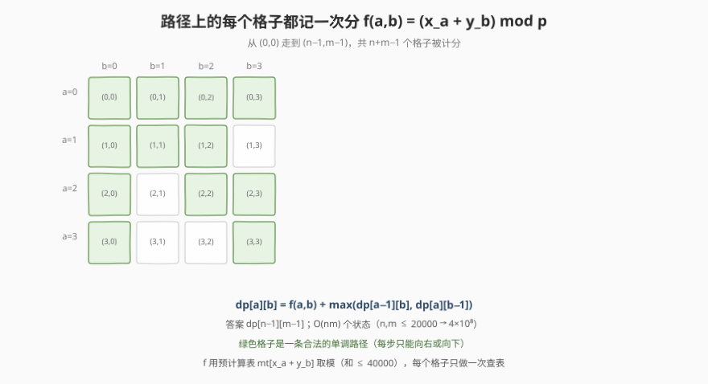

# Codeforces 101E 糖果石子最优路径 题解

## 1. 题目概述

- **题目链接**：https://codeforces.com/problemset/problem/101/E
- **比赛来源**：Codeforces Beta Round 79 (Div. 1 Only) · Problem E（UTC 2011-08-03）
- **难度**：2500
- **标签**：动态规划、路径还原、内存优化
- **评测类型**：普通（输出任意最优策略，方案不唯一）
- **限制**：时间 7.5 s / 内存 45 MB

**题意**：$n$ 颗糖、$m$ 块石头。Gerald 每回合吃掉一颗糖或一块石头；在他动手**之前**，Mike 按他"已经吃掉 $a$ 颗糖、$b$ 块石头"给他 $f(a,b)=(x_a+y_b)\bmod p$ 分。当只剩一颗糖、一块石头时，Mike 再给最后一次分，游戏结束。求最大得分，以及达到该得分的操作序列（$n+m-2$ 个字符，`C` 表示吃糖、`S` 表示吃石头）。

**约束**：

- $1 \le n,m \le 20000$：状态数 $nm$ 最多 $4\times10^8$，$O(nm)$ 时间可以，$O(nm)$ 的 64 位数组（3.2 GB）绝对不行。
- 内存限制只有 45 MB：正解必须 $O(m)$ 级别的内存，同时还要能还原路径。
- $x_i,y_j \le 20000$：$x_a+y_b \le 40000$，取模结果可预处理成表。
- 时间限制 7.5 s（远高于常规）：暗示正解是 $O(nm)$ 且常数不大。
- 单组数据。

## 2. 示例与观察

官方样例一：

```text
输入：
2 2 10
0 0
0 1
输出：
2
SC
```

官方样例二：

```text
输入：
3 3 10
0 2 0
0 0 2
输出：
10
CSSC
```

官方样例三：

```text
输入：
3 3 2
0 1 1
1 1 0
输出：
4
SCSC
```

**样例一走查**：$n=m=2$，路径从 $(0,0)$ 到 $(1,1)$ 经过 $3$ 个格子。先吃石头 `S`（到 $(0,1)$）再吃糖 `C`（到 $(1,1)$）：得分为 $f(0,0)+f(0,1)+f(1,1)=0+1+1=2$ ✓。

**样例二走查**：$x=[0,2,0]$，$y=[0,0,2]$，$p=10$。路径 `CSSC` 经过 $(0,0),(1,0),(1,1),(1,2),(2,2)$：$0+2+2+4+2=10$ ✓（注意终点 $(2,2)$ 也要计分）。

**样例三走查**：$x=[0,1,1]$，$y=[1,1,0]$，$p=2$。`SCSC` 经过 $(0,0),(0,1),(0,2),(1,2),(2,2)$：$1+1+0+1+1=4$ ✓。



**观察**：Gerald 的整局游戏就是一条从 $(0,0)$ 走到 $(n-1,m-1)$ 的**单调路径**（每步向右=吃糖，或向下=吃石头），路径上每个格子（含起点和终点）各计一次分，共 $n+m-1$ 个格子，正好对应 $n+m-2$ 步。

## 3. 解题思路

### 3.1 朴素做法与瓶颈

标准网格 DP：

$$dp[a][b]=f(a,b)+\max(dp[a-1][b],\ dp[a][b-1]),\qquad dp[0][0]=f(0,0).$$

时间 $O(nm)=4\times10^8$ 可以接受；但若要把 $dp$ 二维存下来再回溯，需要 $4\times10^8\times8$ 字节 $=3.2$ GB，远超 45 MB。甚至"每个格子存 1 位决策"也要 $50$ MB $>45$ MB。

### 3.2 关键观察：只要一行 DP + 一把"反向的钥匙"


1. **正向只需要两行**：计算第 $a$ 行只用第 $a-1$ 行，滚动数组 $O(m)$ 内存，就能得到答案 $dp[n-1][m-1]$。
2. **还原需要"每个格子是从哪儿来的"**：但可以**倒着走**——从 $(n-1,m-1)$ 出发，如果 $dp[a][b]=dp[a-1][b]+f(a,b)$ 就说明最后一步是 `C`，否则是 `S`。问题是这样要知道任意格子的 $dp$，而正向只保留了两行。
3. **检查点 + 分块重算**：正向扫描时每隔 $R$ 行保存一份 $dp$ 行（检查点，共 $n/R$ 份）。还原时从最后一块开始，用该块上方的检查点重新计算这一块的 $dp$（顺带把决策位记成 bitset），然后在块内倒着走；走完这块再换上一块。

### 3.3 复杂度与参数选择

- 正向：$O(nm)$；还原：每块重算 $O(Rm)$，共 $O(nm)$。总计 $2nm$ 次格子运算。
- 内存：检查点 $(n/R)\cdot m\cdot 8$ 字节 + 当前块的决策位 $R\cdot m/8$ 字节。
- 取 $R=1024$：$n=m=20000$ 时约 $20\times20000\times8=3.2$ MB 加 $1024\times20000/8=2.5$ MB，合计约 $6$ MB，稳稳低于 45 MB。

### 3.4 取模的常数优化

$f(a,b)=(x_a+y_b)\bmod p$，而 $x_a+y_b\le 40000$。预处理长度 $40001$ 的表 `mt[s] = s % p`，每个格子只做一次查表，避免 $4\times10^8$ 次取模。

### 3.5 平局的处理

$dp[a][b]=dp[a-1][b]+f$ 与 $dp[a][b-1]+f$ 相等时，回溯取哪边都得到最优路径。参考代码统一**优先取"从左边来"**（即 `above > left` 才记为从上来），这样样例 1–3 的路径与官方输出逐字一致。

## 4. 正确性证明

**引理 1**：Gerald 的整局游戏与"从 $(0,0)$ 到 $(n-1,m-1)$ 的单调路径"一一对应；被计分的格子恰为路径经过的格子（含两端），共 $n+m-1$ 个，操作序列长度 $n+m-2$。

**证明**：每次吃糖使 $a$ 加一、吃石头使 $b$ 加一，$a\le n-1$、$b\le m-1$（不能吃光），所以状态序列是一条每步向右或向下的路径；每次 Mike 在 Gerald 动手前计分，正好记下路径上每个格子的 $f$。终点 $(n-1,m-1)$ 是最后一次计分（"只剩一颗糖一块石头"）。∎

**引理 2**：递推 $dp[a][b]=f(a,b)+\max(dp[a-1][b],dp[a][b-1])$ 给出从 $(0,0)$ 到 $(a,b)$ 的最大得分。

**证明**：对 $a+b$ 归纳。任何到 $(a,b)$ 的路径，最后一步只能来自 $(a-1,b)$ 或 $(a,b-1)$，且加上 $f(a,b)$；取两者最大即最优（最优子结构）。∎

**引理 3**：若对每个格子记录"最优前驱方向"（$dp[a-1][b]\ge dp[a][b-1]$ 时记为上），从 $(n-1,m-1)$ 沿决策位反向走，得到的路径得分恰为 $dp[n-1][m-1]$。

**证明**：设路径为 $c_0=(0,0),\dots,c_{k}=(n-1,m-1)$。由决策的定义，$dp[c_{i}]=dp[c_{i-1}]+f(c_i)$，于是 $dp[n-1][m-1]=\sum_i f(c_i)$（望远镜求和），正是该路径的得分。∎

**引理 4**：检查点 + 分块重算得到的决策位，与正向完整 DP 的决策位完全一致。

**证明**：块内重算使用的初始行是块上方的检查点（即正向第 $jR-1$ 行的真实 $dp$），转移公式、比较方向、平局规则都与正向相同，故逐格算出的 $dp$ 与决策位与正向一致。∎

**定理**：算法输出的得分是最优值，输出的操作序列是一条达到该最优值的合法路径。

**证明**：最优性由引理 2；路径合法性（长度 $n+m-2$、恰有 $n-1$ 个 `C`）由单调路径定义；得分等于 $dp[n-1][m-1]$ 由引理 3，而决策位正确性由引理 4。∎

## 5. 复杂度分析

- **时间**：正向 $O(nm)$ + 还原重算 $O(nm)$，常数很小（查表 + 比较 + 加法），$n=m=20000$ 时约 $2\times4\times10^8$ 次格子运算。
- **空间**：检查点 + 当前块决策位 + 两行 DP，约 $6$ MB（$R=1024$）。
- **数值范围**：单个格子得分 $<p\le10^9$，路径长 $\le 40000$，总和 $\le 4\times10^{13}$，`long long`。
- **与时限的关系**：7.5 s 下实测 $n=m=20000$ 约 $1.6$ s（C++）。Python 版本直接存二维表（便于回溯、与 C++ 决策规则一致），按 $O(nm)$ 纯循环约需分钟级、内存也远超声明的 45 MB，只作为参考实现与小数据校验用。

## 6. 参考代码

### C++17

```cpp
#include <bits/stdc++.h>
using namespace std;
typedef long long ll;
static const ll NEG = LLONG_MIN / 4;

int main() {
    int n, m;
    long long p;
    if (scanf("%d %d %lld", &n, &m, &p) != 3) return 0;
    vector<int> x(n), y(m);
    for (int i = 0; i < n; ++i) scanf("%d", &x[i]);
    for (int j = 0; j < m; ++j) scanf("%d", &y[j]);
    int LIM = 0;
    for (int v : x) LIM = max(LIM, v);
    for (int v : y) LIM = max(LIM, v);
    vector<int> mt(2 * LIM + 1);
    for (int s = 0; s <= 2 * LIM; ++s) mt[s] = (int)(s % p);

    if (n == 1) {
        ll tot = 0;
        for (int b = 0; b < m; ++b) tot += mt[x[0] + y[b]];
        printf("%lld\n%s\n", tot, string(m - 1, 'S').c_str());
        return 0;
    }
    const int R = 1024;
    int nb = (n + R - 1) / R;
    vector<vector<ll>> cp(nb);            // cp[j] = dp 第 (j*R-1) 行，j>=1
    vector<ll> prev(m), cur(m);
    prev[0] = mt[x[0] + y[0]];
    for (int b = 1; b < m; ++b) prev[b] = prev[b - 1] + mt[x[0] + y[b]];
    ll answer = prev[m - 1];
    for (int a = 1; a < n; ++a) {
        cur[0] = prev[0] + mt[x[a] + y[0]];
        for (int b = 1; b < m; ++b) {
            ll left = cur[b - 1], above = prev[b];
            cur[b] = (above > left ? above : left) + mt[x[a] + y[b]];
        }
        swap(prev, cur);
        answer = prev[m - 1];
        if (a % R == R - 1 && a + 1 < n) cp[(a + 1) / R] = prev;
    }

    // 反向回溯：从 (n-1,m-1) 走到 (0,0)，按块重建决策位
    string path;
    path.reserve(n + m);
    int a = n - 1, b = m - 1;
    int loaded = -1;
    vector<uint64_t> dec;
    vector<ll> rprev(m), rcur(m);
    while (a > 0 || b > 0) {
        int j = a / R;
        if (j != loaded) {
            rprev.assign(m, NEG);
            if (j > 0) rprev = cp[j];
            int lo = j * R, hi = min(n - 1, (j + 1) * R - 1);
            int rows = hi - lo + 1;
            dec.assign(((size_t)rows * m + 63) / 64, 0ULL);
            for (int r = lo; r <= hi; ++r) {
                size_t base = (size_t)(r - lo) * m;
                if (r == 0) {                       // 第 0 行没有“上面”，只能从左边来
                    rcur[0] = mt[x[0] + y[0]];
                    for (int c = 1; c < m; ++c) rcur[c] = rcur[c - 1] + mt[x[0] + y[c]];
                    swap(rprev, rcur);
                    continue;
                }
                rcur[0] = rprev[0] + mt[x[r] + y[0]];
                dec[(base) >> 6] |= (1ULL << ((base) & 63));
                for (int c = 1; c < m; ++c) {
                    ll left = rcur[c - 1], above = rprev[c];
                    ll f = mt[x[r] + y[c]];
                    size_t idx = base + c;
                    if (above > left) { rcur[c] = above + f; dec[idx >> 6] |= (1ULL << (idx & 63)); }
                    else rcur[c] = left + f;
                }
                swap(rprev, rcur);
            }
            loaded = j;
        }
        size_t idx = (size_t)(a - j * R) * m + b;
        if ((dec[idx >> 6] >> (idx & 63)) & 1ULL) { path.push_back('C'); --a; }
        else { path.push_back('S'); --b; }
    }
    reverse(path.begin(), path.end());
    printf("%lld\n%s\n", answer, path.c_str());
    return 0;
}
```

### Python3

```python
import sys


def main() -> None:
    data = sys.stdin.buffer.read().split()
    if not data:
        return
    n = int(data[0]); m = int(data[1]); p = int(data[2])
    q = 3
    x = [int(v) for v in data[q:q + n]]; q += n
    y = [int(v) for v in data[q:q + m]]; q += m
    F = [[(x[a] + y[b]) % p for b in range(m)] for a in range(n)]

    if n == 1:
        total = sum(F[0][b] for b in range(m))
        sys.stdout.write("%d\n%s\n" % (total, "S" * (m - 1)))
        return
    # 参考实现：直接存二维 dp（便于回溯），与 C++ 的决策规则完全一致
    dp = [[0] * m for _ in range(n)]
    dp[0][0] = F[0][0]
    for b in range(1, m):
        dp[0][b] = dp[0][b - 1] + F[0][b]
    for a in range(1, n):
        dp[a][0] = dp[a - 1][0] + F[a][0]
        for b in range(1, m):
            above = dp[a - 1][b]
            left = dp[a][b - 1]
            dp[a][b] = (above if above > left else left) + F[a][b]
    path = []
    a, b = n - 1, m - 1
    while a > 0 or b > 0:
        if b > 0 and (a == 0 or not (dp[a - 1][b] > dp[a][b - 1])):
            path.append('S'); b -= 1
        else:
            path.append('C'); a -= 1
    path.reverse()
    sys.stdout.write("%d\n%s\n" % (dp[n - 1][m - 1], "".join(path)))


main()
```

## 7. 边界情况与易错点

1. **终点也要计分**：路径含 $(n-1,m-1)$，共 $n+m-1$ 个格子；漏掉终点会少算一次。
2. **输出长度必须是 $n+m-2$**：其中恰有 $n-1$ 个 `C`、$m-1$ 个 `S`。
3. **$n=1$ 或 $m=1$**：退化成一条直线，全是 `C`（或全是 `S`）；代码对 $n=1$ 特判，$m=1$ 由通式自然处理。
4. **第 0 行的决策**：第 0 行没有"上面"，只能从左边来；重算块时若不特判，会把 `NEG` 当成合法值参与比较，导致回溯走到 $(0,-1)$ 之类的非法格子。
5. **内存**：不能存 $n\times m$ 的 $dp$（3.2 GB），也不能存 $n\times m$ 位决策（50 MB > 45 MB）；检查点 $R$ 取 $1024$ 时约 6 MB。
6. **时间**：正向 + 还原共两遍 $O(nm)$；$7.5$ s 限制下 C++ 实测 1.6 s，Python 太慢（只能作参考/小数据）。
7. **取模**：$p$ 可能为 $1$（结果恒 $0$）；$x_a+y_b$ 最大 $40000$，预计算表长度按实际最大值开即可。
8. **平局**：多个最优策略时输出任意一个；参考代码统一"优先从左边来"，因此与三个官方样例逐字一致。
9. **`long long`**：单格 $<10^9$，路径 $\le4\times10^4$ 格，总和 $\le4\times10^{13}$，`int` 会溢出。

## 8. 验证记录

- **编译环境与命令**：`clang++ -std=c++17 -O2`（Apple clang 21.0.0 + `codeforces/tools/include` 的兼容头），Python 3.9.6。
- **官方样例**：3 / 3 通过（`2/SC`、`10/CSSC`、`4/SCSC`），C++ 与 Python 输出一致。由于最优策略一般不唯一，官方样例的路径只是其中一条，本实现在平局时优先"从左边来"，恰好与样例逐字一致。
- **独立暴力对拍**：暴力用二维 $O(nm)$ DP + 直接回溯（与检查点/分块实现完全不同），并按定义校验提交的路径（长度、`C` 的个数、逐格累加的分数）。对 $n,m\le7$、$p\le8$、$x_i,y_j\le5$ 的 **300 组**随机数据：分数全部等于暴力最优值，路径全部合法且自算分数等于声称分数，**0 失败**。
- **最大约束性能**：$n=m=20000$、$p=10^9$ 的随机数据，C++ 端到端 3 次取最小约 $1603$ ms（限制 7.5 s）；内存约 6 MB（远低于 45 MB）。Python 版本在 $500\times500$ 时约 $69$ ms，按 $O(nm)$ 外推满数据需分钟级；它直接存二维表，只作参考实现与小数据校验用。
- **图片校验**：`cf101e_grid.svg`、`cf101e_memory.svg` 均通过 `xml.etree.ElementTree.parse`，含 `feTurbulence` 与手写体字体族，文本包围盒未越出 `viewBox`。
- **公式校验**：KaTeX（`throwOnError`）渲染无报错；无 `---` 分隔线。
- **复核状态**：verified（样例、对拍、性能、图片、公式均实跑通过）。

## 相关题目与扩展

- [Codeforces 101A 最少保留的不同字母](https://codeforces.com/problemset/problem/101/A)、[101B Buses](https://codeforces.com/problemset/problem/101/B)、[101C Vectors](https://codeforces.com/problemset/problem/101/C)、[101D Castle](https://codeforces.com/problemset/problem/101/D)：同场其余题。
- [Codeforces 1197D Yet Another Subarray Problem](https://codeforces.com/problemset/problem/1197/D)：类似的"取模后不满足可分离性"的 DP。
- [Codeforces 2B The least round way](https://codeforces.com/problemset/problem/2/B)：网格 DP + 路径还原 + 特殊格子的处理。
- [LeetCode 64. 最小路径和](https://leetcode.cn/problems/minimum-path-sum/)：本题 DP 的最小版本（无取模）。

**延伸思考**：

1. **如果内存限制放宽到 256 MB**：可以直接存 $n\times m$ 位决策（50 MB）甚至 $O(nm)$ 的 $dp$，实现更简单。
2. **如果要求输出字典序最小的最优序列**（`C` 排在 `S` 前）：平局规则改成"优先向下"，再做一次判定即可。
3. **如果 $f$ 可分离（如 $f=x_a+y_b$，无取模）**：问题可以按行列拆开，用 $O(n+m)$ 的贪心，见"相关题目与扩展"里的思路。
4. **如果要求 $k$ 条互不相交路径的最大总得分**：变成最小费用流，$O(k\cdot nm)$ 或更复杂，内存问题更严峻。

