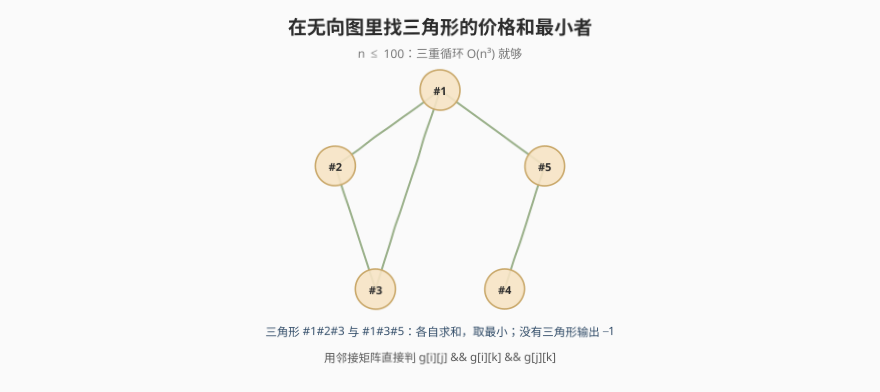
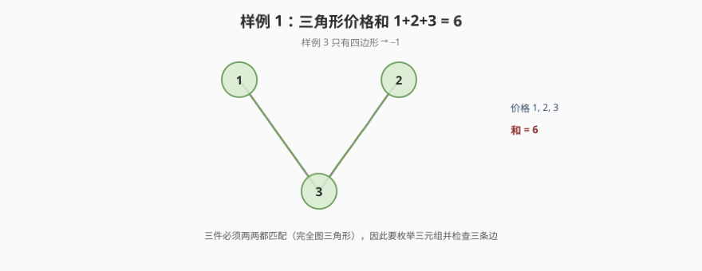

# Codeforces 102A 三件搭配最少花费 题解

## 1. 题目概述

- **题目链接**：https://codeforces.com/problemset/problem/102/A
- **比赛来源**：Codeforces Beta Round 79 (Div. 2 Only) · Problem A（UTC 2011-08-03）
- **难度**：1200
- **标签**：图论、枚举、完全图三角形
- **评测类型**：普通
- **限制**：时间 2 s / 内存 256 MB

**题意**：商店有 $n$ 件衣服，给出 $m$ 对"互相搭配"的衣服，每件衣服有价格 $a_i$。要买**三件两两都搭配**的衣服，求最小总价；不存在这样的三件则输出 `-1`。

**约束**：

- $1 \le n \le 100$，$0 \le m \le \frac{n(n-1)}{2}$：$O(n^3)$ 枚举所有三元组即可（$10^6$ 级）。
- 价格为 $10^6$ 以内的整数，三者之和 $\le 3\times10^6$，`int` 足够。
- 同一个无序对不会重复出现，$u_i\ne v_i$。
- 单组数据。

## 2. 示例与观察

官方样例一：

```text
输入：
3 3
1 2 3
1 2
2 3
3 1
输出：
6
```

官方样例二：

```text
输入：
3 2
2 3 4
2 3
2 1
输出：
-1
```

官方样例三：

```text
输入：
4 4
1 1 1 1
1 2
2 3
3 4
4 1
输出：
-1
```

**样例一走查**：三件衣服两两搭配（三角形），总价 $1+2+3=6$，且只有这一种选法。

**样例二走查**：$1$ 与 $3$ 不搭配，三件无法两两搭配 → `-1`。

**样例三走查**：图是一个四边形（$1-2-3-4-1$），任取三件都缺一条边 → `-1`。



**观察**："三件两两搭配"就是要求这三件在"搭配图"里构成一个三角形。所以答案是所有三角形中价格和的最小值。

## 3. 解题思路

### 3.1 朴素做法与瓶颈

枚举所有三元组 $i<j<k$，检查三条边是否都存在：$O(n^3)$。$n\le100$ 时约 $1.6\times10^5$ 个三元组，完全够用。

### 3.2 算法流程



1. 读入价格与 $m$ 条边，用邻接矩阵 `g[u][v]=true`（无向）；
2. 枚举 $1\le i<j<k\le n$，若 `g[i][j] && g[i][k] && g[j][k]`，用 $a_i+a_j+a_k$ 更新最小值；
3. 若没有任何三角形，输出 `-1`。

### 3.3 一点优化（不必要但好看）

也可以枚举边 $(u,v)$ 并检查共同邻居，$O(nm)$，在 $n=100$ 时更快；但三重循环的常数已经足够小，且更容易写对。

### 3.4 样例走查

| 样例 | 图结构 | 三角形 | 答案 |
|---|---|---|---|
| 1 | 三角形 | $\{1,2,3\}$ | $1+2+3=6$ |
| 2 | 路径 $1-2-3$ | 无 | `-1` |
| 3 | 四边形 | 无 | `-1` |

## 4. 正确性证明

**引理 1**：三件衣服两两搭配 ⟺ 对应三个顶点在搭配图中构成三角形。

**证明**：两两搭配就是三条边 $(i,j),(i,k),(j,k)$ 都存在，这正是三角形的定义。∎

**引理 2**：枚举所有 $i<j<k$ 不重不漏地覆盖了全部三元素子集。

**证明**：任何三元素子集都能唯一写成 $i<j<k$ 的形式，且三重循环恰好枚举所有这些有序化后的组合。∎

**定理**：算法输出的最小值就是所求最小花费（无解时 `-1`）。

**证明**：由引理 1、2，算法检查了所有可能的"三件两两搭配"并取价格和最小；若一个都没找到，说明题目要求的组合不存在，输出 `-1`。∎

## 5. 复杂度分析

- **时间**：$O(n^3)$，$n=100$ 时约 $1.6\times10^5$ 次检查。
- **空间**：邻接矩阵 $O(n^2)$。
- **数值范围**：价格和 $\le3\times10^6$，用 `int` 即可；用 `long long` 更稳。
- **与时限的关系**：2 s 下实测约 $2$ ms（C++），Python 约 $30$ ms。

## 6. 参考代码

### C++17

```cpp
#include <bits/stdc++.h>
using namespace std;

int main() {
    int n, m;
    if (scanf("%d %d", &n, &m) != 2) return 0;
    vector<long long> a(n + 1);
    for (int i = 1; i <= n; ++i) scanf("%lld", &a[i]);
    vector<vector<char>> g(n + 1, vector<char>(n + 1, 0));
    for (int i = 0; i < m; ++i) {
        int u, v;
        scanf("%d %d", &u, &v);
        g[u][v] = g[v][u] = 1;
    }
    long long best = LLONG_MAX;
    for (int i = 1; i <= n; ++i)
        for (int j = i + 1; j <= n; ++j) {
            if (!g[i][j]) continue;
            for (int k = j + 1; k <= n; ++k)
                if (g[i][k] && g[j][k]) best = min(best, a[i] + a[j] + a[k]);
        }
    if (best == LLONG_MAX) printf("-1\n");
    else printf("%lld\n", best);
    return 0;
}
```

### Python3

```python
import sys


def main() -> None:
    data = sys.stdin.buffer.read().split()
    if not data:
        return
    n = int(data[0]); m = int(data[1])
    p = 2
    a = [0] + [int(v) for v in data[p:p + n]]; p += n
    g = [[False] * (n + 1) for _ in range(n + 1)]
    for _ in range(m):
        u = int(data[p]); v = int(data[p + 1]); p += 2
        g[u][v] = g[v][u] = True
    best = None
    for i in range(1, n + 1):
        for j in range(i + 1, n + 1):
            if not g[i][j]:
                continue
            for k in range(j + 1, n + 1):
                if g[i][k] and g[j][k]:
                    s = a[i] + a[j] + a[k]
                    if best is None or s < best:
                        best = s
    print(-1 if best is None else best)


main()
```

## 7. 边界情况与易错点

1. **$n<3$**：不可能选出三件，直接 `-1`（三重循环自然不产生候选）。
2. **$m=0$**：没有任何搭配 → `-1`。
3. **无向边**：要同时设 `g[u][v]` 与 `g[v][u]`；只设一个方向会漏掉三角形。
4. **不重不漏**：用 $i<j<k$ 保证每个三元组只算一次；若写成三重全循环会重复但结果不变（只是更慢）。
5. **求最小值而非计数**：价格可能相同，直接用 `min` 更新。
6. **没有三角形时输出 `-1`**（不是 $0$，也不是最大值）。
7. **价格和**：三件各 $\le10^6$，和 $\le3\times10^6$，`int` 够用，但用 `long long` 更省心。
8. **输入规模**：$m$ 最大约 $4950$，用 `scanf` 读入即可。

## 8. 验证记录

- **编译环境与命令**：`clang++ -std=c++17 -O2`（Apple clang 21.0.0 + `codeforces/tools/include` 的兼容头），Python 3.9.6。
- **官方样例**：3 / 3 通过（`6`、`-1`、`-1`），C++ 与 Python 输出一致。
- **独立暴力对拍**：暴力用 `itertools.combinations` 枚举三元组并在边集（`set`）里查三条边，与邻接矩阵实现不同。对 $n\le8$、$m$ 取遍 $0\dots\binom n2$ 的 **320 组**随机数据比对，**全部一致**。
- **最大约束性能**：$n=100$、$m=4950$（完全图）时 C++ 端到端约 $2$ ms，Python 约 $30$ ms；相对 2 s 余量在数百倍以上。
- **图片校验**：`cf102a_triangles.svg`、`cf102a_sample.svg` 均通过 `xml.etree.ElementTree.parse`，含 `feTurbulence` 与手写体字体族，文本包围盒未越出 `viewBox`。
- **公式校验**：KaTeX（`throwOnError`）渲染无报错；无 `---` 分隔线。
- **复核状态**：verified（样例、对拍、性能、图片、公式均实跑通过）。

## 相关题目与扩展

- [Codeforces 102B Sum of Digits](https://codeforces.com/problemset/problem/102/B)：同场 B 题。
- [Codeforces 101A 最少保留的不同字母](https://codeforces.com/problemset/problem/101/A)、[101B Buses](https://codeforces.com/problemset/problem/101/B)、[101C Vectors](https://codeforces.com/problemset/problem/101/C)、[101D Castle](https://codeforces.com/problemset/problem/101/D)、[101E Candies and Stones](https://codeforces.com/problemset/problem/101/E)：同轮 Div.1 的题。
- [Codeforces 166E Tetrahedron](https://codeforces.com/problemset/problem/166/E)：图上的计数/枚举。
- [LeetCode 1761. 一个图中连通三元组的最小度数](https://leetcode.cn/problems/minimum-degree-of-a-connected-trio-in-a-graph/)：同样是枚举三角形。

**延伸思考**：

1. **如果要求"恰好三件且最大值最小"**：目标函数改成 $\max(a_i,a_j,a_k)$，枚举方式不变。
2. **如果 $n$ 放大到 $10^5$**：需要三角形枚举的快速算法（按度数定向 + 集合求交，$O(m^{3/2})$）。
3. **如果要求输出方案而不是价格**：枚举时记录三元组即可。
4. **如果搭配关系有传递性**（搭配是等价类）：三件两两搭配⟺三件在同一等价类，可以用并查集 + 每类取最便宜三件，$O(n\log n)$。

