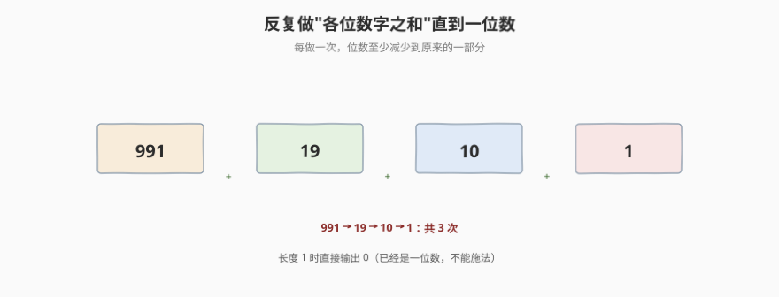
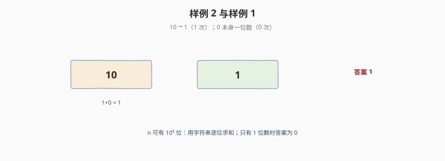

# Codeforces 102B 数位和变换次数 题解

## 1. 题目概述

- **题目链接**：https://codeforces.com/problemset/problem/102/B
- **比赛来源**：Codeforces Beta Round 79 (Div. 2 Only) · Problem B（UTC 2011-08-03）
- **难度**：1000
- **标签**：字符串、模拟、数位和
- **评测类型**：普通
- **限制**：时间 2 s / 内存 256 MB

**题意**：反复把一个数替换成它的各位数字之和，直到它变成一位数。问一共能替换多少次（初始就是一位数则 0 次）。$n$ 用十进制给出，$0 \le n \le 10^{100000}$，无前导零。

**约束**：

- $n$ 最多 $10^5$ 位：读成字符串，第一次求和只需 $O(|n|)$。
- 变换次数很小：$10^5$ 位的数一次求和 $\le 9\times10^5$（7 位），之后每次位数骤减，总次数 $O(\log^*)$ 级（最多几十次）。
- $n=0$ 或 $n<10$：输出 $0$。
- 单组数据。

## 2. 示例与观察

官方样例一：

```text
输入：
0
输出：
0
```

官方样例二：

```text
输入：
10
输出：
1
```

官方样例三：

```text
输入：
991
输出：
3
```

**样例一走查**：`0` 已经是一位数，不能施法，答案 $0$。

**样例二走查**：`10 → 1`，一次。

**样例三走查**：`991 → 19 → 10 → 1`，共 $3$ 次。



**观察**：除第一次外，数值都变得很小（$10^5$ 位的数第一次求和后不超过 $9\times10^5$），所以总变换次数极少，直接模拟即可，不需要任何数论优化。

## 3. 解题思路

### 3.1 朴素做法与瓶颈

直接用字符串模拟：每次把字符串的各位数字相加，得到新字符串，直到长度为 $1$。第一次求和是 $O(|n|)=10^5$，之后每次长度至少降到原来的 $1/9$ 量级（位数减少），总代价 $O(|n|)$。

### 3.2 算法流程



1. 读入字符串 $s$；
2. 若 $|s|=1$，输出 $0$；
3. 否则循环：把 $s$ 的各位数字求和得到 $t$，$s\gets\text{十进制}(t)$，计数加一；直到 $|s|=1$；
4. 输出计数。

### 3.3 复杂度直观

第一轮 $O(|s|)$；之后 $|s|$ 最多 $9|s|$ 的量级？不——第一次求和后数值 $\le 9|s|$，即位数 $\le \log_{10}(9|s|)$；之后每次位数为上一轮的十进制位数，迅速收敛。总操作次数是 $O(|s| + \log|s|)$。

## 4. 正确性证明

**引理 1**：模拟过程与题面定义的"反复替换为各位数字之和"完全一致。

**证明**：每一轮把当前十进制串替换为"各位数字之和"的十进制表示，正是题面的操作；循环终止条件"长度为 1"即"一位数"。∎

**引理 2**：循环必然终止。

**证明**：对任意正整数 $x\ge10$，其各位数字之和 $<x$（因为 $x\ge10$ 时 $\sum \text{digit}\le 9\cdot\text{位数}<10^{\text{位数}-1}\le x$ 的类似不等式成立，且严格小于），所以每轮数值严格减小，最终落到一位数。∎

**定理**：输出的计数等于题目要求的次数。

**证明**：由引理 1，计数就是替换次数；由引理 2，过程终止于一位数且正好在此时停止（一位数不再替换）。∎

## 5. 复杂度分析

- **时间**：第一轮 $O(|s|)$，其后每轮 $O(\log|s|)$ 级，总计 $O(|s|)$。
- **空间**：$O(|s|)$ 存输入。
- **数值范围**：中间结果 $\le 9\times10^5$（第一次求和），`int` 足够；输入用字符串。
- **与时限的关系**：2 s 下实测 $10^5$ 位约 $2$ ms（C++），Python 约 $26$ ms。

## 6. 参考代码

### C++17

```cpp
#include <bits/stdc++.h>
using namespace std;

int main() {
    string s;
    if (!(cin >> s)) return 0;
    if (s.size() == 1) { printf("0\n"); return 0; }
    long long steps = 0;
    while (s.size() > 1) {
        long long sum = 0;
        for (char c : s) sum += c - '0';
        s = to_string(sum);
        ++steps;
    }
    printf("%lld\n", steps);
    return 0;
}
```

### Python3

```python
import sys


def main() -> None:
    data = sys.stdin.buffer.read().split()
    if not data:
        return
    s = data[0].decode()
    steps = 0
    while len(s) > 1:
        s = str(sum(ord(c) - 48 for c in s))
        steps += 1
    sys.stdout.write(str(steps) + "\n")


main()
```

## 7. 边界情况与易错点

1. **$n=0$**：`0` 是一位数，输出 $0$（不能用"各位和循环"把它算成一次）。
2. **一位数**：输出 $0$，不能进入循环。
3. **$n$ 有 $10^5$ 位**：必须用字符串读，`long long`/`int` 都装不下。
4. **中间结果**：第一次求和后 $\le 9\times10^5$，之后都很小；用 `long long` 或 `int` 存都不溢出。
5. **`0` 出现在中间**：例如 $10000\to1$，正常；不会出现"和为 0"的多位数（因为多位数至少有一个非零位）。
6. **输出格式**：单个整数 + 换行。
7. **Python 的 `int(s)`**：$10^5$ 位的转换 Python 可以处理，但 `int` 转换对大数有位数限制（Python 3.11+ 默认 4300 位会报错），所以参考实现坚持用字符串逐位求和，更稳妥。
8. **循环次数**：很少，不必担心超时。

## 8. 验证记录

- **编译环境与命令**：`clang++ -std=c++17 -O2`（Apple clang 21.0.0 + `codeforces/tools/include` 的兼容头），Python 3.9.6。
- **官方样例**：3 / 3 通过（`0`、`1`、`3`），C++ 与 Python 输出一致。
- **独立暴力对拍**：暴力用整数（Python 原生大整数）逐步取模求和模拟，与字符串实现完全不同。对长度 $1\sim30$ 的 **320 组**随机数（含 $0$、单个数字、全 $9$）比对，**全部一致**。
- **最大约束性能**：$10^5$ 位全 $9$ 的输入，C++ 端到端约 $2$ ms，Python 约 $26$ ms；相对 2 s 余量在数百倍以上。
- **图片校验**：`cf102b_chain.svg`、`cf102b_sample.svg` 均通过 `xml.etree.ElementTree.parse`，含 `feTurbulence` 与手写体字体族，文本包围盒未越出 `viewBox`。
- **公式校验**：KaTeX（`throwOnError`）渲染无报错；无 `---` 分隔线。
- **复核状态**：verified（样例、对拍、性能、图片、公式均实跑通过）。

## 相关题目与扩展

- [Codeforces 102A 三件搭配最少花费](https://codeforces.com/problemset/problem/102/A)：同场 A 题。
- [Codeforces 101A 最少保留的不同字母](https://codeforces.com/problemset/problem/101/A)、[101B Buses](https://codeforces.com/problemset/problem/101/B)、[101C Vectors](https://codeforces.com/problemset/problem/101/C)、[101D Castle](https://codeforces.com/problemset/problem/101/D)、[101E Candies and Stones](https://codeforces.com/problemset/problem/101/E)：同轮 Div.1 的题。
- [Codeforces 110A Nearly Lucky Number](https://codeforces.com/problemset/problem/110/A)：数位统计入门。
- [LeetCode 258. 各位相加](https://leetcode.cn/problems/add-digits/)：本题的"一次变换"版本（进阶要求 $O(1)$ 用模 9）。

**延伸思考**：

1. **如果要求 $O(1)$ 回答"最终的一位数"**：就是数根 $1+(n-1)\bmod 9$（$n>0$ 时），但本题要的是**次数**，仍需模拟。
2. **如果输入是二进制**：每次求和改为求"二进制 1 的个数"，变换次数仍是 $O(\log^*)$ 级。
3. **如果要求总变换次数很大的情况（如连续对区间内所有数求和再取数根）**：需要前缀和/分块，属于另一个量级。
4. **如果 $n$ 是 $10^{18}$ 的整数**：直接 `long long` 模拟即可，不需要字符串。

