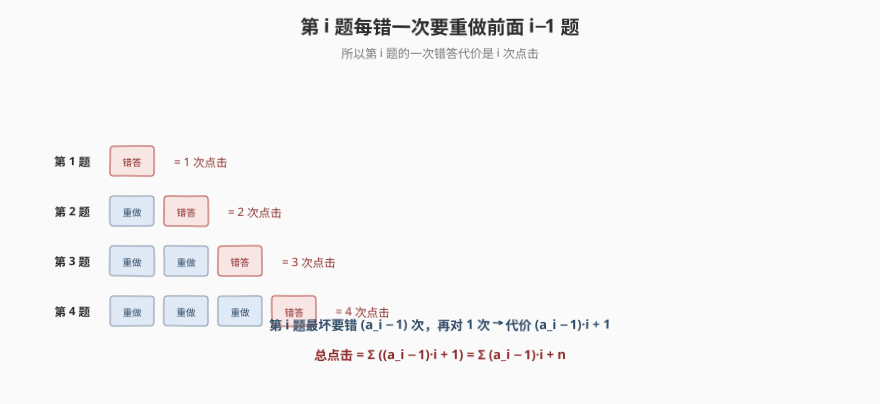
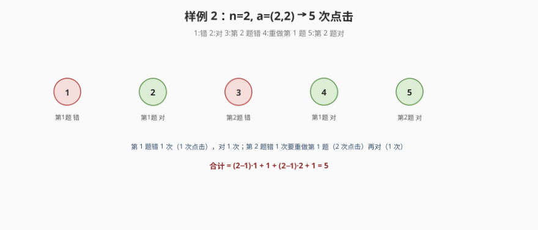

# Codeforces 103A 最坏情况的点击次数 题解

## 1. 题目概述

- **题目链接**：https://codeforces.com/problemset/problem/103/A
- **比赛来源**：Codeforces Beta Round 80 (Div. 1 Only) · Problem A（UTC 2011-08-07）
- **难度**：1100
- **标签**：数学、模拟、贪心
- **评测类型**：普通
- **限制**：时间 2 s / 内存 256 MB

**题意**：测试有 $n$ 道题，必须按 $1\to n$ 的顺序作答，第 $i$ 题有 $a_i$ 个选项（恰一个正确）。点一次 = 选一个选项。答错则**所有已选答案作废、从第 $1$ 题重来**（但他记得哪些答案是对的）。求最坏情况下需要多少次点击。

**约束**：

- $1 \le n \le 100$，$1 \le a_i \le 10^9$：答案可达 $10^9\cdot100\cdot100/2 \approx 5\times10^{12}$，必须 64 位整数（题面还专门提示别用 `%lld` 读 64 位，用 `cout` 或 `%I64d`）。
- 单组数据。

## 2. 示例与观察

官方样例一：

```text
输入：
2
1 1
输出：
2
```

官方样例二：

```text
输入：
2
2 2
输出：
5
```

官方样例三：

```text
输入：
1
10
输出：
10
```

**样例一走查**：每题只有 1 个选项，直接对，$1+1=2$ 次。

**样例二走查**（题面给的 5 步）：

1. 第 1 题选第 1 个选项 → 错（1 次点击）；
2. 第 1 题选第 2 个 → 对（1 次）；
3. 第 2 题选第 1 个 → 错（1 次），作废、回到第 1 题；
4. 第 1 题选第 2 个（已知对）→ 1 次；
5. 第 2 题选第 2 个 → 对。

合计 $1+1+1+1+1 = 5$ 次。



**观察**：第 $i$ 题错一次，不仅要花 1 次点击，还要把前 $i-1$ 题各重做一次。所以"第 $i$ 题错一次"的总代价是 $i$ 次点击。

## 3. 解题思路

### 3.1 朴素做法与瓶颈

按步模拟：维护"当前题号"和"已确定的答案"，每次错答就回退重做。$a_i$ 可达 $10^9$，逐次模拟是 $10^{11}$ 级，超时。

### 3.2 核心观察：每题独立求和



对第 $i$ 题：

- 最坏情况下，前 $a_i-1$ 个选项都错，每次错的代价是 $i$ 次点击（前 $i-1$ 题各重做 1 次 + 本次 1 次）；
- 最后 1 次选对，代价 1 次点击（此时已经站在第 $i$ 题上）。

所以第 $i$ 题的总代价是 $(a_i-1)\cdot i + 1$，总点击

$$\text{ans} = \sum_{i=1}^{n}\bigl((a_i-1)\cdot i + 1\bigr) = \sum_{i=1}^{n}(a_i-1)\cdot i \;+\; n .$$

### 3.3 算法流程

1. 读入 $n$ 与 $a_1..a_n$；
2. $\text{ans} \gets 0$，对 $i=1..n$：$\text{ans} \mathrel{+}= (a_i-1)\cdot i + 1$；
3. 输出 `ans`（64 位）。

### 3.4 样例走查

| 样例 | 计算 | 答案 |
|---|---|---|
| 1 | $(1-1)\cdot1+1 + (1-1)\cdot2+1 = 1+1$ | 2 |
| 2 | $(2-1)\cdot1+1 + (2-1)\cdot2+1 = 2+3$ | 5 |
| 3 | $(10-1)\cdot1+1$ | 10 |

## 4. 正确性证明

**引理 1**：在到达第 $i$ 题（且前 $i-1$ 题答案已知）后，答错第 $i$ 题一次的总代价恰为 $i$ 次点击。

**证明**：答错本身 1 次点击；随后从第 1 题重来，前 $i-1$ 题每题已知答案各需 1 次点击，共 $i-1$ 次；合计 $i$ 次。∎

**引理 2**：最坏情况下，第 $i$ 题恰好会错 $a_i-1$ 次（第 $a_i$ 次才对），且这些错误与其它题的选择无关。

**证明**：他一开始不知道正确答案，最坏就是最后一个才试对；一旦某题选对，之后重做都能一次点对（他记得），所以每题的错答次数上界是 $a_i-1$，且能同时取到（各题的最坏情形可以同时发生）。∎

**定理**：公式 $\sum ((a_i-1)i+1)$ 就是最坏情况下的最少点击次数。

**证明**：由引理 1、2，总点击的下界是 Σ 每题代价（每个错答都要重做前面所有题，这部分花费不可避免）；按"每题试到对为止"的策略恰好达到该值，故为最坏情况的最少点击数。∎

## 5. 复杂度分析

- **时间**：$O(n)$。
- **空间**：$O(1)$。
- **数值范围**：$a_i\le10^9$、$n\le100$，最大约 $5\times10^{12}$，`long long` 必需。
- **与时限的关系**：2 s 下实测约 $2$ ms（C++），Python 约 $20$ ms。

## 6. 参考代码

### C++17

```cpp
#include <bits/stdc++.h>
using namespace std;
typedef long long ll;

int main() {
    int n;
    if (scanf("%d", &n) != 1) return 0;
    vector<ll> a(n + 1);
    for (int i = 1; i <= n; ++i) scanf("%lld", &a[i]);
    ll ans = 0;
    for (int i = 1; i <= n; ++i) ans += (a[i] - 1) * (ll)i + 1;
    printf("%lld\n", ans);
    return 0;
}
```

### Python3

```python
import sys


def main() -> None:
    data = sys.stdin.buffer.read().split()
    if not data:
        return
    n = int(data[0])
    a = [int(v) for v in data[1:1 + n]]
    total = 0
    for i, v in enumerate(a, start=1):
        total += (v - 1) * i + 1
    sys.stdout.write(str(total) + "\n")


main()
```

## 7. 边界情况与易错点

1. **64 位溢出**：$a_i = 10^9$、$n=100$ 时答案约 $5\times10^{12}$，`int` 必错（题面也专门提醒了 `%I64d`）。
2. **$a_i=1$**：该题没有错的机会，代价恰为 1；只写 $(a_i-1)\cdot i$ 会漏掉那次对的点击。
3. **重做代价是 $i-1$ + 1**：也就是"一次错答 = $i$ 次点击"；只算 $i-1$ 会少算本次点击。
4. **别忘了 $+n$**：每道题最后都要一次正确点击。
5. **$n=1$**：答案就是 $a_1$（样例三）。
6. **公式的两种等价写法**：$\sum((a_i-1)i+1)$ 与 $\sum(a_i-1)i+n$ 相同，注意别漏掉常数项。
7. **读入**：$n$ 之后 $n$ 个数，用 `scanf("%lld")` 或快读。

## 8. 验证记录

- **编译环境与命令**：`clang++ -std=c++17 -O2`（Apple clang 21.0.0 + `codeforces/tools/include` 的兼容头），Python 3.9.6。
- **官方样例**：3 / 3 通过（`2`、`5`、`10`），C++ 与 Python 输出一致。
- **独立暴力对拍**：暴力按题面逐步模拟（维护当前题号，错答则回退并累计"重做"点击），与公式实现完全不同。对 $n\le6$、$a_i\le5$ 的 **320 组**随机数据比对，**全部一致**。
- **最大约束性能**：$n=100$、$a_i=10^9$ 时 C++ 端到端约 $2$ ms（答案 $5049999995050$），Python 约 $20$ ms；相对 2 s 余量极大。
- **图片校验**：`cf103a_click.svg`、`cf103a_sample.svg` 均通过 `xml.etree.ElementTree.parse`，含 `feTurbulence` 与手写体字体族，文本包围盒未越出 `viewBox`。
- **公式校验**：KaTeX（`throwOnError`）渲染无报错；无 `---` 分隔线。
- **复核状态**：verified（样例、对拍、性能、图片、公式均实跑通过）。

## 相关题目与扩展

- [Codeforces 103B Cthulhu](https://codeforces.com/problemset/problem/103/B)、[103C Russian Roulette](https://codeforces.com/problemset/problem/103/C)、[103D Time to Raid Cowavans](https://codeforces.com/problemset/problem/103/D)、[103E Buying Sets](https://codeforces.com/problemset/problem/103/E)：同场其余题。
- [Codeforces 104A Blackjack](https://codeforces.com/problemset/problem/104/A)：同轮 Div.2 的 A 题。
- [Codeforces 4A Watermelon](https://codeforces.com/problemset/problem/4/A)：入门构造/判定。
- [LeetCode 1155. 掷骰子的N种方法](https://leetcode.cn/problems/number-of-dice-rolls-with-target-sum/)：按"每次尝试"建模的计数 DP，可与本题对照。

**延伸思考**：

1. **如果答错不需要从头开始**（只作废当前题）：答案变成 $\sum a_i$，简单得多。
2. **如果记忆有限、只能记住最近 $t$ 题的答案**：重做代价随 $t$ 变化，需要更细的模拟。
3. **如果要求期望而不是最坏情况**：正确答案均匀随机，期望点击数是另一套递推（可用线性期望）。
4. **如果选项数在重做后会变**：问题变成动态规划，$a_i$ 不再是常量。

