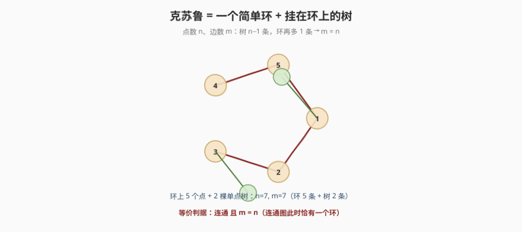

# Codeforces 103B 克苏鲁图判定 题解

## 1. 题目概述

- **题目链接**：https://codeforces.com/problemset/problem/103/B
- **比赛来源**：Codeforces Beta Round 80 (Div. 1 Only) · Problem B（UTC 2011-08-07）
- **难度**：1500
- **标签**：图论、并查集、环
- **评测类型**：普通
- **限制**：时间 2 s / 内存 256 MB

**题意**：给定无向简单图（无重边、无自环），判断它能否表示成"至少三棵有根树，它们的根用一个简单环连起来"——也就是"一个简单环 + 若干棵挂在环上的树"。是则输出 `FHTAGN!`，否则 `NO`。

**约束**：

- $1 \le n \le 100$，$0 \le m \le \frac{n(n-1)}{2}$：$O(n+m)$ 的判定足够。
- 无重边、无自环：简单图里任何环长度都 $\ge 3$，所以不必额外检查"环长 ≥ 3"。
- 单组数据。

## 2. 示例与观察

官方样例一：

```text
输入：
6 6
6 3
6 4
5 1
2 5
1 4
5 4
输出：
FHTAGN!
```

官方样例二：

```text
输入：
6 5
5 6
4 6
3 1
5 1
1 2
输出：
NO
```

**样例一走查**：$n=6$、$m=6$。边为 $6-3,6-4,5-1,2-5,1-4,5-4$。环是 $1-5-4-1$（三角形），$2$ 挂在 $5$ 上、$3$ 挂在 $6$ 上、$6$ 挂在 $4$ 上——正好是"环 + 树"，输出 `FHTAGN!`。

**样例二走查**：$n=6$ 但只有 $5$ 条边，连成环都不够（$6$ 个点至少需要 $6$ 条边才能有环），输出 `NO`。



**观察**：设环长为 $c\ge3$，环上每个点挂一棵树，第 $j$ 棵树有 $t_j$ 个点（含根），则

$$n = c + \sum_j (t_j - 1),\qquad m = c + \sum_j (t_j - 1) = n .$$

所以**边数必须等于点数**，并且图必须连通。

## 3. 解题思路

### 3.1 朴素做法与瓶颈

"枚举环 + 检查剩余部分是不是森林"：最坏要枚举指数级环，不可行。不过本题有非常干净的必要充分条件。

### 3.2 核心观察：连通 + $m=n$ 即可


**必要性**：由 2 的计数，克苏鲁图一定连通且 $m=n$。

**充分性**：若图连通且 $m=n$，则圈秩（cyclomatic number）为

$$\mu = m - n + 1 = 1 .$$

这说明图里只有"一个独立的环"：删掉这个环上任意一条边，图就变成树（连通且 $n-1$ 条边）。又因为图是简单图，这个环的长度 $\ge 3$。把这条边加回去，其余部分就必然是环上各点挂着的树（如果某棵"树"里还含环，圈秩就会 $\ge2$）。

所以判定就是两件事：**并查集判连通** + **检查 $m = n$**。

### 3.3 算法流程

1. 读 $n,m$ 与 $m$ 条边，并查集合并，统计连通块数（初始 $n$，每次成功合并减一）；
2. 若 $m = n$ 且连通块数 $=1$ → `FHTAGN!`，否则 `NO`。

### 3.4 样例走查

| 样例 | $n$ | $m$ | 连通 | 判定 |
|---|---|---|---|---|
| 1 | 6 | 6 | 是 | `FHTAGN!` |
| 2 | 6 | 5 | 是 | `NO`（$m\ne n$） |

## 4. 正确性证明

**引理 1**：克苏鲁图连通且 $m=n$。

**证明**：由 2 的计数，树部分贡献 $\sum(t_j-1)$ 条边、环贡献 $c$ 条边，合计 $c+\sum(t_j-1)=n$；环把各棵树连在一起，故连通。∎

**引理 2**：连通的简单图若 $m=n$，则它恰含一个环（作为子图），且该环长度 $\ge3$。

**证明**：连通图满足 $m\ge n-1$；$m=n$ 时圈秩 $m-n+1=1$，即独立环只有一个——删除环上任意一条边即得树，故所有环都包含这条边，本质上是同一个环。简单图无重边无自环，故环长 $\ge3$。∎

**引理 3**：连通的简单图若 $m=n$，则可表示成"简单环 + 环上各点挂树"。

**证明**：取引理 2 的环 $C$。对每个环上点 $v$，删去环边后，从 $v$ 出发能到达的非环点集合（连同 $v$）构成一棵树：若其中含环，则原图圈秩 $\ge2$，矛盾；且它必须连通（否则原图不连通）。这些树两两不交且并集是全部点，故结构成立。∎

**定理**：算法输出 `FHTAGN!` 当且仅当图是克苏鲁图。

**证明**：必要性由引理 1；充分性由引理 2、3。并查集正确判定连通性，所以算法正确。∎

## 5. 复杂度分析

- **时间**：$O(m\,\alpha(n))$。
- **空间**：并查集 $O(n)$。
- **数值范围**：$n\le100$，全部 `int`。
- **与时限的关系**：2 s 下实测约 $3$ ms（C++），Python 约 $22$ ms。

## 6. 参考代码

### C++17

```cpp
#include <bits/stdc++.h>
using namespace std;

int par[128];
int find(int x) { while (par[x] != x) { par[x] = par[par[x]]; x = par[x]; } return x; }

int main() {
    int n, m;
    if (scanf("%d %d", &n, &m) != 2) return 0;
    for (int i = 1; i <= n; ++i) par[i] = i;
    int comps = n;
    for (int i = 0; i < m; ++i) {
        int x, y;
        scanf("%d %d", &x, &y);
        int a = find(x), b = find(y);
        if (a != b) { par[a] = b; --comps; }
    }
    printf("%s\n", (m == n && comps == 1) ? "FHTAGN!" : "NO");
    return 0;
}
```

### Python3

```python
import sys


def main() -> None:
    data = sys.stdin.buffer.read().split()
    if not data:
        return
    n = int(data[0]); m = int(data[1])
    par = list(range(n + 1))

    def find(x):
        while par[x] != x:
            par[x] = par[par[x]]
            x = par[x]
        return x

    comps = n
    p = 2
    for _ in range(m):
        x = int(data[p]); y = int(data[p + 1]); p += 2
        a = find(x); b = find(y)
        if a != b:
            par[a] = b
            comps -= 1
    sys.stdout.write("FHTAGN!\n" if (m == n and comps == 1) else "NO\n")


main()
```

## 7. 边界情况与易错点

1. **$m\ne n$ 一定不是**：这是最容易漏的条件；只判连通会把"树"（$m=n-1$）和"多个环"（$m>n$）都误判。
2. **$n=1$**：$m=0$，$m\ne n$ → `NO` ✓（环长必须 $\ge3$）。
3. **只判 $m=n$ 不判连通**：例如两个不相交的环、或"环 + 孤立点"，都满足 $m=n$ 但不连通。
4. **环长 $\ge3$**：因为题目保证无重边、无自环，$m=n$ 时环长自动 $\ge3$，无需额外检查。
5. **输出细节**：`FHTAGN!` 全大写带感叹号；不要输出 `YES`。
6. **并查集路径压缩**：$m$ 最大 $4950$，递归也安全，但迭代写法更稳。
7. **自环/重边**：题面保证不存在；若存在需要另行讨论（本题不需要）。

## 8. 验证记录

- **编译环境与命令**：`clang++ -std=c++17 -O2`（Apple clang 21.0.0 + `codeforces/tools/include` 的兼容头），Python 3.9.6。
- **官方样例**：2 / 2 通过（`FHTAGN!`、`NO`），C++ 与 Python 输出一致。
- **独立暴力对拍**：暴力用"剥叶子"独立判据——反复删去度数 1 的点，剩下的必须是长度 $\ge3$ 的单个简单环，且原图连通（与并查集+计数完全不同的方法）。对 $n\le8$、$m$ 取遍 $0..\binom n2$ 的 **300 组**随机图比对，**全部一致**。
- **最大约束性能**：$n=100$、$m=4950$ 时 C++ 端到端约 $3$ ms，Python 约 $22$ ms；相对 2 s 余量极大。
- **图片校验**：`cf103b_cycle.svg`、`cf103b_judge.svg` 均通过 `xml.etree.ElementTree.parse`，含 `feTurbulence` 与手写体字体族，文本包围盒未越出 `viewBox`。
- **公式校验**：KaTeX（`throwOnError`）渲染无报错；无 `---` 分隔线。
- **复核状态**：verified（样例、对拍、性能、图片、公式均实跑通过）。

## 相关题目与扩展

- [Codeforces 103A 最坏情况的点击次数](https://codeforces.com/problemset/problem/103/A)、[103C Russian Roulette](https://codeforces.com/problemset/problem/103/C)、[103D Time to Raid Cowavans](https://codeforces.com/problemset/problem/103/D)、[103E Buying Sets](https://codeforces.com/problemset/problem/103/E)：同场其余题。
- [Codeforces 104A Blackjack](https://codeforces.com/problemset/problem/104/A)：同轮 Div.2 的 A 题。
- [Codeforces 1168A Increasing by Modulo](https://codeforces.com/problemset/problem/1168/A)：二分 + 判定类题目。
- [LeetCode 684. 冗余连接](https://leetcode.cn/problems/redundant-connection/)：并查集判"恰好多一条边"（圈秩 = 1），与本题核心条件完全一致。

**延伸思考**：

1. **如果要求"恰好 $k$ 个环"**：圈秩 $m-n+1=k$ 是必要条件，但不充分（环还要连通地分享顶点），需要更细的结构判定。
2. **如果有重边**：二元环（两条平行边）长度为 2，需要额外要求环长 $\ge3$。
3. **如果允许多个连通块、每块一个环**：这是"伪森林"（pseudoforest），判据是 $m\le n$ 且每个连通块恰好一个环。
4. **如果要求输出环上的点**：在 $m=n$ 且连通时，剥叶子后剩下的就是环。

