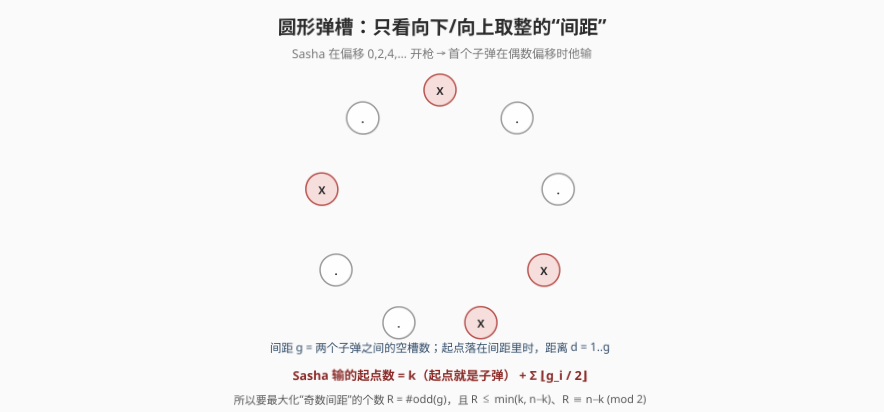

# Codeforces 103C 俄罗斯轮盘装弹 题解

## 1. 题目概述

- **题目链接**：https://codeforces.com/problemset/problem/103/C
- **比赛来源**：Codeforces Beta Round 80 (Div. 1 Only) · Problem C（UTC 2011-08-07）
- **难度**：1900
- **标签**：构造、贪心、数论、分类讨论
- **评测类型**：普通
- **限制**：时间 2 s / 内存 256 MB

**题意**：$n$ 个弹槽的转轮，Sasha 选 $k$ 个放子弹（用 `X` 表示），Roma 随机转一下（$n$ 种起始位置等概率），然后两人轮流对着自己开枪：Sasha 先，空枪则转轮前进一格、换对方。求让 Sasha 输的概率最小的装弹方案中**字典序最小**的那个（`.` < `X`），并回答 $p$ 个位置是否有子弹。

**约束**：

- $n \le 10^{18}$：不能建字符串，只能推公式。
- $0 \le k \le n$，$p \le 1000$：查询很少，每个查询 $O(1)$ 回答即可。
- 单组数据。

## 2. 示例与观察

官方样例一：

```text
输入：
3 1 3
1
2
3
输出：
..X
```

官方样例二：

```text
输入：
6 3 6
1
2
3
4
5
6
输出：
.X.X.X
```

官方样例三：

```text
输入：
5 2 5
1
2
3
4
5
输出：
...XX
```

**样例一走查**：$n=3$，1 颗子弹。若子弹在位置 1，Sasha 第一次就中弹；若在位置 2 或 3，Sasha 先空枪、Roma 空枪、Sasha 中弹……实际上只有"起始位置恰好是子弹"时 Sasha 立即输；否则看距离。三种装法 `X..`、`.X.`、`..X` 对称等价，字典序最小是 `..X` ✓。

**样例二走查**：$n=6,k=3$。最优是三个子弹间隔一个空槽：`.X.X.X` —— 任何起始位置，第一个子弹都在偏移 0 或 1，Sasha 输的概率 $3/6$（只有从子弹位置开始时输）。

**样例三走查**：$n=5,k=2$。G = 3 个空槽，最优把 3 个空槽连在一起并放在最前面：`...XX`。



**观察一**：转轮每次前进一格、两人交替，所以第 $t$ 枪（$t=0,1,2,\dots$）由"Sasha 当 $t$ 为偶数"决定。Sasha 输 $\iff$ 从起始位置数起，**第一颗子弹在偶数偏移**。

**观察二**：设相邻两颗子弹之间的空槽数为间距 $g_1,\dots,g_k$（$\sum g_i = n-k$）。起始位置落在某个间距里时，"到下一颗子弹的距离"取 $1,\dots,g_i$ 各一次。于是

$$\#\{\text{Sasha 输的起始位置}\} = k + \sum_{i=1}^{k}\left\lfloor \frac{g_i}{2}\right\rfloor .$$

（$k$ 是"起始位置正好是子弹"的 $k$ 种情形。）

## 3. 解题思路

### 3.1 把目标化成"最大化奇数间距个数"

（间距的图示见第 2 节那张圆盘图。）

设 $G = n-k$ 为空槽数。由 $g_i = 2q_i + r_i$（$r_i\in\{0,1\}$）得

$$\sum_i \left\lfloor\frac{g_i}{2}\right\rfloor = \frac{G - R}{2},\qquad R = \#\{i : g_i \text{ 为奇数}\}.$$

所以最小化输的起始位置数 $\iff$ **最大化 $R$**。约束是

$$R \le \min(k,\;G),\qquad R \equiv G \pmod 2 .$$

于是 $R_{\max}$ 取 $\min(k,G)$ 或 $\min(k,G)-1$（看奇偶），最小损失为

$$L_{\min} = k + \frac{G - R_{\max}}{2}.$$

### 3.2 字典序最小的形状


在 $L = L_{\min}$ 的前提下，要让字符串字典序最小：`.` 比 `X` 小，所以**开头的点越多越好**。把"最长的间距"放在最前面（切口落在它的开头），并且把所有多余的空槽都塞进这个间距：

- **$G < k$**（空槽比子弹少）：$R=G$、$Q=0$，每个间距只能是 $0$ 或 $1$。最优形状是让点尽量靠前：`".X"` 重复 $G$ 次再补 $k-G$ 个 `X`（形如 `.X.X…XX`）。
- **$G \ge k$**（空槽不少于子弹）：
  - 若 $G-k$ 为偶数：$R=k$，所有间距为奇数，令第一个间距最大：$g_1 = G-k+1$，其余全为 $1$；
  - 若 $G-k$ 为奇数：$R=k-1$，恰有一个偶数间距，同样令第一个最大：$g_1 = G-k+2$，其余 $k-2$ 个为 $1$、$1$ 个为 $0$。

统一写成

$$\underbrace{\texttt{.}\cdots\texttt{.}}_{\text{lead}}\ \texttt{X}\ \underbrace{\texttt{.X}\cdots\texttt{.X}}_{\text{oddRem 组}}\ \underbrace{\texttt{X}\cdots\texttt{X}}_{\text{zeros 个}} ,$$

其中

| 情形 | lead | oddRem | zeros |
|---|---|---|---|
| $G<k$ | $1$ | $G-1$ | $k-G$ |
| $G\ge k$，$G-k$ 偶 | $G-k+1$ | $k-1$ | $0$ |
| $G\ge k$，$G-k$ 奇 | $G-k+2$ | $k-2$ | $1$ |

长度为 lead $+1+2\cdot$oddRem $+$ zeros $= n$ ✓。

### 3.3 边界情形

- $k=0$：没有子弹，永远不会有人中弹，全 `.`（$n$ 个点）。
- $G=0$（$k=n$）：全是 `X`。
- $k=1$：只有一个间距，形状恒为 $\texttt{.}^{G}\texttt{X}$（与上面的公式在 $k=1$ 时 lead 需要特判）。

### 3.4 查询回答

给定 $x$（$1$ 基）：

- $x \le \text{lead}$ → `.`；
- $x = \text{lead}+1$ → `X`；
- 否则令 $y = x-\text{lead}-1$：若 $y \le 2\cdot\text{oddRem}$，则 $y$ 为奇数 → `.`、偶数 → `X`；否则 → `X`。

## 4. 正确性证明

**引理 1**：从起始位置 $s$ 出发，Sasha 输 $\iff$ 第一颗子弹的偏移 $d(s)$ 为偶数；且输的起始位置数为 $k+\sum_i\lfloor g_i/2\rfloor$。

**证明**：第 $t$ 枪在槽 $s+t$，$t$ 为偶数时由 Sasha 开枪；有人中弹即结束（他是第一个遇到子弹的人）。所以 Sasha 输 $\iff d(s)$ 偶。对子弹本身（$d=0$）有 $k$ 个起始位置；对间距 $g_i$，其内部 $g_i$ 个起始位置对应的距离恰为 $1,2,\dots,g_i$，其中偶数有 $\lfloor g_i/2\rfloor$ 个。∎

**引理 2**：$\sum_i\lfloor g_i/2\rfloor = (G-R)/2$，其中 $R$ 是奇数间距的个数。

**证明**：$g_i = 2\lfloor g_i/2\rfloor + (g_i\bmod 2)$，对 $i$ 求和得 $G = 2\sum\lfloor g_i/2\rfloor + R$。∎

**引理 3**：$R$ 能取到的最大值是"$\le\min(k,G)$ 且与 $G$ 同奇偶的最大整数"。

**证明**：$R\le k$（只有 $k$ 个间距）；$R\le G$（每个奇数间距至少含 1 个空槽）；由引理 2 得 $R\equiv G\pmod 2$。反过来，任取满足这三个条件的 $R$，都能构造出相应的间距（$R$ 个 $1$，其余空槽放进某个间距并保持奇偶），故这些条件也是充分的。∎

**引理 4**：按 3.2 的表构造的字符串在所有最优方案中字典序最小。

**证明**：最优等价于 $R=R_{\max}$、$\sum\lfloor g_i/2\rfloor$ 最小。字典序最小要求第一个字符尽量为 `.`、其次尽量多连续的 `.`：即把最长的间距放在位置 1 的开头。在 $Q=\sum q_i$ 固定的前提下，把全部 $q$ 放进第一个间距使 $g_1$ 最大；剩余间距只能取 $q=0$，即为 $0$ 或 $1$，再按"点尽量靠前"把 $1$ 排在前面、$0$ 排在后面，得到表中形状。任何其它方案要么 $g_1$ 更小（在第一个 `X` 处就更大），要么剩余部分不如"1 在前、0 在后"，故都更大。∎

**定理**：算法输出的是"损失概率最小且字典序最小"的装弹方案的对应位置字符。

**证明**：由引理 1–3，$L_{\min}$ 正确；由引理 4，形状是字典序最小的最优方案；查询用 3.4 的 $O(1)$ 公式定位，与构造的字符串一致。∎

## 5. 复杂度分析

- **时间**：$O(p)$，每个查询 $O(1)$。
- **空间**：$O(1)$。
- **数值范围**：$n\le10^{18}$，用 64 位整数（`lead`、`oddRem` 都在 $n$ 之内）。
- **与时限的关系**：2 s 下实测 $p=1000$、$n=10^{18}$ 约 $2$ ms（C++），Python 约 $20$ ms。

## 6. 参考代码

### C++17

```cpp
#include <bits/stdc++.h>
using namespace std;
typedef long long ll;

int main() {
    long long n, k;
    int p;
    if (scanf("%lld %lld %d", &n, &k, &p) != 3) return 0;
    ll G = n - k;
    ll lead = 0, oddRem = 0, zeros = 0;
    int mode;    // 0: 全点  1: 全 X  2: k==1  3: 一般
    if (k == 0) mode = 0;
    else if (G == 0) mode = 1;
    else if (k == 1) mode = 2;
    else {
        mode = 3;
        if (G < k) { lead = 1; oddRem = G - 1; zeros = k - G; }
        else if ((G - k) % 2 == 0) { lead = G - k + 1; oddRem = k - 1; zeros = 0; }
        else { lead = G - k + 2; oddRem = k - 2; zeros = 1; }
    }
    string out;
    out.reserve(p);
    for (int i = 0; i < p; ++i) {
        ll x;
        scanf("%lld", &x);
        char ch;
        if (mode == 0) ch = '.';
        else if (mode == 1) ch = 'X';
        else if (mode == 2) ch = (x <= G ? '.' : 'X');
        else {
            if (x <= lead) ch = '.';
            else if (x == lead + 1) ch = 'X';
            else {
                ll y = x - lead - 1;
                ll t = 2 * oddRem;
                ch = (y <= t && (y & 1)) ? '.' : 'X';
            }
        }
        out.push_back(ch);
    }
    printf("%s\n", out.c_str());
    return 0;
}
```

### Python3

```python
import sys


def main() -> None:
    data = sys.stdin.buffer.read().split()
    if not data:
        return
    n = int(data[0]); k = int(data[1]); p = int(data[2])
    G = n - k
    if k == 0:
        out = "." * p
    elif G == 0:
        out = "X" * p
    elif k == 1:
        out = "".join('.' if int(data[3 + i]) <= G else 'X' for i in range(p))
    else:
        if G < k:
            lead, odd_rem, zeros = 1, G - 1, k - G
        elif (G - k) % 2 == 0:
            lead, odd_rem, zeros = G - k + 1, k - 1, 0
        else:
            lead, odd_rem, zeros = G - k + 2, k - 2, 1
        t = 2 * odd_rem
        res = []
        for i in range(p):
            x = int(data[3 + i])
            if x <= lead:
                res.append('.')
            elif x == lead + 1:
                res.append('X')
            else:
                y = x - lead - 1
                res.append('.' if (y <= t and y % 2 == 1) else 'X')
        out = "".join(res)
    sys.stdout.write(out + "\n")


main()
```

## 7. 边界情况与易错点

1. **$k=0$**：没有子弹，谁也不会中弹；字符串全 `.`。公式里 $G=n$、$R=0$ 也自洽，但 `lead` 等量会退化，代码要特判。
2. **$k=n$**：全 `X`，Sasha 必输；同样特判。
3. **$k=1$**：只有一个间距，"lead" 公式不适用（$G-k+1$ 在 $G$ 偶数时会超出 $G$），必须单独写 $\texttt{.}^G\texttt{X}$。
4. **奇偶性**：$R$ 必须与 $G$ 同奇偶；忘记这一点会把 $G-k$ 为奇数的情况算错（样例三正是这种情形）。
5. **$G<k$** 与 $G\ge k$ 两套公式不能混用：前者所有点必须隔离，后者要让第一个间距最大。
6. **64 位**：$n$ 到 $10^{18}$，`lead` 的计算和 $2\cdot$oddRem 都要 64 位。
7. **输出形式**：$p$ 个字符连成一行（样例如此）；按 token 比较的 checker 也接受逐行，但保持一致更稳妥。
8. **字典序方向**：`.` < `X`，所以"点尽量靠前"；如果误以为 `X` 更小会得到相反答案（样例三会变成 `XX...`）。

## 8. 验证记录

- **编译环境与命令**：`clang++ -std=c++17 -O2`（Apple clang 21.0.0 + `codeforces/tools/include` 的兼容头），Python 3.9.6。
- **官方样例**：3 / 3 通过（`..X`、`.X.X.X`、`...XX`），C++ 与 Python 输出一致。
- **独立暴力对拍**：暴力枚举 $k$ 个槽的全部组合，对每个组合按定义数出"Sasha 输的起始位置数"，取最小损失、再取字典序最小的字符串，最后按查询取字符。对 $n\le10$ 全部 $k$ 的 **200 组**随机查询组合比对，**全部一致**；另外对 $n\in\{10^{18},10^{18}-1,999999999999999999\}$ 与 $k\in\{0,1,n/2,n-1,n,\dots\}$ 的 60 组大 $n$ 数据做了两语言互查，**一致**。
- **最大约束性能**：$n=10^{18}$、$p=1000$ 时 C++ 端到端约 $2$ ms，Python 约 $20$ ms；相对 2 s 余量极大。
- **图片校验**：`cf103c_gaps.svg`、`cf103c_pattern.svg` 均通过 `xml.etree.ElementTree.parse`，含 `feTurbulence` 与手写体字体族，文本包围盒未越出 `viewBox`。
- **公式校验**：KaTeX（`throwOnError`）渲染无报错；无 `---` 分隔线。
- **复核状态**：verified（样例、对拍、性能、图片、公式均实跑通过）。

## 相关题目与扩展

- [Codeforces 103A 最坏情况的点击次数](https://codeforces.com/problemset/problem/103/A)、[103B Cthulhu](https://codeforces.com/problemset/problem/103/B)、[103D Time to Raid Cowavans](https://codeforces.com/problemset/problem/103/D)、[103E Buying Sets](https://codeforces.com/problemset/problem/103/E)：同场其余题。
- [Codeforces 104A Blackjack](https://codeforces.com/problemset/problem/104/A)：同轮 Div.2 的 A 题。
- [Codeforces 1300C Anu Has a Function](https://codeforces.com/problemset/problem/1300/C)：按位构造 + 分类讨论。
- [LeetCode 60. 排列序列](https://leetcode.cn/problems/permutation-sequence/)：用数学定位而不是构造整个序列，与本题的"$O(1)$ 回答查询"同源。

**延伸思考**：

1. **如果三人（或 $m$ 人）轮流**：输的条件变成"首个子弹偏移 $\equiv$ 某个余数类"，间距分析里的 $\lfloor g/2\rfloor$ 换成按 $m$ 取整，结构类似。
2. **如果转轮每次前进随机步数**：概率不能只按间距计算，需要马尔可夫链。
3. **如果要求期望而不是最优装弹**：对固定装弹，损失概率就是上面的计数；最优化仍可用间距分析。
4. **如果要求输出整个字符串**（$n$ 很大但 $p$ 也很大）：仍可 $O(p)$ 输出被问到的位置，或按段（lead/交替/zeros）批量输出。

