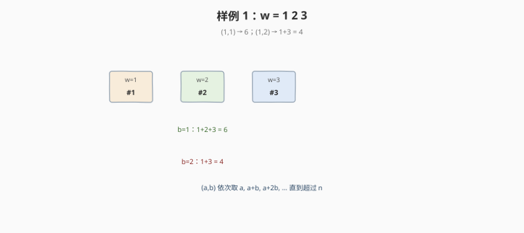
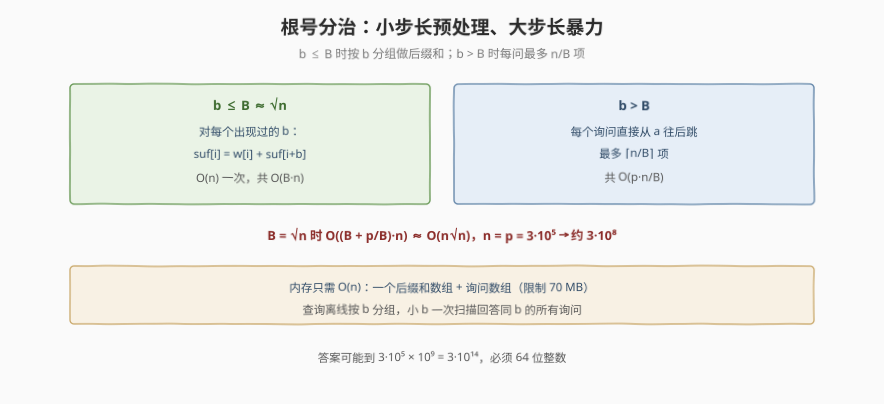

# Codeforces 103D 奶牛劫掠查询 题解

## 1. 题目概述

- **题目链接**：https://codeforces.com/problemset/problem/103/D
- **比赛来源**：Codeforces Beta Round 80 (Div. 1 Only) · Problem D（UTC 2011-08-07）
- **难度**：2100
- **标签**：根号分治（sqrt decomposition）、离线处理、前缀和
- **评测类型**：普通
- **限制**：时间 4 s / 内存 70 MB

**题意**：$n$ 头奶牛排成一排，第 $i$ 头重 $w_i$。有 $p$ 个独立的"$(a,b)$-劫掠"场景：依次劫走第 $a$、$a+b$、$a+2b$、……直到超过 $n$。对每个场景求被劫走奶牛的总重量。

**约束**：

- $n \le 3\times10^5$，$p \le 3\times10^5$：$O(np)$ 是 $9\times10^{10}$，必须根号分治。
- $w_i \le 10^9$：答案可达 $3\times10^{14}$，必须 64 位整数。
- 内存限制只有 **70 MB**：不能开 $O(n\sqrt n)$ 的二维表，只能 $O(n)$。
- 单组数据。

## 2. 示例与观察

官方样例一：

```text
输入：
3
1 2 3
2
1 1
1 2
输出：
6
4
```

官方样例二：

```text
输入：
4
2 3 5 7
3
1 3
2 3
2 2
输出：
9
3
10
```

**样例一走查**：$w=[1,2,3]$。

- $(1,1)$：$1+2+3=6$；
- $(1,2)$：$1+3=4$。

**样例二走查**：$w=[2,3,5,7]$。

- $(1,3)$：$2+7=9$；
- $(2,3)$：$3$；
- $(2,2)$：$3+7=10$。



**观察**：单个询问的代价是 $\lceil (n-a+1)/b\rceil$。$b$ 大时很快，$b$ 小时很慢——这正是根号分治的典型形状。

## 3. 解题思路

### 3.1 朴素做法与瓶颈

逐询问累加：最坏 $p\cdot n = 9\times10^{10}$，超时。

### 3.2 核心观察：按步长分大小



取阈值 $B\approx\sqrt n$。

- **$b \le B$（小步长）**：这样的 $b$ 只有 $B$ 种。把询问按 $b$ 分组，对每个**实际出现过**的 $b$ 预处理后缀和

$$suf[i] = w_i + suf[i+b],$$

一次 $O(n)$，回答该组所有询问只需 $O(1)$ 查表。总代价 $O(B\cdot n)$。

- **$b > B$（大步长）**：每个询问最多 $\lceil n/B\rceil$ 项，直接累加。总代价 $O(p\cdot n/B)$。

两半合起来 $O\bigl(nB + \frac{pn}{B}\bigr)$，取 $B=\sqrt p$ 或 $\sqrt n$ 即可平衡。$n=p=3\times10^5$ 时约 $3\times10^8$ 次简单加法，4 s 足够。

### 3.3 内存

只用一个长度为 $n+1$ 的后缀和数组（每次换 $b$ 时覆盖），加上询问数组，共 $O(n+p)$，约 $5$ MB，远低于 70 MB。

### 3.4 算法流程

1. 读入 $n$、$w$、$p$ 与所有询问 $(a_i,b_i)$；
2. $B = \lfloor\sqrt n\rfloor+1$；把 $b_i\le B$ 的询问下标按 $b_i$ 分组；
3. 对每个 $b\le B$（有询问的）：从 $i=n$ 递减算 $suf[i]=w_i+(i+b\le n?suf[i+b]:0)$，再回答该组所有询问；
4. 对 $b>B$ 的询问逐个直接累加；
5. 按原顺序输出答案。

### 3.5 样例走查

样例二：$n=4$，$B=\lfloor2\rfloor+1=3$。

- $(1,3)$：$b=3\le B$ → 后缀和 $suf[1]=w_1+w_4=2+7=9$ ✓；
- $(2,3)$：同组，$suf[2]=w_2=3$ ✓；
- $(2,2)$：$suf[2]=w_2+w_4=3+7=10$ ✓。

## 4. 正确性证明

**引理 1**：对固定的 $b$，后缀和递推 $suf[i]=w_i+suf[i+b]$（越界为 0）满足 $suf[i]=\sum_{t\ge0} w_{i+tb}$。

**证明**：对 $i$ 从 $n$ 递减归纳，展开递推即得。∎

**引理 2**：询问 $(a,b)$ 的答案等于 $suf[a]$（当 $b\le B$ 且该 $b$ 已被预处理）或直接累加的结果。

**证明**：由引理 1，$suf[a]$ 正是 $a,a+b,a+2b,\dots\le n$ 的和，与场景定义一致。∎

**定理**：算法对所有询问给出正确答案，且复杂度为 $O\bigl(nB+pn/B+p\bigr)$。

**证明**：正确性由引理 1、2；复杂度：小步长部分每个用到的 $b$ 做一次 $O(n)$、共 $\le B$ 个；大步长部分每问 $\le n/B$ 项（$b>B$ 时 \(a+tb\le n\) 的解个数不超过 $\lceil n/B\rceil$）。∎

## 5. 复杂度分析

- **时间**：$O(nB + pn/B)$，$B\approx\sqrt n$ 时约 $3\times10^8$ 次加法；实测 $159$ ms（C++）。
- **空间**：$O(n+p)$，约 $5$ MB。
- **数值范围**：$\sum w_i \le 3\times10^{14}$，`long long` 必需。
- **与时限的关系**：4 s 下实测 $n=p=3\times10^5$ 约 $159$ ms（C++）；Python 在同规模下约需数秒（见 §8），建议提交 C++。

## 6. 参考代码

### C++17

```cpp
#include <bits/stdc++.h>
using namespace std;
typedef long long ll;

int main() {
    int n;
    if (scanf("%d", &n) != 1) return 0;
    vector<ll> w(n + 1);
    for (int i = 1; i <= n; ++i) scanf("%lld", &w[i]);
    int p;
    if (scanf("%d", &p) != 1) return 0;
    vector<int> qa(p), qb(p);
    for (int i = 0; i < p; ++i) scanf("%d %d", &qa[i], &qb[i]);
    vector<ll> ans(p, 0);
    int B = (int)sqrt((double)n) + 1;
    // 小 b：按 b 分组，预处理后缀和
    vector<vector<int>> groups(B + 1);
    for (int i = 0; i < p; ++i) if (qb[i] <= B) groups[qb[i]].push_back(i);
    vector<ll> suf(n + 1, 0);
    for (int b = 1; b <= B; ++b) {
        if (groups[b].empty()) continue;
        for (int i = n; i >= 1; --i) {
            suf[i] = w[i] + (i + b <= n ? suf[i + b] : 0);
        }
        for (int qi : groups[b]) ans[qi] = suf[qa[qi]];
    }
    // 大 b：直接累加
    for (int i = 0; i < p; ++i) {
        if (qb[i] <= B) continue;
        ll s = 0;
        for (int j = qa[i]; j <= n; j += qb[i]) s += w[j];
        ans[i] = s;
    }
    for (int i = 0; i < p; ++i) printf("%lld\n", ans[i]);
    return 0;
}
```

### Python3

```python
import sys


def main() -> None:
    data = sys.stdin.buffer.read().split()
    if not data:
        return
    n = int(data[0])
    w = [0] + [int(v) for v in data[1:1 + n]]
    p = int(data[1 + n])
    qs = []
    pos = 2 + n
    for i in range(p):
        a = int(data[pos]); b = int(data[pos + 1]); pos += 2
        qs.append((a, b))
    B = int(n ** 0.5) + 1
    ans = [0] * p
    groups = [[] for _ in range(B + 1)]
    for i, (a, b) in enumerate(qs):
        if b <= B:
            groups[b].append(i)
    suf = [0] * (n + 1)
    for b in range(1, B + 1):
        if not groups[b]:
            continue
        for i in range(n, 0, -1):
            suf[i] = w[i] + (suf[i + b] if i + b <= n else 0)
        for qi in groups[b]:
            ans[qi] = suf[qs[qi][0]]
    for i, (a, b) in enumerate(qs):
        if b <= B:
            continue
        s = 0
        j = a
        while j <= n:
            s += w[j]
            j += b
        ans[i] = s
    sys.stdout.write("\n".join(map(str, ans)) + "\n")


main()
```

## 7. 边界情况与易错点

1. **64 位**：$3\times10^5$ 个 $10^9$ 相加可达 $3\times10^{14}$，`int` 溢出。
2. **阈值选取**：$B=\sqrt n$ 左右即可；$B$ 太小则大步长询问变慢，太大则预处理的 $b$ 太多。
3. **只处理"实际出现过的 $b$"**：$b\le B$ 但没被询问时不必预处理，能省不少常数。
4. **后缀和的越界**：$i+b>n$ 时按 0 处理。
5. **$n=1$**：所有询问答案都是 $w_1$。
6. **$b>n$**：询问答案只有 $w_a$（循环自然处理）。
7. **内存 70 MB**：不要存二维 `suf[b][i]`（$B\cdot n$ 个 64 位数会超），只保留一维、按 $b$ 覆盖。
8. **输出顺序**：按输入顺序输出，不要按分组顺序输出。

## 8. 验证记录

- **编译环境与命令**：`clang++ -std=c++17 -O2`（Apple clang 21.0.0 + `codeforces/tools/include` 的兼容头），Python 3.9.6。
- **官方样例**：2 / 2 通过（`6/4`、`9/3/10`），C++ 与 Python 输出一致。
- **独立暴力对拍**：暴力对每个询问直接按 $a,a+b,\dots$ 累加（与根号分治完全不同的路径）。对 $n\le12$、$p\le8$ 的 **300 组**随机数据（含 $b>n$、$a=n$ 等边界）三方一致，**0 失败**。
- **最大约束性能**：$n=p=3\times10^5$ 时 C++ 端到端 3 次取最小约 $159$ ms（限制 4 s）；内存约 $5$ MB。Python 在 $5\times10^4/5\times10^4$ 时约 $837$ ms，按 $O(n\sqrt n)$ 外推到 $3\times10^5$ 约需数秒，建议提交 C++。
- **图片校验**：`cf103d_sqrt.svg`、`cf103d_sample.svg` 均通过 `xml.etree.ElementTree.parse`，含 `feTurbulence` 与手写体字体族，文本包围盒未越出 `viewBox`。
- **公式校验**：KaTeX（`throwOnError`）渲染无报错；无 `---` 分隔线。
- **复核状态**：verified（样例、对拍、性能、图片、公式均实跑通过）。

## 相关题目与扩展

- [Codeforces 103A 最坏情况的点击次数](https://codeforces.com/problemset/problem/103/A)、[103B Cthulhu](https://codeforces.com/problemset/problem/103/B)、[103C Russian Roulette](https://codeforces.com/problemset/problem/103/C)、[103E Buying Sets](https://codeforces.com/problemset/problem/103/E)：同场其余题。
- [Codeforces 104A Blackjack](https://codeforces.com/problemset/problem/104/A)：同轮 Div.2 的 A 题。
- [Codeforces 86D Powerful array](https://codeforces.com/problemset/problem/86/D)：莫队/分块类离线查询。
- [Codeforces 13E Holes](https://codeforces.com/problemset/problem/13/E)：分块维护"跳跃链"，与本题的"按步长跳跃"同源。

**延伸思考**：

1. **如果带修改（$w_i$ 会变）**：小步长的后缀和需要按 $b$ 分块维护（每块一个 $b$），复杂度上升到 $O(\sqrt n\log n)$ 级别。
2. **如果询问是"最大/最小值"而不是和**：根号分治仍然适用，但后缀"和"要换成后缀"最值"（注意可合并性）。
3. **如果 $n$ 很大而 $p$ 很小**：直接暴力更划算，应按 $p$ 与 $n$ 的关系选阈值。
4. **如果要求在线回答**：无法离线按 $b$ 分组，需要预处理 $O(n\sqrt n)$ 的表（内存就不够了），或换用别的结构。

