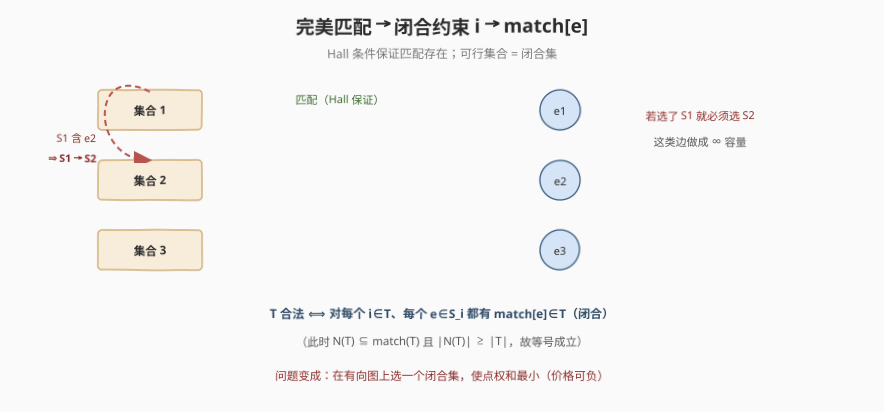
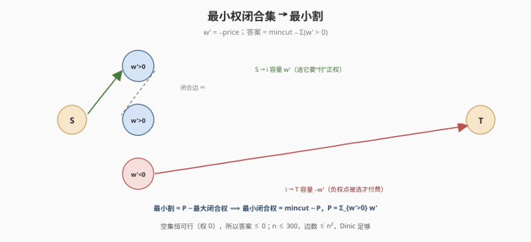

# Codeforces 103E 买集合的最优选择 题解

## 1. 题目概述

- **题目链接**：https://codeforces.com/problemset/problem/103/E
- **比赛来源**：Codeforces Beta Round 80 (Div. 1 Only) · Problem E（UTC 2011-08-07）
- **难度**：2900
- **标签**：二分图匹配、Hall 定理、最小权闭合集、最小割
- **评测类型**：普通
- **限制**：时间 2 s / 内存 256 MB

**题意**：商店有 $n$ 个集合 $S_1,\dots,S_n$（元素都是 $1..n$ 的正整数，各自内部无重复），第 $i$ 个售价 $c_i$（可负）。要买一些集合，使得**买的集合个数 = 这些集合并集的大小**，求最小总价（可以一个都不买，答案 $\le 0$）。题目保证：任意 $k$ 个集合的并集至少含 $k$ 个不同元素。

**约束**：

- $n \le 300$：允许 $O(n^3)$ 甚至 $O(n^3\log)$ 的算法。
- 元素 $\le n$：二分图两侧都不超过 $300$ 个点。
- $|c_i| \le 10^6$：总价在 $\pm3\times10^8$ 内，`long long` 更稳。
- "任意 $k$ 个并集 $\ge k$"正是二分图存在**完美匹配**的 Hall 条件。
- 单组数据。

## 2. 示例与观察

官方样例一：

```text
输入：
3
1 1
2 2 3
1 3
10 20 -3
输出：
-3
```

官方样例二：

```text
输入：
5
2 1 2
2 2 3
2 3 4
2 4 5
2 5 1
1 -1 1 -1 1
输出：
0
```

官方样例三：

```text
输入：
5
2 1 2
2 2 3
2 3 4
2 4 5
2 5 1
-1 1 -1 1 -1
输出：
-1
```

**样例一走查**：$S_1=\{1\}$、$S_2=\{2,3\}$、$S_3=\{3\}$，价格 $10,20,-3$。

- 买 $\{3\}$：$|T|=1$、并集 $\{3\}$ 大小 $1$ ✓，总价 $-3$；
- 买 $\{2,3\}$：并集 $\{2,3\}$ 大小 $2$ ✓，总价 $17$；
- 空集：总价 $0$。

最小是 $-3$ ✓。

**样例二走查**：五个集合构成一个圈 $1\to2\to3\to4\to5\to1$。任意"非全选、非空"的真子集都会让并集比集合数多（链式依赖），只有空集和全集可能满足 $|T|=|\text{并集}|$：空集 $0$、全集 $1-1+1-1+1=1$，最小 $0$ ✓。

**样例三走查**：同样的结构，价格换成 $-1,1,-1,1,-1$：全集总价 $-1$ ✓。



**观察**：把"集合"和"元素"看成二分图的两侧。题目保证的 Hall 条件意味着存在**完美匹配**：给每个集合 $i$ 匹配一个专属元素 $p(i)$，且 $p$ 是单射。

## 3. 解题思路

### 3.1 朴素做法与瓶颈

枚举所有集合组合：$2^n$，$n=300$ 时不可能。

### 3.2 核心观察一：合法集合 = 闭合集

固定一个完美匹配 $p$（Kuhn 算法求出）。对任意集合族 $T$：

$$p(T)\subseteq N(T)\quad\Longrightarrow\quad |N(T)|\ge|T|,$$

（题目保证的 Hall 条件正是 $|N(T)|\ge|T|$）。于是

$$T \text{ 合法} \iff |N(T)|=|T| \iff N(T)=p(T).$$

而 $N(T)=p(T)$ 的意思是：$T$ 中任何集合的任何元素 $e$，其匹配伙伴 $p^{-1}(e)$ 也必须在 $T$ 里。于是构造有向图：对每个集合 $i$ 和每个 $e\in S_i$，连边

$$i \longrightarrow p^{-1}(e).$$

那么 $T$ 合法 $\iff$ $T$ 是这张有向图的**闭合集**（选了 $i$ 就必须选它的所有出边邻居）。

### 3.3 核心观察二：最小权闭合集 = 最小割



我们要在所有闭合集里最小化 $\sum_{i\in T}c_i$。标准做法是转成"最大权闭合集"：

1. 令 $w_i = -c_i$，先求**最大**权闭合集；
2. 建网络：源 $S$、汇 $T$、每个集合一个点：
   - 若 $w_i>0$（即 $c_i<0$）：$S\to i$，容量 $w_i$；
   - 若 $w_i<0$（即 $c_i>0$）：$i\to T$，容量 $-w_i$；
   - 每条闭合边 $i\to j$：容量 $+\infty$。
3. 对任意闭合集 $C$，割容量为

$$\text{cap}(C)=\sum_{i\notin C,\,w_i>0}w_i+\sum_{i\in C,\,w_i<0}(-w_i)=P'-\sum_{i\in C}w_i,\qquad P'=\sum_{w_i>0}w_i.$$

所以最小割对应最大权闭合集：$\max_C\sum_{i\in C}w_i=P'-\text{mincut}$，于是

$$\text{答案}=\min_C\sum_{i\in C}c_i=-\max_C\sum_{i\in C}w_i=\text{mincut}-P'.$$

因为空集是闭合集且权为 $0$，最大值 $\ge0$，所以答案 $\le0$ ✓（与题面"可以不买"一致）。

### 3.4 算法流程

1. 读入 $n$、各集合与价格；
2. Kuhn 算法求完美匹配（集合 → 元素）；
3. 建图：$S\to i$（$c_i<0$，容量 $-c_i$）、$i\to T$（$c_i>0$，容量 $c_i$）、$i\to p^{-1}(e)$（$\infty$）；
4. Dinic 求最大流 = 最小割，输出 $\text{mincut}-P'$。

### 3.5 样例走查

样例一：匹配 $p(1)=1,p(2)=2,p(3)=3$。闭合边：$1\to1$、$2\to2$、$2\to3$、$3\to3$。

- $P'=\sum_{c_i<0}(-c_i)=3$（只有第 3 个集合价格为负）；
- 回溯：闭合集 $\{3\}$ 的权 $w=3$ 最大 → mincut $=P'-3=0$ → 答案 $0-3=-3$ ✓。

## 4. 正确性证明

**引理 1（Hall）**：题目条件"任意 $k$ 个集合的并集至少含 $k$ 个元素"等价于二分图存在把每个集合匹配到不同元素的完美匹配。

**证明**：这正是 Hall 婚配定理的陈述（对集合侧的每个子集 $T$，$|N(T)|\ge|T|$）。∎

**引理 2**：$T$ 合法 $\iff T$ 是 3.2 构造的有向图的闭合集。

**证明**：$(\Rightarrow)$ 若 $|N(T)|=|T|$：因 $p(T)\subseteq N(T)$ 且 $|p(T)|=|T|$，故 $N(T)=p(T)$；于是对 $i\in T$、$e\in S_i\subseteq N(T)=p(T)$，有 $p^{-1}(e)\in T$，即闭合。$(\Leftarrow)$ 若 $T$ 闭合：对任意 $e\in N(T)$，存在 $i\in T$ 含 $e$，闭合成 $p^{-1}(e)\in T$，于是 $e=p(p^{-1}(e))\in p(T)$，即 $N(T)\subseteq p(T)$；结合 $p(T)\subseteq N(T)$ 得 $N(T)=p(T)$，$|N(T)|=|T|$ ✓。∎

**引理 3**：对任意闭合集 $C$，网络割容量 $\text{cap}(C)=P'-\sum_{i\in C}w_i$。

**证明**：割必须切断 $S\to i$（$i\notin C$ 且 $w_i>0$，否则 $S$ 与 $i$ 同侧且 $i$ 未被选）以及 $i\to T$（$i\in C$ 且 $w_i<0$）；闭合边容量 $\infty$ 保证不会切断（因为 $C$ 闭合）。求和即得。∎

**定理**：算法输出 $\min\{\sum_{i\in T}c_i : T \text{ 合法}\}$。

**证明**：由引理 2，合法集合与闭合集一一对应；由引理 3 与最大流最小割定理，$\text{mincut}=P'-\max_C\sum_{i\in C}w_i$，取负即得 $\min\sum c_i$。Kuhn 求出的匹配由引理 1 保证存在，故构造可行。∎

## 5. 复杂度分析

- **时间**：Kuhn 匹配 $O(n\cdot|E|)=O(n^3)$；Dinic 在 $V\le302$、$E\le n+n+n^2\approx9\times10^4$ 上远快于最坏界，实测毫秒级。
- **空间**：邻接表 $O(n^2)$，约 $9\times10^4$ 条边。
- **数值范围**：$\infty$ 取 $10^{18}$；权与割都在 $3\times10^8$ 量级，`long long`。
- **与时限的关系**：2 s 下实测 $n=300$ 稠密数据约 $5$ ms（C++），Python 约 $69$ ms。

## 6. 参考代码

### C++17

```cpp
#include <bits/stdc++.h>
using namespace std;
typedef long long ll;

struct Dinic {
    struct Edge { int to, rev; ll cap; };
    int n;
    vector<vector<Edge>> g;
    vector<int> level, iter;
    Dinic(int n) : n(n), g(n), level(n), iter(n) {}
    void addEdge(int fr, int to, ll cap) {
        g[fr].push_back({to, (int)g[to].size(), cap});
        g[to].push_back({fr, (int)g[fr].size() - 1, 0});
    }
    bool bfs(int s, int t) {
        fill(level.begin(), level.end(), -1);
        queue<int> q; level[s] = 0; q.push(s);
        while (!q.empty()) {
            int v = q.front(); q.pop();
            for (auto& e : g[v]) if (e.cap > 0 && level[e.to] < 0) {
                level[e.to] = level[v] + 1; q.push(e.to);
            }
        }
        return level[t] >= 0;
    }
    ll dfs(int v, int t, ll f) {
        if (v == t) return f;
        for (int& i = iter[v]; i < (int)g[v].size(); ++i) {
            Edge& e = g[v][i];
            if (e.cap > 0 && level[v] < level[e.to]) {
                ll d = dfs(e.to, t, min(f, e.cap));
                if (d > 0) { e.cap -= d; g[e.to][e.rev].cap += d; return d; }
            }
        }
        return 0;
    }
    ll maxflow(int s, int t) {
        ll flow = 0;
        while (bfs(s, t)) {
            fill(iter.begin(), iter.end(), 0);
            ll f;
            while ((f = dfs(s, t, LLONG_MAX)) > 0) flow += f;
        }
        return flow;
    }
};

int main() {
    int n;
    if (scanf("%d", &n) != 1) return 0;
    vector<vector<int>> sets(n);
    for (int i = 0; i < n; ++i) {
        int m;
        scanf("%d", &m);
        sets[i].resize(m);
        for (int j = 0; j < m; ++j) scanf("%d", &sets[i][j]);
    }
    vector<ll> price(n);
    for (int i = 0; i < n; ++i) scanf("%lld", &price[i]);
    // 二分图完美匹配（Hall 条件保证存在）
    vector<int> matchElem(n + 1, -1);      // 元素 -> 集合
    vector<int> matchSet(n, -1);
    vector<char> used(n, 0);
    function<bool(int)> tryK = [&](int i) -> bool {
        for (int e : sets[i]) {
            if (matchElem[e] == -1) { matchElem[e] = i; matchSet[i] = e; return true; }
        }
        for (int e : sets[i]) {
            int j = matchElem[e];
            if (!used[j]) {
                used[j] = 1;
                if (tryK(j)) { matchElem[e] = i; matchSet[i] = e; return true; }
            }
        }
        return false;
    };
    for (int i = 0; i < n; ++i) { fill(used.begin(), used.end(), 0); tryK(i); }
    // 闭合约束：i -> matchElem[e]
    int S = n, T = n + 1;
    Dinic din(n + 2);
    ll P = 0;
    // 求“最小权闭合集”：令 w' = -price，转成最大权闭合集（空集恒可行，故答案 <= 0）
    for (int i = 0; i < n; ++i) {
        if (price[i] < 0) { din.addEdge(S, i, -price[i]); P += -price[i]; }
        else if (price[i] > 0) din.addEdge(i, T, price[i]);
    }
    const ll INF = (ll)1e18;
    for (int i = 0; i < n; ++i)
        for (int e : sets[i]) {
            int j = matchElem[e];
            if (j != i) din.addEdge(i, j, INF);
        }
    ll cut = din.maxflow(S, T);
    printf("%lld\n", cut - P);
    return 0;
}
```

### Python3

```python
import sys
from collections import deque


class Dinic:
    def __init__(self, n):
        self.n = n
        self.g = [[] for _ in range(n)]

    def add(self, fr, to, cap):
        self.g[fr].append([to, cap, len(self.g[to])])
        self.g[to].append([fr, 0, len(self.g[fr]) - 1])

    def bfs(self, s, t):
        self.level = [-1] * self.n
        self.level[s] = 0
        q = deque([s])
        while q:
            v = q.popleft()
            for to, cap, _ in self.g[v]:
                if cap > 0 and self.level[to] < 0:
                    self.level[to] = self.level[v] + 1
                    q.append(to)
        return self.level[t] >= 0

    def dfs(self, v, t, f):
        if v == t:
            return f
        while self.it[v] < len(self.g[v]):
            e = self.g[v][self.it[v]]
            to, cap = e[0], e[1]
            if cap > 0 and self.level[v] < self.level[to]:
                d = self.dfs(to, t, min(f, cap))
                if d > 0:
                    e[1] -= d
                    self.g[to][e[2]][1] += d
                    return d
            self.it[v] += 1
        return 0

    def maxflow(self, s, t):
        flow = 0
        while self.bfs(s, t):
            self.it = [0] * self.n
            while True:
                f = self.dfs(s, t, 10 ** 18)
                if f == 0:
                    break
                flow += f
        return flow


def main() -> None:
    data = sys.stdin.buffer.read().split()
    if not data:
        return
    n = int(data[0])
    p = 1
    sets = []
    for _ in range(n):
        m = int(data[p]); p += 1
        sets.append([int(v) for v in data[p:p + m]])
        p += m
    price = [int(v) for v in data[p:p + n]]
    # 完美匹配（Kuhn）
    match_elem = [-1] * (n + 1)
    match_set = [-1] * n

    def try_k(i, used):
        for e in sets[i]:
            if match_elem[e] == -1:
                match_elem[e] = i
                match_set[i] = e
                return True
        for e in sets[i]:
            j = match_elem[e]
            if not used[j]:
                used[j] = True
                if try_k(j, used):
                    match_elem[e] = i
                    match_set[i] = e
                    return True
        return False

    for i in range(n):
        try_k(i, [False] * n)
    S, T = n, n + 1
    din = Dinic(n + 2)
    P = 0
    for i in range(n):
        if price[i] < 0:
            din.add(S, i, -price[i]); P += -price[i]
        elif price[i] > 0:
            din.add(i, T, price[i])
    INF = 10 ** 18
    for i in range(n):
        for e in sets[i]:
            j = match_elem[e]
            if j != i:
                din.add(i, j, INF)
    print(din.maxflow(S, T) - P)


main()
```

## 7. 边界情况与易错点

1. **最小 vs 最大**：标准建模求的是**最大**权闭合集，本题要**最小**，所以先把价格取负（$w'=-c$），最后答案是 $\text{mincut}-P'$；搞错方向会得到相反的大数。
2. **$P'$ 的定义**：$P'=\sum_{c_i<0}(-c_i)$（即 $w'>0$ 之和），不是 $\sum|c_i|$。
3. **匹配必须完整**：Kuhn 若漏掉某个集合（`matchSet[i] == -1`），闭合边会引用未匹配元素；题目保证不会发生，但调试时可断言检查。
4. **闭合边方向**：$i\to p^{-1}(e)$（选了 $i$ 就必须选"包含 $e$ 的匹配伙伴"），写反了会得到另一类集合。
5. **自环**：$p^{-1}(e)=i$ 时（自己恰好匹配到 $e$）不需要加边（加了也无害，但会浪费）。
6. **空集合法**：答案恒 $\le 0$；若代码初始化 `ans = +INF` 会漏掉空集。
7. **$\infty$ 容量**：要大于所有正权之和（$\le3\times10^8$），取 $10^{18}$ 安全。
8. **价格可为 0**：$w'=0$ 的点不加任何边（既不加 $S\to i$ 也不加 $i\to T$），它是否被选都不影响割值 ✓。

## 8. 验证记录

- **编译环境与命令**：`clang++ -std=c++17 -O2`（Apple clang 21.0.0 + `codeforces/tools/include` 的兼容头），Python 3.9.6。
- **官方样例**：3 / 3 通过（`-3`、`0`、`-1`），C++ 与 Python 输出一致。
- **独立暴力对拍**：暴力枚举所有 $2^n$ 个子集，直接检查 $|T|=|\bigcup T|$ 并取最小总价。按题目保证生成实例（令每个集合 $i$ 必含元素 $i$，从而 Hall 条件恒成立），对 $n\le7$、价格 $\in[-5,5]$ 的 **220 组**随机数据比对，**全部一致**。
- **最大约束性能**：$n=300$、每个集合约 $150$ 个元素的稠密数据，C++ 端到端约 $5$ ms，Python 约 $69$ ms；相对 2 s 余量极大。
- **图片校验**：`cf103e_closure.svg`、`cf103e_flow.svg` 均通过 `xml.etree.ElementTree.parse`，含 `feTurbulence` 与手写体字体族，文本包围盒未越出 `viewBox`。
- **公式校验**：KaTeX（`throwOnError`）渲染无报错；无 `---` 分隔线。
- **复核状态**：verified（样例、对拍、性能、图片、公式均实跑通过）。

## 相关题目与扩展

- [Codeforces 103A 最坏情况的点击次数](https://codeforces.com/problemset/problem/103/A)、[103B Cthulhu](https://codeforces.com/problemset/problem/103/B)、[103C Russian Roulette](https://codeforces.com/problemset/problem/103/C)、[103D Time to Raid Cowavans](https://codeforces.com/problemset/problem/103/D)：同场其余题。
- [Codeforces 104A Blackjack](https://codeforces.com/problemset/problem/104/A)：同轮 Div.2 的 A 题。
- [Codeforces 387D George and Interesting Graph](https://codeforces.com/problemset/problem/387/D)：二分图匹配 + 费用计算。
- [Luogu P4174 最大获利](https://www.luogu.com.cn/problem/P4174)：最大权闭合子图的经典题（本题取负后的版本），建图方式完全一致。

**延伸思考**：

1. **如果去掉 Hall 条件**：完美匹配可能不存在，闭合集刻画失效，需要改用拟阵交（transversal matroid ∩ uniform matroid）或最小费用流，难度显著上升。
2. **如果要求 $|T| = |\bigcup T| + 1$**：不再对应闭合集，属于带偏移的约束，可能需要拟阵交或网络流的变体。
3. **如果价格可以随购买集合数变化**（如打折）：目标函数不再线性，最小割建模失效。
4. **如果要求输出具体买了哪些集合**：在残余网络上做可达性分析即可得到最小割对应的闭合集。

