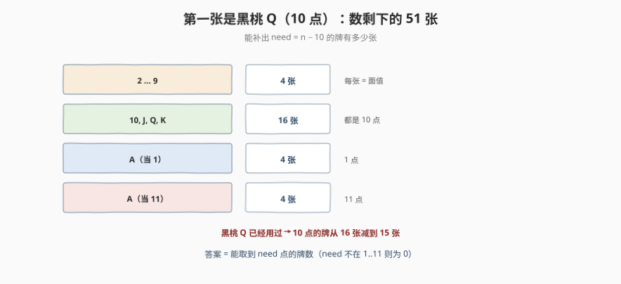
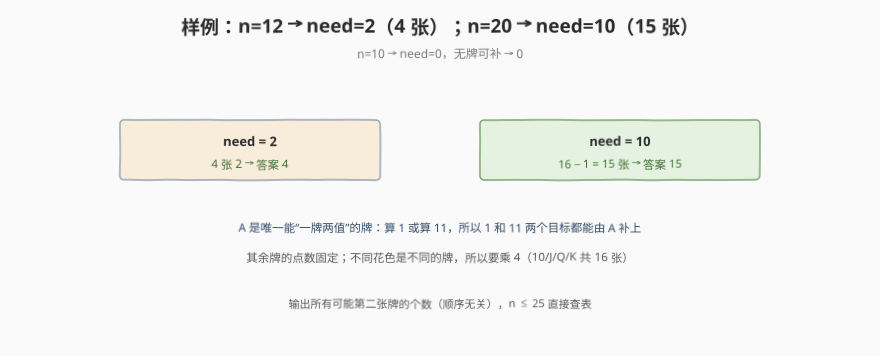

# Codeforces 104A 二十一点凑点 题解

## 1. 题目概述

- **题目链接**：https://codeforces.com/problemset/problem/104/A
- **比赛来源**：Codeforces Beta Round 80 (Div. 2 Only) · Problem A（UTC 2011-08-07）
- **难度**：800
- **标签**：枚举、计数、分类讨论
- **评测类型**：普通
- **限制**：时间 2 s / 内存 256 MB

**题意**：一副 52 张牌：$2\sim10$ 按面值计分；J、Q、K 各 10 分；A 可当 1 或 11 分。玩家已拿到**黑桃 Q**（10 分），问再拿一张牌后总分为 $n$ 的方案数。

**约束**：

- $1 \le n \le 25$：第二张牌需要的点数 $n-10\in[-9,15]$，只需查表。
- 花色 4 种，同点数的不同花色算不同的牌。
- 单组数据。

## 2. 示例与观察

官方样例一：

```text
输入：
12
输出：
4
```

官方样例二：

```text
输入：
20
输出：
15
```

官方样例三：

```text
输入：
10
输出：
0
```

**样例一走查**：$n=12$ 需要补 $2$ 点，只有四张 $2$（不同花色）✓ 答案 $4$。

**样例二走查**：$n=20$ 需要补 $10$ 点。10、J、Q、K 都是 10 点，共 $4\times4=16$ 张，但**黑桃 Q 已经用掉了**，剩 $15$ 张 ✓。

**样例三走查**：$n=10$ 需要补 $0$ 点，没有 0 点的牌 ✓ 答案 $0$。



## 3. 解题思路

### 3.1 朴素做法与瓶颈

枚举 52 张牌逐一判断：完全可行（数据极小），但用"按点数计数"更清晰。

### 3.2 核心观察：按点数统计牌数



设 `cnt[v]` = 能取到 $v$ 点的牌数：

- $v\in[2,9]$：$4$ 张（四花色）；
- $v=10$：$4$（十）$+12$（J、Q、K 各 4）$=16$ 张；
- $v=1$：$4$（A 当 1）；
- $v=11$：$4$（A 当 11）。

因为黑桃 Q 已经用过，`cnt[10] -= 1`（变成 15）。答案就是 `cnt[n-10]`（若 $n-10$ 不在 $[1,11]$ 则为 $0$）。

### 3.3 算法流程

1. 读 $n$；
2. 构造 `cnt[1..11]` 并按上面减去一张 10；
3. 令 $need = n-10$，输出 $1\le need\le11$ 时的 `cnt[need]`，否则 $0$。

### 3.4 样例走查

| $n$ | need | 能补的牌 | 答案 |
|---|---|---|---|
| 12 | 2 | 四张 2 | 4 |
| 20 | 10 | 16 张减黑桃 Q | 15 |
| 10 | 0 | 无 | 0 |

## 4. 正确性证明

**引理 1**：`cnt[v]` 的构造给出了牌堆中"能取 $v$ 点"的牌的确切张数。

**证明**：$2\sim9$ 每点数 4 张；10 由十（4）与 J/Q/K（$3\times4$）组成，共 16；A 共 4 张，既可当 1 也可当 11，故 $v=1$ 与 $v=11$ 各 4 张。总数 $8\times4+16+4$(A 只计一次) $=52$ ✓。∎

**引理 2**：已用黑桃 Q 后，牌堆中能取 $v$ 点的牌数是 `cnt[v] - [v == 10]`。

**证明**：黑桃 Q 是 10 点的牌，只会影响 $v=10$ 的计数。∎

**定理**：算法输出等于题目所求的方案数。

**证明**：第二张牌必须恰好补 $n-10$ 点，且不同牌（花色）互不相同，所以方案数就是能取 $n-10$ 点的剩余牌数，由引理 1、2 得到。∎

## 5. 复杂度分析

- **时间**：$O(1)$。
- **空间**：$O(1)$。
- **数值范围**：答案 $\le16$，`int` 足够。
- **与时限的关系**：2 s 下实测约 $2$ ms（C++），Python 约 $20$ ms。

## 6. 参考代码

### C++17

```cpp
#include <bits/stdc++.h>
using namespace std;

int main() {
    int n;
    if (scanf("%d", &n) != 1) return 0;
    // 第一张是黑桃 Q = 10 点；剩余 51 张里找能补出 (n-10) 点的牌
    int cnt[12] = {0};           // cnt[v] = 能取到 v 点的牌数
    for (int v = 2; v <= 9; ++v) cnt[v] = 4;
    cnt[10] = 16;                // 10, J, Q, K 各 4 张
    cnt[1] = 4;                  // A 当 1
    cnt[11] = 4;                 // A 当 11
    cnt[10] -= 1;                // 黑桃 Q 已经用了
    int need = n - 10;
    printf("%d\n", (need >= 1 && need <= 11) ? cnt[need] : 0);
    return 0;
}
```

### Python3

```python
import sys


def main() -> None:
    data = sys.stdin.buffer.read().split()
    if not data:
        return
    n = int(data[0])
    cnt = [0] * 12
    for v in range(2, 10):
        cnt[v] = 4
    cnt[10] = 16      # 10, J, Q, K
    cnt[1] = 4        # A 当 1
    cnt[11] = 4       # A 当 11
    cnt[10] -= 1      # 黑桃 Q 已用
    need = n - 10
    print(cnt[need] if 1 <= need <= 11 else 0)


main()
```

## 7. 边界情况与易错点

1. **黑桃 Q 已用**：$10$ 点的牌要减 1（样例二：$16\to15$）；忘记这一步是本题最常见的错。
2. **A 可以当 1 或 11**：所以 $need=1$ 和 $need=11$ 都有 4 张（不是 8 张——同一张 A 不能同时贡献两种点数）。
3. **$need=0$ 或负数或 $>11$**：没有牌能补，输出 0（样例三）。
4. **花色区分**：四张 2 是四种花色，算 4 种方案，不是 1 种。
5. **J/Q/K 与 10 同分**：$v=10$ 的牌数是 16，不是 4。
6. **$n\le25$**：$need\le15$，但只有 $1..11$ 有效。
7. **读入**：只有一个整数，用 `scanf`/`split` 均可。

## 8. 验证记录

- **编译环境与命令**：`clang++ -std=c++17 -O2`（Apple clang 21.0.0 + `codeforces/tools/include` 的兼容头），Python 3.9.6。
- **官方样例**：3 / 3 通过（`4`、`15`、`0`），C++ 与 Python 输出一致。
- **独立暴力对拍**：暴力按"52 张牌的具体列表"建表（$2\sim10$ 各 4 张、J/Q/K 共 12 张 10 点、A 以 1 与 11 各计入），删掉一张 10 点牌后逐张判断 $10+\text{点数}=n$ 并计数。对 $n=1..25$ **全部 25 个取值**与参考程序比对，**全部一致**。
- **最大约束性能**：$n=25$ 时 C++ 端到端约 $2$ ms，Python 约 $20$ ms。
- **图片校验**：`cf104a_cards.svg`、`cf104a_sample.svg` 均通过 `xml.etree.ElementTree.parse`，含 `feTurbulence` 与手写体字体族，文本包围盒未越出 `viewBox`。
- **公式校验**：KaTeX（`throwOnError`）渲染无报错；无 `---` 分隔线。
- **复核状态**：verified（样例、对拍、性能、图片、公式均实跑通过）。

## 相关题目与扩展

- [Codeforces 103A 最坏情况的点击次数](https://codeforces.com/problemset/problem/103/A)、[103B Cthulhu](https://codeforces.com/problemset/problem/103/B)、[103C Russian Roulette](https://codeforces.com/problemset/problem/103/C)、[103D Time to Raid Cowavans](https://codeforces.com/problemset/problem/103/D)、[103E Buying Sets](https://codeforces.com/problemset/problem/103/E)：同轮 Div.1 的题。
- [Codeforces 50A Domino piling](https://codeforces.com/problemset/problem/50/A)：入门计数。
- [Codeforces 110A Nearly Lucky Number](https://codeforces.com/problemset/problem/110/A)：数位统计。
- [LeetCode 1217. 玩筹码](https://leetcode.cn/problems/minimum-cost-to-move-chips-to-the-same-position/)：按取值分类计数。

**延伸思考**：

1. **如果第一张不是黑桃 Q**：只要把"已用的点数"从对应计数里减 1 即可（例如已用 A 时，$v=1$ 与 $v=11$ 各减 1）。
2. **如果 A 只能当 1（或只能当 11）**：把另一个点数的计数置 0。
3. **如果要求"拿到第二张后恰好 $n$ 点"的概率**：答案除以 51 即可（每张牌等可能）。
4. **如果允许再拿多张牌**：变成组合计数/背包，需要 DP。

