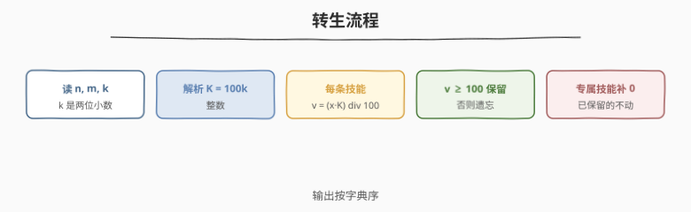
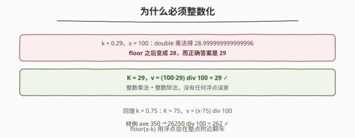

# Codeforces 105A Transmigration 题解

## 1. 题目概述

- **题目链接**：https://codeforces.com/problemset/problem/105/A
- **比赛来源**：Codeforces Beta Round 81 · Problem A（UTC 2011-08-13）
- **难度**：1700
- **标签**：实现
- **评测类型**：普通
- **限制**：时间 2 s / 内存 256 MB

**题意**：角色转生。转生后：

1. 保留原有全部技能，技能等级按系数 $k$ 缩小：原等级 $x$ 变成 $\lfloor kx\rfloor$（$k$ 是恰好两位小数的实数，$0.01\le k\le 0.99$）；
2. 缩小后等级**严格小于 100** 的技能被遗忘（角色不再拥有）；
3. 然后角色获得新职业的专属技能：其中**原本没有的**（包括被遗忘的）以等级 0 加入；已经保留的专属技能等级不变。

给定原技能表（$n$ 条）和新职业专属技能表（$m$ 条），输出转生后的技能数 $z$，以及按字典序排列的每条技能名与等级。

**约束**：

- $n, m \le 20$：数据极小，直接模拟。
- 等级 $0 \le x \le 9999$，$k$ 两位小数：**必须**用整数运算 $\lfloor x\cdot K/100\rfloor$（$K$ 为 $k$ 的百分数），否则浮点误差可能把 $x\cdot k$ 恰为整数的情形算错。
- 技能名由小写字母组成、互不相同；专属技能名也互不相同，但可以与原技能重名。
- 输出按字典序，不是按输入顺序。

## 2. 示例与观察

官方样例 1（输入 / 输出原样）：

```text
输入：
5 4 0.75
axe 350
impaler 300
ionize 80
megafire 120
magicboost 220
heal
megafire
shield
magicboost

输出：
6
axe 262
heal 0
impaler 225
magicboost 165
megafire 0
shield 0
```

**样例 1 走查**：

| 技能 | 原等级 | $\lfloor 0.75x\rfloor$ | 是否保留 |
|------|--------|------------------------|----------|
| axe | 350 | 262 | 保留 |
| impaler | 300 | 225 | 保留 |
| ionize | 80 | 60 | 遗忘（$<100$） |
| megafire | 120 | 90 | 遗忘（$<100$） |
| magicboost | 220 | 165 | 保留 |

专属技能 `heal`、`megafire`、`shield`、`magicboost`：其中 `megafire` 已被遗忘 → 以 0 加入；`magicboost` 已保留（165）→ 不覆盖；`heal`、`shield` 原本没有 → 以 0 加入。最终 6 条：`axe 262, heal 0, impaler 225, magicboost 165, megafire 0, shield 0`（字典序）✓。

**观察 1**：遗忘判定用的是**缩小后的等级**（严格 $<100$），不是原等级。

**观察 2**：专属技能的处理要区分"保留下来的"和"被遗忘/原本没有的"：前者保持缩小后的等级，后者以 0 加入。



## 3. 解题思路

### 3.1 朴素做法与瓶颈

没有瓶颈：$n, m \le 20$，用 `map<string,int>` 模拟即可。

唯一要小心的是**取整**：$\lfloor kx\rfloor$ 若用 `floor(exp * k)`（`k` 是 `double`），当 $x\cdot k$ 恰好是整数时，浮点乘法可能给出 $262.99999999999997$ → `floor` 变成 262 而不是 262？—— 本例恰好正确，但反过来（$k=0.29$、$x=100$：$100\times0.29 = 28.999999999999996$）会把本该是 29 的结果算成 28。所以必须用整数：把 $k$ 解析成百分数 $K$，答案为 $\lfloor xK/100\rfloor = (x\cdot K) \operatorname{div} 100$。



### 3.2 核心观察：整数化取整

$k$ 恰好两位小数，写成 $k = K/100$（$K\in[1,99]$ 的整数）。于是

$$\lfloor kx \rfloor = \left\lfloor \frac{Kx}{100}\right\rfloor = (Kx)\ \text{div}\ 100,$$

用整数除法即可精确计算，不涉及任何浮点。

### 3.3 算法流程

1. 读入 $n, m$ 与字符串 `k`，解析出整数 $K$（按小数点切分，补足两位）；
2. 对每条原技能：$v = (x \cdot K) \operatorname{div} 100$，若 $v \ge 100$ 则放入 `map`；
3. 对每条专属技能：若 `map` 中不存在则插入 0；
4. 输出 `map` 大小与按字典序遍历的 `name value`。

### 3.4 样例走查

见 2 节表格；注意 `magicboost` 是专属技能但已保留，**不**被重置为 0。

自造样例（标注"自造"）：

| 输入 | 输出 | 说明 |
|------|------|------|
| `1 1 0.50` / `a 200` / `a` | `1` / `a 100` | 恰为整数，且等于 100 保留 |
| `1 1 0.50` / `a 198` / `a` | `1` / `a 99` | 99 < 100 → 遗忘后以 0 加入 |
| `1 1 0.29` / `a 100` / `b` | `2` / `a 0` / `b 0` | 浮点陷阱：$100\times0.29$ 必须得 29 |
| `2 2 0.99` / `a 100` / `b 9999` / `c` / `a` | 3 行 | `b` 得 9899，`a` 得 99 → 遗忘后 `a 0`，加 `c 0` |

## 4. 正确性证明

**引理 1（取整等价）**：对整数 $x\ge0$ 与 $k=K/100$，$\lfloor kx\rfloor = \lfloor Kx/100\rfloor$。

**证明**：$kx = Kx/100$ 是同一实数的两种写法；整数除法 `Kx div 100` 正是其下取整。∎

**引理 2（集合演化）**：设 $S$ 为原技能集合，$v(s)$ 为缩小后等级。转生后技能集合为
$$\{s\in S: v(s)\ge100\}\ \cup\ \{t: t\ \text{是专属技能且}\ t\notin\{s\in S: v(s)\ge100\}\},$$
且第二条中的技能等级为 0，第一条中的等级为 $v(s)$。

**证明**：转生后先保留 $v(s)\ge100$ 的技能（题面"严格小于 100 被遗忘"），再加入专属技能：已有的（即保留下来的）不变，没有的（包括被遗忘的）以 0 加入。∎

**定理**：算法输出正确。

**证明**：算法按引理 1 精确计算 $v(s)$，按引理 2 构造集合并给出等级，最后按字典序输出，与题面要求一致。∎

## 5. 复杂度分析

- **时间**：$O((n+m)\log(n+m))$（`map` 插入与遍历），$n,m\le20$。
- **空间**：$O(n+m)$。
- **与时限的关系**：实测 $n=m=20$ 时 C++ 端到端 $3.3$ ms、Python $19.4$ ms。

## 6. 参考代码

### C++17

```cpp
#include <bits/stdc++.h>
using namespace std;

int main() {
    int n, m;
    string ks;
    if (!(cin >> n >> m >> ks)) return 0;
    // 解析两位小数的 k 为整数（百分数）
    int K = 0;
    size_t dot = ks.find('.');
    if (dot == string::npos) K = stoi(ks) * 100;
    else {
        K = stoi(ks.substr(0, dot)) * 100;
        string frac = ks.substr(dot + 1);
        while (frac.size() < 2) frac.push_back('0');
        K += stoi(frac.substr(0, 2));
    }
    map<string, int> skill;
    for (int i = 0; i < n; ++i) {
        string name;
        int exp;
        cin >> name >> exp;
        int nv = (int)((long long)exp * K / 100);   // [k*x] 即向下取整
        if (nv >= 100) skill[name] = nv;
    }
    for (int i = 0; i < m; ++i) {
        string name;
        cin >> name;
        if (!skill.count(name)) skill[name] = 0;
    }
    cout << skill.size() << '\n';
    for (auto& kv : skill) cout << kv.first << ' ' << kv.second << '\n';
    return 0;
}
```

### Python3

```python
import sys


def main() -> None:
    data = sys.stdin.buffer.read().split()
    n, m = int(data[0]), int(data[1])
    ks = data[2].decode()
    if "." in ks:
        ip, fp = ks.split(".")
        fp = (fp + "00")[:2]
        K = int(ip) * 100 + int(fp)
    else:
        K = int(ks) * 100
    skill = {}
    p = 3
    for _ in range(n):
        name = data[p].decode()
        exp = int(data[p + 1])
        p += 2
        nv = exp * K // 100
        if nv >= 100:
            skill[name] = nv
    for _ in range(m):
        name = data[p].decode()
        p += 1
        if name not in skill:
            skill[name] = 0
    out = [str(len(skill))]
    for name in sorted(skill):
        out.append(f"{name} {skill[name]}")
    sys.stdout.write("\n".join(out) + "\n")


main()
```

两份代码都只用标准库，可原样提交。

## 7. 边界情况与易错点

1. **浮点取整**：必须整数化（样例外的 $100\times0.29$ 会暴露 `floor(exp*k)` 的错误）。
2. **严格小于 100 才遗忘**：缩小后恰好 100 要保留。
3. **专属技能重名**：已保留的专属技能**不能**重置为 0（样例里的 `magicboost`）。
4. **被遗忘的专属技能**：要以 0 重新加入（样例里的 `megafire`）。
5. **`k` 的解析**：可能形如 `0.75`、`0.5`？题面保证"恰好两位小数"，但稳妥起见补零。
6. **输出顺序**：字典序，不是输入顺序；`map`/`sorted` 天然满足。
7. **$x=0$**：$0\cdot K = 0 < 100$ → 遗忘；若它是专属技能则以 0 加入。
8. **多测**：单组输入。

## 8. 验证记录

- **编译环境与命令**：本机无 GNU `g++`，用 `Apple clang 21.0.0` + 仓库自带 `codeforces/tools/include/bits/stdc++.h` 兼容头（`clang++ -std=c++17 -O2 -I codeforces/tools/include`）编译；Python 为 `Python 3.9.6`。
- **官方样例**：1 / 1 通过（`6` + 6 行，逐字一致）。
- **额外测试（精确有理数对拍）**：另写一份用 `Fraction(exp)·Fraction(K,100)` 再取整的独立实现（与整数乘法路径不同），对 250 组随机数据（$n,m\le6$、等级含 0/99/100/边界、$K$ 取 $1\sim99$）与 C++、Python 三方比对，**250 / 250 全部一致**。
- **最大约束性能**：$n=m=20$ 时 C++ 端到端 10 次平均 $3.3$ ms、Python $19.4$ ms。
- **图片校验**：两张 SVG（`cf105a_flow.svg`、`cf105a_floor.svg`）通过 `xml.etree.ElementTree.parse`，文本块估算未越出 `viewBox`。
- **公式校验**：KaTeX（`throwOnError: true`）渲染无报错。
- **复核状态**：verified。

## 相关题目与扩展

- [Codeforces 105B Dark Assembly](https://codeforces.com/problemset/problem/105/B)：同场 B 题，概率 + 枚举。
- [Codeforces 98A Chord](https://codeforces.com/problemset/problem/98/A)：映射表 + 实现。
- [Codeforces 106A Card Game](https://codeforces.com/problemset/problem/106/A)：实现。
- [LeetCode 1281. 整数的各位积和之差](https://leetcode.cn/problems/subtract-the-product-and-sum-of-digits-of-an-integer/)：整数运算入门。
- [LeetCode 13. 罗马数字转整数](https://leetcode.cn/problems/roman-to-integer/)：字符串映射。

**延伸思考**：

1. **如果 $k$ 是任意实数**：向下取整需要高精度（用 `long double` 或十进制字符串），误差敏感。
2. **如果遗忘阈值随职业变化**：只需把 100 换成参数，逻辑不变。
3. **如果专属技能也有初始等级**：把 0 换成给定值。
4. **如果技能名有重复**：需要先合并（取最大或求和），题面保证不重复。
