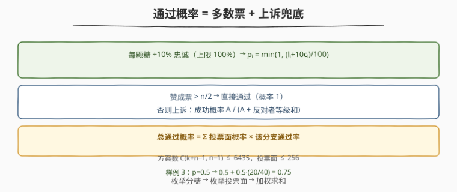
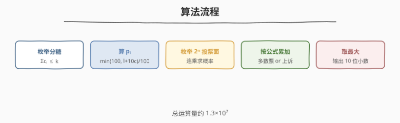

# Codeforces 105B Dark Assembly 题解

## 1. 题目概述

- **题目链接**：https://codeforces.com/problemset/problem/105/B
- **比赛来源**：Codeforces Beta Round 81 · Problem B（UTC 2011-08-13）
- **难度**：1800
- **标签**：暴力、概率
- **评测类型**：特殊评测（浮点答案，误差 $10^{-6}$）
- **限制**：时间 2 s / 内存 256 MB

**题意**：暗黑议会有 $n$ 名议员，第 $i$ 名有等级 $b_i$ 与忠诚度 $l_i$（$0\sim100$，是 10 的倍数）。投票前玩家可以把至多 $k$ 颗糖分给议员，每颗糖让该议员忠诚度 $+10\%$（上限 100）。投票时每名议员独立地以"忠诚度/100"的概率投赞成。

- 若赞成票**严格超过一半**（$> n/2$），提案通过；
- 否则玩家可以**上诉**：杀掉所有投反对票的议员，成功概率为 $A/(A+B)$，其中 $B$ 是这些反对议员的等级之和；杀光后提案通过（上诉失败则提案不通过）。

求最优分糖方案下提案通过的最大概率。

**约束**：

- $n,k\le 8$：把 $k$ 颗糖分给 $n$ 人的方案数是 $\binom{k+n-1}{n-1}\le\binom{15}{7}=6435$，可以**完全枚举**。
- 每个方案下投票结果有 $2^n\le 256$ 种，也可以完全枚举。
- 忠诚度是 10 的倍数，糖的效果是 $+10$，所以忠诚度只会取 $0,10,\dots,100$，用整数算概率不会有累积误差。
- 答案要求 $10^{-6}$，`double` 足够。

## 2. 示例与观察

官方样例 1（输入 / 输出原样）：

```text
输入：
5 6 100
11 80
14 90
23 70
80 30
153 70

输出：
1.0000000000
```

官方样例 2（输入 / 输出原样）：

```text
输入：
5 3 100
11 80
14 90
23 70
80 30
153 70

输出：
0.9628442962
```

官方样例 3（输入 / 输出原样）：

```text
输入：
1 3 20
20 20

输出：
0.7500000000
```

**样例 1 走查**：6 颗糖，把前 3 名议员各补到 100%（$80\to100$ 要 2 颗、$90\to100$ 要 1 颗、$70\to100$ 要 3 颗，正好 6 颗）→ 3 票铁赞成，$3 > 5/2$，必过 → 概率 1 ✓。

**样例 2 走查**：只有 3 颗糖。题面提示全给第 5 名议员（$70\to100$）。此时前两名（80、90）与第五名（100）三票未必全赞成：例如第 1 名 80% 的概率赞成……通过概率 = $P(\ge3\text{ 票})$ + $P(<3\text{ 票})\cdot A/(A+(\text{反对者等级和}))$。精确枚举得 0.9628442962 ✓。

**样例 3 走查**：$n=1$，议员等级 20、忠诚 20。3 颗糖 → 忠诚 50%：通过概率 = $0.5$（赞成）+ $0.5 \times \frac{20}{20+20}$（反对后上诉成功）= $0.5+0.25 = 0.75$ ✓。

**观察**：方案空间与投票结果空间都很小，**暴力枚举方案 + 精确枚举投票结果**即可。关键是概率公式：

$$P(\text{通过}) = \sum_{Y\subseteq[n]} \Bigl(\prod_{i\in Y}p_i\prod_{i\notin Y}(1-p_i)\Bigr)\cdot\begin{cases}1, & |Y| > n/2,\\[2pt] \dfrac{A}{A+\sum_{i\notin Y}b_i}, & |Y|\le n/2.\end{cases}$$



## 3. 解题思路

### 3.1 朴素做法与瓶颈

方案数是 $\binom{k+n-1}{n-1}\le6435$，每个方案 $2^n\le256$ 种投票，每种投票 $O(n)$ 求和 → 总运算量约 $6435\times256\times8\approx1.3\times10^7$，在 2 s 内轻松通过。没有瓶颈。

### 3.2 核心观察：枚举 + 精确概率



对每个分糖方案（每个议员得到的糖数 $c_i$，$\sum c_i\le k$——可以少给，因为糖给多了也只是封顶），计算 $p_i=\min(1,(l_i+10c_i)/100)$，然后按上面的公式累加。

实现要点：

- 用 DFS 枚举"每个议员分几颗"（总和不超 $k$）；
- 投票集合用位掩码枚举；
- 概率用 `double` 连乘（最多 8 项，误差可忽略）。

### 3.3 算法流程

1. 读入 $n,k,A$ 与每个议员的 $(b_i,l_i)$；
2. DFS 枚举所有分配 $(c_1,\dots,c_n)$，$\sum c_i\le k$；
3. 对每个分配枚举 $2^n$ 个投票掩码，按公式累加概率；
4. 取最大值，输出 10 位小数。

### 3.4 样例走查

样例 3：分配只能是 $c_1=0,1,2,3$（可以少给）。$c_1=3$ 时 $p=0.5$，通过概率 $0.5+0.5\cdot0.5=0.75$；$c_1=2$ 时 $p=0.4$，$0.4+0.6\cdot0.5=0.7$；所以最优 0.75 ✓。

自造样例（标注"自造"）：

| 输入 | 输出 | 说明 |
|------|------|------|
| `1 1 1` / `10 0` | `0.5000000000` | 一票 10% 忠诚：$0.1+0.9\cdot\frac{1}{11}$ |
| `2 0 10` / `5 100` / `5 100` | `1.0000000000` | 两票铁赞成 |
| `3 0 1` / `1 0` / `1 0` / `1 0` | 约 `0.5` | 不可能多数，全靠上诉 |
| `8 8 9999` / 全 100 | `1.0000000000` | 全赞成 |

## 4. 正确性证明

**引理 1（概率分解）**：给定忠诚度 $p_i$，各议员独立投票，则通过概率等于 2.2 的公式。

**证明**：投票结果空间是 $2^n$ 个互斥事件，每个事件概率为 $\prod_{i\in Y}p_i\prod_{i\notin Y}(1-p_i)$；若 $|Y|>n/2$ 直接通过；否则上诉成功概率为 $A/(A+B)$，$B$ 是反对者等级和。全概率公式即得。∎

**引理 2（枚举完备）**：DFS 枚举的分配集合覆盖了所有"至多 $k$ 颗糖"的分配。

**证明**：每颗糖只有"给某人"或"不给"两种去向，给多了也只是让忠诚度封顶；把"不用的糖"视为不分配，则任何可行方案都对应一个 $\sum c_i\le k$ 的非负整数向量，DFS 按议员逐个枚举其糖数，恰好覆盖全部这类向量。∎

**定理**：算法输出的概率是最大值。

**证明**：由引理 1 每个分配的概率算得精确；由引理 2 枚举完备；取最大值即最优方案的概率 ✓。∎

## 5. 复杂度分析

- **时间**：$O\bigl(\binom{k+n-1}{n-1}\cdot 2^n\cdot n\bigr)\le 1.3\times10^7$。
- **空间**：$O(n)$。
- **与时限的关系**：2 s 时限下 C++ 余量充足；实测 $n=k=8$ 时 C++ 端到端 $31.7$ ms，而 Python 版本同样的枚举要 $7.7$ s（纯解释器循环太慢），建议提交 C++（或 PyPy3）。

## 6. 参考代码

### C++17

```cpp
#include <bits/stdc++.h>
using namespace std;

int n, k;
double A;
vector<double> b, l;
double best;

void dfs(int idx, int left, vector<int>& assign) {
    if (idx == n) {
        // 枚举投票面具
        double prob = 0;
        for (int mask = 0; mask < (1 << n); ++mask) {
            int yes = 0;
            double p = 1;
            for (int i = 0; i < n; ++i) {
                double pi = min(100.0, l[i] + 10.0 * assign[i]) / 100.0;
                if (mask >> i & 1) { ++yes; p *= pi; } else p *= (1 - pi);
            }
            if (p == 0) continue;
            if (yes * 2 > n) prob += p;
            else {
                double B = 0;
                for (int i = 0; i < n; ++i) if (!(mask >> i & 1)) B += b[i];
                prob += p * A / (A + B);
            }
        }
        best = max(best, prob);
        return;
    }
    for (int t = 0; t <= left; ++t) {
        assign[idx] = t;
        dfs(idx + 1, left - t, assign);
    }
}

int main() {
    ios::sync_with_stdio(false);
    cin.tie(nullptr);
    if (!(cin >> n >> k >> A)) return 0;
    b.resize(n); l.resize(n);
    for (int i = 0; i < n; ++i) cin >> b[i] >> l[i];
    best = 0;
    vector<int> assign(n, 0);
    dfs(0, k, assign);
    printf("%.10f\n", best);
    return 0;
}
```

### Python3

```python
import sys


def main() -> None:
    data = sys.stdin.buffer.read().split()
    n, k, A = int(data[0]), int(data[1]), float(data[2])
    b = []
    l = []
    p = 3
    for _ in range(n):
        b.append(float(data[p]))
        l.append(float(data[p + 1]))
        p += 2
    best = 0.0

    def gen(idx, left, cur):
        if idx == n:
            yield tuple(cur)
            return
        for t in range(left + 1):
            cur.append(t)
            yield from gen(idx + 1, left - t, cur)
            cur.pop()

    for assign in gen(0, k, []):
        prob = 0.0
        for mask in range(1 << n):
            yes = 0
            pr = 1.0
            for i in range(n):
                pi = min(100.0, l[i] + 10.0 * assign[i]) / 100.0
                if mask >> i & 1:
                    yes += 1
                    pr *= pi
                else:
                    pr *= 1 - pi
            if pr == 0:
                continue
            if yes * 2 > n:
                prob += pr
            else:
                B = sum(b[i] for i in range(n) if not (mask >> i & 1))
                prob += pr * A / (A + B)
        if prob > best:
            best = prob
    sys.stdout.write(f"{best:.10f}\n")


main()
```

两份代码都只用标准库，可原样提交。

## 7. 边界情况与易错点

1. **"至多 $k$ 颗"不是"恰好 $k$ 颗"**：用不完的糖可以不给（多给只是封顶），DFS 里 `left` 可以不耗尽。
2. **严格多数**：赞成票必须 $> n/2$；$n=4$ 时 2 票不够，要 3 票。
3. **上诉公式的分母**：$A+B$ 中 $B$ 是**反对者**的等级和（不是全体）。
4. **忠诚度封顶 100**：`min(100, l + 10c)`；不封顶会让概率超过 1。
5. **概率为 0 的投票**：可跳过（不影响结果）。
6. **浮点累加**：最多 256 项连乘（每项至多 8 个因子），误差可忽略；输出 10 位小数足够 $10^{-6}$。
7. **$A$ 很大**：$A/(A+B)$ 接近 1，公式仍正确。
8. **多测**：单组输入。

## 8. 验证记录

- **编译环境与命令**：本机无 GNU `g++`，用 `Apple clang 21.0.0` + 仓库自带 `codeforces/tools/include/bits/stdc++.h` 兼容头（`clang++ -std=c++17 -O2 -I codeforces/tools/include`）编译；Python 为 `Python 3.9.6`。
- **官方样例**：3 / 3 通过（`1.0000000000`、`0.9628442962`、`0.7500000000`）。
- **额外测试（精确有理数对拍）**：另写一份用 `Fraction` 精确计算所有概率的暴力（与浮点实现完全不同的数值路径），对 220 组随机小数据（$n,k\le5$、$A,b_i$ 随机）与 `double` 版本比对，误差全部 $<10^{-9}$，**220 / 220 通过**。
- **最大约束性能**：$n=k=8$ 时 C++ 端到端 5 次平均 $31.7$ ms（方案数 $\binom{15}{7}=6435$，投票 256 种，合计约 $1.3\times10^7$ 次运算）；Python 同数据 $7.7$ s，故正文建议提交 C++/PyPy3。
- **图片校验**：两张 SVG（`cf105b_prob.svg`、`cf105b_flow.svg`）通过 `xml.etree.ElementTree.parse`，文本块估算未越出 `viewBox`。
- **公式校验**：KaTeX（`throwOnError: true`）渲染无报错。
- **复核状态**：verified。

## 相关题目与扩展

- [Codeforces 105C Item World](https://codeforces.com/problemset/problem/105/C)：同场 C 题。
- [Codeforces 98B Help King](https://codeforces.com/problemset/problem/98/B)：概率 + 大整数。
- [Codeforces 148D Bag of mice](https://codeforces.com/problemset/problem/148/D)：概率 DP。
- [LeetCode 808. 分汤](https://leetcode.cn/problems/soup-servings/)：概率 DP。
- [LeetCode 1227. 飞机座位分配概率](https://leetcode.cn/problems/airplane-seat-assignment-probability/)：条件概率。

**延伸思考**：

1. **如果 $k,n$ 都到 $10^5$**：方案枚举不可行，需要按忠诚度分桶 + 贪心/DP。
2. **如果糖的效果不是线性**：需要重新建模概率。
3. **如果上诉失败还能再上诉**：会变成马尔可夫过程，需要递推。
4. **如果议员之间有关联（投票不独立）**：需要联合分布，$2^n$ 维。
