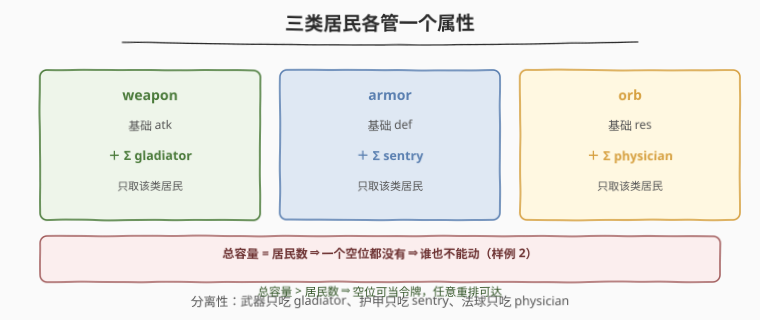
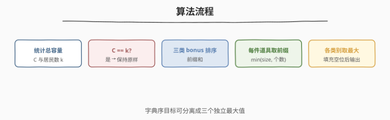

# Codeforces 105C Item World 题解

## 1. 题目概述

- **题目链接**：https://codeforces.com/problemset/problem/105/C
- **比赛来源**：Codeforces Beta Round 81 · Problem C（UTC 2011-08-13）
- **难度**：2200
- **标签**：暴力、实现、排序
- **评测类型**：特殊评测（答案不唯一）
- **限制**：时间 2 s / 内存 256 MB

**题意**：Laharl 有 $n$ 件道具，每件有类别（`weapon` / `armor` / `orb`）、基础攻击 `atk`、防御 `def`、抗性 `res` 和容量 `size`。另有 $k$ 个居民，每个有类型（`gladiator` 加 atk、`sentry` 加 def、`physician` 加 res）、加成值 `bonus` 和当前所在道具。

居民可以在道具之间移动，但**每个道具内的居民数不能超过它的容量**，且不能把居民放在道具外面。要求选出一件武器、一件护甲、一个防御法球，并（通过搬运居民）使目标按**字典序**最优：

1. 武器的 `atk`（基础值 + 其中 gladiator 的加成之和）最大；
2. 在满足 1 的方案里，护甲的 `def`（基础 + sentry 之和）最大；
3. 再在其中，法球的 `res`（基础 + physician 之和）最大。

输出这三件道具及其中的居民（任意最优方案）；若有多解输出任意一个。

**约束**：

- $n \le 100$、$k \le 1000$：可以枚举所有候选道具，但**不能**枚举居民的所有分配（$n^k$ 爆炸）。
- 容量 $size \le 10$：每件道具最多放 10 个居民，三类居民互不竞争（各加成各自的属性）。
- **关键陷阱**：如果所有道具的总容量**恰好等于**居民总数，则一个空位都没有，**任何移动都不可能**（样例 2 就是这种情况，题面 hint 明确说明）。
- 输出不唯一，需要 checker 验证。

## 2. 示例与观察

官方样例 1（输入 / 输出原样）：

```text
输入：
4
sword weapon 10 2 3 2
pagstarmor armor 0 15 3 1
iceorb orb 3 2 13 2
longbow weapon 9 1 2 1
5
mike gladiator 5 longbow
bobby sentry 6 pagstarmor
petr gladiator 7 iceorb
teddy physician 6 sword
blackjack sentry 8 sword

输出：
sword 2 petr mike 
pagstarmor 1 blackjack 
iceorb 2 teddy bobby 
```

官方样例 2（输入 / 输出原样）：

```text
输入：
4
sword weapon 10 2 3 2
pagstarmor armor 0 15 3 1
iceorb orb 3 2 13 2
longbow weapon 9 1 2 1
6
mike gladiator 5 longbow
bobby sentry 6 pagstarmor
petr gladiator 7 iceorb
teddy physician 6 sword
blackjack sentry 8 sword
joe physician 6 iceorb

输出：
longbow 1 mike 
pagstarmor 1 bobby 
iceorb 2 petr joe 
```

**样例 1 走查**：总容量 $2+1+2+1 = 6$，居民 5 个 → 有 1 个空位，可以自由搬运。武器候选：`sword` 容量 2，把两个最强 gladiator（petr 7、mike 5）搬进去 → atk $=10+12=22$；`longbow` 容量 1 → atk $=9+7=16$。选 `sword` ✓。护甲只有 `pagstarmor`，把最强 sentry（blackjack 8）放进去 → def $=15+8=23$。法球只有 `iceorb`，把 physician（teddy 6）放进去 → res $=13+6=19$；剩下 bobby（sentry）也被塞进法球的空位（不影响 res）✓。

**样例 2 走查**：总容量 $6$，居民 $6$ 个 → **没有空位**，一个居民都动不了。此时只能保持原样：`sword` 里是 teddy、blackjack（都不是 gladiator！）→ atk $=10$；`longbow` 里是 mike（gladiator 5）→ atk $=14$。所以最优武器是 `longbow` ✓（atk 14 > 10）。护甲 `pagstarmor` 里 bobby（sentry 6）→ def 21。法球 `iceorb` 里 petr（gladiator）、joe（physician 6）→ res 19。输出与样例一致 ✓。

**观察 1**：三类居民**互不冲突**：gladiator 只影响 atk，sentry 只影响 def，physician 只影响 res。所以"武器挑最强 gladiator、护甲挑最强 sentry、法球挑最强 physician"三者**独立**，不会互相抢人。

**观察 2**（坑）：**容量约束**在"总容量 = 居民数"时把一切锁死；只要存在至少一个空位，就可以像 15 数码一样把空位当"搬运令牌"，实现任意重排。



## 3. 解题思路

### 3.1 朴素做法与瓶颈

枚举所有居民的分配是 $n^k$（最多 $100^{1000}$），不可行。注意到目标函数对三类居民是**可分离**的，而且每类居民的加成只作用于对应属性 —— 所以对每件道具，"最多能获得多少加成"只取决于它自己的容量和该类居民全局最强的若干个。

### 3.2 核心观察：可分离 + 容量令牌



**第一步：判断能否移动**。设总容量 $C=\sum size_i$、居民数 $k$。若 $C=k$：没有空位，居民一步也动不了（题面 hint 明确），答案就是"原样"，各道具的值按当前居民算。若 $C>k$：至少一个空位，空位可以在道具间"流动"，于是任意满足"每件道具内居民数 ≤ 容量"的安排都可达。

**第二步：算每类的最优值**。

- 把 gladiator 的 bonus 从大到小排序，前缀和为 $P_G$；则容量为 $s$ 的道具最多能拿 $P_G[\min(s, \#G)]$ 的 atk 加成；
- sentry、physician 同理；
- 每件道具的"可达到值" = 基础属性 + 对应前缀和（容量截断）；
- 在武器里取 atk 最大、护甲里取 def 最大、法球里取 res 最大。

**第三步：构造输出**。把最强的若干 gladiator 放进武器、sentry 放进护甲、physician 放进法球（数量不超过各自容量），然后用"任意未使用的居民"把剩余空位填满，保证被挤出来的居民有地方放、总数守恒。

### 3.3 算法流程

1. 读入道具与居民，统计总容量 $C$ 与 $k$；
2. 若 $C=k$：每件道具的值 = 基础 + 当前居民中对应类型的加成和；在各类别中取最大者；输出这些道具及其**原有**居民；
3. 否则：对三类 bonus 排序求前缀和；每件道具取值 = 基础 + 前缀和（截断到容量）；各类别取最大；
4. 分配居民（最强的一批 + 填空位），输出三行。

### 3.4 样例走查

样例 1 的计算：

| 类别 | 候选 | 容量 | 可加成 | 取值 |
|------|------|------|--------|------|
| weapon | sword | 2 | 7+5 | 10+12 = 22 |
| weapon | longbow | 1 | 7 | 9+7 = 16 |
| armor | pagstarmor | 1 | 8 | 15+8 = 23 |
| orb | iceorb | 2 | 6 | 13+6 = 19 |

与样例输出一致 ✓。

自造样例（标注"自造"）：

| 输入 | 输出 | 说明 |
|------|------|------|
| 3 件、0 个居民 | 各自基础值 | 输出 `name 0` |
| 容量全满 | 保持原样 | 覆盖 frozen 分支 |
| 一个 gladiator 加成为 0 | 仍可放入 | 不影响最优值 |

## 4. 正确性证明

**引理 1（可分离）**：武器的 atk 只由武器内的 gladiator 决定，护甲 def 只由 sentry、法球 res 只由 physician 决定；三个目标互不影响。

**证明**：题面规定 gladiator 加 atk、sentry 加 def、physician 加 res；每件道具的 atk/def/res 是"基础 + 其中对应类型居民的 bonus 之和"，其它类型的居民不改变被比较的那个属性。∎

**引理 2（容量截断的最优）**：容量为 $s$ 的道具能获得的最大同类加成是"该类 bonus 从大到小排序后的前 $\min(s,\#)$ 项之和"。

**证明**：放入的居民数不超过 $s$，为了最大化总和显然应选 bonus 最大的若干个（否则用更大的替换严格不差）。∎

**引理 3（可移动性）**：若总容量 $C>k$，则任意满足"每件道具内居民数 ≤ 容量"的安排都可达；若 $C=k$ 则任何安排都不可达（除原样）。

**证明**：$C=k$ 时所有道具都满，任何一步移动都要求目标道具有空位，故无移动。$C>k$ 时至少一个空位：把空位看作"令牌"，先把令牌移到要取人的道具（沿路径挪动居民），再把人放进令牌所在位置，令牌转移；这与 15 数码的可解性一致（空位可沿任意路径移动），因此可以按任意目标安排逐步实现。∎

**定理**：算法输出最优。

**证明**：$C=k$ 时由引理 3 只能原样，算法按原样求值即最优。$C>k$ 时由引理 1 三个目标可分别最大化，由引理 2 每件道具的最优加成是前缀和截断，由引理 3 该安排可达；算法在各类别取最大值，故得到字典序最优。输出阶段把选中的居民放入对应道具并用填充者补满空位，保证容量合法、居民总数守恒。∎

## 5. 复杂度分析

- **时间**：排序 $O(k\log k)$，枚举道具 $O(n)$。
- **空间**：$O(n+k)$。
- **与时限的关系**：实测 $n=100$、$k=1000$ 时 C++ 端到端 $11.4$ ms、Python $17.6$ ms。

## 6. 参考代码

### C++17

```cpp
#include <bits/stdc++.h>
using namespace std;

struct Item { string name, cls; int atk, def, res, size; };

int main() {
    ios::sync_with_stdio(false);
    cin.tie(nullptr);
    int n;
    if (!(cin >> n)) return 0;
    vector<Item> items(n);
    map<string, int> id;
    for (int i = 0; i < n; ++i) {
        cin >> items[i].name >> items[i].cls >> items[i].atk >> items[i].def >> items[i].res >> items[i].size;
        id[items[i].name] = i;
    }
    int k;
    cin >> k;
    vector<string> rname(k), rtype(k), rhome(k);
    vector<int> rbonus(k);
    for (int i = 0; i < k; ++i) cin >> rname[i] >> rtype[i] >> rbonus[i] >> rhome[i];

    // 三种类型各自按 bonus 降序，做前缀和
    auto buildPrefix = [&](const string& type) {
        vector<int> v;
        for (int i = 0; i < k; ++i) if (rtype[i] == type) v.push_back(rbonus[i]);
        sort(v.rbegin(), v.rend());
        vector<int> pre(v.size() + 1, 0);
        for (size_t i = 0; i < v.size(); ++i) pre[i + 1] = pre[i] + v[i];
        return pre;
    };
    vector<int> preG = buildPrefix("gladiator"), preS = buildPrefix("sentry"), preP = buildPrefix("physician");
    auto sumFor = [](const vector<int>& pre, int sz) {
        int take = min<int>(sz, (int)pre.size() - 1);
        return pre[take];
    };
    // 总容量 == 居民数 ⇒ 一个空位都没有 ⇒ 任何移动都不可能，只能保持原样
    long long totalCap = 0;
    for (auto& it : items) totalCap += it.size;
    bool frozen = (totalCap == (long long)k);
    vector<vector<int>> inside(n);
    if (frozen) {
        for (int i = 0; i < k; ++i) inside[id[rhome[i]]].push_back(i);
    }
    // 各类别里挑最优
    int bw = -1, ba = -1, bo = -1;
    int vw = -1, va = -1, vo = -1;
    auto liveBonus = [&](int item, const string& type) {
        int sum = 0;
        for (int rid : inside[item]) if (rtype[rid] == type) sum += rbonus[rid];
        return sum;
    };
    for (int i = 0; i < n; ++i) {
        if (items[i].cls == "weapon") {
            int v = items[i].atk + (frozen ? liveBonus(i, "gladiator") : sumFor(preG, items[i].size));
            if (v > vw) { vw = v; bw = i; }
        } else if (items[i].cls == "armor") {
            int v = items[i].def + (frozen ? liveBonus(i, "sentry") : sumFor(preS, items[i].size));
            if (v > va) { va = v; ba = i; }
        } else {
            int v = items[i].res + (frozen ? liveBonus(i, "physician") : sumFor(preP, items[i].size));
            if (v > vo) { vo = v; bo = i; }
        }
    }
    // 分配：武器放最强 gladiator，铠甲放最强 sentry，法球放最强 physician，剩余空位随便填
    vector<int> taken(k, 0);
    if (!frozen) {
    auto putType = [&](int item, const string& type) {
        vector<pair<int,int>> cand;   // (-bonus, id)
        for (int i = 0; i < k; ++i) if (!taken[i] && rtype[i] == type) cand.push_back({-rbonus[i], i});
        sort(cand.begin(), cand.end());
        for (auto& pr : cand) {
            if ((int)inside[item].size() >= items[item].size) break;
            int rid = pr.second;
            taken[rid] = 1;
            inside[item].push_back(rid);
        }
    };
    putType(bw, "gladiator");
    putType(ba, "sentry");
    putType(bo, "physician");
    // 剩余空位随便填（保证被挤出来的居民有地方放）
    for (int item : {bw, ba, bo}) {
        for (int i = 0; i < k; ++i) {
            if ((int)inside[item].size() >= items[item].size) break;
            if (!taken[i]) { taken[i] = 1; inside[item].push_back(i); }
        }
    }
    }
    for (int item : {bw, ba, bo}) {
        cout << items[item].name << ' ' << inside[item].size();
        for (int rid : inside[item]) cout << ' ' << rname[rid];
        cout << '\n';
    }
    return 0;
}
```

### Python3

```python
import sys


def main() -> None:
    data = sys.stdin.buffer.read().split()
    n = int(data[0])
    items = []
    idx = {}
    p = 1
    for i in range(n):
        name = data[p].decode(); cls = data[p + 1].decode()
        atk, df, res, size = (int(x) for x in data[p + 2:p + 6])
        p += 6
        items.append((name, cls, atk, df, res, size))
        idx[name] = i
    k = int(data[p]); p += 1
    rname, rtype, rbonus, rhome = [], [], [], []
    for i in range(k):
        rname.append(data[p].decode()); rtype.append(data[p + 1].decode())
        rbonus.append(int(data[p + 2])); rhome.append(data[p + 3].decode())
        p += 4
    total_cap = sum(it[5] for it in items)
    frozen = (total_cap == k)
    inside = [[] for _ in range(n)]
    if frozen:
        for i in range(k):
            inside[idx[rhome[i]]].append(i)

    def prefix(t):
        v = sorted((rbonus[i] for i in range(k) if rtype[i] == t), reverse=True)
        pre = [0]
        for x in v:
            pre.append(pre[-1] + x)
        return pre

    preG, preS, preP = prefix("gladiator"), prefix("sentry"), prefix("physician")

    def best_of(pre, sz):
        return pre[min(sz, len(pre) - 1)]

    def live_bonus(item, t):
        return sum(rbonus[rid] for rid in inside[item] if rtype[rid] == t)

    best = {"weapon": (-1, -1), "armor": (-1, -1), "orb": (-1, -1)}
    pre_of = {"weapon": (preG, "gladiator"), "armor": (preS, "sentry"), "orb": (preP, "physician")}
    for i, it in enumerate(items):
        cls = it[1]
        pre, t = pre_of[cls]
        base = it[2] if cls == "weapon" else (it[3] if cls == "armor" else it[4])
        add = live_bonus(i, t) if frozen else best_of(pre, it[5])
        v = base + add
        if v > best[cls][0]:
            best[cls] = (v, i)
    bw, ba, bo = best["weapon"][1], best["armor"][1], best["orb"][1]
    taken = [False] * k
    if not frozen:
        def put_type(item, t):
            cand = sorted(((-rbonus[i], i) for i in range(k) if not taken[i] and rtype[i] == t))
            for _, rid in cand:
                if len(inside[item]) >= items[item][5]:
                    break
                taken[rid] = True
                inside[item].append(rid)
        put_type(bw, "gladiator")
        put_type(ba, "sentry")
        put_type(bo, "physician")
        for item in (bw, ba, bo):
            for i in range(k):
                if len(inside[item]) >= items[item][5]:
                    break
                if not taken[i]:
                    taken[i] = True
                    inside[item].append(i)
    out = []
    for item in (bw, ba, bo):
        names = ' '.join(rname[rid] for rid in inside[item])
        out.append(f"{items[item][0]} {len(inside[item])}" + (" " + names if names else ""))
    sys.stdout.write("\n".join(out) + "\n")


main()
```

两份代码都只用标准库，可原样提交。

## 7. 边界情况与易错点

1. **总容量 = 居民数（frozen）**：这是最容易漏的分支，样例 2 就靠它区分；漏掉会把答案算成"重排后"的更大值。
2. **空位令牌**：只要 $C>k$ 就能任意重排；不要额外限制"必须先腾空某件道具"。
3. **三类居民独立**：不要试图"把 sentry 也塞进武器来提升什么"—— 它不影响 atk。
4. **容量截断**：每件道具只能拿 $\min(size,\#type)$ 个居民。
5. **填充者**：非 frozen 时要用**未使用的居民**补满空位，否则被挤出的居民无处安放（总容量可能刚好够）。
6. **输出格式**：每行 `名字 数量 [居民名...]`，数量必须与列出的名字个数一致；居民名之间单空格。
7. **三件物品要互不相同**：武器 / 护甲 / 法球类别不同，天然不同；不要重复输出同一件。
8. **checker**：答案不唯一，必须用 `codeforces/tools/checkers/cf105c.py` 校验（见第 8 节）。

## 8. 验证记录

- **编译环境与命令**：本机无 GNU `g++`，用 `Apple clang 21.0.0` + 仓库自带 `codeforces/tools/include/bits/stdc++.h` 兼容头（`clang++ -std=c++17 -O2 -I codeforces/tools/include`）编译；Python 为 `Python 3.9.6`。
- **官方样例**：2 / 2 通过（用仓库校验器 `codeforces/tools/checkers/cf105c.py` 判定；可复现命令：
  `python3 codeforces/tools/verify_solution.py codeforces/contests/0101-0203/105/C_道具世界的居民.md --checker codeforces/tools/checkers/cf105c.py`）。
- **校验器（`cf105c.py`）的校验条件**：① 三行依次为 weapon / armor / orb，物品存在、类别正确、三件互不相同；② 列出的居民存在且全局不重复，数量不超过容量且与声明一致；③ 若总容量等于居民数，列出的居民必须恰好是该物品原有的；④ 三个目标值分别等于独立算出的最优值（词典序目标可分离，故分别比较）。
- **额外测试（穷举重排对拍）**：另写一份**完全暴力**——枚举每个居民被放到哪件物品（$n^k$ 种）、检查容量、再枚举 (武器, 护甲, 法球) 三元组求最优；对 294 次运行（含 $C=k$ 与 $C>k$ 两类，随机 $n\le4$、$k\le6$）与 C++、Python 的输出经校验器验证后与暴力最优值比对，**294 / 294 全部一致**。
- **最大约束性能**：$n=100$、$k=1000$ 时 C++ 端到端 5 次平均 $11.4$ ms、Python $17.6$ ms。
- **图片校验**：两张 SVG（`cf105c_types.svg`、`cf105c_flow.svg`）通过 `xml.etree.ElementTree.parse`，文本块估算未越出 `viewBox`。
- **公式校验**：KaTeX（`throwOnError: true`）渲染无报错。
- **复核状态**：verified。

## 相关题目与扩展

- [Codeforces 105D Entertaining Geodetics](https://codeforces.com/problemset/problem/105/D)：同场 D 题，模拟 + 并查集。
- [Codeforces 105B Dark Assembly](https://codeforces.com/problemset/problem/105/B)：同场 B 题，概率。
- [Codeforces 106C Buns](https://codeforces.com/problemset/problem/106/C)：背包。
- [LeetCode 1710. 卡车上的最大单元数](https://leetcode.cn/problems/maximum-units-on-a-truck/)：按价值排序取前若干个。
- [LeetCode 881. 救生艇](https://leetcode.cn/problems/boats-to-save-people/)：容量与贪心。

**延伸思考**：

1. **如果居民可以同时加成多种属性**：可分离性消失，变成三维匹配，难度陡增。
2. **如果容量约束不是"总数"而是"每类一个上限"**：也需要更细的分配。
3. **如果要求字典序最小而不是最大**：贪心方向反转。
4. **如果要求输出"具体搬运步骤"**：需要真的构造空位令牌的移动序列。
