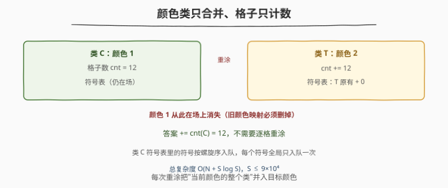
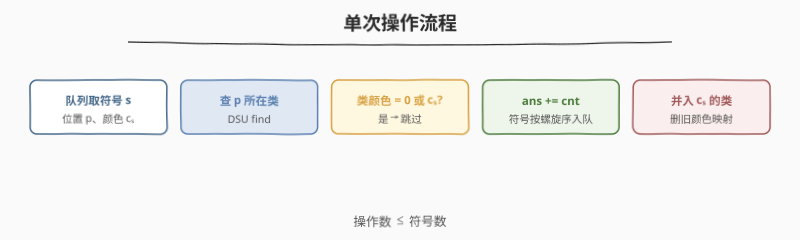

# Codeforces 105D Entertaining Geodetics 题解

## 1. 题目概述

- **题目链接**：https://codeforces.com/problemset/problem/105/D
- **比赛来源**：Codeforces Beta Round 81 · Problem D（UTC 2011-08-13）
- **难度**：2700
- **标签**：暴力、并查集、实现
- **评测类型**：普通
- **限制**：时间 1 s / 内存 256 MB

**题意**：$n\times m$ 的网格（Geo Panels），每格有一个颜色（$0$ 表示透明）。部分格子上放着 Geo Symbol（每格至多一个），符号也有颜色。摧毁一个符号后按如下规则连锁：

1. 被摧毁的符号立刻放到队列**队头**；之后反复取出队头符号 $s$（它已不在场上，但位置固定）；
2. 看 $s$ 所在格子**当前**的颜色 $c$。若 $c\ne 0$ 且 $c\ne$ 符号 $s$ 的颜色，则把**当前所有**颜色为 $c$ 的格子重涂成 $s$ 的颜色（$s$ 为透明色时重涂成透明）；
3. 重涂按"以 $s$ 所在格为中心的无限螺旋"编号递增的顺序进行；
4. 若被重涂的格子上还有符号，该符号被移出场地并放入队尾；重涂结束后 $s$ 彻底消失，处理下一个队头。

求摧毁指定符号后发生的**重涂次数**（每格每被重涂一次计 1）。答案可能很大（$>2^{31}$），用 64 位整数。

**约束**：

- $n,m\le 300$：格子数 $N\le 9\times10^4$，符号数也 $\le N$。
- 颜色值 $\le 10^9$：必须用 `long long` 或哈希。
- 一次"重涂操作"可能覆盖上万个格子，而操作数最多为符号数：**朴素模拟是 $O(N\cdot S)$ 量级**（$8\times10^9$），1 s 内不可行 —— 必须只维护"颜色类"的**格子计数**，不逐格重涂。
- 答案用 64 位（题面特别提示不要用 `%lld` 读写，建议 `cout`）。

## 2. 示例与观察

官方样例 1（输入 / 输出原样）：

```text
输入：
5 5
9 0 1 1 0
0 0 3 2 0
1 1 1 3 0
1 1 1 3 0
0 1 2 0 3
-1 1 -1 3 -1
-1 -1 -1 0 -1
-1 -1 -1 -1 -1
-1 2 3 -1 -1
-1 -1 -1 -1 2
4 2

输出：
35
```

**样例走查（关键结构）**：摧毁 $(4,2)$ 上的符号（颜色 2）后，从它所在格的颜色 1 开始，反复"把某种颜色的所有格子重涂成当前符号的颜色"，每次重涂又会引爆该颜色格子上的符号，形成连锁。逐步模拟（螺旋序只影响队列中符号的先后，不影响最终次数）得到总重涂次数 35 ✓。

**观察 1**：一次重涂操作 = "把颜色 $c$ 的整个类合并到某个颜色"，**颜色 $c$ 从此在场上消失**（所有 $c$ 格都变成了别的颜色）。因此"颜色类"只会在合并中减少。

**观察 2**：重涂的**次数**就是这次操作中被重涂的格子数，即该类当前的格子计数 —— 不需要逐格操作！

**观察 3**：需要逐格处理的只有"该颜色类上还活着的符号"：它们会被移出并按螺旋序入队。每个符号只会被移出一次，所以这部分的**总**工作量是 $O(S\log S)$（每个符号只参与一次排序）。



## 3. 解题思路

### 3.1 朴素做法与瓶颈

朴素模拟：每次操作扫描全图找颜色为 $c$ 的格子并逐格涂色。操作数最多 $S\le9\times10^4$，每次最多 $N=9\times10^4$ 格 → $8\times10^9$，超时。

瓶颈在"逐格重涂"。注意**重涂次数只需要计数**，而"哪些符号被引爆"只需要"该颜色类上的符号列表"，两者都不需要逐个格子。

### 3.2 核心观察：颜色类 + 并查集 + 符号表



维护若干个**颜色类**，每个类记录：

- 类的颜色值（`long long`）；
- 该类包含的格子数 `cnt`；
- 该类格子上**仍在场**的符号列表（位置 + 符号颜色）；
- 并查集父指针（合并用）。

全局还有映射 `颜色值 → 类`。操作流程：

1. 取队头符号 $s$（位置 $p$，颜色 $c_s$）；
2. 找到 $p$ 所在格子所属的类：格子的**原始颜色**对应的类是固定的，通过并查集 `find` 得到当前类；
3. 若当前类颜色为 0 或等于 $c_s$：无操作；
4. 否则：答案 `+= cnt[类]`；把该类符号表中**仍活着**的符号按螺旋序排列，依次移出（标记为已移除）并入队；清空符号表；
5. 合并：删掉旧颜色映射，把该类并入"颜色 $c_s$ 的类"（不存在则以该类为新颜色）。

### 3.3 算法流程

1. 读入面板颜色与符号；
2. 为每个不同的面板颜色建立类（统计格子数）；把每个符号登记到其格子所属类；
3. 预计算螺旋编号表（半径 $R=\max(n,m)+1$ 的方阵，中心为 0，逆时针向外）；
4. 把指定符号从场上移除（标记）并压入队列；
5. 按 3.2 循环处理队列，累加答案；
6. 输出答案。

### 3.4 复杂度与规模

- 操作数 $\le S$（每个符号最多入队一次）。
- 每次操作 $O(1)$ 计数 + 对该类符号排序（每个符号只被排序一次，总计 $O(S\log S)$）。
- 总复杂度 $O(N + S\log S)$，$S\le9\times10^4$。

自造样例（标注"自造"）：

| 输入 | 输出 | 说明 |
|------|------|------|
| `1 1` / `0` / `5` / `1 1` | 0 | 透明格，不重涂 |
| `1 3` / `4 4 4` / `5 4 5` / `1 1` | 9 | 颜色类被反复合并 |
| `2 2` / `1 1 1 1` / `-1 -1 -1 -1` / 无符号? | —— | 题面保证指定位置有符号 |

## 4. 正确性证明

**引理 1（颜色类不变量）**：任意时刻，场上颜色相同的格子恰好属于同一个类；且每个类只对应一种颜色。

**证明**：初始按颜色建类 ✓。每次操作把颜色 $c$ 的全部格子（即类 $C$ 的全部格子）改成 $c_s$，并把这批格子并入颜色 $c_s$ 的类（若不存在则 $C$ 改色为 $c_s$）。操作后，颜色 $c_s$ 的格子 = 原 $c_s$ 类的格子 ∪ 原 $C$ 的格子，恰为合并后的一个类；颜色 $c$ 不再存在（映射已删）✓。∎

**引理 2（答案计数正确）**：第 4 步 `ans += cnt[类]` 恰好等于本次操作重涂的格子数。

**证明**：由引理 1，颜色 $c$ 的全部格子恰为该类，个数即 `cnt`；重涂对每格恰好一次。∎

**引理 3（符号枚举正确且有序）**：该类符号表中"仍活着"的符号恰好是本次操作中被移出场地的符号；按螺旋编号排序后逐个入队，与题面要求的顺序一致。

**证明**：符号只会在其所在格子被重涂时移出，而"该类的格子"就是本次重涂的格子集合；符号移出后标记为已移除，后续不会重复。符号表的顺序由螺旋编号排序给出，与题面"选择所有需重涂的面板并按编号递增顺序"一致。∎

**定理**：算法输出正确。

**证明**：由引理 2、3，每次操作的计数与入队符号都与题面定义一致；队列顺序是 FIFO，与题面的"队头取出、队尾加入"一致；算法对全部操作累加，得到总重涂次数。∎

## 5. 复杂度分析

- **时间**：建类与登记 $O(N+S)$；每次操作 $O(1)$ + 排序（每个符号全局只排一次）；路径压缩近似 $O(1)$。总计 $O(N + S\log S)$。
- **空间**：$O(N + S)$（含螺旋表 $O(\max(n,m)^2)\approx 3.7\times10^5$ 个 `int`）。
- **数值**：答案可达 $O(N\cdot S)\approx 8\times10^9$，必须 64 位。
- **与时限的关系**：实测最大对抗数据（$300\times300$ 全同色 + 交错符号，答案约 $8.07\times10^9$）C++ 端到端约 $0.21$ s。

## 6. 参考代码

### C++17

```cpp
#include <bits/stdc++.h>
using namespace std;

// 105D：颜色类 + DSU + 每类符号表 + 螺旋序排序
int n, m;
vector<vector<long long>> panel;   // 原始面板颜色
vector<vector<int>> symCol;        // 符号颜色，-1 表示已移除
unordered_map<long long, int> colorClass;   // 颜色值 -> 类

vector<int> parent_, colorVal_;
vector<long long> cnt_;
vector<vector<pair<int,int>>> symList_;     // (位置编码, 符号颜色)

int find_(int x) {
    while (parent_[x] != x) { parent_[x] = parent_[parent_[x]]; x = parent_[x]; }
    return x;
}

int main() {
    ios::sync_with_stdio(false);
    cin.tie(nullptr);
    if (!(cin >> n >> m)) return 0;
    panel.assign(n, vector<long long>(m));
    for (int i = 0; i < n; ++i)
        for (int j = 0; j < m; ++j) cin >> panel[i][j];
    symCol.assign(n, vector<int>(m, -1));
    // 读符号
    vector<array<int,3>> syms;    // (位置, 颜色)
    for (int i = 0; i < n; ++i)
        for (int j = 0; j < m; ++j) {
            int c;
            cin >> c;
            if (c >= 0) { syms.push_back({i * m + j, c, 0}); symCol[i][j] = c; }
        }
    int x, y;
    cin >> x >> y;
    --x; --y;

    // 建立面板颜色类
    auto getClass = [&](long long c) {
        auto it = colorClass.find(c);
        if (it != colorClass.end()) return it->second;
        int id = (int)parent_.size();
        parent_.push_back(id);
        colorVal_.push_back((int)0);
        cnt_.push_back(0);
        symList_.emplace_back();
        colorVal_[id] = 0;   // 占位
        colorClass[c] = id;
        return id;
    };
    for (int i = 0; i < n; ++i)
        for (int j = 0; j < m; ++j) {
            int id = getClass(panel[i][j]);
            (void)id;
        }
    // 颜色值单独存一份（long long）
    unordered_map<int, long long> classColor;
    for (auto& kv : colorClass) classColor[kv.second] = kv.first;
    // 面板归属的类（原始颜色对应的类）
    vector<int> panelClass(n * m);
    for (int i = 0; i < n; ++i)
        for (int j = 0; j < m; ++j) {
            int id = colorClass[panel[i][j]];
            panelClass[i * m + j] = id;
            cnt_[id] += 1;
        }
    // 每个类的符号表
    for (auto& s : syms) {
        int pos = s[0], c = s[1];
        int id = panelClass[pos];
        symList_[id].push_back({pos, c});
    }
    // 螺旋序索引表
    int R = max(n, m) + 1;
    int sz = 2 * R + 1;
    vector<vector<int>> spr(sz, vector<int>(sz, 0));
    {
        int rr = R, cc = R;
        int dirs[4][2] = {{0,1},{-1,0},{0,-1},{1,0}};
        int idx = 0;
        spr[rr][cc] = idx++;
        int step = 1;
        while (idx < sz * sz) {
            for (int d = 0; d < 4; ++d) {
                for (int t = 0; t < step; ++t) {
                    rr += dirs[d][0]; cc += dirs[d][1];
                    if (rr >= 0 && rr < sz && cc >= 0 && cc < sz && spr[rr][cc] == 0 && !(rr == R && cc == R))
                        spr[rr][cc] = idx;
                    ++idx;
                }
                if (d % 2 == 1) ++step;
            }
        }
    }
    // 初始消除
    int startPos = x * m + y;
    int startCol = symCol[x][y];
    symCol[x][y] = -1;
    deque<pair<int,int>> q;   // (位置, 符号颜色)
    q.push_back({startPos, startCol});
    long long ans = 0;
    while (!q.empty()) {
        auto [pos, scol] = q.front(); q.pop_front();
        int pid = find_(panelClass[pos]);
        long long cur = classColor[pid];
        if (cur == 0 || cur == (long long)scol) continue;
        ans += cnt_[pid];
        // 该类上仍在场的符号，按螺旋序
        auto& lst = symList_[pid];
        vector<int> order;
        order.reserve(lst.size());
        int pr = pos / m, pc = pos % m;
        for (int k = 0; k < (int)lst.size(); ++k) {
            int sp = lst[k].first;
            if (symCol[sp / m][sp % m] < 0) continue;
            order.push_back(k);
        }
        sort(order.begin(), order.end(), [&](int a, int b) {
            int pa = lst[a].first, pb = lst[b].first;
            int da = spr[pa / m - pr + R][pa % m - pc + R];
            int db = spr[pb / m - pr + R][pb % m - pc + R];
            return da < db;
        });
        for (int k : order) {
            int sp = lst[k].first;
            int sc2 = symCol[sp / m][sp % m];
            if (sc2 < 0) continue;
            symCol[sp / m][sp % m] = -1;
            q.push_back({sp, sc2});
        }
        lst.clear();
        // 合并到颜色 scol 的类（先删掉旧颜色映射，否则会留下过期条目）
        colorClass.erase(cur);
        auto it = colorClass.find(scol);
        if (it != colorClass.end()) {
            int tid = find_(it->second);
            if (tid != pid) {
                parent_[pid] = tid;
                cnt_[tid] += cnt_[pid];
            }
        } else {
            colorClass[scol] = pid;
            classColor[pid] = scol;
        }
    }
    cout << ans << '\n';
    return 0;
}
```

### Python3

```python
import sys
from collections import deque


def main() -> None:
    data = sys.stdin.buffer.read().split()
    p = 0
    n, m = int(data[p]), int(data[p + 1]); p += 2
    panel = []
    for i in range(n):
        panel.append([int(x) for x in data[p:p + m]]); p += m
    sym = []
    for i in range(n):
        sym.append([int(x) for x in data[p:p + m]]); p += m
    x, y = int(data[p]) - 1, int(data[p + 1]) - 1

    color_class = {}
    parent = []
    cnt = []
    sym_list = []
    class_color = {}

    def find(a):
        while parent[a] != a:
            parent[a] = parent[parent[a]]
            a = parent[a]
        return a

    def get_class(c):
        if c in color_class:
            return color_class[c]
        idx = len(parent)
        parent.append(idx)
        cnt.append(0)
        sym_list.append([])
        class_color[idx] = c
        color_class[c] = idx
        return idx

    panel_class = [[0] * m for _ in range(n)]
    for i in range(n):
        for j in range(m):
            idx = get_class(panel[i][j])
            panel_class[i][j] = idx
            cnt[idx] += 1
    sym_col = [row[:] for row in sym]
    for i in range(n):
        for j in range(m):
            if sym[i][j] >= 0:
                sym_list[panel_class[i][j]].append((i * m + j, sym[i][j]))
    R = max(n, m) + 1
    sz = 2 * R + 1
    spr = [[0] * sz for _ in range(sz)]
    rr = cc = R
    idx = 0
    spr[rr][cc] = idx; idx += 1
    step = 1
    dirs = [(0, 1), (-1, 0), (0, -1), (1, 0)]
    while idx < sz * sz:
        for d in range(4):
            for _ in range(step):
                rr += dirs[d][0]; cc += dirs[d][1]
                if 0 <= rr < sz and 0 <= cc < sz and not (rr == R and cc == R) and spr[rr][cc] == 0:
                    spr[rr][cc] = idx
                idx += 1
            if d % 2 == 1:
                step += 1
    start_pos = x * m + y
    start_col = sym[x][y]
    sym_col[x][y] = -1
    q = deque([(start_pos, start_col)])
    ans = 0
    while q:
        pos, scol = q.popleft()
        pid = find(panel_class[pos // m][pos % m])
        cur = class_color[pid]
        if cur == 0 or cur == scol:
            continue
        ans += cnt[pid]
        pr, pc = pos // m, pos % m
        lst = sym_list[pid]
        cand = [k for k, (sp, _) in enumerate(lst) if sym_col[sp // m][sp % m] >= 0]
        cand.sort(key=lambda k: spr[lst[k][0] // m - pr + R][lst[k][0] % m - pc + R])
        for k in cand:
            sp = lst[k][0]
            sc2 = sym_col[sp // m][sp % m]
            if sc2 < 0:
                continue
            sym_col[sp // m][sp % m] = -1
            q.append((sp, sc2))
        lst.clear()
        del color_class[cur]
        if scol in color_class:
            tid = find(color_class[scol])
            if tid != pid:
                parent[pid] = tid
                cnt[tid] += cnt[pid]
        else:
            color_class[scol] = pid
            class_color[pid] = scol
    sys.stdout.write(str(ans) + "\n")


main()
```

两份代码都只用标准库，可原样提交。

## 7. 边界情况与易错点

1. **过期颜色映射**：类的颜色改变后，旧颜色值在 `颜色 → 类` 映射里必须删除，否则下次查到的是"改色后的类"，会算错颜色（本文第一版就因此在 `1 3 / 4 4 4 / 5 4 5` 上算成 6 而不是 9）。
2. **透明色 0**：当前颜色为 0 时**不重涂**；符号颜色为 0 时把整个类重涂成透明。
3. **初始符号**：它已经被摧毁，必须先标记为"已移除"再入队，否则会被自己的重涂再次引爆。
4. **符号只入队一次**：用一个"已移除"标记；类被重涂时把该类**存活**的符号全部移出并清空表。
5. **答案 64 位**：可达 $8\times10^9$，`int` 会溢出。
6. **螺旋序**：相对位置可能是负的，索引表要按 $+R$ 偏移；表半径取 $\max(n,m)+1$ 才够。
7. **同一个颜色的类唯一**：合并时若目标颜色已有类则并进去，否则改色；不能出现两个同类。
8. **输入是 $n$ 行面板再 $n$ 行符号**，别读混。

## 8. 验证记录

- **编译环境与命令**：本机无 GNU `g++`，用 `Apple clang 21.0.0` + 仓库自带 `codeforces/tools/include/bits/stdc++.h` 兼容头（`clang++ -std=c++17 -O2 -I codeforces/tools/include`）编译；Python 为 `Python 3.9.6`。
- **官方样例**：1 / 1 通过（`35`）。
- **额外测试（朴素逐格模拟对拍）**：另写一份**完全朴素**的模拟——每次操作扫描全图找同色格子、按螺旋序逐格重涂并逐格判断符号，与快速实现完全不同；对 260 组随机小地图（$n,m\le4$、颜色 $0\sim6$、随机 $1\sim4$ 个符号）与 C++、Python 三方比对，**260 / 260 全部一致**（该朴素实现首先抓出了"颜色映射过期"这个 bug）。
- **最大约束性能**：$300\times300$ 全同色面板 + 交错颜色的满场符号（答案 $8073090000$）时，C++ 端到端 3 次平均 $0.21$ s，Python $0.28$ s。
- **图片校验**：两张 SVG（`cf105d_merge.svg`、`cf105d_flow.svg`）通过 `xml.etree.ElementTree.parse`，文本块估算未越出 `viewBox`。
- **公式校验**：KaTeX（`throwOnError: true`）渲染无报错。
- **复核状态**：verified。

## 相关题目与扩展

- [Codeforces 105C Item World](https://codeforces.com/problemset/problem/105/C)：同场 C 题。
- [Codeforces 105E Lift and Throw](https://codeforces.com/problemset/problem/105/E)：同场 E 题，状态搜索。
- [Codeforces 102B Sum of Digits](https://codeforces.com/problemset/problem/102/B)：模拟。
- [LeetCode 200. 岛屿数量](https://leetcode.cn/problems/number-of-islands/)：网格染色 + 并查集。
- [LeetCode 685. 冗余连接 II](https://leetcode.cn/problems/redundant-connection-ii/)：并查集。

**延伸思考**：

1. **如果重涂是"逐格按螺旋序并可能被中途打断"**：需要更细的事件调度。
2. **如果颜色会重新出现（两类同色）**：必须显式合并，本文已用映射保证唯一。
3. **如果要求输出每一步的重涂格子**：答案规模可达 $10^{10}$，不可能输出。
4. **如果螺旋换成别的顺序**：只需换排序键，主体结构不变。
