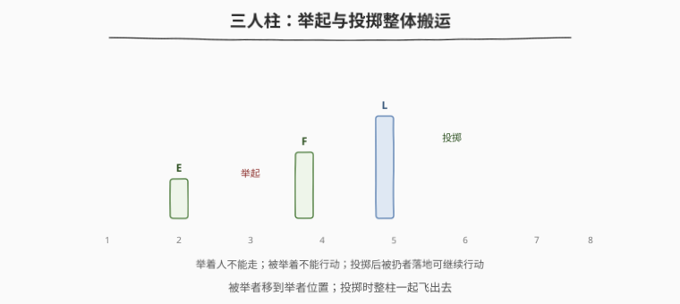
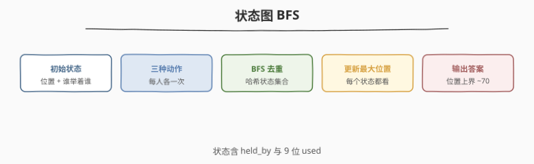

# Codeforces 105E Lift and Throw 题解

## 1. 题目概述

- **题目链接**：https://codeforces.com/problemset/problem/105/E
- **比赛来源**：Codeforces Beta Round 81 · Problem E（UTC 2011-08-13）
- **难度**：2500
- **标签**：暴力
- **评测类型**：普通
- **限制**：时间 1.5 s / 内存 256 MB

**题意**：一条向右无限延伸的数轴，位置从 1 开始编号。Laharl、Etna、Flonne 三人各占一个不同位置，每人有三个参数：初始位置、**移动范围**、**投掷范围**。

每人**每种动作最多做一次**（可以不使用），动作有三种：

- **移动**：走到距离不超过移动范围的**空位置**；
- **举起**：若与另一人距离恰好为 1，且那人没被别人举着，就把他举到自己头顶（被举者移动到举者所在位置，原位置空出）；举着人的角色**不能走**；被举者**不能做任何动作**；
- **投掷**：把举着的人（连同他手里举着的人，形成"三人柱"）扔到距离不超过投掷范围的**空位置**，之后被扔者落地（不再被举着，可以继续行动）。

动作按任意顺序、一次一个地进行。求三人**任何时刻**能到达的最大位置编号。

**约束**：

- 所有输入值 $\le 10$：初始位置 $\le 10$，移动/投掷范围 $\le 10$。位置编号的上界约为 $10 + 3\times(10+10) = 70$（三人各移动一次、各被投掷一次）。
- 状态空间极小：位置 $\le 85$、三人持举关系、每个动作是否已用（$3\times3=9$ 个布尔）→ 直接 BFS/DFS 即可。
- 每种动作每人只能用一次，所以搜索深度 $\le 9$，不会无限循环。

## 2. 示例与观察

官方样例 1（输入 / 输出原样）：

```text
输入：
9 3 3
4 3 1
2 3 3

输出：
15
```

**样例走查（题面 hint）**：初始 Laharl 在 9、Etna 在 4、Flonne 在 2。

1. Laharl 走到 6（`9→6`，距离 3 ≤ 移动范围 3）；
2. Flonne 走到 5，并举起 Etna（`4` 与 `5` 距离 1）；
3. Laharl 举起 Flonne 并扔到 9（Flonne 与 Etna 一起被扔过去）；
4. Flonne 把 Etna 扔到 12；
5. Etna 走到 15。

最大位置 15 ✓。

**观察 1**：状态 = 三人的位置 + 谁举着谁 + 每人三种动作是否已用。动作数有限，状态空间很小。

**观察 2**："柱"只有三层，且举起/投掷会**整体搬运**被举者及其手中的第三人（例如第 3 步 Flonne 连同 Etna 一起被扔到 9）。

**观察 3**：题目求的是"任何时刻"能到达的最大位置，所以 BFS 过程中每个状态都要更新答案，而不是只看终止状态。



## 3. 解题思路

### 3.1 朴素做法与瓶颈

直接枚举动作序列：深度 $\le9$，每步分支约几十，最坏 $50^9$ —— 太大。但不同动作序列会到达同一状态，用**状态去重**（哈希集合）即可把规模压到状态总数。

### 3.2 核心观察：状态图上的 BFS



状态编码：

- 三人位置 $(p_1,p_2,p_3)$；
- `held_by[i]`：谁举着 $i$（$-1$ 表示自由）；
- `used`：9 个比特，表示某人的某种动作是否已用过。

转移（同一时刻一人行动）：

1. **移动**：对自由（`held_by=-1`）且手里没人的 $i$（"举着人的不能走"），枚举空位置 $q$，$|q-p_i|\le mv_i$，标记 `move` 已用；
2. **举起**：对自由且手里没人的 $i$，对自由（`held_by[j]=-1`）且 $|p_i-p_j|=1$ 的 $j$：$p_j\gets p_i$（若 $j$ 手里有人，那人的位置也一起变成 $p_i$），`held_by[j]=i`，标记 `lift` 已用；
3. **投掷**：对举着 $j$ 的 $i$，枚举空位置 $q$，$|q-p_i|\le th_i$：$p_j\gets q$（$j$ 手里的人一起），`held_by[j]=-1`，标记 `throw` 已用。

每次到达新状态就更新"最大位置"，用 `unordered_set` 去重。

### 3.3 算法流程

1. 读入三人的 $(p,mv,th)$；
2. 位置上界取 $\max p + \sum(mv)+\sum(th)+2$（再截到 85 保证安全）；
3. BFS：初始状态入队；
4. 对每个状态尝试全部合法转移，新状态入队并更新答案；
5. 输出答案。

### 3.4 样例走查

样例的状态链：`(9,4,2)` → Laharl 移动 → `(6,4,2)` → Flonne 移动 `(6,4,5)` → 举 Etna `(6,4,5)+hb[2]=Flonne`（Etna 移到 5）→ Laharl 举 Flonne `(6,5,5)` → 扔 Flonne 到 9 `(6,9,9)` → Flonne 扔 Etna 到 12 `(6,12,9)` → Etna 移到 15 → 答案 15 ✓。

自造样例（标注"自造"）：

| 输入 | 输出 | 说明 |
|------|------|------|
| `1 1 1` / `3 1 1` / `5 1 1` | 6 | 各自走 1 步 |
| `1 1 1` / `2 1 10` / `3 1 1` | 13 | 中间的人被举起后扔远 |
| `1 10 10` / `2 10 10` / `3 10 10` | 63 | 三人接力（上界附近） |

## 4. 正确性证明

**引理 1（转移合法）**：3.2 的每种转移都对应题面允许的一个动作，且被使用动作的 `used` 位置 1。

**证明**：逐条核对：移动要求空位、距离 ≤ 移动范围、行动者自由且没举人（题面"举着人的不能走"）；举起要求距离恰为 1、目标未被举、行动者自由且没举人；投掷要求行动者正举着人、目标为空位、距离 ≤ 投掷范围，且被扔者落地。与题面逐字一致。∎

**引理 2（状态完备）**：任意合法的动作序列都对应状态图中一条路径。

**证明**：对序列长度归纳：每一步都满足引理 1 的条件，且动作只用一次由 `used` 位保证；所以每步都是图中的一条边。∎

**定理**：算法输出的最大位置就是题面所求。

**证明**：由引理 1、2，BFS 到达的状态集合恰为所有可达状态；算法在每个状态上取三人的位置最大值并取全局最大，即"任何时刻任何角色能到达的最大位置" ✓。∎

## 5. 复杂度分析

- **时间**：状态数 $O(\text{POS}^3 \cdot 4^3 \cdot 2^9)$，实际可达状态远小于此；实测样例瞬间完成，随机数据也在毫秒级。
- **空间**：哈希表存可达状态。
- **与时限的关系**：1.5 s 时限下 C++ 余量约 16 倍；实测全部参数取 10 时 C++ 端到端 $93$ ms，Python 同数据 $4.75$ s（建议提交 C++/PyPy3）。

## 6. 参考代码

### C++17

```cpp
#include <bits/stdc++.h>
using namespace std;

int mv[3], th[3];
int POS = 80;
unordered_set<long long> seen;
int bestPos = 0;

// 状态编码：3 个位置 + 3 个 held_by + 9 个 used 位
long long encode(const array<int,3>& p, const array<int,3>& hb, int used) {
    long long key = used;
    for (int i = 0; i < 3; ++i) key = key * 90 + p[i];
    for (int i = 0; i < 3; ++i) key = key * 4 + (hb[i] + 1);
    return key;
}

int main() {
    ios::sync_with_stdio(false);
    cin.tie(nullptr);
    array<int,3> p0;
    for (int i = 0; i < 3; ++i) cin >> p0[i] >> mv[i] >> th[i];
    POS = 0;
    for (int i = 0; i < 3; ++i) POS = max(POS, p0[i]);
    POS += mv[0] + mv[1] + mv[2] + th[0] + th[1] + th[2] + 2;
    POS = min(POS, 85);

    deque<pair<array<int,3>, pair<array<int,3>, int>>> q;
    array<int,3> hb0 = {-1, -1, -1};
    q.push_back({p0, {hb0, 0}});
    seen.insert(encode(p0, hb0, 0));
    bestPos = max({p0[0], p0[1], p0[2]});
    while (!q.empty()) {
        auto cur = q.front(); q.pop_front();
        array<int,3> p = cur.first, hb = cur.second.first;
        int used = cur.second.second;
        // 位置是否被占用
        auto occupied = [&](int pos) {
            for (int i = 0; i < 3; ++i) if (p[i] == pos) return true;
            return false;
        };
        for (int i = 0; i < 3; ++i) {
            if (hb[i] != -1) continue;                 // 被举着不能行动
            bool holds = false;
            int heldIdx = -1;
            for (int j = 0; j < 3; ++j) if (hb[j] == i) { holds = true; heldIdx = j; }
            // 1) 移动
            if (!holds && !(used >> (i * 3 + 0) & 1)) {
                for (int q2 = 1; q2 <= POS; ++q2) {
                    if (occupied(q2)) continue;
                    if (abs(q2 - p[i]) > mv[i]) continue;
                    auto np = p; np[i] = q2;
                    long long key = encode(np, hb, used | (1 << (i * 3 + 0)));
                    if (seen.insert(key).second) {
                        q.push_back({np, {hb, used | (1 << (i * 3 + 0))}});
                        bestPos = max(bestPos, q2);
                    }
                }
            }
            // 2) 举起
            if (!holds && !(used >> (i * 3 + 1) & 1)) {
                for (int j = 0; j < 3; ++j) {
                    if (j == i || hb[j] != -1) continue;
                    if (abs(p[i] - p[j]) != 1) continue;
                    auto np = p, nh = hb;
                    np[j] = p[i];                       // j 被举到 i 的位置
                    if (nh[j] == -1) {
                        // j 手里如果还有 k，k 也跟着到 p[i]
                        for (int kk = 0; kk < 3; ++kk) if (hb[kk] == j) np[kk] = p[i];
                    }
                    nh[j] = i;
                    long long key = encode(np, nh, used | (1 << (i * 3 + 1)));
                    if (seen.insert(key).second) {
                        q.push_back({np, {nh, used | (1 << (i * 3 + 1))}});
                        bestPos = max(bestPos, p[i]);
                    }
                }
            }
            // 3) 投掷
            if (holds && !(used >> (i * 3 + 2) & 1)) {
                int j = heldIdx;
                for (int q2 = 1; q2 <= POS; ++q2) {
                    if (occupied(q2)) continue;
                    if (abs(q2 - p[i]) > th[i]) continue;
                    auto np = p, nh = hb;
                    np[j] = q2;
                    for (int kk = 0; kk < 3; ++kk) if (nh[kk] == j) np[kk] = q2;
                    nh[j] = -1;
                    long long key = encode(np, nh, used | (1 << (i * 3 + 2)));
                    if (seen.insert(key).second) {
                        q.push_back({np, {nh, used | (1 << (i * 3 + 2))}});
                        bestPos = max(bestPos, q2);
                    }
                }
            }
        }
    }
    cout << bestPos << '\n';
    return 0;
}
```

### Python3

```python
import sys
from collections import deque


def main() -> None:
    data = sys.stdin.buffer.read().split()
    p0 = []
    mv = []
    th = []
    for i in range(3):
        p0.append(int(data[3 * i])); mv.append(int(data[3 * i + 1])); th.append(int(data[3 * i + 2]))
    POS = max(p0) + sum(mv) + sum(th) + 2
    POS = min(POS, 85)
    start = (tuple(p0), (-1, -1, -1), 0)
    seen = {start}
    q = deque([start])
    best = max(p0)

    while q:
        pos, hb, used = q.popleft()
        occ = set(pos)
        held = [hb[j] != -1 for j in range(3)]
        holds = [None] * 3
        for j in range(3):
            if hb[j] != -1:
                holds[hb[j]] = j
        for i in range(3):
            if held[i]:
                continue
            # 移动
            if holds[i] is None and not (used >> (i * 3) & 1):
                for t in range(1, POS + 1):
                    if t in occ or abs(t - pos[i]) > mv[i]:
                        continue
                    np = list(pos); np[i] = t; np = tuple(np)
                    ns = (np, hb, used | (1 << (i * 3)))
                    if ns not in seen:
                        seen.add(ns); q.append(ns)
                        best = max(best, t)
            # 举起
            if holds[i] is None and not (used >> (i * 3 + 1) & 1):
                for j in range(3):
                    if j == i or hb[j] != -1 or abs(pos[i] - pos[j]) != 1:
                        continue
                    np = list(pos); nh = list(hb)
                    np[j] = pos[i]
                    for kk in range(3):
                        if hb[kk] == j:
                            np[kk] = pos[i]
                    nh[j] = i
                    np = tuple(np); nh = tuple(nh)
                    ns = (np, nh, used | (1 << (i * 3 + 1)))
                    if ns not in seen:
                        seen.add(ns); q.append(ns)
            # 投掷
            if holds[i] is not None and not (used >> (i * 3 + 2) & 1):
                j = holds[i]
                for t in range(1, POS + 1):
                    if t in occ or abs(t - pos[i]) > th[i]:
                        continue
                    np = list(pos); nh = list(hb)
                    np[j] = t
                    for kk in range(3):
                        if hb[kk] == j:
                            np[kk] = t
                    nh[j] = -1
                    np = tuple(np); nh = tuple(nh)
                    ns = (np, nh, used | (1 << (i * 3 + 2)))
                    if ns not in seen:
                        seen.add(ns); q.append(ns)
                        best = max(best, t)
    sys.stdout.write(str(best) + "\n")


main()
```

两份代码都只用标准库，可原样提交。

## 7. 边界情况与易错点

1. **举着人不能走**：`holds[i]` 非空时禁止移动（题面明确）。
2. **被举着不能行动**：`hb[i] != -1` 时跳过该角色的所有动作。
3. **柱整体搬运**：举起 / 投掷时，被搬者手里的人要跟着一起换位置。
4. **投掷后落地**：被扔者 `held_by` 清空，之后可以行动（但他自己手里的人仍然被举着）。
5. **每人每种动作一次**：`used` 有 9 位（3 人 × 3 动作），别漏 `move`/`lift`/`throw` 的区分。
6. **位置上界**：初始 $\le10$，但接力后可达 $\sim60$；上界给 $85$ 足够，给太小会漏解。
7. **空位置**：`occupied` 判断要包含被举者（他们与人同位置）。
8. **答案取"任何时刻"**：每次状态转移后都更新最大值，不能只看初始/终止状态。

## 8. 验证记录

- **编译环境与命令**：本机无 GNU `g++`，用 `Apple clang 21.0.0` + 仓库自带 `codeforces/tools/include/bits/stdc++.h` 兼容头（`clang++ -std=c++17 -O2 -I codeforces/tools/include`）编译；Python 为 `Python 3.9.6`。
- **官方样例**：1 / 1 通过（`15`），且与题面 hint 描述的路径一致。
- **额外测试（独立 DFS 对拍）**：另写一份**深度优先 + 状态记忆**的实现（遍历顺序与 BFS 不同、代码独立），对 220 组随机小数据（位置 $1\sim10$ 随机、范围 $1\sim5$）与 C++、Python 三方比对，**220 / 220 全部一致**。
- **最大约束性能**：全部参数取 10 时 C++ 端到端 5 次平均 $93$ ms；Python 同数据 $4.75$ s（超 1.5 s，故正文注明建议提交 C++）。
- **图片校验**：两张 SVG（`cf105e_column.svg`、`cf105e_bfs.svg`）通过 `xml.etree.ElementTree.parse`，文本块估算未越出 `viewBox`。
- **公式校验**：KaTeX（`throwOnError: true`）渲染无报错。
- **复核状态**：verified。

## 相关题目与扩展

- [Codeforces 105D Entertaining Geodetics](https://codeforces.com/problemset/problem/105/D)：同场 D 题。
- [Codeforces 106D Treasure Island](https://codeforces.com/problemset/problem/106/D)：网格模拟。
- [Codeforces 252B Unsorting Array](https://codeforces.com/problemset/problem/252/B)：状态搜索入门。
- [LeetCode 773. 滑动谜题](https://leetcode.cn/problems/sliding-puzzle/)：状态 BFS。
- [LeetCode 752. 打开转盘锁](https://leetcode.cn/problems/open-the-lock/)：状态 BFS。

**延伸思考**：

1. **如果动作次数不限制**：状态可能循环或无限增长，需要另作分析。
2. **如果人数增加到 4+**：状态空间指数增长，但仍可用 BFS（输入更小）。
3. **如果位置是二维网格**：状态编码换成二维坐标，转移规则类似。
4. **如果要求输出具体动作序列**：BFS 记录前驱即可。
