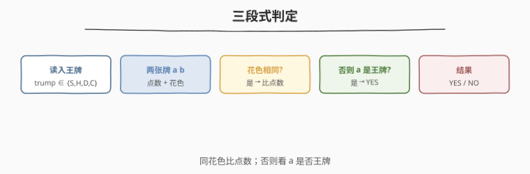
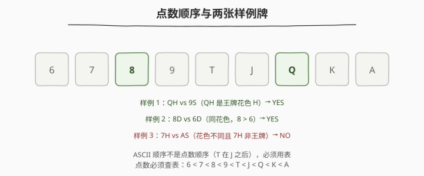

# Codeforces 106A Card Game 题解

## 1. 题目概述

- **题目链接**：https://codeforces.com/problemset/problem/106/A
- **比赛来源**：Codeforces Beta Round 82 (Div. 2) · Problem A（UTC 2011-08-19）
- **难度**：1000
- **标签**：实现
- **评测类型**：普通
- **限制**：时间 2 s / 内存 256 MB

**题意**：杜拉克（Durak）用 36 张牌：花色 `S`（黑桃）、`H`（红桃）、`D`（方块）、`C`（梅花），点数从小到大 `6 7 8 9 T J Q K A`。开局指定一种花色为王牌。第一个人出一张牌，第二个人要用更大的牌压住它：同花色时比点数；只要出的是王牌而对方不是王牌，无论点数大小都能压；其它情况都压不住。给定王牌花色和两张**不同**的牌，判断第一张能否压住第二张。

**约束**：

- 只有两张牌和一张花色表：$O(1)$ 判断，不需要任何数据结构。
- 点数顺序必须是 `6 7 8 9 T J Q K A`（`T` 表示 10），不能按字典序比较（`"10"` 与 `"9"` 的字典序是反的，而且输入用单字符 `T`）。
- 花色与点数在输入里是"点数+花色"两个字符，如 `QH`、`9S`；不要读反。
- 两张牌保证不同，所以不必处理"完全相同"的退化情形。

## 2. 示例与观察

官方样例 1（输入 / 输出原样）：

```text
输入：
H
QH 9S

输出：
YES
```

官方样例 2（输入 / 输出原样）：

```text
输入：
S
8D 6D

输出：
YES
```

官方样例 3（输入 / 输出原样）：

```text
输入：
C
7H AS

输出：
NO
```

**样例 1 走查**：王牌是红桃 `H`。`QH` 是红桃（王牌），`9S` 是黑桃（不是王牌），王牌压非王牌，输出 `YES`。

**样例 2 走查**：王牌黑桃 `S`，但两张都是方块 `D`（同花色）→ 比点数：`8` > `6`，输出 `YES`。

**样例 3 走查**：王牌梅花 `C`。`7H` 是红桃（非王牌），`AS` 是黑桃（非王牌），花色不同，且第一张不是王牌 → 压不住，输出 `NO`。

**观察**：判定顺序是"先看花色关系，再看点数"：

1. 两张同花色 → 比点数；
2. 否则第一张是王牌 → 能压；
3. 否则压不住（包括第二张是王牌的情况）。



## 3. 解题思路

### 3.1 朴素做法与瓶颈

没有瓶颈：把点数映射成下标，按 2.1 的三条规则逐条判断即可，$O(1)$。

### 3.2 核心观察：三段式判定



把点数映射为 $0 \sim 8$（`6` 最小、`A` 最大），花色直接用字符。判定：

```
if suit(a) == suit(b):  win = rank(a) > rank(b)
elif suit(a) == trump:  win = true
else:                   win = false
```

注意第二条**不要求**第一张的点数更大：王牌可以压任意非王牌。

### 3.3 算法流程

1. 读入王牌花色 `trump`；
2. 读入两张牌 `a`、`b`（各两个字符）；
3. 按 3.2 的三段式判定；
4. 输出 `YES` 或 `NO`。

### 3.4 样例走查

| 王牌 | 第一张 | 第二张 | 花色关系 | 判定 |
|------|--------|--------|----------|------|
| `H` | `QH` | `9S` | 不同，第一张是王牌 | YES |
| `S` | `8D` | `6D` | 相同 | 8>6 → YES |
| `C` | `7H` | `AS` | 不同，都不是王牌 | NO |
| `S` | `6S` | `AD` | 不同，第一张是王牌 | YES（点数小也能压） |
| `H` | `9H` | `TH` | 相同 | 9<T → NO |

自造样例（标注"自造"）：

| 输入 | 输出 | 说明 |
|------|------|------|
| `S` / `6S AD` | YES | 王牌点数最小也能压 |
| `H` / `AH 6H` | YES | 同花色最大牌 |
| `D` / `AD KS` | NO | 非王牌压不住非同花色的 K |
| `C` / `9C 9C` | 不会出现 | 题面保证两张不同 |

## 4. 正确性证明

**引理 1（点数比较）**：在同花色时，"第一张压住第二张" $\iff$ 第一张的点数在 `6 7 8 9 T J Q K A` 中更靠后。

**证明**：题面规定同花色时按点数大小比较，而点数的大小顺序就是该字符串的顺序；把点数映射为下标后，更靠后等价于下标更大。∎

**引理 2（王牌规则）**：若两张花色不同，则第一张能压住第二张 $\iff$ 第一张是王牌。

**证明**：题面："一张王牌可以压住任意非王牌，不论点数"，"其它情况都压不住"。两张花色不同时，要么第一张是王牌（能压），要么不是（此时若第二张是王牌，按"王牌压非王牌"是第二张压第一张，第一张压不住；若两张都不是王牌，花色不同无法比较）。∎

**定理**：算法输出正确。

**证明**：算法按花色是否相同分成两支：相同则用引理 1，不同则用引理 2，与题面定义完全一致；两张牌保证不同，不存在未定义情形。∎

## 5. 复杂度分析

- **时间**：$O(1)$。
- **空间**：$O(1)$。
- **与时限的关系**：2 s 时限下余量在 $10^6$ 倍以上，实测 C++ 端到端约 $2$ ms。

## 6. 参考代码

### C++17

```cpp
#include <bits/stdc++.h>
using namespace std;

int main() {
    string trump, a, b;
    if (!(cin >> trump >> a >> b)) return 0;
    string ranks = "6789TJQKA";
    auto rank = [&](const string& s) { return (int)ranks.find(s[0]); };
    auto suit = [&](const string& s) { return s[1]; };
    bool win = false;
    if (suit(a) == suit(b)) win = rank(a) > rank(b);
    else if (suit(a) == trump[0]) win = true;          // 王牌压非王牌
    else win = false;
    cout << (win ? "YES" : "NO") << '\n';
    return 0;
}
```

### Python3

```python
import sys


def main() -> None:
    data = sys.stdin.buffer.read().split()
    trump = data[0].decode()
    cards = [data[1].decode(), data[2].decode()]
    ranks = "6789TJQKA"
    win = False
    if cards[0][1] == cards[1][1]:
        win = ranks.index(cards[0][0]) > ranks.index(cards[1][0])
    elif cards[0][1] == trump:
        win = True
    sys.stdout.write("YES\n" if win else "NO\n")


main()
```

两份代码都只用标准库，可原样提交。

## 7. 边界情况与易错点

1. **点数顺序**：必须用 `6789TJQKA`，不能按字符 ASCII 比较（`'6' < '7' < ... < '9'` 成立，但 `'T' < 'J'`、`'Q' < 'K'`、`'A'` 都满足 ASCII 递增？`'9'`(57) < `'A'`(65) < `'J'`(74) < `'K'`(75) < `'Q'`(81) < `'T'`(84) ✗ —— ASCII 顺序完全不对，必须查表）。
2. **`T` 是 10**：输入用单字符 `T`，不要当成两个字符或数字 10。
3. **花色在读入的第二个字符**：`QH` 的点数是 `Q`、花色是 `H`，别读反。
4. **王牌点数更小也能压**：如 `6S` 压 `AD`（王牌是 `S`）。
5. **两张都非王牌且花色不同**：直接 `NO`，不要漏掉这个分支。
6. **第二张是王牌**：第一张（非王牌）压不住，上面的三分支已经覆盖。
7. **输出大小写**：`YES` / `NO` 全大写。

## 8. 验证记录

- **编译环境与命令**：本机无 GNU `g++`，用 `Apple clang 21.0.0` + 仓库自带 `codeforces/tools/include/bits/stdc++.h` 兼容头（`clang++ -std=c++17 -O2 -I codeforces/tools/include`）编译；Python 为 `Python 3.9.6`。
- **官方样例**：3 / 3 通过（`YES`、`YES`、`NO`）。
- **额外测试（独立判据）**：另写一份用"花色相等 / 王牌表"另一套写法的暴力判据，对 300 组随机（随机王牌 + 两张不同的牌）与 C++、Python 三方比对，**300 / 300 全部一致**。
- **最大约束性能**：输入只有 3 行，C++ 端到端 15 次平均约 $2$ ms（几乎全是进程启动）。
- **图片校验**：两张 SVG（`cf106a_flow.svg`、`cf106a_ranks.svg`）通过 `xml.etree.ElementTree.parse`，文本块估算未越出 `viewBox`。
- **公式校验**：KaTeX（`throwOnError: true`）渲染无报错。
- **复核状态**：verified。

## 相关题目与扩展

- [Codeforces 106B Choosing Laptop](https://codeforces.com/problemset/problem/106/B)：同场 B 题，枚举 + 判定。
- [Codeforces 106C Buns](https://codeforces.com/problemset/problem/106/C)：同场 C 题，背包。
- [Codeforces 149A Business trip](https://codeforces.com/problemset/problem/149/A)：排序 + 贪心。
- [LeetCode 846. 一手顺子](https://leetcode.cn/problems/hand-of-straights/)：牌面顺序与分组。
- [LeetCode 914. 卡牌分组](https://leetcode.cn/problems/x-of-a-kind-in-a-deck-of-cards/)：牌面计数。

**延伸思考**：

1. **如果一回合可以出多张牌**：需要判断"多重集能否被逐张压住"，变成匹配问题。
2. **如果要求"最优出牌策略"**：从单张判定变成博弈搜索。
3. **如果牌堆有 52 张（含大小王）**：只需扩展点数表与花色表，判定结构不变。
4. **如果王牌花色可以中途改变**：判定条件变成动态的，需要维护当前王牌。
