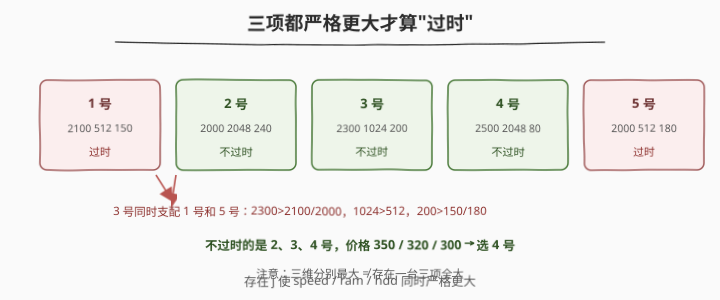
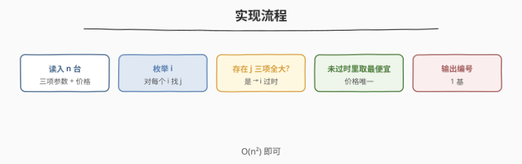

# Codeforces 106B Choosing Laptop 题解

## 1. 题目概述

- **题目链接**：https://codeforces.com/problemset/problem/106/B
- **比赛来源**：Codeforces Beta Round 82 (Div. 2) · Problem B（UTC 2011-08-19）
- **难度**：1000
- **标签**：暴力、实现
- **评测类型**：普通
- **限制**：时间 2 s / 内存 256 MB

**题意**：商店有 $n$ 台笔记本电脑，第 $i$ 台有处理器主频、内存、硬盘三个参数和价格。若存在另一台笔记本的三项参数都**严格大于**它，则它被 Vasya 认为"过时"。在所有不过时的笔记本里，Vasya 选**最便宜**的一台。输出它的编号（按输入顺序 $1 \sim n$）。题面保证所有价格互不相同。

**约束**：

- $n \le 100$：$O(n^2)$ 枚举即可，不需要排序或数据结构。
- 三个参数范围很小（主频 $\le 4200$、内存 $\le 4096$、硬盘 $\le 500$），但**不能**用"三维前缀最大"去判：判据是"存在严格全大"，不是"每维分别最大"。
- 价格互不相同，所以最便宜的那台唯一，不存在并列。

## 2. 示例与观察

官方样例 1（输入 / 输出原样）：

```text
输入：
5
2100 512 150 200
2000 2048 240 350
2300 1024 200 320
2500 2048 80 300
2000 512 180 150

输出：
4
```

**样例 1 走查**：逐台检查是否被别的机器三项全压：

| 编号 | 主频 | 内存 | 硬盘 | 价格 | 被谁三项全压 | 过时？ |
|------|------|------|------|------|--------------|--------|
| 1 | 2100 | 512 | 150 | 200 | 3 号（2300>2100，1024>512，200>150） | 是 |
| 2 | 2000 | 2048 | 240 | 350 | 3 号（2300>2000，内存 1024<2048 ✗） | 否 |
| 3 | 2300 | 1024 | 200 | 320 | 无 | 否 |
| 4 | 2500 | 2048 | 80 | 300 | 3 号（硬盘 200>80，但主频 2300<2500 ✗） | 否 |
| 5 | 2000 | 512 | 180 | 150 | 3 号（2300>2000，1024>512，200>180） | 是 |

不过时的是 2、3、4 号，最便宜的是 4 号（300），输出 `4` ✓。

**观察 1**：判据是"存在 $j$ 使三个参数**同时**严格更大"，不是"每个参数都有一个更大的"。

**观察 2**：$n \le 100$，直接两重循环即可。



## 3. 解题思路

### 3.1 朴素做法与瓶颈

$O(n^2)$ 枚举：对每台 $i$，检查是否存在 $j\ne i$ 满足 $s_j>s_i$ 且 $r_j>r_i$ 且 $h_j>h_i$；若不存在则 $i$ 不过时。然后在不过时的里取价格最小者。$n=100$ 时 1 万次比较，毫无压力。

### 3.2 核心观察：三条件合取



"过时" $=$ 存在另一台在三项上都严格更大。这是**支配关系**（dominance）的判定：$i$ 被 $j$ 支配。注意"严格"：如果两台机器三项完全相同（题面没有禁止参数相同，只禁止价格相同），它们互不支配，都不过时。

### 3.3 算法流程

1. 读入 $n$ 与每台的四元组；
2. 对每个 $i$：若存在 $j \ne i$ 使三项都严格更大 → 标记过时；
3. 在未过时的集合里取价格最小的编号；
4. 输出编号（1 开始）。

### 3.4 样例走查

见 2 节的表格：不过时的是 2、3、4，价格分别 350、320、300，取 4 号。

自造样例（标注"自造"）：

| 输入 | 输出 | 说明 |
|------|------|------|
| `1` / `1000 256 1 100` | 1 | 只有一台，不过时 |
| `2` / `1000 256 1 100` / `1000 256 1 200` | 2 | 三项相同，互不支配，取便宜的 |
| `2` / `2000 512 2 100` / `1000 256 1 200` | 1 | 1 号支配 2 号 |
| `3` / `3000 1024 4 100` / `2000 2048 3 200` / `1000 4096 2 300` | 1 | 三项各有赢家，谁都不支配谁 |

## 4. 正确性证明

**引理 1（判定式）**：$i$ 过时 $\iff$ $\exists j\ne i$：$s_j > s_i \wedge r_j > r_i \wedge h_j > h_i$。

**证明**：直接来自题面定义："如果一台笔记本的三项参数都严格小于另一台，则它被认为是过时的"。∎

**引理 2（最便宜唯一）**：不过时的笔记本中价格最小者唯一。

**证明**：题面保证所有价格互不相同，故最小价格只对应一台。∎

**定理**：算法输出正确。

**证明**：由引理 1，算法标记的过时集合与题面定义一致；在补集里按价格取最小，由引理 2 唯一，即为 Vasya 的选择。∎

## 5. 复杂度分析

- **时间**：$O(n^2) \le 10^4$ 次比较。
- **空间**：$O(n)$。
- **与时限的关系**：2 s 时限下余量在 $10^2$ 倍以上，实测 $n=100$ 时 C++ 端到端 $3.5$ ms、Python $17.7$ ms。

## 6. 参考代码

### C++17

```cpp
#include <bits/stdc++.h>
using namespace std;

int main() {
    int n;
    if (!(cin >> n)) return 0;
    vector<int> sp(n), ram(n), hdd(n), cost(n);
    for (int i = 0; i < n; ++i) cin >> sp[i] >> ram[i] >> hdd[i] >> cost[i];
    int best = -1;
    for (int i = 0; i < n; ++i) {
        bool outdated = false;
        for (int j = 0; j < n; ++j) {
            if (i == j) continue;
            if (sp[j] > sp[i] && ram[j] > ram[i] && hdd[j] > hdd[i]) { outdated = true; break; }
        }
        if (outdated) continue;
        if (best < 0 || cost[i] < cost[best]) best = i;
    }
    cout << best + 1 << '\n';
    return 0;
}
```

### Python3

```python
import sys


def main() -> None:
    data = sys.stdin.buffer.read().split()
    n = int(data[0])
    lap = []
    p = 1
    for _ in range(n):
        s, r, h, c = (int(x) for x in data[p:p + 4])
        p += 4
        lap.append((s, r, h, c))
    best = -1
    for i in range(n):
        outdated = False
        for j in range(n):
            if i != j and lap[j][0] > lap[i][0] and lap[j][1] > lap[i][1] and lap[j][2] > lap[i][2]:
                outdated = True
                break
        if not outdated and (best < 0 or lap[i][3] < lap[best][3]):
            best = i
    sys.stdout.write(str(best + 1) + "\n")


main()
```

两份代码都只用标准库，可原样提交。

## 7. 边界情况与易错点

1. **"严格"更大**：三项必须**都**严格大于；等于不算。若写成 `>=`，参数相同的两台会互相判过时，可能全部过时、无解。
2. **参数相同不算过时**：只有价格不同；两台三项相同的机器都不过时。
3. **输出编号从 1 开始**：内部下标 0 开始，输出要 $+1$。
4. **最便宜的唯一性**：价格互不相同，不必处理并列；但仍要"在不过时的里面"取最小，不能全局取最小。
5. **全部过时？** 不可能：支配关系是严格偏序，至少有一个极大元；若所有价格互异且都过时才会矛盾，题面数据保证有解。
6. **不要用"每维最大值"判**：三维分别最大不代表存在一台同时支配。
7. **多测**：本题单组输入，不需要清空全局数组。

## 8. 验证记录

- **编译环境与命令**：本机无 GNU `g++`，用 `Apple clang 21.0.0` + 仓库自带 `codeforces/tools/include/bits/stdc++.h` 兼容头（`clang++ -std=c++17 -O2 -I codeforces/tools/include`）编译；Python 为 `Python 3.9.6`。
- **官方样例**：1 / 1 通过（`4`）。
- **额外测试（独立实现）**：另写一份不同循环结构与判定的实现，对 300 组随机小数据（$n\le 8$，参数随机、价格互异）与 C++、Python 三方比对，**300 / 300 全部一致**；并额外覆盖"三项完全相同"的构造。
- **最大约束性能**：$n=100$ 时 C++ 端到端 10 次平均 $3.5$ ms、Python $17.7$ ms。
- **图片校验**：两张 SVG（`cf106b_dominate.svg`、`cf106b_flow.svg`）通过 `xml.etree.ElementTree.parse`，文本块估算未越出 `viewBox`。
- **公式校验**：KaTeX（`throwOnError: true`）渲染无报错。
- **复核状态**：verified。

## 相关题目与扩展

- [Codeforces 106A Card Game](https://codeforces.com/problemset/problem/106/A)：同场 A 题。
- [Codeforces 106C Buns](https://codeforces.com/problemset/problem/106/C)：同场 C 题，背包。
- [Codeforces 158B Taxi](https://codeforces.com/problemset/problem/158/B)：贪心分组。
- [LeetCode 1996. 游戏中弱角色的数量](https://leetcode.cn/problems/the-number-of-weak-characters-in-the-game/)：二维支配关系计数。
- [LeetCode 354. 俄罗斯套娃信封问题](https://leetcode.cn/problems/russian-doll-envelopes/)：二维偏序。

**延伸思考**：

1. **如果改成"三项都不小于且至少一项严格大"**：判定变成"弱支配"，会出现相同参数互相支配，需要去重。
2. **如果 $n$ 很大（$10^5$）**：$O(n^2)$ 不可行，需要三维偏序/树套树或排序后扫描。
3. **如果要求"所有极大元"**：直接输出未被支配的集合，就是本题判定的副产品。
4. **如果价格也参与支配**：问题变成四维偏序，复杂度显著上升。
