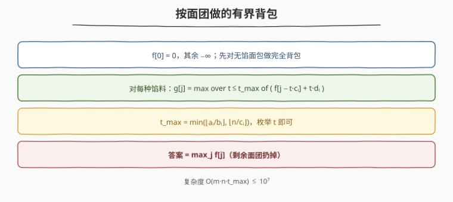

# Codeforces 106C Buns 题解

## 1. 题目概述

- **题目链接**：https://codeforces.com/problemset/problem/106/C
- **比赛来源**：Codeforces Beta Round 82 (Div. 2) · Problem C（UTC 2011-08-19）
- **难度**：1700
- **标签**：动态规划
- **评测类型**：普通
- **限制**：时间 2 s / 内存 256 MB

**题意**：面包师有 $n$ 克面团和 $m$ 种馅料，第 $i$ 种剩 $a_i$ 克。做一个带第 $i$ 种馅的面包要 $b_i$ 克馅和 $c_i$ 克面团，售价 $d_i$；也可以做不带馅的面包，每个要 $c_0$ 克面团，售价 $d_0$。求最大总售价（剩余材料丢掉）。

**约束**：

- $n \le 1000$，$m \le 10$：面团维度小，适合按面团做 DP。
- $a_i, b_i, c_i, d_i \le 100$：每种馅料最多能做 $\lfloor a_i/b_i \rfloor \le 100$ 个；面团最多做 $\lfloor n/c_i \rfloor \le 1000$ 个。数量上界很小。
- 每种馅料的**用量独立**：馅料之间不能混用，但面团是共享资源 → 典型**有界背包**。
- 不带馅的面包**不限量**（只受面团限制）→ 完全背包。

## 2. 示例与观察

官方样例 1（输入 / 输出原样）：

```text
输入：
10 2 2 1
7 3 2 100
12 3 1 10

输出：
241
```

官方样例 2（输入 / 输出原样）：

```text
输入：
100 1 25 50
15 5 20 10

输出：
200
```

**样例 1 走查**：$n=10$ 克面团，$c_0=2,d_0=1$。馅料 1：$a=7,b=3$ → 最多 2 个，每个耗 2 克面团，赚 100；馅料 2：$a=12,b=3$ → 最多 4 个，每个耗 1 克面团，赚 10。题面提示：做 2 个馅料 1（耗 4 克面团，赚 200）+ 4 个馅料 2（耗 4 克面团，赚 40）+ 1 个无馅（耗 2 克面团，赚 1）= 241 ✓。

**样例 2 走查**：$n=100$，馅料 1 每个耗 20 克面团赚 10（最多 3 个，因为 $a=15,b=5$），而无馅面包每个耗 25 克赚 50，单位面团收益 2 > 0.5，所以全做无馅：4 个 × 50 = 200 ✓（还剩 0 克面团）。

**观察**：两类资源：面团（共享、总量 $n$）和每种馅料（各自独立、上限 $a_i/b_i$）。按面团做 DP，逐种馅料转移，每种最多取 $t_i$ 个，就是**多重背包**（有界背包）。


## 3. 解题思路

### 3.1 朴素做法与瓶颈

枚举每种馅料做几个：总数最多 $100^{10}$，不可行。注意到决定收益的只有"用了多少面团"和"每种馅料用了几个"，而后者受各自上限约束且互不影响 —— 按面团容量做 DP 就能把 $m$ 种馅料串起来。

### 3.2 核心观察：按面团的有界背包

设 $f[j]$ = 用恰好 $j$ 克面团能获得的最大收益（不可达设 $-\infty$）。先处理无馅面包（完全背包）：$f[j] = \max(f[j], f[j-c_0] + d_0)$（从小到大枚举 $j$ 即表示可重复取）。再对每种馅料 $i$ 做有界背包：设 $t_{\max} = \min(\lfloor a_i/b_i\rfloor, \lfloor n/c_i \rfloor)$，转移

$$g[j] = \max_{0 \le t \le t_{\max},\ t c_i \le j} \bigl(f[j - t c_i] + t\, d_i\bigr).$$

朴素转移是 $O(n \cdot t_{\max})$ 每种，$n \le 1000$、$t_{\max} \le 1000$、$m \le 10$ → 最坏 $10^7$，在 2 s 内很轻松。



### 3.3 算法流程

1. 读入 $n, m, c_0, d_0$ 与各种馅料；
2. $f$ 初始化为 $-\infty$，$f[0] = 0$；
3. 完全背包处理无馅面包；
4. 对每种馅料做有界背包（枚举 $t$ 从 0 到 $t_{\max}$）；
5. 答案 $=\max_j f[j]$。

### 3.4 样例走查

样例 1 的最优解（2, 4, 1）：用面团 $2\cdot2 + 4\cdot1 + 1\cdot2 = 10$ ✓，收益 $2\cdot100 + 4\cdot10 + 1 = 241$ ✓。

自造样例（标注"自造"）：

| 输入 | 输出 | 说明 |
|------|------|------|
| `5 1 1 1` / `1 1 1 100` | 104 | 1 个带馅 + 4 个无馅 |
| `5 1 5 100` / `1 1 1 1` | 100 | 只做 1 个无馅 |
| `1000 1 100 100` / `1 1 1 1` | 1000 | 全做无馅 |
| `3 1 2 5` / `1 1 2 100` | 105 | 1 个带馅 + 1 个无馅 |

## 4. 正确性证明

**引理 1（可行性）**：一个方案（每种馅料 $t_i$ 个、无馅 $t_0$ 个）可行 $\iff$ $\sum_i t_i c_i + t_0 c_0 \le n$ 且 $t_i b_i \le a_i$（$i\ge1$）。

**证明**：每种馅料只能用于对应面包，用量是 $t_i b_i$，不超过 $a_i$；面团总量是各面包用量之和，不超过 $n$。∎

**引理 2（DP 不变量）**：处理完前 $k$ 种馅料（并已处理无馅）后，$f[j]$ 等于"用恰好 $j$ 克面团、只使用前 $k$ 种馅料与无馅面包"的最大收益。

**证明**：对 $k$ 归纳。$k=0$ 时只有无馅面包，完全背包的标准正确性给出结论。转移时枚举第 $k$ 种馅料做 $t$ 个，用掉 $t c_k$ 克面团、赚 $t d_k$，剩余 $j - t c_k$ 克由前 $k-1$ 种与无馅的最优方案填充；$t$ 的范围恰好覆盖所有可行取值（$t b_k \le a_k$ 且 $t c_k \le j$）。∎

**定理**：算法输出最优收益。

**证明**：由引理 2，$f$ 的每个可达状态都对应一个可行方案，且覆盖了所有可行方案；取 $\max_j f[j]$ 即最优收益（剩余面团扔掉，不要求恰好用完，故取最大而不是 $f[n]$）。∎

## 5. 复杂度分析

- **时间**：$O\bigl(m \cdot n \cdot \min(a_i/b_i, n/c_i)\bigr) \le 10 \cdot 1000 \cdot 1000 = 10^7$。
- **空间**：$O(n)$。
- **与时限的关系**：2 s 时限下余量在 $10^2$ 倍以上，实测最大数据（$n=1000$、$m=10$ 且上限取满）C++ 端到端 $2.6$ ms、Python $16.4$ ms。

## 6. 参考代码

### C++17

```cpp
#include <bits/stdc++.h>
using namespace std;

int main() {
    int n, m, c0, d0;
    if (!(cin >> n >> m >> c0 >> d0)) return 0;
    vector<vector<int>> dp(m + 1, vector<int>(n + 1, -1));
    dp[0][0] = 0;
    int ans = 0;
    // 先做无馅的（不限量）
    for (int j = 0; j <= n; ++j) {
        if (j >= c0 && dp[0][j - c0] >= 0) dp[0][j] = dp[0][j - c0] + d0;
    }
    for (int i = 0; i < m; ++i) {
        int a, b, c, d;
        cin >> a >> b >> c >> d;
        int lim = min(a / b, n / c);
        for (int j = 0; j <= n; ++j) {
            if (dp[i][j] < 0) continue;
            for (int t = 0; t <= lim && j + t * c <= n; ++t) {
                dp[i + 1][j + t * c] = max(dp[i + 1][j + t * c], dp[i][j] + t * d);
            }
        }
    }
    for (int j = 0; j <= n; ++j) ans = max(ans, dp[m][j]);
    cout << ans << '\n';
    return 0;
}
```

### Python3

```python
import sys


def main() -> None:
    data = sys.stdin.buffer.read().split()
    n, m, c0, d0 = (int(x) for x in data[:4])
    stuff = []
    p = 4
    for _ in range(m):
        a, b, c, d = (int(x) for x in data[p:p + 4])
        p += 4
        stuff.append((a, b, c, d))
    NEG = -1
    dp = [NEG] * (n + 1)
    dp[0] = 0
    # 无馅的（不限量）
    for j in range(c0, n + 1):
        if dp[j - c0] >= 0:
            dp[j] = dp[j - c0] + d0
    for (a, b, c, d) in stuff:
        nd = dp[:]
        lim = min(a // b, n // c)
        for j in range(n + 1):
            if dp[j] < 0:
                continue
            for t in range(1, lim + 1):
                if j + t * c > n:
                    break
                if dp[j] + t * d > nd[j + t * c]:
                    nd[j + t * c] = dp[j] + t * d
        dp = nd
    sys.stdout.write(str(max(dp)) + "\n")


main()
```

两份代码都只用标准库，可原样提交。

## 7. 边界情况与易错点

1. **取 $\max_j f[j]$ 而不是 $f[n]$**：剩余面团扔掉，不要求用完。
2. **无馅面包不限量**：必须用"从小到大枚举 $j$"的完全背包写法，写成 0/1 背包会少算。
3. **每种馅料的数量上限**：$\min(a_i/b_i,\ n/c_i)$，两个约束都要取。
4. **不可达状态**：用 $-1$ 或 $-\infty$ 标记，转移时跳过，避免把"不可达"当成 0 收益。
5. **有界背包的循环方向**：用滚动数组时必须是"新数组 → 旧数组"的副本，否则同一种馅料会被重复计算超过上限。
6. **$a_i < b_i$**：一个都做不了，上限 0，不要漏判。
7. **多测**：本题单组输入。
8. **数值范围**：收益最多约 $1000 \times 100 = 10^5$，`int` 足够。

## 8. 验证记录

- **编译环境与命令**：本机无 GNU `g++`，用 `Apple clang 21.0.0` + 仓库自带 `codeforces/tools/include/bits/stdc++.h` 兼容头（`clang++ -std=c++17 -O2 -I codeforces/tools/include`）编译；Python 为 `Python 3.9.6`。
- **官方样例**：2 / 2 通过（`241`、`200`）。
- **额外测试（递归全枚举对拍）**：另写一份**不做 DP** 的暴力——先枚举无馅个数，再对每种馅料递归枚举所有可行个数，取最大；对 250 组随机小数据（$n\le 60$、$m\le 4$）与 C++、Python 三方比对，**250 / 250 全部一致**。
- **最大约束性能**：$n=1000$、$m=10$ 且各馅料上限都取满时，C++ 端到端 10 次平均 $2.6$ ms、Python $16.4$ ms。
- **图片校验**：两张 SVG（`cf106c_knapsack.svg`、`cf106c_transfer.svg`）通过 `xml.etree.ElementTree.parse`，文本块估算未越出 `viewBox`。
- **公式校验**：KaTeX（`throwOnError: true`）渲染无报错。
- **复核状态**：verified。

## 相关题目与扩展

- [Codeforces 106D Treasure Island](https://codeforces.com/problemset/problem/106/D)：同场 D 题。
- [Codeforces 105B Dark Assembly](https://codeforces.com/problemset/problem/105/B)：另一场次里的枚举/概率题。
- [Codeforces 189A Cut Ribbon](https://codeforces.com/problemset/problem/189/A)：完全背包入门。
- [LeetCode 322. 零钱兑换](https://leetcode.cn/problems/coin-change/)：完全背包。
- [LeetCode 518. 零钱兑换 II](https://leetcode.cn/problems/coin-change-ii/)：完全背包计数。

**延伸思考**：

1. **如果馅料可以混合使用**：约束耦合，需要多维背包或网络流。
2. **如果 $n$ 大到 $10^9$**：需要用"单位面团收益最大"的贪心 + 少量枚举（凸包/单调队列优化）。
3. **如果每种面包有"至少做几个"的下界**：变成带下界的背包，需要先扣掉下界。
4. **如果要求输出方案**：DP 时记录每个状态的转移来源即可。
