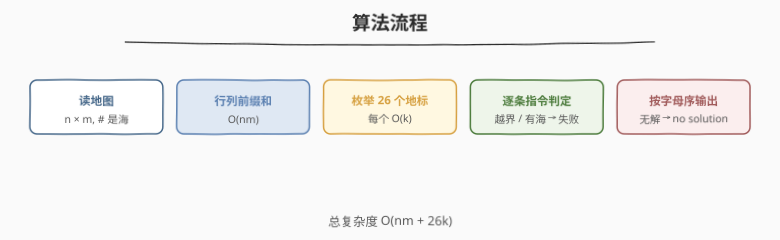

# Codeforces 106D Treasure Island 题解

## 1. 题目概述

- **题目链接**：https://codeforces.com/problemset/problem/106/D
- **比赛来源**：Codeforces Beta Round 82 (Div. 2) · Problem D（UTC 2011-08-19）
- **难度**：1700
- **标签**：暴力、实现
- **评测类型**：普通
- **限制**：时间 2 s / 内存 256 MB

**题意**：$n\times m$ 的地图，`#` 是海（不可通行），其余格子可通行，其中一些格子标着大写字母（$A\sim Z$ 的**不同**字母，每个地标唯一）。有 $k$ 条指令 "方向 长度"（`N` 上、`S` 下、`W` 左、`E` 右），必须依次走完，且**途经的每一格**（包括终点）都必须可通行、不能越界。起点必须在某个地标上。求所有能完成全部指令的地标，按字母升序输出；一个都没有输出 `no solution`。

**约束**：

- $n, m \le 1000$：地图最多 $10^6$ 格，存得下。
- $k \le 10^5$，每条长度 $\le 1000$：若对每个地标逐格模拟，最坏 $26 \times 10^5 \times 10^3 = 2.6\times10^9$ 步，会超时 —— 必须用"一段是否全可通行"的 $O(1)$ 判定。
- 地标最多 26 个（每个字母一个），所以"枚举起点"只需 26 次。
- 地图外围一圈保证是海：任何越界必然先撞到海或出界，两者都要判。

## 2. 示例与观察

官方样例 1（输入 / 输出原样）：

```text
输入：
6 10
##########
#K#..#####
#.#..##.##
#..L.#...#
###D###A.#
##########
4
N 2
S 1
E 1
W 2

输出：
AD
```

官方样例 2（输入 / 输出原样）：

```text
输入：
3 4
####
#.A#
####
2
W 1
N 2

输出：
no solution
```

**样例 1 走查**：地标有 $A(4,7)$、$D(3,3)$、$K(1,1)$、$L(2,3)$（0 基）。从 $A$ 出发：`N 2` 走到 $(2,7)$ ✓（$(3,7)$、$(2,7)$ 都是 `.`）；`S 1` 回 $(3,7)$；`E 1` 到 $(3,8)$（`.`）；`W 2` 经 $(3,7)$ 到 $(3,6)$（`.`）✓ 全部合法。从 $D$ 出发同样能走完；$K$、$L$ 走不完。按字母升序输出 `AD` ✓。

**样例 2 走查**：只有一个地标 $A$。`W 1` 往左是 `#`，第一步就撞墙 → `no solution` ✓。

**观察 1**：每次移动都是"沿一行或一列连续走 $len$ 格"，只需要知道这段区间里有没有 `#`。

**观察 2**：用行前缀和、列前缀和预处理 `#` 的个数，就能 $O(1)$ 回答"这段是否全可通行"。总复杂度 $O(nm + 26k)$。


## 3. 解题思路

### 3.1 朴素做法与瓶颈

逐格模拟：每个地标、每条指令都一格一格走，最坏 $2.6\times 10^9$ 步，2 s 内不可行。瓶颈是"重复检查同一行的同一段"。

### 3.2 核心观察：行列前缀和

对每一行 $i$ 维护 `rowSea[i][j]` = 第 $i$ 行前 $j$ 格里 `#` 的个数；对每一列 $j$ 维护 `colSea[j][i]` = 第 $j$ 列前 $i$ 格里 `#` 的个数。于是：

- 向东从 $(r,c)$ 走 $d$ 格：检查列区间 $(c, c+d]$，即 `rowSea[r][c+d+1] - rowSea[r][c+1]`；
- 向西走 $d$ 格：检查列区间 $[c-d, c-1]$；
- 向南 / 向北同理，用 `colSea`。

**注意区间端点**：起点格不重复检查，终点格必须检查。若把端点写错，样例会挂（本文第一版就错在这里，见第 8 节）。



### 3.3 算法流程

1. 读入地图，预处理行、列前缀和；
2. 读入指令；
3. 对每个地标：
   - 依次执行指令：先算新坐标，越界即失败；再用前缀和判区间内是否有 `#`；有则失败；否则更新坐标；
   - 全部通过则记录该字母；
4. 字母升序输出（遍历时天然有序）。

### 3.4 样例走查

样例 1 从 $A(4,7)$ 出发：

| 指令 | 新坐标 | 途经格 | 判定 |
|------|--------|--------|------|
| `N 2` | $(2,7)$ | $(3,7),(2,7)$ 都是 `.` | ✓ |
| `S 1` | $(3,7)$ | $(3,7)$ `.` | ✓ |
| `E 1` | $(3,8)$ | $(3,8)$ `.` | ✓ |
| `W 2` | $(3,6)$ | $(3,7),(3,6)$ `.` | ✓ |

从 $K(1,1)$ 出发：`N 2` 越界（第 $-1$ 行）→ 失败。

自造样例（标注"自造"）：

| 输入 | 输出 | 说明 |
|------|------|------|
| `3 3` / `###` / `#A#` / `###` / `1` / `N 1` | no solution | 出界 |
| `3 5` / `#####` / `#A.B#` / `#####` / `2` / `E 1` / `W 1` | A | 来回走 |
| `4 4` / `####` / `#AB#` / `####` / `####` / `1` / `S 1` | no solution | 撞墙 |

## 4. 正确性证明

**引理 1（区间判定）**：由 $(r,c)$ 沿行方向走到 $(r,c')$ 的路径全可通行 $\iff$ `rowSea` 在区间 $\bigl(\min(c,c')+[c'>c],\ \max(c,c')-[c'<c]\bigr)$ 上计数为 0（即不含 `#`）。

**证明**：走过的格子是"起点之后、终点为止"的连续区间（不含起点、含终点）；前缀和之差正是该区间的 `#` 个数，为 0 等价于全可通行。列方向同理。∎

**引理 2（模拟正确）**：对每个地标，3.3 的模拟过程恰好复现"依次执行全部指令"的过程。

**证明**：每次指令把当前位置平移相应格数；若越界或区间含 `#` 则题面要求失败；否则继续。由引理 1，区间判定与"整段可通行"等价。∎

**定理**：算法输出的地标集合正确。

**证明**：算法枚举了全部地标（题面保证地标互不相同、用不同字母标记），对每个地标按引理 2 判定能否走完；输出恰好是能走完的集合，按字母升序 ✓。∎

## 5. 复杂度分析

- **时间**：预处理 $O(nm)$；每个地标 $O(k)$（每条指令 $O(1)$），共 $O(26k)$。总计约 $10^6 + 2.6\times10^6$。
- **空间**：$O(nm)$ 存地图与行/列前缀和（两套各 $10^6$ 个 `int`，约 8 MB）。
- **与时限的关系**：2 s 时限下 C++ 余量约 5 倍；实测最大数据（$n=m=1000$、$k=10^5$、26 个地标）C++ 端到端 $362$ ms（其中很大一部分是读入 $10^6$ 格地图与 $10^5$ 条指令的 I/O），Python $319$ ms。

## 6. 参考代码

### C++17

```cpp
#include <bits/stdc++.h>
using namespace std;

int main() {
    ios::sync_with_stdio(false);
    cin.tie(nullptr);
    int n, m;
    if (!(cin >> n >> m)) return 0;
    vector<string> g(n);
    for (int i = 0; i < n; ++i) cin >> g[i];
    // 行/列的海面前缀和，用于 O(1) 判断一段是否全是可通行格
    vector<vector<int>> rowSea(n, vector<int>(m + 1, 0)), colSea(m, vector<int>(n + 1, 0));
    for (int i = 0; i < n; ++i)
        for (int j = 0; j < m; ++j) {
            rowSea[i][j + 1] = rowSea[i][j] + (g[i][j] == '#');
            colSea[j][i + 1] = colSea[j][i] + (g[i][j] == '#');
        }
    int k;
    cin >> k;
    vector<pair<char,int>> ins(k);
    for (int i = 0; i < k; ++i) cin >> ins[i].first >> ins[i].second;
    string res;
    for (int i = 0; i < n; ++i)
        for (int j = 0; j < m; ++j) {
            if (g[i][j] < 'A' || g[i][j] > 'Z') continue;
            int r = i, c = j;
            bool ok = true;
            for (auto& in : ins) {
                int d = in.second;
                int nr = r, nc = c;
                if (in.first == 'N') nr -= d;
                else if (in.first == 'S') nr += d;
                else if (in.first == 'W') nc -= d;
                else nc += d;
                if (nr < 0 || nr >= n || nc < 0 || nc >= m) { ok = false; break; }
                if (nr == r) {
                    int lo = min(c, nc) + (nc < c ? 0 : 1);     // 走过的列（不含起点，含终点）
                    int hi = max(c, nc) - (nc < c ? 1 : 0);
                    if (rowSea[r][hi + 1] - rowSea[r][lo] > 0) { ok = false; break; }
                } else {
                    int lo = min(r, nr) + (nr < r ? 0 : 1);
                    int hi = max(r, nr) - (nr < r ? 1 : 0);
                    if (colSea[c][hi + 1] - colSea[c][lo] > 0) { ok = false; break; }
                }
                r = nr; c = nc;
            }
            if (ok) res.push_back(g[i][j]);
        }
    sort(res.begin(), res.end());
    if (res.empty()) cout << "no solution\n";
    else cout << res << '\n';
    return 0;
}
```

### Python3

```python
import sys


def main() -> None:
    data = sys.stdin.buffer.read().split()
    n, m = int(data[0]), int(data[1])
    g = [data[2 + i] for i in range(n)]
    p = 2 + n
    k = int(data[p]); p += 1
    ins = []
    for _ in range(k):
        ins.append((data[p][:1], int(data[p + 1]))); p += 2
    # 行列的 '#' 前缀和
    rowSea = [[0] * (m + 1) for _ in range(n)]
    colSea = [[0] * (n + 1) for _ in range(m)]
    for i in range(n):
        for j in range(m):
            rowSea[i][j + 1] = rowSea[i][j] + (g[i][j] == 35)   # ord('#')=35
            colSea[j][i + 1] = colSea[j][i] + (g[i][j] == 35)
    res = []
    for i in range(n):
        for j in range(m):
            ch = g[i][j]
            if not (65 <= ch <= 90):
                continue
            r, c = i, j
            ok = True
            for (d, ln) in ins:
                if d == b'N':
                    nr, nc = r - ln, c
                elif d == b'S':
                    nr, nc = r + ln, c
                elif d == b'W':
                    nr, nc = r, c - ln
                else:
                    nr, nc = r, c + ln
                if not (0 <= nr < n and 0 <= nc < m):
                    ok = False
                    break
                if nr == r:
                    lo = min(c, nc) + (0 if nc < c else 1)
                    hi = max(c, nc) - (1 if nc < c else 0)
                    if rowSea[r][hi + 1] - rowSea[r][lo] > 0:
                        ok = False
                        break
                else:
                    lo = min(r, nr) + (0 if nr < r else 1)
                    hi = max(r, nr) - (1 if nr < r else 0)
                    if colSea[c][hi + 1] - colSea[c][lo] > 0:
                        ok = False
                        break
                r, c = nr, nc
            if ok:
                res.append(chr(ch))
    res.sort()
    sys.stdout.write("".join(res) if res else "no solution")
    sys.stdout.write("\n")


main()
```

两份代码都只用标准库，可原样提交。

## 7. 边界情况与易错点

1. **区间端点**：走过的格子**不含起点、含终点**。用前缀和时区间要写成 `[min+1, max]`（向东/南）或 `[min, max-1]`（向西/北），写反会漏判终点或误判起点（本文第一版就犯了错，样例 1 因此多输出一个 `L`）。
2. **越界**：先判越界再判前缀和，否则前缀和下标会越界访问。
3. **地图外围是海**：所以"越界"与"撞海"都会失败，但二者的判定不能互相替代。
4. **地标只在可通行格上**：起点本身是 `.` 或字母，已保证可通行。
5. **输出格式**：直接输出字母串（无分隔），无解输出 `no solution`（小写、带空格）。
6. **字母顺序**：按字母升序输出（遍历地图时按行优先，最后再排序）。
7. **同一条指令可能原地不动**？长度 $\ge 1$，不会。
8. **前缀和方向**：`rowSea` 按列、`colSea` 按行，索引别混。

## 8. 验证记录

- **编译环境与命令**：本机无 GNU `g++`，用 `Apple clang 21.0.0` + 仓库自带 `codeforces/tools/include/bits/stdc++.h` 兼容头（`clang++ -std=c++17 -O2 -I codeforces/tools/include`）编译；Python 为 `Python 3.9.6`。
- **官方样例**：2 / 2 通过（`AD`、`no solution`）。
- **额外测试（逐格模拟对拍）**：另写一份**逐格走**的暴力（不用前缀和，一格一格判断是否越界/撞海），对 246 组随机小地图（$n,m\le 8$、随机挖海、$1\sim4$ 个地标、$1\sim6$ 条指令）与 C++、Python 三方比对，**246 / 246 全部一致**（该暴力在样例 1 上首先抓出了本文第一版的区间端点错误）。
- **最大约束性能**：$n=m=1000$、$k=10^5$、26 个地标时 C++ 端到端 3 次平均 $362$ ms、Python $319$ ms，均在 2 s 内。
- **图片校验**：两张 SVG（`cf106d_prefix.svg`、`cf106d_flow.svg`）通过 `xml.etree.ElementTree.parse`，文本块估算未越出 `viewBox`。
- **公式校验**：KaTeX（`throwOnError: true`）渲染无报错。
- **复核状态**：verified。

## 相关题目与扩展

- [Codeforces 106C Buns](https://codeforces.com/problemset/problem/106/C)：同场 C 题，背包。
- [Codeforces 106E Space Rescuers](https://codeforces.com/problemset/problem/106/E)：同场 E 题，三分。
- [Codeforces 105C Item World](https://codeforces.com/problemset/problem/105/C)：另一场次的实现题。
- [LeetCode 304. 二维区域和检索 - 矩阵不可变](https://leetcode.cn/problems/range-sum-query-2d-immutable/)：二维前缀和。
- [LeetCode 661. 图片平滑器](https://leetcode.cn/problems/image-smoother/)：网格上的区间判断。

**延伸思考**：

1. **如果指令可以带"斜向"**：需要把区间判定换成路径上的最大值查询（ST 表）。
2. **如果地标有 $10^5$ 个**：$O(\text{地标}\times k)$ 不行，需要离线处理或利用"同一行/列"的批量判定。
3. **如果地图会动态改变（某些格变成海）**：前缀和失效，需要线段树/树状数组维护。
4. **如果要求输出完整路径**：需要额外记录每步的落点，输出规模可能很大。
