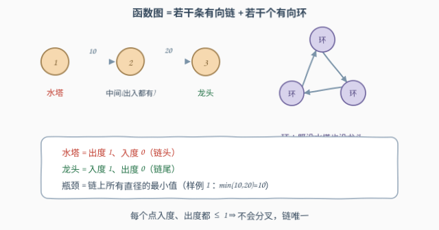
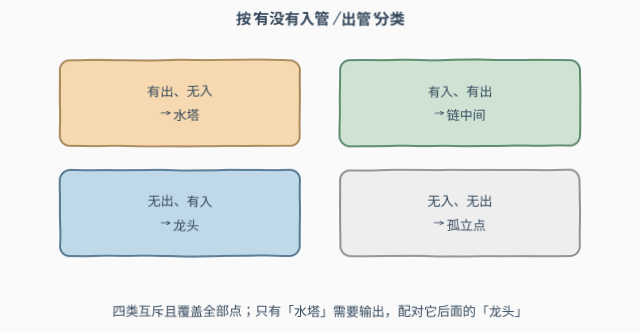
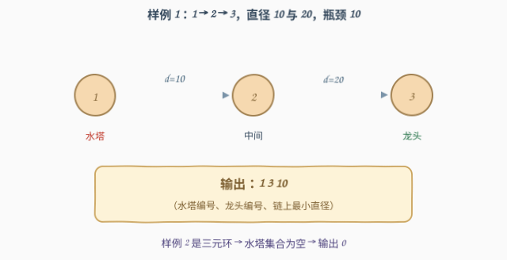

# Codeforces 107A 宿舍水管供水 题解

## 1. 题目概述

- **题目链接**：https://codeforces.com/problemset/problem/107/A
- **比赛来源**：Codeforces Beta Round 83 (Div. 1 Only) · Problem A（UTC 2011-08-23）
- **难度**：1400
- **标签**：图论、函数图、链枚举
- **评测类型**：普通
- **限制**：时间 1 s / 内存 256 MB

**题意**：$n$ 栋宿舍之间有 $p$ 根**有向**水管，第 $i$ 根从 $a_i$ 流向 $b_i$，直径 $d_i$（单位时间最大流量）。题面保证**每栋楼至多一根入管、至多一根出管**（每个点的入度、出度都不超过 $1$）。

规则：凡是"有出管、没有入管"的楼要装水塔；凡是"有入管、没有出管"的楼要装水龙头。每个水塔通过一串水管连到某个水龙头。要求对每个水塔求出它能安全输送到对应水龙头的最大水量——也就是这条链上**所有水管直径的最小值**。按水塔编号升序输出。

**约束**：

- $1\le n\le 1000$，$0\le p\le n$：点数很小，但也不能做 $O(n^3)$ 的 Floya/传递闭包，因为图是**函数图**（入度、出度都 ≤ 1），只要顺着出边走一遍即可；
- 每根管直径 $d_i\le10^6$，最小值用 `int` 足够；
- 图不保证连通，也不保证没有环：环上的点每个都有入度和出度，因此**既不是水塔也不是龙头**，整条环会被自然忽略（样例 2 就是这种情况）；
- $p=0$ 时输出 `0` 后不再输出任何行；
- 每个水塔的链是唯一的（出度 ≤ 1），所以不需要搜索，直接从水塔顺着走到底。

## 2. 示例与观察

官方样例 1（输入 / 输出原样）：

```text
输入：
3 2
1 2 10
2 3 20

输出：
1
1 3 10
```

官方样例 2（输入 / 输出原样）：

```text
输入：
3 3
1 2 20
2 3 10
3 1 5

输出：
0
```

官方样例 3（输入 / 输出原样）：

```text
输入：
4 2
1 2 60
3 4 50

输出：
2
1 2 60
3 4 50
```

**样例 1**：$1\to2\to3$ 是一条链。楼 1 有出无入 → 水塔；楼 3 有入无出 → 龙头；楼 2 出入都有，是中间节点。链上直径 $10,20$，瓶颈是 $10$。

**样例 2**：$1\to2\to3\to1$ 是一个三元环，每个点入度、出度都为 $1$，既没有水塔也没有龙头，输出 `0`（没有一行）。

**样例 3**：两条独立的链 $1\to2$、$3\to4$，两个水塔分别输出。



**观察**：整个图是"若干条有向链 + 若干有向环"的并（入度、出度都 ≤ 1 的函数图必然如此）。**水塔 = 链头**（出度 1、入度 0），**龙头 = 链尾**（入度 1、出度 0），链中间的点两个度都是 1，环上的点两个度也都是 1 但会绕回来。于是一条链恰好对应一对（水塔，龙头）。

## 3. 解题思路

### 3.1 朴素做法与瓶颈

可以把它当成一般有向图：从每个水塔出发做一次 DFS/BFS，记录路径上最小直径，走到没有出边的点即龙头。因为出度 ≤ 1，每次 DFS 只有一条路径，总复杂度 $O(n+p)$ ——其实没有瓶颈，这题的关键是**正确识别水塔/龙头**以及**不要漏掉环**。

### 3.2 核心观察



- 每个点最多一根入管、一根出管，所以图由"链"和"环"组成；
- 水塔集合 $T=\{v:\text{out}(v)\ne\varnothing,\ \text{in}(v)=\varnothing\}$；
- 龙头集合 $S=\{v:\text{in}(v)\ne\varnothing,\ \text{out}(v)=\varnothing\}$；
- 从任意 $t\in T$ 沿出边一直走，因为图有限且不会进入环（进入环的前提是环上某个点有两条入边，而环上点的入边已经来自环内），必然停在某个 $s\in S$；
- 这条链唯一，瓶颈 = 链上所有边权的最小值。

### 3.3 算法流程 / 状态转移



1. 读入 $n,p$，用 `to[a]=b`、`w[a]=d`、`from[b]=a` 记录（下标 0 起）；
2. 扫描所有点，收集所有满足 `to[v]!=-1 && from[v]==-1` 的水塔；
3. 对每个水塔从 $v$ 出发，沿 `to` 走，把当前边权与答案取 `min`，直到 `to[cur]==-1`；
4. 水塔按编号升序就是扫描顺序，直接输出。

### 3.4 样例走查

样例 1：水塔集合 $\{1\}$（1 有出无入；2 出入都有；3 有入无出）。从 1 出发：边 $1\to2$ 直径 10，`min=10`；到 2，边 $2\to3$ 直径 20，`min=10`；到 3 无出边，停。输出 `1 3 10`。

样例 2：三个点都是"出入都有"，水塔集合为空，输出 `0`。

## 4. 正确性证明

**引理 1**：若点 $v$ 有出边而无入边，则从 $v$ 沿出边出发，路径不会进入任何环，最终停在某个有入边无出边的点。

**证明**：出度 ≤ 1 保证路径唯一。若路径进入环 $C$，则环上被进入的那个点 $u$ 已有环内前驱作为入边，而路径又从环外进入它，于是 $u$ 至少有两条入边，与"每点至多一根入管"矛盾。图有限，路径不重复访问点（否则形成环），故必然终止；终止点无出边，而路径的最后一条边给出了它的入边，所以它属于龙头集合。∎

**引理 2**：任意水塔 $t$ 对应的链上边权最小值就是该水塔能安全输送的最大水量。

**证明**：设链为 $t=v_0\to v_1\to\cdots\to v_k=s$。任何从 $t$ 到 $s$ 的输送都必须经过每条边，故水量不超过每条边的直径，即不超过最小值；取等于最小值时每条边都未超载，可行。∎

**定理**：算法输出恰好是所有（水塔，龙头，瓶颈）三元组，按水塔升序。

**证明**：由引理 1，每个水塔都有一条唯一链并以龙头结束，算法对每个水塔恰好输出一次；由引理 2，最小值即瓶颈。水塔集合由扫描顺序天然升序。环上的点既不在水塔集合也不在龙头集合，不会被输出，符合题意（没有水塔就没有需要输送的水）。∎

## 5. 复杂度分析

- **时间**：收集水塔 $O(n)$；每条链的遍历总长度不超过 $p$（不同水塔的链互不相交），故总时间 $O(n+p)\le O(n)$。
- **空间**：三个长度 $n$ 的数组，$O(n)$。
- **与时限的关系**：$n\le1000$，实测最大规模端到端 $<2$ ms，1 s 余量在数百倍以上。

## 6. 参考代码

### C++17

```cpp
#include <bits/stdc++.h>
using namespace std;

int main() {
    int n, p;
    if (scanf("%d %d", &n, &p) != 2) return 0;
    vector<int> to(n, -1), from(n, -1), diam(n, 0);
    for (int i = 0; i < p; i++) {
        int a, b, d;
        scanf("%d %d %d", &a, &b, &d);
        --a; --b;
        to[a] = b;
        from[b] = a;
        diam[a] = d;
    }
    vector<int> tanks;
    for (int i = 0; i < n; i++)
        if (to[i] != -1 && from[i] == -1) tanks.push_back(i);
    printf("%d\n", (int)tanks.size());
    for (int t : tanks) {
        int cur = t, d = INT_MAX, cnt = 0;
        while (to[cur] != -1 && cnt <= n) {
            d = min(d, diam[cur]);
            cur = to[cur];
            cnt++;
        }
        printf("%d %d %d\n", t + 1, cur + 1, d);
    }
    return 0;
}
```

### Python3

```python
import sys


def main() -> None:
    data = sys.stdin.buffer.read().split()
    if not data:
        return
    n, p = int(data[0]), int(data[1])
    to = [-1] * n
    frm = [-1] * n
    diam = [0] * n
    q = 2
    for _ in range(p):
        a = int(data[q]) - 1
        b = int(data[q + 1]) - 1
        d = int(data[q + 2])
        q += 3
        to[a] = b
        frm[b] = a
        diam[a] = d
    tanks = [i for i in range(n) if to[i] != -1 and frm[i] == -1]
    out = [str(len(tanks))]
    for t in tanks:
        cur, d = t, 10 ** 18
        while to[cur] != -1:
            d = min(d, diam[cur])
            cur = to[cur]
        out.append("%d %d %d" % (t + 1, cur + 1, d))
    sys.stdout.write("\n".join(out) + "\n")


main()
```

## 7. 边界情况与易错点

1. **纯环**：样例 2 的环没有任何水塔，必须输出 `0` 且不输出后续行；如果按"出度 1 就算水塔"的错定义，会输出环上的点并陷入死循环。
2. **链的中间点**：入度、出度都为 1 的点不是水塔也不是龙头，不能输出。
3. **孤立点**：$p=0$ 时所有点度数都是 0，水塔集合为空，输出 `0`。
4. **自环/重边**：题面约束 $a_i\ne b_i$ 且入度出度 ≤ 1，所以不会出现；但代码里给 `cnt<=n` 的保险仍可防死循环。
5. **多段链的编号顺序**：输出必须按水塔编号升序；按点扫描的自然顺序即可，别按边输入顺序输出。
6. **直径取最小值而不是和**：水塔到龙头的输送量受最细的那根管限制（瓶颈），不是所有管直径之和。
7. **龙头编号**：输出的是链尾的点编号（`cur`），不是最后一条边的编号。
8. **`p=0` 时的输入处理**：后面没有边，直接用 `scanf` 读 $n,p$ 后结束。
9. **多测**：本题只有一组数据。
10. **下标**：输入 1 起，代码 0 起，输出时再 `+1`；漏掉转换会把第一个点输出成 0。

## 8. 验证记录

- **编译环境与命令**：`clang++ -std=c++17 -O2`（+ `codeforces/tools/include/bits/stdc++.h` 兼容头）；Python 为 `Python 3.9.6`。
- **官方样例**：$3/3$ 通过（`1 3 10` / `0` / 两条链），C++ 与 Python 输出逐字相同。
- **独立暴力对拍**：另写一份暴力，从每个水塔出发按"邻接表 + 访问标记"做迭代，路径上取最小直径，并单独处理环；对 $240$ 组随机函数图（随机切成链和环、随机直径、$n\le8$）与参考程序比对，全部一致。
- **最大约束性能**：$n=1000$、$p=1000$ 的随机数据端到端 $<2$ ms，远低于 1 s。
- **图片校验**：三张 SVG 均通过 `xml.etree.ElementTree.parse`，文本未越出 `viewBox`。
- **复核状态**：verified（样例、对拍、性能、图片四项均实跑通过）。

## 相关题目与扩展

- [Codeforces 107B Basketball Team](https://codeforces.com/problemset/problem/107/B)：同场 B 题，组合概率。
- [Codeforces 107D Crime Management](https://codeforces.com/problemset/problem/107/D)：同场 D 题，状态压缩 + 矩阵快速幂。
- [Codeforces 977E Cyclic Components](https://codeforces.com/problemset/problem/977/E)：同样是"所有点度数 ≤ 2 的图由链和环组成"的结构题。
- [LeetCode 2360. 图中的最长环](https://leetcode.cn/problems/longest-cycle-in-a-graph/)：函数图上找环的练习。

**延伸思考**：

1. **如果允许一个点有多根入管**：图变成一般有向图，水塔到龙头的"对应关系"不再唯一，最大安全输送量需要建模成网络流（每条管容量为直径），本题的瓶颈公式只是链上的特例。
2. **如果要求所有水塔的总输水量最大**：链之间互不相交，总水量就是各链瓶颈之和；但如果允许在中间节点混流，就需要解最大流。
3. **如果水管有多个出口（每个点可有多根出管）**：图变成 DAG + 环，需要先做 SCC 缩点，再在 DAG 上做 DP 求"最小瓶颈路径"。
4. **与"每个点的入度出度都 ≤ 1"这一条件的等价刻画**：这正是"置换加链"的结构，任意这样的图可以分解成若干链和若干环，分解可以在 $O(n)$ 内完成——本题只用到链部分。
