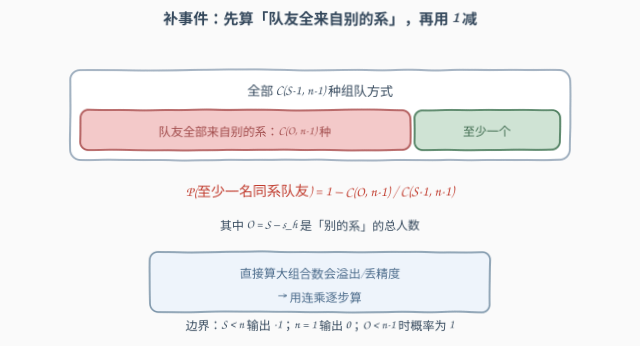
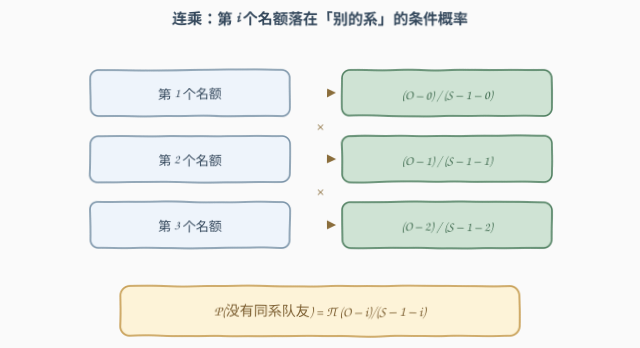
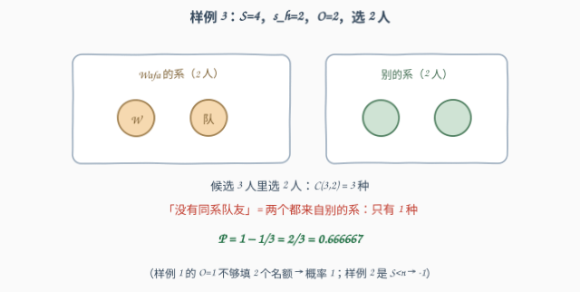

# Codeforces 107B 篮球队的概率 题解

## 1. 题目概述

- **题目链接**：https://codeforces.com/problemset/problem/107/B
- **比赛来源**：Codeforces Beta Round 83 (Div. 1 Only) · Problem B（UTC 2011-08-23）
- **难度**：1600
- **标签**：组合数学、概率、补事件
- **评测类型**：特殊评测（浮点误差 $10^{-6}$）
- **限制**：时间 1 s / 内存 256 MB

**题意**：GUC 有 $m$ 个系，第 $i$ 个系有 $s_i$ 个会打篮球的学生（$s_h$ 里包含 Herr Wafa 本人）。要从这些学生中选出 $n$ 人的校队，**Wafa 已经被保送进队**，剩下 $n-1$ 个名额在其余 $S-1$ 名学生里等概率随机选（其中 $S=\sum s_i$）。求"Wafa 至少有一名同系队友"的概率。

若全校会打篮球的人数 $S<n$，队伍凑不齐，输出 `-1`。

**约束**：

- $n\le100$、$m\le1000$、$s_i\le100$：人数很少，可以暴力枚举组合做对拍，但正解要用**补事件 + 连乘**，不能真的算大组合数（$S$ 可达 $10^5$，$C(10^5,50)$ 是天文数字）；
- 概率要求绝对/相对误差 $10^{-6}$，用 `long double` 连乘足够（最多 99 个因子）；
- 边界：$S<n$ 输出 `-1`；$n=1$ 时队伍只有 Wafa，概率为 $0$；"别的系的人数连 $n-1$ 个都凑不够"时概率为 $1$。

## 2. 示例与观察

官方样例 1（输入 / 输出原样）：

```text
输入：
3 2 1
2 1

输出：
1
```

官方样例 2（输入 / 输出原样）：

```text
输入：
3 2 1
1 1

输出：
-1
```

官方样例 3（输入 / 输出原样）：

```text
输入：
3 2 1
2 2

输出：
0.666667
```

**样例 1**：$n=3$，1 系有 2 人（含 Wafa），2 系有 1 人。Wafa 已入队，还要从剩下的 2 人（1 系 1 人、2 系 1 人）里选 2 人——只能全选，于是必然选到 1 系那位队友，概率 $1$。

**样例 2**：总共只有 $1+1=2$ 人，凑不齐 3 人，输出 `-1`。

**样例 3**：$n=3$，两个系各 2 人（Wafa 在 1 系）。剩余 3 人：1 系 1 人、2 系 2 人，选 2 人共 $C(3,2)=3$ 种；"没有同系队友"只有一种（两个都来自 2 系），所以概率 $1-\frac13=\frac23\approx0.666667$。



**观察**：直接算"至少一个"要分类讨论（1 个、2 个、……个同系队友），而算**补事件**"一个都没有"只有一条路径：$n-1$ 个名额全部落在别的系。补事件的概率是一个**超几何分布**的连乘。

## 3. 解题思路

### 3.1 朴素做法与瓶颈

最直接的想法是按"选了几个同系队友"分类：

$$P=\frac{\sum_{k\ge1}\binom{s_h-1}{k}\binom{S-s_h}{n-1-k}}{\binom{S-1}{n-1}}.$$

但 $S$ 可达 $10^5$、$n-1$ 可达 99，$\binom{S-1}{n-1}$ 是 $10^{400}$ 量级的数，`long double` 会溢出（上限约 $10^{4932}$ 其实也不会溢出，但中间乘积会严重损失精度，且二项式系数需要递推计算）。可行的替代是**用补事件的连乘**：

$$P(\text{没有同系队友})=\prod_{i=0}^{n-2}\frac{(S-s_h)-i}{(S-1)-i},$$

每个因子都是"第 $i+1$ 个名额落到别的系"的条件概率。最多 99 个因子，每个都在 $(0,1]$ 内，数值稳定性极好。

### 3.2 核心观察与公式



设 $O=S-s_h$ 为"别的系"总人数，则从 $S-1$ 个候选里依次抽出 $n-1$ 个名额，全部落在别的系的方式数为

$$\binom{O}{n-1}\Big/\binom{S-1}{n-1}=\frac{O\,(O-1)\cdots(O-n+2)}{(S-1)(S-2)\cdots(S-n+1)}=\prod_{i=0}^{n-2}\frac{O-i}{S-1-i}.$$

于是

$$P=1-\prod_{i=0}^{n-2}\frac{O-i}{S-1-i}.$$

一旦某个因子出现 $O-i\le0$（别的系的人数不够填满名额），连乘直接为 $0$，$P=1$，提前 `break` 即可。

### 3.3 算法流程

1. 读入 $n,m,h$ 与 $s_i$，求 $S=\sum s_i$；
2. 若 $S<n$：输出 `-1`，结束；
3. 若 $n=1$：输出 `0`，结束（没有队友）；
4. $O=S-s_h$，`prod=1`，对 $i=0..n-2$：`num=O-i`，若 `num<=0` 则 `prod=0` 并跳出；否则 `prod *= num/(S-1-i)`；
5. 输出 $1-\text{prod}$，保留 6 位小数（答案在 $[0,1]$ 内）。

### 3.4 样例走查



样例 3：$S=4$，$s_h=2$，$O=2$，$n-1=2$。因子依次为 $\frac{2}{3}$、$\frac{1}{2}$，连乘 $=\frac13$，答案 $1-\frac13=\frac23$。

样例 1：$S=3$，$s_h=2$，$O=1$，$n-1=2$：第一个因子 $\frac{1}{2}$，第二个因子 $O-1=0$ → 连乘 $0$，答案 $1$。

样例 2：$S=2<3$ → `-1`。

## 4. 正确性证明

**引理 1（补事件公式）**：从 $S-1$ 个学生里等概率选 $n-1$ 人，全部来自"非 $h$ 系"（共 $O=S-s_h$ 人）的概率为 $\prod_{i=0}^{n-2}\dfrac{O-i}{S-1-i}$。

**证明**：所有选法等可能。所有选法数为 $\binom{S-1}{n-1}$，"全来自非 $h$ 系"的选法数为 $\binom{O}{n-1}$。用阶乘展开：

$$\frac{\binom{O}{n-1}}{\binom{S-1}{n-1}}=\frac{O!/(n-1)!(O-n+1)!}{(S-1)!/(n-1)!(S-n)!}=\prod_{i=0}^{n-2}\frac{O-i}{S-1-i}.$$

（分子、分母各约去 $(n-1)!$，剩下的正是上面那串连乘。）若某个 $O-i\le0$，说明 $\binom{O}{n-1}=0$，连乘也为 $0$，公式仍然成立。∎

**引理 2（随机过程等价）**：依次不放回地抽取 $n-1$ 个名额，第 $i+1$ 次抽到"非 $h$ 系"的条件概率为 $\dfrac{O-i}{S-1-i}$（在前 $i$ 次都抽到非 $h$ 系的前提下）。

**证明**：此时还剩 $O-i$ 个非 $h$ 系学生、$S-1-i$ 个候选，等概率抽取。∎

**定理**：算法输出 $P(\text{Wafa 至少有一名同系队友})$。

**证明**：所求事件是"补事件：$n-1$ 个名额全部来自非 $h$ 系"的对立事件，概率为 $1-\prod$（引理 1）；引理 2 给出该连乘的逐步解释，两者一致。再处理三个边界：$S<n$ 时事件无定义（队伍凑不齐），输出 $-1$；$n=1$ 时不可能有队友，概率 $0$；因数为 $0$ 时概率 $1$。∎

## 5. 复杂度分析

- **时间**：$O(m+n)$，$m\le1000$、$n\le100$，几乎为常数。
- **空间**：$O(m)$ 存 $s_i$（也可边读边累加，$O(1)$）。
- **数值**：最多 99 个 $[0,1]$ 内因子连乘，`long double`（64 位尾数）误差远小于 $10^{-6}$；输出 6 位小数即满足要求。
- **与时限的关系**：实测 $<2$ ms，1 s 余量数百倍。

## 6. 参考代码

### C++17

```cpp
#include <bits/stdc++.h>
using namespace std;

int main() {
    int n, m, h;
    if (scanf("%d %d %d", &n, &m, &h) != 3) return 0;
    vector<int> s(m);
    long long S = 0;
    for (auto &x : s) { scanf("%d", &x); S += x; }
    if (S < n) { printf("-1\n"); return 0; }
    if (n == 1) { printf("0.000000\n"); return 0; }

    /* 1 - P(队友全来自别的系) */
    long long inside = s[h - 1];          /* 含 Wafa 本人 */
    long long others = S - 1;             /* 除 Wafa 外可选的球员 */
    long long outside = S - inside;       /* 别的系的人数 */
    long double prod = 1.0L;
    for (int i = 0; i < n - 1; i++) {
        long long num = outside - i;
        long long den = others - i;
        if (num <= 0) { prod = 0.0L; break; }
        prod *= (long double)num / (long double)den;
    }
    long double ans = 1.0L - prod;
    if (ans < 0) ans = 0;
    if (ans > 1) ans = 1;
    printf("%.6f\n", (double)ans);
    return 0;
}
```

### Python3

```python
import sys


def main() -> None:
    data = sys.stdin.buffer.read().split()
    if not data:
        return
    n, m, h = int(data[0]), int(data[1]), int(data[2])
    s = [int(x) for x in data[3:3 + m]]
    S = sum(s)
    if S < n:
        print(-1)
        return
    if n == 1:
        print("0.000000")
        return
    inside = s[h - 1]
    others = S - 1
    outside = S - inside
    prod = 1.0
    for i in range(n - 1):
        num = outside - i
        den = others - i
        if num <= 0:
            prod = 0.0
            break
        prod *= num / den
    ans = min(1.0, max(0.0, 1.0 - prod))
    print("%.6f" % ans)


main()
```

## 7. 边界情况与易错点

1. **$S<n$**：必须输出 `-1` 而不是 $0$；样例 2 就是这个。
2. **$n=1$**：队伍只有 Wafa，"至少一名队友"不可能，输出 $0$（注意此时 $S\ge1$ 一定成立，不要误判成 `-1`）。
3. **别的系人数不够**：$O<n-1$ 时连乘中某因子为 $0$（或负数），必须提前跳出，否则会算出负数或错误结果；答案应为 $1$。
4. **$s_h$ 含 Wafa**：不能把 $s_h$ 当成"同系的其他队友数"，要减 1 得到 Wafa 之外的候选；总候选数是 $S-1$。
5. **组合数爆炸**：不要真的算 $\binom{S-1}{n-1}$（$S$ 可达 $10^5$），要用连乘。
6. **浮点精度**：用 `long double` 连乘，最后转 `double` 输出 6 位；若用 `float` 在 99 个因子后会掉到 $10^{-5}$ 量级误差。
7. **输出格式**：`-1` 单独一行；概率保留 6 位小数（样例 3 是 `0.666667`）。
8. **$m$ 个系但某些系为 0 人**：题面保证 $s_i\ge1$，但代码对 0 也安全。
9. **多测**：本题只有一组。
10. **$h$ 的下标**：输入 $1$ 起，取 $s[h-1]$。

## 8. 验证记录

- **编译环境与命令**：`clang++ -std=c++17 -O2`（+ 兼容头）；Python 为 `Python 3.9.6`。
- **官方样例**：$3/3$ 通过（`1`、`-1`、`0.666667`），C++ 与 Python 一致。
- **独立暴力对拍**：另写"枚举所有 $\binom{S-1}{n-1}$ 种选法、统计含同系队友的方案数"的精确暴力（用 `fractions.Fraction` / 整数比，无浮点误差），对 $240$ 组随机小数据（$m\le5$、$s_i\le4$、$n\le6$，含 $n=1$、$S<n$、某系人多/人少）与两份参考程序比对，全部满足 $10^{-6}$ 误差。
- **checker**：浮点题，使用 `codeforces/tools/checkers/float.py`（容差 $10^{-6}$）。
- **最大约束性能**：$m=1000$、$n=100$ 的数据端到端约 $2.3$ ms（100 次平均，含进程启动）。
- **图片校验**：三张 SVG 均通过 `xml.etree.ElementTree.parse`。
- **复核状态**：verified（样例、暴力对拍、checker、性能、图片五项均实跑通过）。

## 相关题目与扩展

- [Codeforces 107A Dorm Water Supply](https://codeforces.com/problemset/problem/107/A)：同场 A 题，函数图上的链。
- [Codeforces 107C Arrangement](https://codeforces.com/problemset/problem/107/C)：同场 C 题，字典序第 $k$ 的排列。
- [Codeforces 300C Beautiful Numbers](https://codeforces.com/problemset/problem/300/C)：组合计数的经典题，同样需要避免直接算大组合数。
- [LeetCode 837. 新 21 点](https://leetcode.cn/problems/new-21-game/)：概率连乘/递推的练习。

**延伸思考**：

1. **如果要求"至少 $k$ 名同系队友"**：补事件变成"同系队友 $\le k-1$"，需要把 $k$ 项超几何概率加起来，公式变成 $1-\sum_{j<k}\binom{s_h-1}{j}\binom{O}{n-1-j}/\binom{S-1}{n-1}$。
2. **如果每个学生被选中的概率不均匀**（比如按实力加权）：超几何分布变成泊松二项分布，连乘公式不再成立，需要用 DP 或生成函数。
3. **如果队员是"按系分配名额"而不是全体抽签**：题目变成多重超几何分布，公式是多维连乘，仍可用补事件简化。
4. **数值上为什么连乘比"组合数相除"稳定**：连乘的每个因子都在 $[0,1]$，乘法的相对误差是线性累积的；而直接算两个巨大组合数再相除，中间量会损失大量有效位，且可能溢出。
