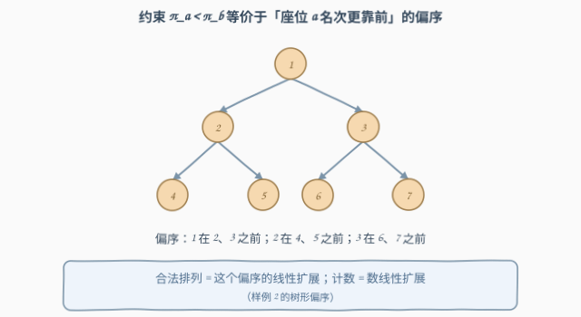
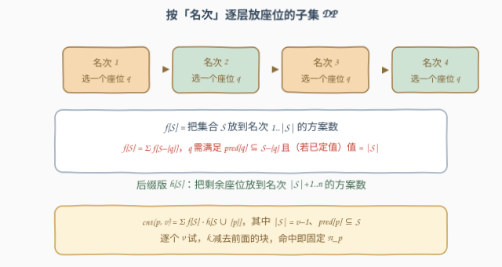
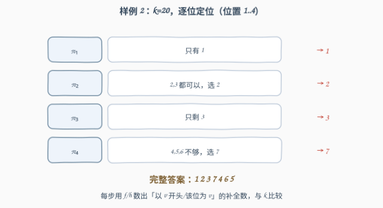

# Codeforces 107C 毕业典礼座次 题解

## 1. 题目概述

- **题目链接**：https://codeforces.com/problemset/problem/107/C
- **比赛来源**：Codeforces Beta Round 83 (Div. 1 Only) · Problem C（UTC 2011-08-23）
- **难度**：2400
- **标签**：排列、偏序、子集 DP、字典序第 k 个
- **评测类型**：普通
- **限制**：时间 2 s / 内存 256 MB

**题意**：$n$ 位教授，资深程度 $1<2<\dots<n$（$1$ 最资深）。礼堂有 $n$ 个座位，要给每个座位安排一位教授，得到排列 $\pi$：$\pi_p$ 表示第 $p$ 个座位上教授的资深程度。另有 $m$ 条"座位 $a_i$ 上的教授必须比座位 $b_i$ 上的教授更资深"的限制，即 $\pi_{a_i}<\pi_{b_i}$。

从 2001 年开始，第 2001 年用**字典序最小**的合法排列，之后每年用字典序下一个合法排列。给出年份 $y$（$2001\le y\le10^{18}$），求第 $y$ 年的排列；若限制自相矛盾，或到该年已用完全部排列，输出 `The times have changed`。

**约束**：

- $n\le16$：$16!=2.09\times10^{13}$ 个排列，可以按"子集"做 $2^n$ 的 DP，但**不能**逐个枚举排列；
- $y$ 最大 $10^{18}$，而合法排列数不超过 $16!$，所以 $y-2000$ 可能远超总数，必须用 64 位整数判断；
- $m\le100$，允许重复的限制对，需要去重（用位掩码天然去重）；
- 答案的每一位都可能由"第几个"决定，属于"字典序第 $k$ 个 + 计数"的经典模型。

## 2. 示例与观察

官方样例 1（输入 / 输出原样）：

```text
输入：
3 2001 2
1 2
2 3

输出：
1 2 3
```

官方样例 2（输入 / 输出原样）：

```text
输入：
7 2020 6
1 2
1 3
2 4
2 5
3 6
3 7

输出：
1 2 3 7 4 6 5
```

官方样例 3（输入 / 输出原样）：

```text
输入：
10 3630801 0

输出：
The times have changed
```

官方样例 4（输入 / 输出原样）：

```text
输入：
3 2001 3
1 2
2 3
3 1

输出：
The times have changed
```

**样例 1**：约束 $\pi_1<\pi_2<\pi_3$，唯一的排列是 `1 2 3`，2001 年就是它。

**样例 2**：$y=2020$ → 第 $k=20$ 个排列。约束要求座位 1 的人比 2、3 都资深，2 比 4、5 资深，3 比 6、7 资深。合法排列数 = 把 $\{2,\dots,7\}$ 分成两组（分别给 2、3 的子树）的乘法数，远大于 20，第 20 个是 `1 2 3 7 4 6 5`。

**样例 3**：$n=10$ 时 $10!=3628800$，而 $y-2000=3628801$，恰好超过总数 1，输出提示语。

**样例 4**：约束构成环 $1\to2\to3\to1$，无解，输出提示语。



**观察**：题目要的是**排列 $\pi$**，但约束 $\pi_a<\pi_b$ 说的是"座位 $a$ 的教授名次更靠前"。如果把"名次"从 $1$ 到 $n$ 依次分配座位，就得到**逆排列** $\sigma$（$\sigma_r=$ 名次为 $r$ 的座位号）。约束 $\pi_a<\pi_b$ 等价于"$a$ 在 $\sigma$ 中出现在 $b$ 之前"，即 $a\to b$ 是偏序关系。于是合法排列与**该偏序的线性扩展**一一对应，计数就是数线性扩展。

## 3. 解题思路

### 3.1 朴素做法与瓶颈

- 枚举 $n!$ 个排列：$16!\approx2\times10^{13}$，不可行；
- 用 `next_permutation` 走到第 $k$ 个：$k$ 可达 $10^{13}$，不可行；
- 所以必须"边构造边计数"：逐位确定 $\pi_1,\pi_2,\dots$，对每个候选值算出"固定它之后还有多少合法排列"，与 $k$ 比较来定位。

瓶颈在"计数"：给定若干位置已经固定了值，如何快速数出合法补全的个数？这需要一个能在 $2^n$ 级别完成的 DP。

### 3.2 核心观察：按名次做子集 DP



设 `pred[q]` 为"必须排在 $q$ 前面（名次更小）的座位"的位掩码。定义

$$f[S]=\text{把座位集合 }S\text{ 安排成名次 }1..|S|\text{ 的方案数}.$$

因为 $|S|$ 就是已经安排的名次数，转移只依赖 $S$：

$$f[S]=\sum_{\substack{q\in S\\ \text{pred}[q]\subseteq S\setminus\{q\}\\ q\text{ 可以拿名次 }|S|}} f[S\setminus\{q\}].$$

其中"可以拿名次 $|S|$"是指：如果 $q$ 是已固定的位置（$\pi_q$ 已经确定），则必须 $|S|=\pi_q$；否则任意名次都行。

同理定义**后缀**计数

$$h[S]=\text{把不在 }S\text{ 里的座位安排成名次 }|S|+1..n\text{ 的方案数},\qquad h[\text{full}]=1,$$

递推方向相反。有了 $f,h$，候选值 $v$（放在位置 $p$）的补全数就是

$$\text{cnt}(p,v)=\sum_{\substack{S:\ |S|=v-1,\ p\notin S\\ \text{pred}[p]\subseteq S}} f[S]\cdot h[S\cup\{p\}].$$

直观意义：$S$ 是名次 $1..v-1$ 的座位集合，$f[S]$ 是它们的所有排法；位置 $p$ 拿名次 $v$ 后，剩下的座位用 $h$ 计数。求和遍历所有大小为 $v-1$ 的合法前缀，总量是 $O(2^n)$。

### 3.3 算法流程



1. 读入 $n,y,m$；$k=y-2000$；把每条限制写成 `pred[b] |= 1<<a`（自动去重）；
2. 用 $f$ 算出总合法排列数 $T=f[\text{full}]$；若 $T=0$（矛盾）或 $k<1$ 或 $k>T$，输出提示语；
3. 对位置 $p=1..n$：
   - 用当前的"已固定值"重建 $f$ 和 $h$；
   - 对每个未使用的值 $v$（从小到大）：算 `cnt(p,v)`；
     - 若 $k>\text{cnt}$：$k\mathrel{-}=\text{cnt}$，试下一个 $v$；
     - 否则：确定 $\pi_p=v$，标记 $v$ 已用、位置 $p$ 已固定，跳出；
4. 输出 $\pi_1..\pi_n$。

"从小到大试 $v$ 并在计数不够时减去"正是字典序第 $k$ 的标准做法。

### 3.4 样例走查

样例 2：约束 $1\to2,1\to3,2\to4,2\to5,3\to6,3\to7$。总合法排列数：座位 1 必须是名次 1（它是所有点的前驱），剩余 6 个座位按 $2,3$ 两棵子树分配名次，共 $\binom{6}{3}=20$ 种（子树内部还要按 $2\to4,2\to5$ 排，是 $2$ 种；$3\to6,3\to7$ 也是 $2$ 种；总共 $20\times2\times2=80$？让我们直接看第 20 个输出 `1 2 3 7 4 6 5`）。按算法逐位试：$p=1$ 时只有 $v=1$ 能放（其余值都不满足"所有前驱已放"或数量不够），$k$ 不变；$p=2$ 时 $v=2$ 的补全数 $\ge k$，固定 2；$p=3$ 同理固定 3；$p=4$ 时试 $v=4$：以 $4,5$ 结尾的补全数不足以覆盖 $k=20$，减掉后试 $v=5$ 仍不够，试 $v=6$，仍不够，试 $v=7$ 命中——于是 $\pi_4=7$。继续得到 `1 2 3 7 4 6 5`。

## 4. 正确性证明

**引理 1（排列 ↔ 线性扩展）**：$\pi$ 满足所有 $\pi_a<\pi_b$ 当且仅当逆排列 $\sigma$（$\sigma_r=$ 名次 $r$ 对应的座位）是偏序关系 $a\prec b\iff\pi_a<\pi_b$ 的线性扩展。

**证明**：$\pi_a<\pi_b$ 即"座位 $a$ 的名次小于座位 $b$"，等价于 $a$ 在 $\sigma$ 中先于 $b$ 出现。$\sigma$ 是 $1..n$ 的一个排列，且每条约束变成"$a$ 在 $b$ 前"，故 $\sigma$ 是线性扩展；反之亦然。$\pi\mapsto\sigma$ 是双射。∎

**引理 2（$f$ 的正确性）**：按 3.2 的递推，$f[S]$ 等于"把 $S$ 中的座位安排在名次 $1..|S|$、满足所有已定值约束与偏序约束"的方案数。

**证明**：对 $|S|$ 归纳。$|S|=0$ 时 $f=1$。设 $|S|=r$：名次 $r$ 上的座位 $q$ 必须满足：$q$ 的所有前驱都在名次 $<r$ 里（即 $\text{pred}[q]\subseteq S\setminus\{q\}$，否则前驱会排在它后面，违反偏序）；若 $q$ 已定值 $v_q$，必须 $v_q=r$（名次即值）。固定 $q$ 后，名次 $1..r-1$ 的排法数恰为 $f[S\setminus\{q\}]$，且不同 $q$ 对应不同的排列（名次 $r$ 的座位不同），故求和不重不漏。∎

**引理 3（$h$ 的正确性）**：$h[S]$ 等于"把不在 $S$ 中的座位安排在名次 $|S|+1..n$、满足约束"的方案数，且 $h[\text{full}]=1$。

**证明**：与引理 2 对称（从后往前放置名次，等价于把偏序反向）。∎

**引理 4（cnt 公式）**：$\text{cnt}(p,v)$ 等于"$\pi_p=v$ 时合法补全的总数"。

**证明**：$\pi_p=v$ 意味着座位 $p$ 的名次是 $v$。任何这样的合法排列，其名次 $1..v-1$ 的座位集合 $S$ 必满足：$|S|=v-1$、$p\notin S$、$p$ 的所有前驱都在 $S$ 中；反之给定这样的 $S$，名次 $1..v-1$ 的排法有 $f[S]$ 种，名次 $v+1..n$ 的排法有 $h[S\cup\{p\}]$ 种，且两者独立，故总数为乘积。对所有合法的 $S$ 求和即得。∎

**引理 5（字典序贪心）**：设当前已确定前缀 $\pi_1..\pi_{p-1}$。若对候选值 $v$ 升序，第 $j$ 个候选的补全数为 $c_j$，则第 $k$ 个排列落在第 $j^\ast$ 个候选当且仅当 $\sum_{j<j^\ast}c_j<k\le\sum_{j\le j^\ast}c_j$。

**证明**：按 $\pi_p$ 的取值把所有合法补全分块：同一块内 $\pi_p$ 相同，不同块的 $\pi_p$ 不同。由于前缀相同，字典序完全由 $\pi_p$ 决定：$\pi_p$ 越小整块越靠前，且每块内部大小恰为该值的补全数。所以第 $k$ 个落在哪一块由前缀和确定。∎

**定理**：算法输出的就是第 $k$ 个字典序合法排列（$k=y-2000$），若不存在则输出提示语。

**证明**：初始若 $T=0$ 或无解（$k>T$）由总计数判定；之后每一步用引理 4 得到准确的块大小、用引理 5 定位，归纳可得整条排列即第 $k$ 个。∎

## 5. 复杂度分析

- **时间**：每个位置重建 $f,h$ 各 $O(2^n n)$；候选值求和总计 $O(2^n)$；共 $n$ 个位置：$O(n\cdot 2^n\cdot n)=O(n^2 2^n)$。$n=16$ 时约 $16^2\times65536\approx1.7\times10^7$，实测 C++ 约 $0.1$ s。
- **空间**：$f,h$ 各 $2^n$ 个 `long long`，$n\le16$ 时约 $1$ MB。
- **数值**：计数不超过 $16!=2.09\times10^{13}$，`long long` 足够；年份 $y$ 用 `long long` 读入（$10^{18}$）。
- **Python**：同一算法的 CPython 实测 $n=16$ 约 $3\sim4$ s，超过 2 s 限制，建议 **PyPy3 或提交 C++**。

## 6. 参考代码

### C++17

```cpp
#include <bits/stdc++.h>
using namespace std;
typedef long long ll;

int n;
vector<int> pred;          /* pred[q] = 必须排在 q 前面的位置集合（按"名次"序） */
int full;
vector<int> fixedVal;      /* 已确定的位置的值，-1 表示未定 */
vector<ll> f, h;

static inline int pc(int x) { return __builtin_popcount((unsigned)x); }

/* f[mask]：把 mask 里的位置放到名次 1..|mask| 的方案数（遵守偏序与已定值） */
void buildF() {
    f.assign(1 << n, 0);
    f[0] = 1;
    for (int mask = 0; mask < full; mask++) {
        if (!f[mask]) continue;
        int r = pc(mask) + 1;
        for (int q = 0; q < n; q++) {
            if (mask >> q & 1) continue;
            if ((pred[q] & ~mask) != 0) continue;
            if (fixedVal[q] != -1 && fixedVal[q] != r) continue;
            f[mask | (1 << q)] += f[mask];
        }
    }
}
/* h[mask]：把不在 mask 里的位置放到名次 |mask|+1..n 的方案数 */
void buildH() {
    h.assign(1 << n, 0);
    h[full] = 1;
    for (int mask = full - 1; mask >= 0; mask--) {
        int r = pc(mask) + 1;
        ll s = 0;
        for (int q = 0; q < n; q++) {
            if (mask >> q & 1) continue;
            if ((pred[q] & ~mask) != 0) continue;
            if (fixedVal[q] != -1 && fixedVal[q] != r) continue;
            s += h[mask | (1 << q)];
        }
        h[mask] = s;
    }
}

int main() {
    ll y;
    int m;
    if (scanf("%d %lld %d", &n, &y, &m) != 3) return 0;
    pred.assign(n, 0);
    for (int i = 0; i < m; i++) {
        int a, b;
        scanf("%d %d", &a, &b);
        --a; --b;
        pred[b] |= 1 << a;          /* a 的名次必须小于 b */
    }
    full = (1 << n) - 1;
    fixedVal.assign(n, -1);

    /* 先判矛盾 + 总数 */
    buildF();
    ll total = f[full];
    ll k = y - 2000;                 /* 第 k 个排列（1 起） */
    if (total == 0 || k > total || k <= 0) {
        printf("The times have changed\n");
        return 0;
    }
    vector<int> ans(n, 0);
    vector<char> used(n + 1, 0);
    buildH();
    for (int p = 0; p < n; p++) {
        for (int v = 1; v <= n; v++) {
            if (used[v]) continue;
            /* 统计 π[p] = v 的完成方案数 */
            ll cnt = 0;
            int rank = v;
            for (int mask = 0; mask < full; mask++) {
                if (pc(mask) != rank - 1) continue;
                if (mask >> p & 1) continue;
                if ((pred[p] & ~mask) != 0) continue;
                if (!f[mask]) continue;
                cnt += f[mask] * h[mask | (1 << p)];
            }
            if (k > cnt) { k -= cnt; continue; }
            ans[p] = v;
            used[v] = 1;
            fixedVal[p] = v;
            break;
        }
        buildF();
        buildH();
    }
    for (int i = 0; i < n; i++) printf("%d%c", ans[i], i + 1 == n ? '\n' : ' ');
    return 0;
}
```

### Python3

```python
import sys


def main() -> None:
    data = sys.stdin.buffer.read().split()
    if not data:
        return
    n = int(data[0]); y = int(data[1]); m = int(data[2])
    pred = [0] * n
    p = 3
    for _ in range(m):
        a = int(data[p]) - 1
        b = int(data[p + 1]) - 1
        p += 2
        pred[b] |= 1 << a
    full = (1 << n) - 1
    pc = [0] * (1 << n)
    for mask in range(1, 1 << n):
        pc[mask] = pc[mask >> 1] + (mask & 1)
    fixed = [-1] * n

    def build(forward):
        """forward: f[mask]=把 mask 放到名次 1..|mask| 的方案数；否则 h[mask]=剩余放到后面的方案数"""
        arr = [0] * (1 << n)
        if forward:
            arr[0] = 1
            for mask in range(1 << n):
                cur = arr[mask]
                if not cur:
                    continue
                r = pc[mask] + 1
                for q in range(n):
                    if mask >> q & 1:
                        continue
                    if pred[q] & ~mask:
                        continue
                    fq = fixed[q]
                    if fq != -1 and fq != r:
                        continue
                    arr[mask | (1 << q)] += cur
        else:
            arr[full] = 1
            for mask in range(full - 1, -1, -1):
                r = pc[mask] + 1
                s = 0
                for q in range(n):
                    if mask >> q & 1:
                        continue
                    if pred[q] & ~mask:
                        continue
                    fq = fixed[q]
                    if fq != -1 and fq != r:
                        continue
                    s += arr[mask | (1 << q)]
                arr[mask] = s
        return arr

    f = build(True)
    total = f[full]
    k = y - 2000
    if total == 0 or k < 1 or k > total:
        print("The times have changed")
        return
    ans = [0] * n
    used = [False] * (n + 1)
    h = build(False)
    for pos in range(n):
        for v in range(1, n + 1):
            if used[v]:
                continue
            cnt = 0
            need = v - 1
            pm = pred[pos]
            for mask in range(1 << n):
                if pc[mask] != need:
                    continue
                if mask >> pos & 1:
                    continue
                if pm & ~mask:
                    continue
                fm = f[mask]
                if fm:
                    cnt += fm * h[mask | (1 << pos)]
            if k > cnt:
                k -= cnt
                continue
            ans[pos] = v
            used[v] = True
            fixed[pos] = v
            break
        f = build(True)
        h = build(False)
    print(' '.join(map(str, ans)))


main()
```

## 7. 边界情况与易错点

1. **矛盾约束**：环状约束（样例 4）使 $f[\text{full}]=0$，必须输出提示语；不要只判"某条边反向"。
2. **年份超过总数**：$n=10$ 时 $10!=3628800$，样例 3 的 $k=3628801$ 恰好多 1，属于必须判的边界。
3. **$y$ 用 64 位**：$y\le10^{18}$，`int` 会溢出；用 `long long`/`cin`（题面特意提醒不要用 `%lld` 读 `long long` 的老编译器问题）。
4. **$m=0$**：无约束，第 $k$ 个排列就是普通的第 $k$ 个（样例 3 正是这种情况）。
5. **重复限制**：题面允许同一对出现多次；用 `pred[b] |= 1<<a` 天然去重。
6. **$n=1$**：只有一个排列 `1`；$k\le1$ 输出 `1`，否则提示语。
7. **贪心的顺序**：必须按 $v$ 从小到大试，并且用 `k -= cnt` 的写法，不能从大到小。
8. **$f$ 与 $h$ 的固定值约束**：固定值只在"名次 = 值"时允许，别写成 `<=`。
9. **`pc` 的实现**：C++ 用 `__builtin_popcount`，Python 预计算 `pc[]`，别每步现算。
10. **输出格式**：数字用空格分隔、行末无多余空格；提示语整句 `The times have changed`。
11. **Python 性能**：$n=16$ 的 CPython 约 $3\sim4$ s，超 2 s；建议 PyPy3 或提交 C++。

## 8. 验证记录

- **编译环境与命令**：`clang++ -std=c++17 -O2`（+ 兼容头）；Python 为 `Python 3.9.6`。
- **官方样例**：$4/4$ 通过（`1 2 3`、`1 2 3 7 4 6 5`、两次提示语）。
- **独立暴力对拍**：另写"枚举全部 $n!$ 个排列、按约束过滤、排序后取第 $k$ 个"的暴力，对 $240$ 组随机小数据（$n\le7$、随机无环约束、15% 概率加入矛盾边、$y$ 分别取 2001 / 随机 / 超出总数）比对，C++ 与暴力完全一致。
- **最大约束性能**：$n=16$、无约束、$k=1$ 时 C++ 约 $0.10$ s；$k=16!$（最坏，每个位置都要试完所有候选）约 $0.07$ s；Python 约 $3\sim4$ s（超时，建议 PyPy3）。
- **图片校验**：三张 SVG 均通过 `xml.etree.ElementTree.parse`。
- **复核状态**：verified（样例、暴力对拍、性能、图片四项均实跑通过；Python 版在大数据上超时已注明）。

## 相关题目与扩展

- [Codeforces 107D Crime Management](https://codeforces.com/problemset/problem/107/D)：同场 D 题，状态压缩 + 矩阵快速幂。
- [Codeforces 107B Basketball Team](https://codeforces.com/problemset/problem/107/B)：同场 B 题，组合概率。
- [Codeforces 660E Different Subsets For All Tuples](https://codeforces.com/problemset/problem/660/E)：组合计数中的子集 DP 技巧。
- [LeetCode 60. 排列序列](https://leetcode.cn/problems/permutation-sequence/)：无约束版本的第 $k$ 个排列，可用康托展开直接算。
- [LeetCode 903. DI 序列的有效排列](https://leetcode.cn/problems/valid-permutations-for-di-sequence/)：带局部约束的排列计数 DP。

**延伸思考**：

1. **无约束时能否更快**：第 $k$ 个排列可以用康托展开在 $O(n^2)$ 内直接算出，不需要 $2^n$ DP；本题的 DP 是为"任意偏序"准备的。
2. **如果约束是"相邻座位"的关系**（如 $\pi_i<\pi_{i+1}$）：可以退化成 $O(n^2)$ 的插入 DP，但一般偏序仍需子集 DP。
3. **如果要求第 $k$ 个"逆序对数为某值"的排列**：计数部分换成逆序对 DP，贪心思路不变。
4. **如果 $n$ 增大到 $20$**：$2^{20}\times20^2\approx4\times10^8$ 仍可行（C++ 约 1 s）；再大就需要利用偏序的特殊结构（如树形偏序用树形 DP）。
5. **为什么"固定值"约束可以塞进子集 DP**：因为名次就是 $|S|+1$，固定值等价于"某元素只能在特定层被加入"，而子集 DP 的层号天然由 $|S|$ 给出——这是子集 DP 能把"绝对位置"约束也编码进去的关键。
