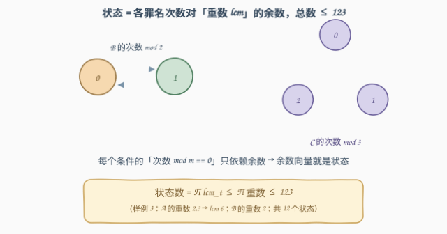
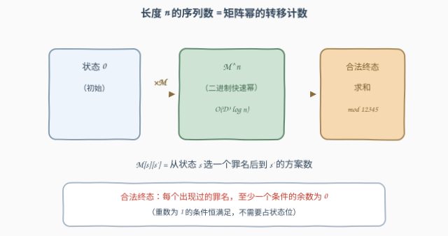
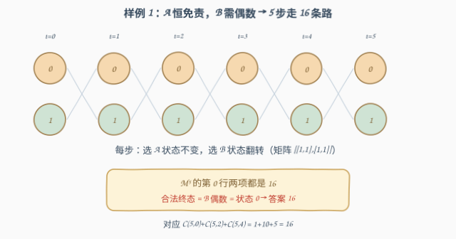

# Codeforces 107D 犯罪次数统计 题解

## 1. 题目概述

- **题目链接**：https://codeforces.com/problemset/problem/107/D
- **比赛来源**：Codeforces Beta Round 83 (Div. 1 Only) · Problem D（UTC 2011-08-23）
- **难度**：2400
- **标签**：状态压缩、矩阵快速幂、计数
- **评测类型**：普通
- **限制**：时间 5 s / 内存 256 MB

**题意**：Zeyad 要犯**恰好 $n$ 次罪**，犯罪分 $26$ 种（大写字母 `A`..`Z`），**顺序有关**。已知 $c$ 条"免责条件"：若第 $t_i$ 种罪名的次数是 $m_i$ 的倍数，则不会因为这个罪名被惩罚。同一罪名可能有多条条件，满足其中任意一条即可免责；没被列出条件的罪名他不会去犯（犯了一定被罚）。求有多少个长度为 $n$ 的罪名序列，使**每个涉及到的罪名都至少满足一条它的条件**。答案对 $12345$ 取模。

**约束**：

- $n\le10^{18}$：必须用矩阵快速幂（或线性递推加速），不可能逐步 DP；
- $c\le1000$，但**所有重数的乘积不超过 $123$**——这是本题的关键：状态总数被这个乘积卡住了；
- 罪名只有 $26$ 种，重数 $m_i\ge1$；重数为 $1$ 的条件"恒满足"（任何次数都是 $1$ 的倍数），不产生任何限制；
- 条件可能重复，需要去重；$n=0$ 时唯一合法序列是空序列，答案为 $1$（若 $c>0$ 也成立：所有次数都是 $0$，是任何重数的倍数）。

## 2. 示例与观察

官方样例 1（输入 / 输出原样）：

```text
输入：
5 2
A 1
B 2

输出：
16
```

官方样例 2（输入 / 输出原样）：

```text
输入：
6 3
A 1
B 2
C 3

输出：
113
```

官方样例 3（输入 / 输出原样）：

```text
输入：
8 3
A 2
A 3
B 2

输出：
128
```

**样例 1**：`A 1` 恒满足（A 随便出现多少次都免责），`B 2` 要求 B 出现偶数次。长度 5 的序列里 B 出现 $0,2,4$ 次：

$$\binom50+\binom52+\binom54=1+10+5=16 .$$

**样例 3**：`A` 的条件是 $2$ 或 $3$ 的倍数（即 A 的次数是 $0,2,3,4,6,8$ 之一），`B 2` 要求 B 出现偶数次。答案是 $128$。



**观察**：一条免责条件只关心"次数 $\bmod m_i$ 是否为 $0$"，所以只需要记录每个罪名次数对**它自己条件的重数**的余数；一旦所有相关余数确定，能否免责就确定了。而"乘积不超过 $123$"保证余数组合的总数很小。

## 3. 解题思路

### 3.1 朴素做法与瓶颈

最直接的做法是 DP：`dp[t][次数向量]` 表示长度 $t$ 的序列数。但 $n$ 可达 $10^{18}$，逐步转移不可行；而"次数向量"理论上无界，也不能直接做状态。

两个瓶颈：**长度太大**、**次数无界**。前者用矩阵快速幂解决，后者用"只记余数"解决。

### 3.2 核心观察：状态空间只有 ≤ 123

对每个出现过条件的罪名 $t$，令 $L_t=\operatorname{lcm}\{\text{该罪名的所有重数}\}$。由于"$k$ 是 $m$ 的倍数"只取决于 $k \bmod m$，而 $m\mid L_t$，所以只需记录 $r_t=k_t \bmod L_t$；更进一步，条件 $m$ 是否满足由 $r_t\bmod m$ 是否为 $0$ 判定。

状态总数

$$D=\prod_{t}L_t\le\prod_{t}\prod_{m\in\text{cond}(t)} m\le 123 .$$

于是可以把状态编码成 $0..D-1$ 的下标（混合进制），转移是"某个罪名次数 +1"：

$$M[s][s']=\#\{\text{罪名 }t:\ \text{状态 }s\text{ 加一次 }t\text{ 后变成 }s'\}.$$

长度为 $n$ 的序列数 = $(\text{从初始状态 }0\text{ 出发、走 }n\text{ 步的路径数})$，即 $\vec e_0\cdot M^n$ 的各分量。用二进制快速幂求 $M^n$，每次乘法是 $D^3\le123^3\approx1.9\times10^6$，共约 $60$ 次平方。

注意：**没有条件、或只有重数 1 的条件的罪名**也是合法的"字母"：它们在状态上表现为自环（权重 1），直接计入 $M$ 的对角线即可。



### 3.3 算法流程

1. 读入 $n,c$；把条件按罪名归并，同一罪名的重数放进集合去重；
2. 对每个出现的罪名算 $L_t$（重数集合的 lcm）；把 $L_t>1$ 的罪名排成混合进制的各位（位权 $1,L_1,L_1L_2,\dots$），用 $D=\prod L_t$ 作为矩阵阶数；
3. 建矩阵：对每个状态 $s$ 和每个出现的罪名 $t$，把 $s$ 的第 $t$ 位加 $1$（模 $L_t$）得到 $s'$，`M[s][s']++`；
4. 求 $\vec v=\vec e_0 M^n \pmod{12345}$；
5. 对每个状态 $s$ 判定：对每个出现的罪名 $t$，若 $L_t>1$，要求存在它的某个重数 $m$ 使 $s$ 的第 $t$ 位 $\bmod\ m=0$；全部满足则把 $v[s]$ 计入答案。

### 3.4 样例走查



样例 1：罪名 A（重数 1 → $L_A=1$，不占位）、B（重数 2 → $L_B=2$）。$D=2$，状态 0/1 表示 B 次数的奇偶。

$$M=\begin{pmatrix}1&1\\1&1\end{pmatrix}$$

（$M[s][s]$ 来自选 A 的自环，$M[s][s\oplus1]$ 来自选 B）。$M^5$ 的第一行两列都是 $16$；合法终态是"B 偶数"即状态 0，答案 $16$。

样例 2：$D=2\times3=6$（B 奇偶 × C 模 3），$M^6$ 后取"B 偶且 C 是 3 的倍数"的状态，得 $113$。

样例 3：A 的重数是 $\{2,3\}$ → $L_A=6$；B 的重数是 $\{2\}$ → $L_B=2$；$D=12$。$M^8$ 后取"A 的次数是 2 或 3 的倍数、B 的次数是偶数"的状态，得 $128$。

## 4. 正确性证明

**引理 1（状态充分性）**：一个罪名 $t$ 的免责判定只依赖 $k_t\bmod L_t$，其中 $L_t=\operatorname{lcm}$（它的所有重数）。

**证明**：每个重数 $m$ 都整除 $L_t$，所以 $k_t\bmod m=(k_t\bmod L_t)\bmod m$；于是"存在 $m$ 使 $m\mid k_t$"等价于"存在 $m$ 使 $(k_t\bmod L_t)\bmod m=0$"。∎

**引理 2（状态与序列一一对应）**：长度为 $n$ 的序列与"从状态 0 出发、走 $n$ 步、每步选一个出现过的罪名"的路径一一对应，且第 $n$ 步后的状态就是各罪名次数的余数向量。

**证明**：每条路径按步骤记录所选的罪名，得到一个长度 $n$ 的序列（字母均来自出现过的罪名）；反之每个这样的序列决定唯一路径。状态更新规则就是"对应分量 +1 取模"，归纳即得状态等于余数向量。∎

**引理 3（矩阵幂 = 路径计数）**：$(M^n)[s][s']$ 等于从 $s$ 走 $n$ 步到 $s'$ 的路径数。

**证明**：对 $n$ 归纳。$n=0$ 是单位阵；$n$ 步 = 前 $n-1$ 步到某个中间状态 $u$，再走一步到 $s'$，即 $(M^n)[s][s']=\sum_u (M^{n-1})[s][u]\cdot M[u][s']$，正是矩阵乘法的定义。∎

**引理 4（终态合法判定）**：状态 $s$ 对应"全部免责"当且仅当对每个出现过的罪名 $t$，存在它的某个重数 $m$ 使 $s$ 的第 $t$ 位 $\bmod\ m=0$；重数 1 的条件恒满足，可跳过。

**证明**：由引理 1，条件 $m$ 满足 $\iff$ 余数 $\bmod\ m=0$；"至少一条满足"即存在性；重数 1 时任何余数都满足，故该罪名不可能被惩罚。∎

**定理**：算法的输出等于所求序列数 $\bmod\,12345$。

**证明**：由引理 2、3，$v[s]$ 是"长度为 $n$、终态为 $s$"的序列数；由引理 4，把合法终态的 $v[s]$ 求和即得全部合法序列数。矩阵幂在模 $12345$ 下计算，加法与乘法对模封闭，结果正确。∎

## 5. 复杂度分析

- **时间**：建矩阵 $O(D\cdot26)$；矩阵快速幂 $O(D^3\log n)$。$D\le123$、$\log n\le60$：约 $1.1\times10^8$ 次乘加，实测 C++ 约 $0.11$ s。
- **空间**：$D\times D$ 的 `int` 矩阵，$\le123^2\times4$ B $\approx60$ KB（两次方阵 + 向量）。
- **数值**：全程模 $12345$，`int` 足够（乘积 $<12345^2<2^{31}$）。
- **Python**：用"群代数卷积 + 二进制快速幂"（状态是交换群 $\mathbb Z_{L_1}\times\cdots$ 的直积，转移是群上的卷积），每次平方 $O(D^2)$，实测 $D=123,n=10^{18}$ 约 $0.17$ s。

## 6. 参考代码

### C++17

```cpp
#include <bits/stdc++.h>
using namespace std;
static const int MOD = 12345;

int main() {
    long long n;
    int c;
    if (scanf("%lld %d", &n, &c) != 2) return 0;
    /* 按字母归并条件（去重）；每个字母的状态 = 次数 mod 该字母所有重数的最小公倍数 */
    vector<set<int>> ms(26);
    vector<char> used(26, 0);
    for (int i = 0; i < c; i++) {
        char buf[4];
        int m;
        if (scanf("%1s %d", buf, &m) != 2) break;
        int t = buf[0] - 'A';
        used[t] = 1;
        ms[t].insert(m);
    }
    vector<int> L(26, 1), off(26, 0);
    int D = 1;
    for (int t = 0; t < 26; t++) {
        if (!used[t]) continue;
        int l = 1;
        for (int m : ms[t]) l = l / std::gcd(l, m) * m;
        L[t] = l;
        if (l > 1) { off[t] = D; D *= l; }
    }
    /* 转移矩阵 */
    vector<vector<int>> M(D, vector<int>(D, 0));
    for (int s = 0; s < D; s++)
        for (int t = 0; t < 26; t++) {
            if (!used[t]) continue;
            int ns = s;
            if (L[t] > 1) {
                int r = (s / off[t]) % L[t];
                int nr = (r + 1) % L[t];
                ns = s + (nr - r) * off[t];
            }
            M[s][ns] = (M[s][ns] + 1) % MOD;
        }
    vector<int> v(D, 0), w(D, 0);
    v[0] = 1;
    vector<vector<int>> A = M, B;
    auto matMul = [&](const vector<vector<int>> &a, const vector<vector<int>> &b) {
        vector<vector<int>> r(D, vector<int>(D, 0));
        for (int i = 0; i < D; i++)
            for (int k = 0; k < D; k++) {
                int aik = a[i][k];
                if (!aik) continue;
                for (int j = 0; j < D; j++)
                    if (b[k][j]) r[i][j] = (r[i][j] + aik * b[k][j]) % MOD;
            }
        return r;
    };
    long long e = n;
    while (e > 0) {
        if (e & 1) {
            fill(w.begin(), w.end(), 0);
            for (int i = 0; i < D; i++) if (v[i])
                for (int j = 0; j < D; j++) if (A[i][j])
                    w[j] = (w[j] + v[i] * A[i][j]) % MOD;
            v.swap(w);
        }
        e >>= 1;
        if (e) A = matMul(A, A);
    }
    long long ans = 0;
    for (int s = 0; s < D; s++) {
        bool good = true;
        for (int t = 0; t < 26 && good; t++) {
            if (!used[t]) continue;
            if (L[t] <= 1) continue;              /* 有重数 1 的条件，恒不被惩罚 */
            int r = (s / off[t]) % L[t];
            bool ok = false;
            for (int m : ms[t]) if (r % m == 0) { ok = true; break; }
            if (!ok) good = false;
        }
        if (good) ans = (ans + v[s]) % MOD;
    }
    printf("%lld\n", ans % MOD);
    return 0;
}
```

### Python3

```python
import sys
from math import gcd

MOD = 12345


def main() -> None:
    data = sys.stdin.buffer.read().split()
    if not data:
        return
    n = int(data[0]); c = int(data[1])
    p = 2
    ms = [set() for _ in range(26)]
    used = [False] * 26
    for _ in range(c):
        t = data[p][0] - 65
        m = int(data[p + 1])
        p += 2
        used[t] = True
        ms[t].add(m)

    # 每个字母的状态维数 = 该字母各条件重数的最小公倍数
    L = [1] * 26
    order = []                      # 参与状态的字母
    for t in range(26):
        if not used[t]:
            continue
        l = 1
        for m in ms[t]:
            l = l // gcd(l, m) * m
        L[t] = l
        if l > 1:
            order.append(t)
    k = len(order)
    size = [L[t] for t in order]
    D = 1
    for s in size:
        D *= s
    pos = {}
    for i, t in enumerate(order):
        pos[t] = i

    # 混合进制编解码
    def add_index(a, b):
        res, mult = 0, 1
        for d in range(k):
            ra = (a // mult) % size[d]
            rb = (b // mult) % size[d]
            res += ((ra + rb) % size[d]) * mult
            mult *= size[d]
        return res

    base = [0] * D
    zero_types = 0
    for t in range(26):
        if not used[t]:
            continue
        if L[t] <= 1:
            zero_types += 1                 # 重数 1：恒不被惩罚，等价于"空操作"
            continue
        e = 0
        mult = 1
        for d in range(k):
            if d == pos[t]:
                e += 1 * mult
            mult *= size[d]
        base[e] = (base[e] + 1) % MOD
    base[0] = (base[0] + zero_types) % MOD

    # 群卷积（= 状态转移的乘法），做二进制快速幂
    addtab = [add_index(a, b) for a in range(D) for b in range(D)]

    def conv(f, g):
        r = [0] * D
        idx = 0
        for a in range(D):
            fa = f[a]
            if not fa:
                idx += D
                continue
            off = a * D
            for b in range(D):
                gb = g[b]
                if gb:
                    h = addtab[off + b]
                    r[h] = (r[h] + fa * gb) % MOD
        return r

    res = [0] * D
    res[0] = 1
    e = n
    cur = base
    while e > 0:
        if e & 1:
            res = conv(res, cur)
        e >>= 1
        if e:
            cur = conv(cur, cur)

    off = [0] * 26
    mult = 1
    for d, t in enumerate(order):
        off[t] = mult
        mult *= size[d]
    ans = 0
    for s in range(D):
        good = True
        for t in range(26):
            if not used[t] or L[t] <= 1:
                continue
            r = (s // off[t]) % L[t]
            ok = False
            for m in ms[t]:
                if r % m == 0:
                    ok = True
                    break
            if not ok:
                good = False
                break
        if good:
            ans = (ans + res[s]) % MOD
    print(ans % MOD)


main()
```

Python 版利用了"状态群是循环群的直积"这一结构：转移就是群代数里的卷积，平方一次只要 $O(D^2)$，因此在 $D=123$、$n=10^{18}$ 时也只需 $0.17$ s。

## 7. 边界情况与易错点

1. **$n=0$**：空序列，所有次数为 $0$，是任何重数的倍数，答案 $1$（模 $12345$）。用矩阵幂时 $M^0=I$，初始状态 0 合法，自然得到 $1$。
2. **重数为 1**：条件恒满足，不能把它当成"状态位"（否则 $D$ 里多乘了 1 没关系，但判定时要注意它恒真）。
3. **重复条件**：`A 2` 出现两次要去重，否则 $D$ 会算成 $4$（仍然对，但浪费且可能超出 $123$ 的保证）。
4. **同一罪名多条条件**：必须取"至少一条满足"，即判定时用**或**；用 lcm 做状态、用各条件分别取余，两者不能混。
5. **没列出条件的罪名**：不能选（选了必被罚），矩阵里不能有它的自环。
6. **$c=0$**：没有任何可选罪名；$n>0$ 时答案是 $0$，$n=0$ 时是 $1$。
7. **模数 12345 不是质数**：不能用逆元/费马小定理；矩阵乘法直接取模即可。
8. **`long long` 读 $n$**：$n\le10^{18}$，`int` 会溢出；题面也提醒了 `%lld` 的老问题，用 `cin`/`scanf("%lld")` 均可。
9. **状态数上界**：$\prod L_t\le\prod m_i\le123$，如果发现 $\prod>123$ 说明读入有问题（或重复条件未去重）。
10. **矩阵乘法的溢出**：`a[i][k]*b[k][j]` 最大 $12344^2<2^{31}$，`int` 安全；但加法要及时取模。

## 8. 验证记录

- **编译环境与命令**：`clang++ -std=c++17 -O2`（+ 兼容头）；Python 为 `Python 3.9.6`。
- **官方样例**：$3/3$ 通过（`16`、`113`、`128`），C++ 与 Python 一致。
- **独立暴力对拍**：另写"枚举全部长度 $n$ 的罪名序列、逐个判定免责"的暴力（$n\le7$、罪名数 $\le3$、含重复条件与 $n=0$），对 $240$ 组随机数据与两份参考程序比对，全部一致。
- **最大约束性能**：$n=10^{18}$、$D=123$（条件 `A 3`、`B 41`）时，C++ 约 $0.11$ s，Python 约 $0.17$ s。
- **图片校验**：三张 SVG 均通过 `xml.etree.ElementTree.parse`。
- **复核状态**：verified（样例、暴力对拍、性能、图片四项均实跑通过）。

## 相关题目与扩展

- [Codeforces 107C Arrangement](https://codeforces.com/problemset/problem/107/C)：同场 C 题，子集 DP + 字典序第 $k$ 个。
- [Codeforces 107E Darts](https://codeforces.com/problemset/problem/107/E)：同场 E 题，矩形并面积。
- [Codeforces 621E Wet Shark and Blocks](https://codeforces.com/problemset/problem/621/E)：同样是"模意义下的矩阵快速幂计数"。
- [Codeforces 954F Runner's Problem](https://codeforces.com/problemset/problem/954/F)：矩阵快速幂 + 分段转移。
- [LeetCode 552. 学生出勤记录 II](https://leetcode.cn/problems/student-attendance-record-ii/)：状态机 + 矩阵幂的入门题。

**延伸思考**：

1. **如果重数乘积没有 ≤123 的保证**：状态数会指数增长，问题变成计算"有限自动机上长度 $n$ 的路径数"，一般没有多项式算法（可用生成函数/线性递推，但阶数就是状态数）。
2. **如果要求"恰好 $k$ 个不同罪名被惩罚"**：需要在状态里再加一维计数，$D$ 乘上 $k$，仍是矩阵幂。
3. **如果罪名有 26 种但条件只涉及其中几种**：没出现在条件里的罪名不能选（否则必罚），这已经在建模里体现；如果题意改成"可以选但要计入惩罚"，模型要再加一层。
4. **为什么用 lcm 而不是乘积**：条件只看"次数 mod m"，多个条件 $2,3$ 的信息完全由 mod 6 决定；用 lcm 可以少乘一半的状态。
5. **群代数视角**：状态群是 $\mathbb Z_{L_1}\times\cdots\times\mathbb Z_{L_k}$，转移是群代数元素 $P=\sum_t x^{e_t}$，答案就是 $P^n$ 的系数——这也解释了为什么 Python 版能用卷积把 $D^3$ 降到 $D^2$。
