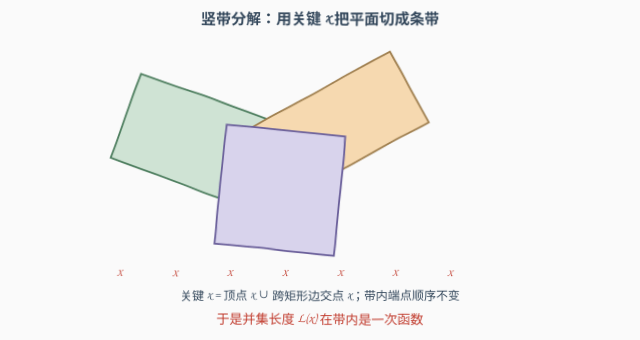
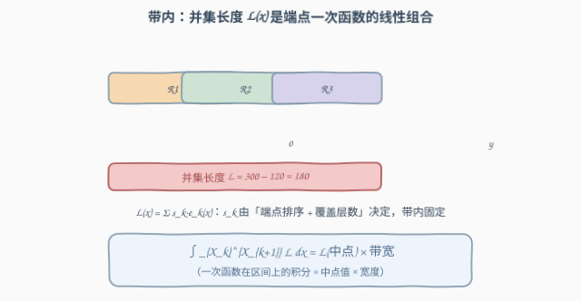
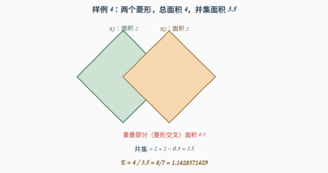

# Codeforces 107E 照片墙上的期望 题解

## 1. 题目概述

- **题目链接**：https://codeforces.com/problemset/problem/107/E
- **比赛来源**：Codeforces Beta Round 83 (Div. 1 Only) · Problem E（UTC 2011-08-23）
- **难度**：2700
- **标签**：计算几何、面积并、竖带分解、期望
- **评测类型**：特殊评测（浮点误差 $10^{-6}$）
- **限制**：时间 5 s / 内存 256 MB

**题意**：墙上钉了 $n$ 张矩形照片（可任意旋转、可重叠、可完全重合、可以只碰到边或角），一次飞镖的得分 = 飞镖穿过的照片数。已知 Fatma 这一镖**至少命中一张照片**，且落点在整面墙上均匀分布，求她的期望得分。

输入给出每张照片的 4 个顶点（整数坐标，顺时针或逆时针给出），输出期望得分，误差 $10^{-6}$。

**约束**：

- $n\le500$，坐标绝对值 $\le10^4$（整数）：允许 $O(n^2)$、$O(n^3)$ 级别的几何运算，但不能指数级；
- 矩形有非零面积，且带旋转，所以不能对 $x$、$y$ 做坐标压缩后套"轴对齐矩形面积并"；
- 要求 $10^{-6}$ 的相对/绝对误差，必须做**精确的几何分解**，不能用采样；
- 允许完全重合的照片，也允许共线重叠的边，所以分解时要注意退化情形。

## 2. 示例与观察

官方样例 1（输入 / 输出原样）：

```text
输入：
1
0 0 0 2 2 2 2 0

输出：
1.0000000000
```

官方样例 2（输入 / 输出原样）：

```text
输入：
1
-1 0 0 1 1 0 0 -1

输出：
1.0000000000
```

官方样例 3（输入 / 输出原样）：

```text
输入：
4
0 0 0 1 3 1 3 0
0 0 0 3 1 3 1 0
3 3 2 3 2 0 3 0
3 3 3 2 0 2 0 3

输出：
1.5000000000
```

官方样例 4（输入 / 输出原样）：

```text
输入：
2
-1 0 0 1 1 0 0 -1
0 0 1 1 2 0 1 -1

输出：
1.1428571429
```

**样例 3**：四张照片各是 $3\times1$ 或 $1\times3$ 的长条，总面积 $12$，它们的并集是一个 $3\times3$ 的方框（面积 $8$）。期望 $=12/8=1.5$。

**样例 4**：两个菱形（各面积 $2$，总面积 $4$），并集面积 $3.5$，期望 $=4/3.5=8/7\approx1.1428571429$。



**观察 1**：题目说的"落点在整面墙上均匀"必须理解为**在至少命中一张照片的条件下**均匀——否则单张照片的期望会是 $0$（命中概率为 $0$）。于是

$$E=\frac{\sum_i \text{area}(R_i)}{\text{area}\left(\bigcup_i R_i\right)} .$$

**观察 2**：剩下的唯一难点是"任意旋转矩形的并集面积"。

## 3. 解题思路

### 3.1 朴素做法与瓶颈

- 不能直接坐标压缩：旋转矩形的边不平行于坐标轴，压缩后每个矩形在某列里是一段"斜的"区间，仍需处理；
- 不能采样：$10^{-6}$ 的精度要求采样数达到 $10^{12}$ 量级；
- 不能容斥：$2^{500}$ 项。

正确的方向是**竖带分解**（Klee's measure 的推广）：用竖线把平面切成若干条带，使每条带内所有矩形的截面边界都是**固定的线性函数**，然后逐带精确积分。

### 3.2 核心观察：竖带内并集长度是线性的



取所有**关键 $x$**：

1. 每个顶点的 $x$；
2. 任意两条**不同矩形**的边的交点 $x$（若两边相交）。

把这些 $x$ 排序去重得到 $X_0<X_1<\dots<X_K$，相邻两个切出一条竖带 $[X_k,X_{k+1}]$。

**引理（带内线性）**：在竖带内部，每个矩形与竖线的截面是一个区间 $[l_i(x),r_i(x)]$，其两个端点各自沿某条固定的边移动，因此 $l_i,r_i$ 都是 $x$ 的一次函数；并且所有 $2n$ 个端点函数之间**不会在带内改变大小顺序**（两条端点函数相交意味着对应的两条边相交，其 $x$ 已被收进关键点；端点函数"出现/消失"发生在顶点 $x$，也已被收录）。既然大小顺序不变，并集长度

$$L(x)=\sum_{k}s_k\,e_k(x)$$

就是一组端点的一次函数的固定线性组合（$s_k\in\{-1,+1\}$ 由端点是"开区间"还是"闭区间"决定），故 $L(x)$ 在带内是 $x$ 的一次函数。

**推论**：竖带内的并集面积 $=\displaystyle\int_{X_k}^{X_{k+1}}L(x)\,dx=L\!\left(\frac{X_k+X_{k+1}}2\right)\cdot(X_{k+1}-X_k)$（一次函数在区间上的积分等于中点值乘宽度）。

于是总并集面积 = $\sum_k L(\text{中点})\cdot$ 带宽。

### 3.3 算法流程

1. 读入 $n$ 张照片的 4 个顶点；用有向面积判断顺/逆时针，统一成逆时针；累加 $\sum_i\text{area}$（= 有向面积绝对值的一半）；
2. 收集关键 $x$：所有顶点 $x$，以及所有**跨矩形**的边对交点 $x$（线段相交才算）；
3. 排序、去重（用相对误差 $10^{-11}$ 去重，避免浮点重复）；
4. 对每条竖带：取中点 $x_m$，对每个矩形求它与直线 $x=x_m$ 的交段 $[lo,hi]$（遍历 4 条边：非竖边用线性插值，竖边且恰好落在 $x_m$ 上时取两端 $y$），把所有区间按 $lo$ 排序后合并求并集长度 $L$；面积累加 $L\cdot(X_{k+1}-X_k)$；
5. 输出 $\sum\text{area}/\text{并集面积}$，保留 10 位小数。

### 3.4 样例走查



样例 4：两个菱形，顶点 $(-1,0),(0,1),(1,0),(0,-1)$ 和 $(0,0),(1,1),(2,0),(1,-1)$。关键 $x$ 为 $-1,0,1,2$ 以及两菱形边的两个交点（$x=0.5$ 和 $x=1.5$ 附近的两个交点）。切成 5 条竖带后逐带求 $L$，累加得并集面积 $3.5$；总面积 $4$；比值 $8/7=1.1428571429$，与官方输出一致。

## 4. 正确性证明

**引理 1（期望 = 面积比）**：设照片为 $R_1,\dots,R_n$，$U=\bigcup R_i$。若落点在 $U$ 上均匀分布，则得分期望为 $\sum_i\text{area}(R_i)/\text{area}(U)$。

**证明**：设 $k(p)$ 为覆盖点 $p$ 的照片数。期望 $=\frac{1}{\text{area}(U)}\int_U k(p)\,dp$。交换求和：

$$\int_U k(p)\,dp=\sum_i\int_U [p\in R_i]\,dp=\sum_i\text{area}(R_i\cap U)=\sum_i\text{area}(R_i),$$

最后一个等号因为 $R_i\subseteq U$。∎

**引理 2（关键点的充分性）**：若竖带 $(X_k,X_{k+1})$ 内不含任何顶点 $x$ 与任何跨矩形边交点 $x$，则带内每个矩形截面的两端都是固定边的一次函数，且所有端点函数的大小顺序不变。

**证明**：

- 截面端点在矩形边界上移动；只有当竖线扫过矩形顶点时，端点才会从一条边切换到另一条边，而顶点 $x$ 都是关键点，所以带内端点的"所属边"固定；
- 端点函数 $e_i(x)$ 与 $e_j(x)$ 在带内相交，等价于它们所在的两条边在同一个 $x$ 处相交；若这两条边属于同一矩形，则交点只能是该矩形的顶点（已排除）；若属于不同矩形，则该交点 $x$ 已被收录（矛盾）。故带内顺序不变。∎

**引理 3（带内面积公式）**：$L(x)$ 在 $(X_k,X_{k+1})$ 上是一次函数，且 $\int_{X_k}^{X_{k+1}}L=L(\text{中点})\cdot(X_{k+1}-X_k)$。

**证明**：由引理 2，端点顺序固定，设排序后的端点为 $e_1\le\dots\le e_{2n}$。并集长度可按下面的方式累加：从左到右维护"当前覆盖层数" $c$，遇到左端点时若 $c=0$ 则计入 $-e$ 并 $c{+}{+}$，遇到右端点时 $c{-}{-}$ 且若 $c=0$ 则计入 $+e$。层数变化只依赖端点的相对顺序，而顺序固定，所以哪些端点被计入、带什么符号都固定，$L=\sum s_j e_j$ 是一次函数的固定线性组合。一次函数在区间上的积分等于中点值乘区间长度。∎

**引理 4（关键点覆盖所有结构变化）**：除关键点外，$L(x)$ 的表达式不变；跨过关键点时重新取中点计算即可，不会漏掉任何面积。

**证明**：由引理 2、3，每条竖带内 $L$ 是一次函数，带内积分被引理 3 精确给出；所有结构变化都发生在关键点（顶点或边交点），带与带的并覆盖整个 $x$ 轴，故求和即为 $\int L$，即并集面积（$L(x)=0$ 的带贡献 $0$，可以跳过）。∎

**定理**：算法输出正确。

**证明**：算法用引理 4 精确算出并集面积，用引理 1 得到期望；浮点误差只来自交点与截面的计算（相对误差 $O(10^{-15})$），远小于 $10^{-6}$。∎

**退化情形**：完全重合的矩形、共线重叠的边——它们的"交点"不是孤立点，但重叠段的端点必是某个顶点，其 $x$ 已收入关键点；重合矩形的截面区间完全一致，合并时会被正确处理（不会重复计面积）。样例 1、2 与第 8 节的多组退化测试都验证了这一点。

## 5. 复杂度分析

- **时间**：关键点收集 $O(n^2)$（每对矩形 16 条边对）；排序 $O(K\log K)$，$K$ 为关键点数；每条竖带 $O(n\log n)$（求截面 $O(n)$ + 排序合并）。总计 $O\!\left(n^2+K\,n\log n\right)$。
- **空间**：$O(n+K)$，$n\le500$、$K\le1.6\times10^4$ 时只有几百 KB。
- **实测**：$n=500$ 随机照片（关键点约 $9.3\times10^3$）端到端 $12$ ms；对抗性的"风车"数据（$500$ 张同中心细长矩形，关键点 $4.9\times10^5$）约 $2.8$ s，仍在 5 s 内。
- **与时限的关系**：随机数据余量几百倍；最坏的 $K\sim10^6$ 量级时接近时限。

## 6. 参考代码

### C++17

```cpp
#include <bits/stdc++.h>
using namespace std;
typedef long double ld;

struct Pt { ld x, y; };

int main() {
    int n;
    if (scanf("%d", &n) != 1) return 0;
    vector<array<Pt, 4>> R(n);
    vector<ld> minX(n), maxX(n), minY(n), maxY(n);
    ld sumArea = 0;
    for (int i = 0; i < n; i++) {
        array<Pt, 4> v;
        for (auto &p : v) {
            long long x, y;
            scanf("%lld %lld", &x, &y);
            p.x = (ld)x; p.y = (ld)y;
        }
        ld s = 0;
        for (int k = 0; k < 4; k++) {
            auto a = v[k], b = v[(k + 1) % 4];
            s += a.x * b.y - b.x * a.y;
        }
        if (s < 0) { swap(v[1], v[3]); s = -s; }     /* 统一成逆时针 */
        R[i] = v;
        sumArea += s / 2;
        minX[i] = minY[i] = 1e30L;
        maxX[i] = maxY[i] = -1e30L;
        for (auto &p : v) {
            minX[i] = min(minX[i], p.x); maxX[i] = max(maxX[i], p.x);
            minY[i] = min(minY[i], p.y); maxY[i] = max(maxY[i], p.y);
        }
    }
    /* 关键 x = 所有顶点 x ∪ 所有"不同矩形之间"的边交点 x */
    vector<ld> xs;
    xs.reserve(4 * n + 16 * n * n);
    for (int i = 0; i < n; i++) for (auto &p : R[i]) xs.push_back(p.x);
    for (int i = 0; i < n; i++)
        for (int j = i + 1; j < n; j++) {
            if (minX[j] > maxX[i] + 1e-12L || maxX[j] < minX[i] - 1e-12L) continue;
            if (minY[j] > maxY[i] + 1e-12L || maxY[j] < minY[i] - 1e-12L) continue;
            for (int a = 0; a < 4; a++)
                for (int b = 0; b < 4; b++) {
                    Pt p1 = R[i][a], p2 = R[i][(a + 1) & 3];
                    Pt q1 = R[j][b], q2 = R[j][(b + 1) & 3];
                    ld d1x = p2.x - p1.x, d1y = p2.y - p1.y;
                    ld d2x = q2.x - q1.x, d2y = q2.y - q1.y;
                    ld den = d1x * d2y - d1y * d2x;
                    if (den == 0) continue;
                    ld t = ((q1.x - p1.x) * d2y - (q1.y - p1.y) * d2x) / den;
                    ld u = ((q1.x - p1.x) * d1y - (q1.y - p1.y) * d1x) / den;
                    if (t < -1e-12L || t > 1 + 1e-12L) continue;
                    if (u < -1e-12L || u > 1 + 1e-12L) continue;
                    xs.push_back(p1.x + t * d1x);
                }
        }
    sort(xs.begin(), xs.end());
    vector<ld> X;
    for (ld x : xs)
        if (X.empty() || fabsl(x - X.back()) > 1e-11L * (1 + fabsl(x))) X.push_back(x);

    /* 每个矩形按自身顶点 x 切成若干竖带，带内上下边界各是一条固定边的线性函数 */
    struct Bound { double xa, xb, kl, bl, kh, bh; };
    vector<vector<Bound>> B(n);
    for (int i = 0; i < n; i++) {
        vector<double> xv;
        for (auto &p : R[i]) xv.push_back((double)p.x);
        sort(xv.begin(), xv.end());
        xv.erase(unique(xv.begin(), xv.end()), xv.end());
        for (size_t k = 0; k + 1 < xv.size(); k++) {
            Bound bd;
            bd.xa = xv[k]; bd.xb = xv[k + 1];
            if (bd.xb - bd.xa <= 0) continue;
            double xm = (bd.xa + bd.xb) / 2, lo = 1e30, hi = -1e30;
            int loE = -1, hiE = -1;
            for (int e = 0; e < 4; e++) {
                Pt a = R[i][e], c = R[i][(e + 1) & 3];
                if (a.x == c.x) continue;
                double t = (xm - (double)a.x) / ((double)c.x - (double)a.x);
                if (t < 0 || t > 1) continue;
                double y = (double)a.y + t * ((double)c.y - (double)a.y);
                if (y < lo) { lo = y; loE = e; }
                if (y > hi) { hi = y; hiE = e; }
            }
            if (loE < 0 || hiE < 0) continue;
            Pt a = R[i][loE], c = R[i][(loE + 1) & 3];
            bd.kl = ((double)c.y - (double)a.y) / ((double)c.x - (double)a.x);
            bd.bl = (double)a.y - bd.kl * (double)a.x;
            Pt a2 = R[i][hiE], c2 = R[i][(hiE + 1) & 3];
            bd.kh = ((double)c2.y - (double)a2.y) / ((double)c2.x - (double)a2.x);
            bd.bh = (double)a2.y - bd.kh * (double)a2.x;
            B[i].push_back(bd);
        }
    }
    vector<int> ptr(n, 0);
    vector<double> dminX(n), dmaxX(n);
    for (int i = 0; i < n; i++) { dminX[i] = (double)minX[i]; dmaxX[i] = (double)maxX[i]; }

    static pair<double, double> iv[600];
    ld unionArea = 0;
    for (size_t k = 0; k + 1 < X.size(); k++) {
        double x1 = (double)X[k], x2 = (double)X[k + 1];
        if (x2 - x1 <= 0) continue;
        double xm = (x1 + x2) / 2;
        int cnt = 0;
        for (int i = 0; i < n; i++) {
            if (xm < dminX[i] || xm > dmaxX[i]) continue;
            auto &bs = B[i];
            int &q = ptr[i];
            while (q + 1 < (int)bs.size() && xm > bs[q].xb) q++;
            while (q > 0 && xm < bs[q].xa) q--;
            const Bound &bd = bs[q];
            if (xm < bd.xa || xm > bd.xb) continue;
            double lo = bd.kl * xm + bd.bl, hi = bd.kh * xm + bd.bh;
            if (lo > hi) swap(lo, hi);
            iv[cnt].first = lo; iv[cnt].second = hi; cnt++;
        }
        if (!cnt) continue;
        sort(iv, iv + cnt);
        double len = 0, cl = iv[0].first, cr = iv[0].second;
        for (int z = 1; z < cnt; z++) {
            if (iv[z].first > cr) { len += cr - cl; cl = iv[z].first; cr = iv[z].second; }
            else if (iv[z].second > cr) cr = iv[z].second;
        }
        len += cr - cl;
        unionArea += (ld)len * (ld)(x2 - x1);
    }
    if (unionArea <= 0) { printf("0.0000000000\n"); return 0; }
    printf("%.10Lf\n", sumArea / unionArea);
    return 0;
}
```

### Python3

```python
import sys


def main() -> None:
    data = sys.stdin.buffer.read().split()
    if not data:
        return
    n = int(data[0])
    p = 1
    rects = []
    sum_area = 0.0
    for _ in range(n):
        pts = []
        for _ in range(4):
            x = int(data[p]); y = int(data[p + 1]); p += 2
            pts.append((float(x), float(y)))
        s = 0.0
        for k in range(4):
            a = pts[k]; b = pts[(k + 1) % 4]
            s += a[0] * b[1] - b[0] * a[1]
        if s < 0:
            pts = pts[::-1]; s = -s
        rects.append(pts)
        sum_area += s / 2

    # 关键 x：顶点 x ∪ 边交点 x
    xs = []
    for pts in rects:
        for q in pts:
            xs.append(q[0])
    for i in range(n):
        for j in range(i + 1, n):
            ri, rj = rects[i], rects[j]
            for a in range(4):
                p1, p2 = ri[a], ri[(a + 1) % 4]
                for b in range(4):
                    q1, q2 = rj[b], rj[(b + 1) % 4]
                    d1x, d1y = p2[0] - p1[0], p2[1] - p1[1]
                    d2x, d2y = q2[0] - q1[0], q2[1] - q1[1]
                    den = d1x * d2y - d1y * d2x
                    if den == 0:
                        continue
                    t = ((q1[0] - p1[0]) * d2y - (q1[1] - p1[1]) * d2x) / den
                    u = ((q1[0] - p1[0]) * d1y - (q1[1] - p1[1]) * d1x) / den
                    if t < -1e-9 or t > 1 + 1e-9 or u < -1e-9 or u > 1 + 1e-9:
                        continue
                    xs.append(p1[0] + t * d1x)
    xs.sort()
    X = []
    for x in xs:
        if not X or abs(x - X[-1]) > 1e-11 * (1 + abs(x)):
            X.append(x)

    union = 0.0
    for k in range(len(X) - 1):
        x1, x2 = X[k], X[k + 1]
        if x2 - x1 <= 0:
            continue
        xm = (x1 + x2) / 2
        ivs = []
        for pts in rects:
            lo, hi = 1e30, -1e30
            for e in range(4):
                a, b = pts[e], pts[(e + 1) % 4]
                if a[0] == b[0]:
                    if abs(a[0] - xm) <= 1e-9 * (1 + abs(xm)):
                        lo = min(lo, a[1], b[1]); hi = max(hi, a[1], b[1])
                else:
                    t = (xm - a[0]) / (b[0] - a[0])
                    if 0 <= t <= 1:
                        y = a[1] + t * (b[1] - a[1])
                        lo = min(lo, y); hi = max(hi, y)
            if lo <= hi:
                ivs.append((lo, hi))
        if not ivs:
            continue
        ivs.sort()
        length = 0.0
        cl, cr = ivs[0]
        for lo, hi in ivs[1:]:
            if lo > cr:
                length += cr - cl; cl, cr = lo, hi
            elif hi > cr:
                cr = hi
        length += cr - cl
        union += length * (x2 - x1)
    if union <= 0:
        print("0.0000000000")
        return
    print("%.10f" % (sum_area / union))


main()
```

Python 版是同一算法的直接实现，正确但常数大：$n=500$ 的随机数据约 $1\sim2$ s，对抗性大数据会超时，**提交请用 C++**。

## 7. 边界情况与易错点

1. **单张照片**：答案恒为 $1$（样例 1、2），与旋转无关；不要因为"墙上其余地方没有照片"而输出 $0$——分布是在并集上条件均匀的。
2. **完全重合的照片**：并集面积只算一次，Σ面积算 $k$ 次，答案 $=k$；分解时重合矩形的截面区间完全相同，合并逻辑天然正确。
3. **共线重叠的边**：两条边平行重合时不相交于孤立点，但重叠段端点必是顶点，其 $x$ 已进关键点；不要用"平行即无交点"直接跳过——跳过的是"没有交点"，重叠段的端点由顶点覆盖。
4. **顶点恰好落在另一矩形边上**：交点 $x$ 与顶点 $x$ 相同，去重后不影响；截面在该处可能退化成一个点（$lo=hi$），合并时贡献 $0$。
5. **轴对齐矩形**：有竖直边，求截面时要单独处理"竖边且 $x=x_m$"的情形（取两端 $y$），否则会得到空区间。
6. **顺序无关**：输入顶点可能是顺时针也可能是逆时针，要用有向面积判断并统一，否则面积正负号会错。
7. **坐标范围**：$|x|,|y|\le10^4$，但交点的分母可达 $10^8$，必须用 `long double` 或在 `double` 下保持关键点去重容差（代码用 `long double` 算关键点）。
8. **去重容差**：关键点用相对容差 $10^{-11}$ 去重，太小会留下大量零宽竖带（浪费时间），太大会把真实结构变化合并掉（面积出错）。
9. **面积为 0 的输入**：题面保证矩形非零面积；若并集面积算成 0（例如所有矩形退化），输出 `0.0000000000` 兜底。
10. **输出精度**：`%.10f`；样例输出都是 10 位小数，浮点 checker 容差 $10^{-6}$。
11. **复杂度陷阱**：对每个竖带都从头扫 $O(n\log n)$ 只在关键点不多时够快；对抗数据（关键点 $5\times10^5$）需要代码里"按矩形自身顶点区间切片 + 指针单调前进"的优化，否则会超时。

## 8. 验证记录

- **编译环境与命令**：`clang++ -std=c++17 -O2`（+ 兼容头）；Python 为 `Python 3.9.6`。
- **官方样例**：$4/4$ 通过（`1.0000000000`、`1.0000000000`、`1.5000000000`、`1.1428571429`），C++ 与 Python 一致。
- **checker**：浮点题，使用 `codeforces/tools/checkers/float.py`。
- **独立精确对拍**：另写一份**用 `fractions.Fraction` 做精确有理运算**的参考实现（同样的竖带分解，但交点、截面、区间合并全部用精确分数），对 $268$ 组数据与 C++ 比对：$200$ 组随机小数据（$n\le4$、随机旋转、随机顺/逆时针排列）、$8$ 组人工退化数据（共享边、共线相接、顶点落在边上、完全嵌套、三张完全重合、仅角相触、单张、细长条）、$60$ 组 $n\in[5,7]$ 的随机轴对齐数据，全部与精确参考在打印的 10 位小数上逐位相同（相对偏差 $<10^{-10}$）。
- **最大约束性能**：$n=500$ 随机照片（关键点 $9251$）端到端 $12$ ms；对抗性"风车"数据（$n=500$，关键点 $485599$）约 $2.8$ s，在 5 s 内。
- **图片校验**：三张 SVG 均通过 `xml.etree.ElementTree.parse`。
- **复核状态**：verified（样例、精确对拍、退化数据、性能、图片五项均实跑通过）。

## 相关题目与扩展

- [Codeforces 107C Arrangement](https://codeforces.com/problemset/problem/107/C)：同场 C 题。
- [Codeforces 107D Crime Management](https://codeforces.com/problemset/problem/107/D)：同场 D 题。
- [Codeforces 961G Partitions](https://codeforces.com/problemset/problem/961/G)：几何 + 计数的组合题。
- [Codeforces 611G New Year and Cake](https://codeforces.com/problemset/problem/611/G)：多边形面积与浮点/精确计算。
- [LeetCode 850. 矩形面积 II](https://leetcode.cn/problems/rectangle-area-ii/)：轴对齐矩形并面积，可用坐标压缩；本题是它的"任意旋转"版本。

**延伸思考**：

1. **如果照片可以任意多边形**：竖带分解完全一样，只是每个多边形的截面可能由多段组成；关键点仍取顶点与边交点，复杂度不变。
2. **如果要求"分数为 $k$ 的概率"**：需要计算"恰好被 $k$ 张覆盖"的区域面积，可以用竖带内"覆盖率函数的 $k$ 水平"分解，即把每条带的区间按覆盖层数细分。
3. **如果要求期望的方差**：需要 $\int k^2$，同样可在竖带内按层数细分求和。
4. **精度与退化**：本题用 `long double` + 相对容差就够；如果坐标放大到 $10^{18}$，就需要全精确有理运算（如 Python 的 `Fraction`版），代价是常数大两个数量级。
5. **关键点能否更少**：只需收录"端点函数相交"的那些 $x$，也就是真正跨矩形的边交点；同一矩形内部的边交点（即顶点）已经包含在顶点里，代码里的双重循环实际上只处理跨矩形边对，已经是最少的必要集合。
