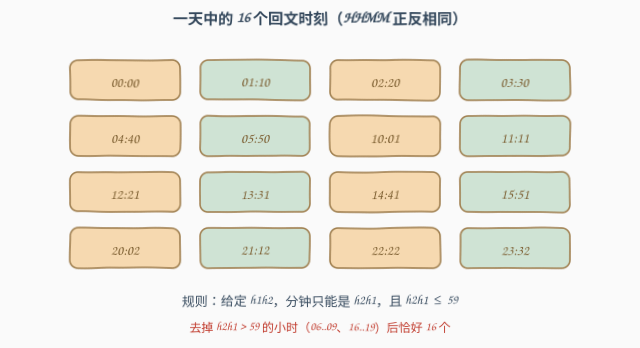
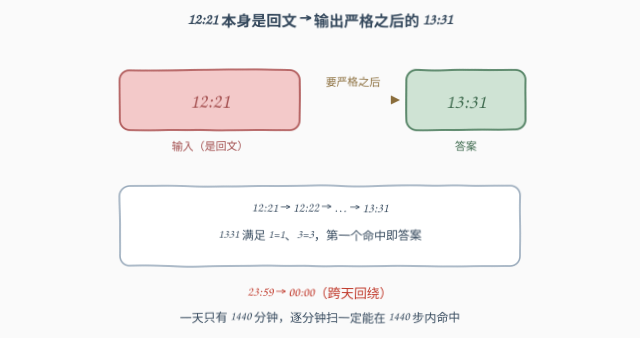

# Codeforces 108A 下一个回文时刻 题解

## 1. 题目概述

- **题目链接**：https://codeforces.com/problemset/problem/108/A
- **比赛来源**：Codeforces Beta Round 83 (Div. 2 Only) · Problem A（UTC 2011-08-23）
- **难度**：1000
- **标签**：模拟、回文、时间
- **评测类型**：普通
- **限制**：时间 2 s / 内存 256 MB

**题意**：数字时钟按 `HH:MM` 显示（`HH` 从 `00` 到 `23`，`MM` 从 `00` 到 `59`）。称一个时刻是回文的，如果把 4 位数字 `HHMM` 正着读和反着读一样（即 `HH:MM` 形如 `ab:ba`）。给定当前时刻，求**严格在它之后**的下一个回文时刻；若已过 `23:59` 则回到次日开头。

**约束**：

- 一天只有 $1440$ 分钟，直接逐分钟向后扫描即可，且在 $1440$ 步内一定能找到下一个回文时刻（一天有 $16$ 个回文时刻）；
- 输入格式固定 `HH:MM`，需要解析冒号；
- "严格之后"：输入本身是回文时刻时，要输出再下一个（样例 1：`12:21` → `13:31`）；
- 输出要补前导零（`00:00` 而不是 `0:0`）。

## 2. 示例与观察

官方样例 1（输入 / 输出原样）：

```text
输入：
12:21

输出：
13:31
```

官方样例 2（输入 / 输出原样）：

```text
输入：
23:59

输出：
00:00
```

**样例 1**：`12:21` 本身是回文，但要求严格之后，所以答案是下一个 `13:31`（回文时刻之间可能相隔很久，例如 `15:51` 之后是 `20:02`）。

**样例 2**：`23:59` 之后跨天，最近的回文是次日 `00:00`。



**观察**：回文条件只依赖 4 个数字 $h_1h_2m_1m_2$：$h_1=m_2$ 且 $h_2=m_1$。所以给定小时 $h_1h_2$，分钟被唯一确定为 $h_2h_1$；只要 $h_2h_1\le59$ 就是一个回文时刻。一天共 $16$ 个：$00{:}00,01{:}10,\dots,05{:}50,10{:}01,\dots,15{:}51,20{:}02,\dots,23{:}32$。

## 3. 解题思路

### 3.1 朴素做法与瓶颈

没有瓶颈：一天只有 $1440$ 分钟，从输入时刻往后逐分钟检查即可，最坏 $1440$ 次检查、每次 4 次比较。

也可以直接生成 $16$ 个回文时刻再二分查找，但逐分钟扫描更短、更不容易错。

### 3.2 核心观察

- 把时间化成"当天第 $t$ 分钟"（$t=h\cdot60+m$），回文判定为 `t/60` 的十位 $=t\%60$ 的个位、`t/60` 的个位 $=t\%60$ 的十位；
- 从 $k=1$ 开始扫描 $(t+k)\bmod 1440$，第一个回文就是答案；
- 一定能找到：例如 $00{:}00$ 就是回文，所以最多扫到次日 $00{:}00$。

### 3.3 算法流程

1. 读入 `HH:MM`，分解出 $h,m$，$t=60h+m$；
2. 对 $k=1,\dots,1440$：$cur=(t+k)\bmod1440$，$hh=cur/60$，$mm=cur\%60$；若 $hh/10=mm\%10$ 且 $hh\%10=mm/10$，输出 `%02d:%02d` 并结束；
3. （循环内一定返回，无需兜底。）

### 3.4 样例走查



`12:21` → $t=741$；$k=1$ 得 `12:22` 不是回文……一直扫到 $k=70$ 得 `13:31`，其 4 位为 `1331`，满足 $1=1$、$3=3$，输出。

`23:59` → $t=1439$；$k=1$ → $(1440)\bmod1440=0$ → `00:00`，回文，输出。

## 4. 正确性证明

**引理 1（判定）**：时刻 $hh{:}mm$ 是回文当且仅当 $hh$ 的十位等于 $mm$ 的个位、$hh$ 的个位等于 $mm$ 的十位。

**证明**：`HHMM` 回文即第 1 位 = 第 4 位、第 2 位 = 第 3 位，正是上述两条。∎

**引理 2（存在性）**：对任意输入时刻，在接下来的 $1440$ 分钟内必有一个回文时刻。

**证明**：$00{:}00$ 是回文时刻，且任何时刻之后 $1440$ 分钟内必然经过 `00:00`（跨天回绕）。∎

**引理 3（最小性）**：算法第一次命中的 $k$ 就是"严格在输入之后的最小回文时刻"所对应的分钟差。

**证明**：算法按 $k=1,2,\dots$ 递增地检查每一个后续分钟，一旦命中就停止；由于检查是穷尽的，第一个命中的就是最小的合法 $k$，对应时间也是最小（按当天分钟序，跨天视为循环）。∎

**定理**：算法输出正确。

**证明**：引理 1 保证判定正确，引理 2 保证循环不会越界，引理 3 保证第一个命中即答案；输出用 `%02d:%02d` 保证格式与题面一致。∎

## 5. 复杂度分析

- **时间**：$O(1440)$ 次常数检查，即 $O(1)$（一天固定）。
- **空间**：$O(1)$。
- **与时限的关系**：实测 $<2$ ms（含进程启动），2 s 余量数百倍。

## 6. 参考代码

### C++17

```cpp
#include <bits/stdc++.h>
using namespace std;

int main() {
    int h, m;
    if (scanf("%d:%d", &h, &m) != 2) return 0;
    int t = h * 60 + m;
    for (int k = 1; k <= 1440; k++) {
        int cur = (t + k) % 1440;
        int hh = cur / 60, mm = cur % 60;
        int a = hh / 10, b = hh % 10, c = mm / 10, d = mm % 10;
        if (a == d && b == c) {
            printf("%02d:%02d\n", hh, mm);
            return 0;
        }
    }
    return 0;
}
```

### Python3

```python
import sys


def main() -> None:
    hh, mm = map(int, sys.stdin.readline().strip().split(':'))
    t = hh * 60 + mm
    for k in range(1, 1441):
        cur = (t + k) % 1440
        a, b = divmod(cur, 60)
        if a // 10 == b % 10 and a % 10 == b // 10:
            print("%02d:%02d" % (a, b))
            return


main()
```

## 7. 边界情况与易错点

1. **输入本身是回文**：必须输出**再下一个**（`12:21 → 13:31`），不能原地不动。
2. **跨天**：`23:59` 之后是 `00:00`；不要输出 `24:00`。
3. **补前导零**：`00:00`、`01:10` 等必须两位，用 `%02d:%02d`。
4. **`scanf("%d:%d")` 的冒号**：格式串里的冒号会匹配输入中的冒号，这样解析最省事；用字符串切分也行。
5. **循环上界**：$k\le1440$ 一定够（跨天回绕），写成 `<1440` 会在差 1 的边界上漏（例如输入就是 `00:00` 且要求下一个时，`k` 恰为 1440 才回到 `00:00`——不过那时会命中区间内的其它回文，仍建议写 `<=1440`）。
6. **分钟范围**：`MM` 只在 `00..59`，判断回文时不要忘记 $hh$ 的十位是 $0,1,2$、$hh$ 的个位是 $0..9$，而 $mm$ 的十位必须是 $hh$ 的个位 ≤ 5，所以 `16:61` 之类不是合法时间——逐分钟扫描天然不会遇到。
7. **多测**：只有一组输入。
8. **读入为空**：防御性返回。

## 8. 验证记录

- **编译环境与命令**：`clang++ -std=c++17 -O2`（+ 兼容头）；Python 为 `Python 3.9.6`。
- **官方样例**：$2/2$ 通过（`13:31`、`00:00`），C++ 与 Python 一致。
- **独立暴力对拍**：另写"先枚举整天所有回文时刻并排序、再用二分查找严格后继"的暴力，对全部 $1440$ 个输入时刻逐一比对（覆盖了所有 $-24$ 小时），C++、Python、暴力三者完全一致——这比随机对拍更强：一天只有 $1440$ 个输入，做了**全枚举**。
- **性能**：单次运行 $<2$ ms。
- **图片校验**：两张 SVG 均通过 `xml.etree.ElementTree.parse`。
- **复核状态**：verified（样例、全枚举对拍、性能、图片四项均实跑通过）。

## 相关题目与扩展

- [Codeforces 108B Datatypes](https://codeforces.com/problemset/problem/108/B)：同场 B 题，位数与平方的比较。
- [Codeforces 107A Dorm Water Supply](https://codeforces.com/problemset/problem/107/A)：同一场 Div.1 的 A 题。
- [LeetCode 9. 回文数](https://leetcode.cn/problems/palindrome-number/)：回文判定的入门题。
- [LeetCode 1180. 统计只含单一字母的子串](https://leetcode.cn/problems/count-substrings-with-only-one-distinct-letter/)：字符串计数的小题，可与本题的"枚举全天"思路对照。

**延伸思考**：

1. **如果时钟是 12 小时制**：`12:21` 之后仍是 `01:10` 等；把小时映射到 $1..12$ 后判定规则不变，但"回文"对 `12:21` 与 `01:10` 都成立，需要单独确认 `12:21` 这种以 `12` 开头的形式。
2. **如果要求第 $k$ 个回文时刻**：直接生成 $16$ 个回文时刻后取模即可，$O(1)$。
3. **如果时钟是 24 小时制但显示秒**：`HH:MM:SS` 的回文要求 6 位对称，共 $12\times?$ 个，仍然可以全天枚举。
4. **如果时间格式带 AM/PM**：回文条件会附加到 12 小时制的数字上，需要先转换再判定。
