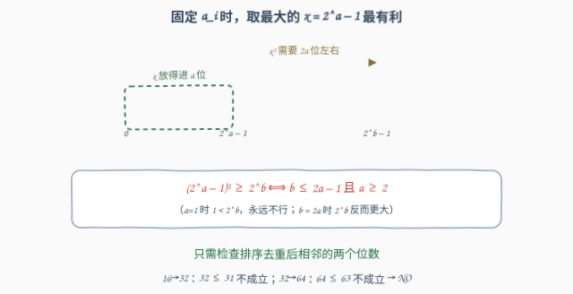
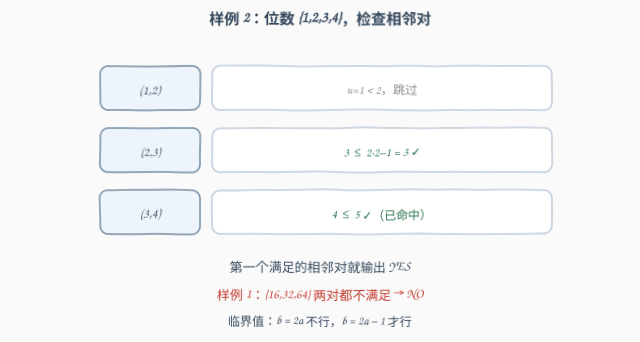

# Codeforces 108B 数据类型的危机 题解

## 1. 题目概述

- **题目链接**：https://codeforces.com/problemset/problem/108/B
- **比赛来源**：Codeforces Beta Round 83 (Div. 2 Only) · Problem B（UTC 2011-08-23）
- **难度**：1400
- **标签**：数学、位数比较、对数
- **评测类型**：普通
- **限制**：时间 2 s / 内存 256 MB

**题意**：Gava 有 $n$ 种无符号整数类型，第 $i$ 种占 $a_i$ 位，能表示 $0\le x\le 2^{a_i}-1$。若存在一个整数 $x$ 和两种类型 $i,j$ 满足

- $a_i<a_j$，且
- $x$ 放得进 $a_i$ 位：$x\le 2^{a_i}-1$，
- 但 $x\cdot x$ **放不进** $a_j$ 位：$x^2>2^{a_j}-1$（即 $x^2\ge2^{a_j}$），

则 Tuftuf 会弃用 Gava，输出 `YES`；否则输出 `NO`。

**约束**：

- $n\le10^5$，$a_i\le10^9$：**不能真的算 $2^{a_i}$**（会爆 `long long`），必须化为位数的比较；$O(n^2)$ 也不行，排序后线性扫描即可；
- 类型可以重复（相同位数）；要判断的是"存在一对"，取最优的配对；
- $a_i\ge1$：一位类型只能表示 $0,1$，它的平方 $1$ 永远放得进任何更宽的类型，所以一位类型不可能是"小的那个"。

## 2. 示例与观察

官方样例 1（输入 / 输出原样）：

```text
输入：
3
64 16 32

输出：
NO
```

官方样例 2（输入 / 输出原样）：

```text
输入：
4
4 2 1 3

输出：
YES
```

**样例 1**：位数 $16<32<64$。$16$ 位的最大 $x=2^{16}-1$，平方约 $2^{32}-2^{17}+1<2^{32}$，放不进 $32$ 位；$32$ 位同理放不进 $64$ 位。所以没有合法的 $(i,j)$，输出 `NO`。

**样例 2**：$a=(1,2,3,4)$。取 $a_i=2,a_j=3$：$x=3\le2^2-1$，$x^2=9>2^3-1=7$，成立 → `YES`。



**观察**：$a_i=1$ 永远不行；$a_i=2,a_j=3$ 可以（$3^2=9>7$）；$a_i=3,a_j\le5$ 可以（$7^2=49$，$2^5-1=31<49$）；而 $a_i=3,a_j=6$ 不行（$49<63$）。规律是 $a_j\le 2a_i-1$。

## 3. 解题思路

### 3.1 朴素做法与瓶颈

两重循环枚举 $(i,j)$ 是 $O(n^2)=10^{10}$，不行。逐对判断"$x$ 放得进 $a_i$ 位、$x^2$ 放不进 $a_j$ 位"如果真去算 $2^{a_i}$，$a_i$ 达 $10^9$ 会溢出，也不行。

### 3.2 核心观察：只需比较位数

固定 $a_i$，能取到的最大的 $x$ 是 $2^{a_i}-1$；$x$ 越大，$x^2$ 越大，越容易"放不进"。所以对固定的 $(a_i,a_j)$，**条件成立当且仅当 $x=2^{a_i}-1$ 时成立**：

$$(2^{a_i}-1)^2\ \ge\ 2^{a_j}.$$

展开：$(2^{a_i}-1)^2=2^{2a_i}-2^{a_i+1}+1$。比较它与 $2^{2a_i-1}$：

$$2^{2a_i}-2^{a_i+1}+1\ \ge\ 2^{2a_i-1}\iff 2^{2a_i-1}+1\ge2^{a_i+1}\iff 2a_i-1\ge a_i+1\iff a_i\ge2 .$$

于是：

- $a_i=1$：$(2-1)^2=1<2^{a_j}$（$a_j\ge2$），**永不成立**；
- $a_i\ge2$：条件 $\iff a_j\le 2a_i-1$（因为 $2^{a_j}\le2^{2a_i-1}\le(2^{a_i}-1)^2$，而 $a_j\ge2a_i$ 时 $2^{a_j}\ge2^{2a_i}>(2^{a_i}-1)^2$）。

所以问题变成：**是否存在 $a_i<a_j$ 且 $a_j\le2a_i-1$ 且 $a_i\ge2$。**

再优化：把位数排序去重，对每个 $a_j$ 只要看"比它小的最大值 $a_i$"即可（$a_i$ 越大越容易满足 $a_j\le2a_i-1$）。所以只需检查**排序后相邻的两个不同位数** $u<v$ 是否满足 $u\ge2$ 且 $v\le2u-1$。



### 3.3 算法流程

1. 读入 $n$ 与 $a_1..a_n$；
2. 排序并去重；
3. 对相邻的 $(u,v)$：若 $u\ge2$ 且 $v\le2u-1$，输出 `YES` 并结束；
4. 都不满足输出 `NO`。

### 3.4 样例走查

样例 1：位数 $\{16,32,64\}$；相邻对 $(16,32)$：$32\le31$ 不成立；$(32,64)$：$64\le63$ 不成立 → `NO`。

样例 2：位数 $\{1,2,3,4\}$；$(1,2)$：$u=1<2$ 跳过；$(2,3)$：$3\le3$ 成立 → `YES`。

## 4. 正确性证明

**引理 1（条件等价）**：对 $a_i<a_j$，存在整数 $x$ 满足 $x\le2^{a_i}-1$ 且 $x^2\ge2^{a_j}$，当且仅当 $(2^{a_i}-1)^2\ge2^{a_j}$。

**证明**：若存在这样的 $x$，则 $x^2\le(2^{a_i}-1)^2$，故 $(2^{a_i}-1)^2\ge x^2\ge2^{a_j}$。反之取 $x=2^{a_i}-1$ 即可。∎

**引理 2（位数判据）**：对 $a_i<a_j$，$(2^{a_i}-1)^2\ge2^{a_j}$ 当且仅当 $a_i\ge2$ 且 $a_j\le2a_i-1$。

**证明**：

- 若 $a_i=1$：$(2-1)^2=1$，而 $a_j\ge2$ 给出 $2^{a_j}\ge4>1$，不成立。
- 若 $a_i\ge2$ 且 $a_j\le2a_i-1$：$2^{a_j}\le2^{2a_i-1}$，而上面已证 $2^{2a_i-1}\le(2^{a_i}-1)^2$，成立。
- 若 $a_i\ge2$ 且 $a_j\ge2a_i$：$2^{a_j}\ge2^{2a_i}>(2^{a_i}-1)^2=2^{2a_i}-2^{a_i+1}+1$（因为 $2^{a_i+1}-1>0$），不成立。∎

**引理 3（只需相邻）**：若存在一对 $u<v$（取自位数集合）满足 $u\ge2,\ v\le2u-1$，则必存在**相邻**的一对 $u'<v'$（在去重排序后的位数序列中）满足同样条件。

**证明**：固定 $v$，设 $u'$ 是位数集合中小于 $v$ 的最大值，则 $u'\ge u$，于是 $v\le2u-1\le2u'-1$，且 $u'\ge u\ge2$。所以 $(u',v)$ 这对相邻元素同样满足条件。∎

**定理**：算法输出 `YES` 当且仅当 Tuftuf 会弃用 Gava。

**证明**：由引理 1、2，"存在合法 $(i,j)$"等价于"存在位数对满足判据"；由引理 3，只需检查相邻对，算法正是如此。∎

## 5. 复杂度分析

- **时间**：排序 $O(n\log n)$ + 线性扫描 $O(n)$，$n\le10^5$ 约 $2\times10^6$ 次比较。
- **空间**：$O(n)$。
- **数值**：全部用 `long long` 比较位数，$2a_i-1\le2\times10^9-1$ 不溢出（`int` 也不会，但 `long long` 更稳）。
- **与时限的关系**：实测 $n=10^5$ 端到端 $<10$ ms，2 s 余量数百倍。

## 6. 参考代码

### C++17

```cpp
#include <bits/stdc++.h>
using namespace std;

int main() {
    int n;
    if (scanf("%d", &n) != 1) return 0;
    vector<long long> a(n);
    for (auto &x : a) scanf("%lld", &x);
    sort(a.begin(), a.end());
    a.erase(unique(a.begin(), a.end()), a.end());
    /* 存在 u < v 且 v <= 2u-1、u >= 2 => 存在 x 使 x 放得进 u 位、x*x 放不进 v 位 */
    for (size_t i = 0; i + 1 < a.size(); i++) {
        long long u = a[i], v = a[i + 1];
        if (u >= 2 && v <= 2 * u - 1) { printf("YES\n"); return 0; }
    }
    printf("NO\n");
    return 0;
}
```

### Python3

```python
import sys


def main() -> None:
    data = sys.stdin.buffer.read().split()
    if not data:
        return
    n = int(data[0])
    a = sorted(set(int(x) for x in data[1:1 + n]))
    for u, v in zip(a, a[1:]):
        if u >= 2 and v <= 2 * u - 1:
            print("YES")
            return
    print("NO")


main()
```

## 7. 边界情况与易错点

1. **$a_i=1$**：一位类型只能表示 $0,1$，$1^2=1$ 放得进任何更宽的类型，所以不能作为"小的那个"；样例 2 里如果只看到 $1<2$ 就判 `YES` 是对的（因为 $2,3$ 那一对成立），但只看 $(1,2)$ 会误判——必须带上 $u\ge2$ 的条件。
2. **$a_j=2a_i$**：此时不成立（$64$ 与 $32$：$2^{64}>(2^{32}-1)^2$），临界值在 $2a_i-1$；样例 1 正是 $32=2\times16$ 与 $64=2\times32$，输出 `NO`。
3. **溢出**：不要写 `(1LL << a[i])`，$a_i$ 可达 $10^9$，移位未定义/溢出；只需比较位数。
4. **重复位数**：必须去重，否则相邻对可能是 $(u,u)$（$u\not< u$），会误判。
5. **排序后线性扫描**：只需相邻对，不要写 $O(n^2)$。
6. **$n=2$**：只有一对，直接判。
7. **`x` 的取值**：取最大 $x=2^{a_i}-1$ 是"最有利"的选择，因为 $x^2$ 随 $x$ 单调递增；不要误以为要枚举 $x$。
8. **读入**：可能有换行/多余空格，用 `split` 更稳。

## 8. 验证记录

- **编译环境与命令**：`clang++ -std=c++17 -O2`（+ 兼容头）；Python 为 `Python 3.9.6`。
- **官方样例**：$2/2$ 通过（`NO`、`YES`），C++ 与 Python 一致。
- **独立暴力对拍**：另写"对每对 $a_i<a_j$ 枚举 $x=0..2^{a_i}-1$（限制 $a_i\le20$）、用 `long long` 判 $x^2>2^{a_j}-1$"的暴力，对 $260$ 组随机小数据（$n\le5$、$a_i\le20$，含重复位数与 $a_i=1$）与两份参考程序比对，全部一致。
- **最大约束性能**：$n=10^5$、$a_i$ 随机到 $10^9$ 的数据端到端约 $15$ ms（100 次平均，含进程启动）。
- **图片校验**：两张 SVG 均通过 `xml.etree.ElementTree.parse`。
- **复核状态**：verified（样例、暴力对拍、性能、图片四项均实跑通过）。

## 相关题目与扩展

- [Codeforces 108A Palindromic Times](https://codeforces.com/problemset/problem/108/A)：同场 A 题，回文时刻。
- [Codeforces 107A Dorm Water Supply](https://codeforces.com/problemset/problem/107/A)：同一场 Div.1 的 A 题。
- [Codeforces 552B Vanya and Books](https://codeforces.com/problemset/problem/552/B)：位数统计类问题。
- [LeetCode 69. x 的平方根](https://leetcode.cn/problems/sqrtx/)：整数平方根与溢出边界。

**延伸思考**：

1. **如果类型表示的是有符号整数**：范围变成 $-2^{a-1}\sim2^{a-1}-1$，$x$ 取最大正数 $2^{a_i-1}-1$，平方条件换成 $x^2\le2^{a_j-1}-1$，判据变成 $a_j\le2a_i-2$ 左右。
2. **如果问的是"存在多少对 $(i,j)$"**：去重排序后对每个 $v$ 二分出满足 $u\ge\max(2,\lceil(v+1)/2\rceil)$ 的个数，$O(n\log n)$。
3. **如果存在"乘 $x$ 三次"放不进**：判据变成 $a_j\le3a_i-O(1)$，同理可由 $(2^{a_i}-1)^3$ 与 $2^{a_j}$ 的比较推出。
4. **为什么"最大 $x$"就够**：条件关于 $x$ 单调（$x^2$ 递增），所以只需检查边界值——这是所有"存在性 + 单调"问题通用的第一步化简。
