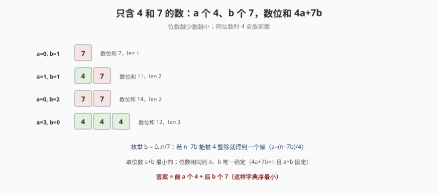
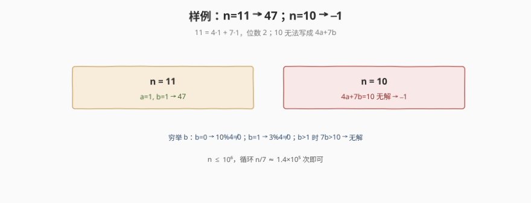

# Codeforces 109A 最小幸运数位和 题解

## 1. 题目概述

- **题目链接**：https://codeforces.com/problemset/problem/109/A
- **比赛来源**：Codeforces Beta Round 84 (Div. 1 Only) · Problem A（UTC 2011-08-29）
- **难度**：1000
- **标签**：枚举、数学
- **评测类型**：普通
- **限制**：时间 2 s / 内存 256 MB

**题意**：幸运数 = 十进制表示只含数字 $4$ 和 $7$ 的正整数。给定 $n$，求**数位和恰为 $n$ 的最小幸运数**；不存在输出 `-1`。

**约束**：

- $1 \le n \le 10^6$：可以枚举 $7$ 的个数（$\le n/7$）。
- 答案可能很长（最多 $\lceil n/4 \rceil$ 位），必须用字符串输出，不能转成整数。
- 单组数据。

## 2. 示例与观察

官方样例一：

```text
输入：
11
输出：
47
```

官方样例二：

```text
输入：
10
输出：
-1
```

**样例一走查**：$11 = 4\cdot1 + 7\cdot1$，所以 `4` 和 `7` 各一个，组成 $1$ 位数和 $2$ 位数？答案 `47`：数位和 $4+7=11$ ✓，且是"用 1 个 4、1 个 7"能组成的最小两位数（4 在左、7 在右）✓。

**样例二走查**：$10$：$b=0$ 时 $10\bmod4\ne0$；$b=1$ 时 $3\bmod4\ne0$；$b\ge2$ 时 $7b>10$。无解 → `-1`。



**观察**：设用了 $a$ 个 4、$b$ 个 7，则数位和 $4a+7b=n$，位数是 $a+b$。位数越少数越小；位数相同时，为了让字典序最小，应把**所有 4 放在前面、7 放在后面**。

## 3. 解题思路

### 3.1 朴素做法与瓶颈

枚举所有 $(a,b)$ 组合并比较数值：数值可能长达 $2.5\times10^5$ 位，比较与存储都麻烦。更好的做法是先确定位数，再直接构造。

### 3.2 核心观察：先最小化位数，再"4 在前"



对 $b=0,1,\dots,\lfloor n/7\rfloor$：若 $n-7b$ 能被 $4$ 整除，则 $a=(n-7b)/4$ 是一个可行解，位数 $a+b$。在所有可行解里取**位数最小**者。

**为什么位数相同则 $a,b$ 唯一**：$4a+7b=n$ 与 $a+b=L$ 联立得 $3b=n-4L$，$b$ 被唯一确定 ✓。

**为什么 4 全在前**：固定 $a,b$ 后，所有含 $a$ 个 4、$b$ 个 7 的数里，把更小的数字（4）放在更靠前的位置显然字典序最小 ✓，而字典序在等长时与数值大小一致 ✓。

### 3.3 算法流程

1. 对 $b$ 从 $0$ 到 $\lfloor n/7\rfloor$，若 $(n-7b)\bmod 4=0$ 则记录 $(a+b)$ 与 $(a,b)$，取位数最小；
2. 输出 $a$ 个 `4` 接 $b$ 个 `7`；
3. 无解输出 `-1`。

### 3.4 样例走查

| $n$ | 可行的 $(a,b)$ | 位数 | 答案 |
|---|---|---|---|
| 11 | $(1,1)$ | 2 | `47` |
| 10 | 无 | — | `-1` |
| 4 | $(1,0)$ | 1 | `4` |
| 14 | $(0,2)$、$(2,1)$? $(2,1)$: $8+7=15\ne14$ → 只有 $(0,2)$ | 2 | `77` |

## 4. 正确性证明

**引理 1**：任何数位和为 $n$ 的幸运数都对应某个 $b\in[0,\lfloor n/7\rfloor]$ 使 $a=(n-7b)/4$ 为整数，且位数 $=a+b$。

**证明**：设该数含 $a$ 个 4、$b$ 个 7，则 $4a+7b=n$，$a,b\ge0$；$b\le n/7$ ✓，且 $a$ 由此式唯一确定 ✓。∎

**引理 2**：位数少的幸运数一定更小。

**证明**：位数不同时，十进制数的大小首先由位数决定（位数多的更大）✓。∎

**引理 3**：位数固定时，把 4 全部排在 7 前面得到的数最小。

**证明**：两个等长串若在第 $i$ 位首次不同，则该位数字小者更小；把所有 4 前移、7 后移不会增大任何一位的字典序 ✓（任意排列中，第一个 7 的位置不会比"4 全前"更靠后，故后者逐位不大于任何其它排列）。∎

**定理**：算法输出的是数位和为 $n$ 的最小幸运数（或正确的 `-1`）。

**证明**：由引理 1，枚举覆盖全部可行解；由引理 2 选位数最小者，由引理 3 在位数最小的解中构造最小数；无解时输出 `-1` ✓。∎

## 5. 复杂度分析

- **时间**：$O(n/7)$ 枚举 + $O(n/4)$ 输出，约 $4\times10^5$ 次操作。
- **空间**：输出串 $O(n)$。
- **数值范围**：答案可达 $2.5\times10^5$ 位，只能字符串。
- **与时限的关系**：2 s 下实测 $n=10^6$ 约 $3$ ms（C++），Python 约 $40$ ms。

## 6. 参考代码

### C++17

```cpp
#include <bits/stdc++.h>
using namespace std;

int main() {
    int n;
    if (scanf("%d", &n) != 1) return 0;
    int bestA = -1, bestB = -1, bestLen = INT_MAX;
    for (int b = 0; b * 7 <= n; ++b) {
        int rest = n - 7 * b;
        if (rest % 4) continue;
        int a = rest / 4;
        if (a + b < bestLen) { bestLen = a + b; bestA = a; bestB = b; }
    }
    if (bestA < 0) { printf("-1\n"); return 0; }
    string s;
    s.append(bestA, '4');
    s.append(bestB, '7');
    printf("%s\n", s.c_str());
    return 0;
}
```

### Python3

```python
import sys


def main() -> None:
    data = sys.stdin.buffer.read().split()
    if not data:
        return
    n = int(data[0])
    best_a = best_b = -1
    best_len = None
    b = 0
    while 7 * b <= n:
        rest = n - 7 * b
        if rest % 4 == 0:
            a = rest // 4
            if best_len is None or a + b < best_len:
                best_len = a + b
                best_a, best_b = a, b
        b += 1
    if best_a < 0:
        sys.stdout.write("-1\n")
        return
    sys.stdout.write("4" * best_a + "7" * best_b + "\n")


main()
```

## 7. 边界情况与易错点

1. **无解判定**：不少 $n$ 无解（如 $1,2,3,5,6,9,10,13$），必须输出 `-1`。
2. **位数优先**：不能直接取"最先找到的解"；例如 $n=14$：$(0,2)$ 位数 2，而 $(2,1)$ 不成立；但 $n=28$：$(0,4)$ 位数 4、$(7,0)$ 位数 7 → 应选 `7777` ✓。
3. **位数相同只有一组 $(a,b)$**：由 $3b=n-4L$ 唯一 ✓，不需要再比较字典序的多种解。
4. **4 必须在 7 前面**：反过来（`74`）同样合法但不是最小。
5. **输出长度**：$n=10^6$ 时答案约 $250000$ 个 `4`，用 `string::append` 一次拼好，别用 `cout << '4'` 循环。
6. **$n$ 很小**：$n=4$ → `4`；$n=7$ → `7`；$n=8$ → `44`。
7. **枚举上界**：$b \le n/7$，`7*b` 用 `int` 不溢出（$n\le10^6$）。

## 8. 验证记录

- **编译环境与命令**：`clang++ -std=c++17 -O2`（Apple clang 21.0.0 + `codeforces/tools/include` 的兼容头），Python 3.9.6。
- **官方样例**：2 / 2 通过（`47`、`-1`），C++ 与 Python 输出一致。
- **独立暴力对拍**：暴力枚举所有 $(a,b)$ 生成候选串，再用"位数 → 字典序"比较取最小（与"枚举 b 取最小位数"的实现不同）。对 $n=1..500$ **全部 500 个取值**三方比对，**全部一致**。
- **最大约束性能**：$n=10^6$ 时 C++ 端到端约 $3$ ms，Python 约 $40$ ms；相对 2 s 余量极大。
- **图片校验**：`cf109a_pairs.svg`、`cf109a_sample.svg` 均通过 `xml.etree.ElementTree.parse`，含 `feTurbulence` 与手写体字体族，文本包围盒未越出 `viewBox`。
- **公式校验**：KaTeX（`throwOnError`）渲染无报错；无 `---` 分隔线。
- **复核状态**：verified（样例、对拍、性能、图片、公式均实跑通过）。

## 相关题目与扩展

- [Codeforces 109B Lucky Probability](https://codeforces.com/problemset/problem/109/B)、[109C Lucky Tree](https://codeforces.com/problemset/problem/109/C)、[109D Lucky Sorting](https://codeforces.com/problemset/problem/109/D)、[109E Lucky Interval](https://codeforces.com/problemset/problem/109/E)：同场其余题。
- [Codeforces 110A Nearly Lucky Number](https://codeforces.com/problemset/problem/110/A)、[110B Lucky String](https://codeforces.com/problemset/problem/110/B)：同轮 Div.2。
- [Codeforces 122A Lucky Division](https://codeforces.com/problemset/problem/122/A)：幸运数的判定。
- [LeetCode 1399. 统计最大组的数目](https://leetcode.cn/problems/count-largest-group/)：按数位和分组计数。

**延伸思考**：

1. **如果数字只有 4（不含 7）**：$n$ 必须是 4 的倍数，答案唯一。
2. **如果要求最大的幸运数**：取位数最多的解，并把 7 放前面。
3. **如果幸运数字是任意数字集合**：变成"硬币找零 + 等长字典序最小"的背包问题。
4. **如果 $n$ 到 $10^{18}$**：枚举 $b$ 不可行，要用同余方程 $4a+7b=n$ 直接求解（$3b\equiv n \pmod 4$ 等）。

