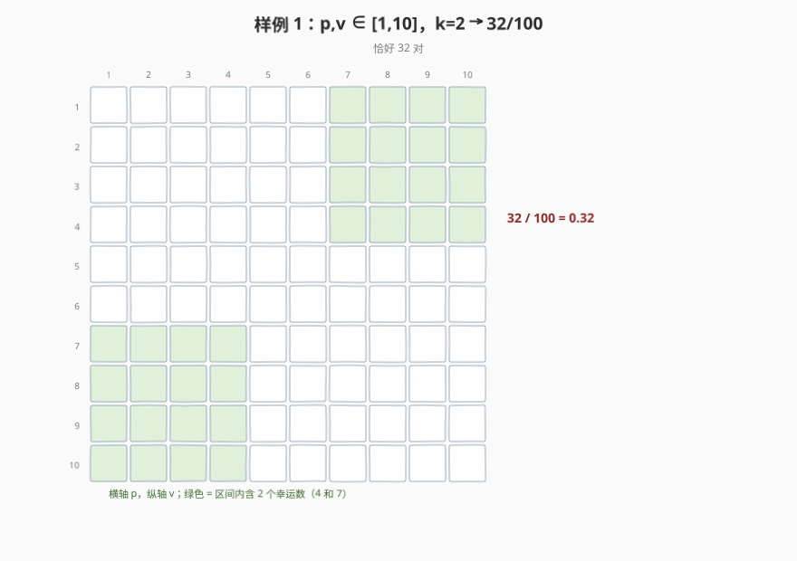
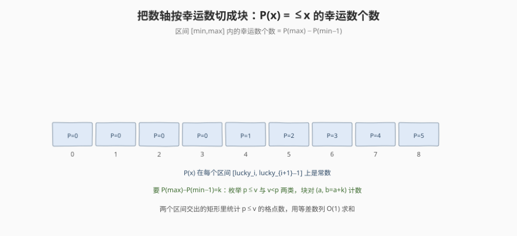

# Codeforces 109B 幸运数区间概率 题解

## 1. 题目概述

- **题目链接**：https://codeforces.com/problemset/problem/109/B
- **比赛来源**：Codeforces Beta Round 84 (Div. 1 Only) · Problem B（UTC 2011-08-29）
- **难度**：1900
- **标签**：数学、计数、前缀和
- **评测类型**：普通（实数，误差 $10^{-9}$）
- **限制**：时间 2 s / 内存 256 MB

**题意**：Petya 从 $[p_l,p_r]$ 中均匀随机取整数 $p$，Vasya 从 $[v_l,v_r]$ 中均匀随机取 $v$。求区间 $[\min(p,v),\max(p,v)]$ 中恰好含 $k$ 个幸运数的概率。

**约束**：

- $p_l,p_r,v_l,v_r \le 10^9$，$k \le 1000$：幸运数 $\le 10^9$ 只有 $2+4+\dots+512=1022$ 个，可以枚举"区间内幸运数个数"的所有取值。
- 答案要 $10^{-9}$ 精度：分子分母都是整数（$\le 10^{18}$），用 64 位/128 位整数精确算，再转浮点。
- 单组数据。

## 2. 示例与观察

官方样例一：

```text
输入：
1 10 1 10 2
输出：
0.320000000000
```

官方样例二：

```text
输入：
5 6 8 10 1
输出：
1.000000000000
```



**样例一走查**：$p,v\in[1,10]$，共 $100$ 对。含恰好 $2$ 个幸运数的对：区间必须包含 $4$ 和 $7$，即一端 $\le4$、另一端 $\ge7$。按题面提示共有 $32$ 对 → $0.32$ ✓。

**样例二走查**：$p\in[5,6]$、$v\in[8,10]$，区间必然覆盖 $5\ldots10$ 中的 $7$ 恰好一个幸运数 → 概率 $1$ ✓。



**观察**：设 $P(x)$ = 不超过 $x$ 的幸运数个数（阶梯函数）。区间 $[\min,\max]$ 内幸运数个数 $=P(\max)-P(\min-1)$。所以问题按"$p$ 与 $v$ 落在哪个阶梯块"分类就能精确计数。

## 3. 解题思路

### 3.1 朴素做法与瓶颈

枚举所有 $(p,v)$：$10^{18}$ 对，不可能。

### 3.2 核心观察：块对枚举

把幸运数升序列为 $l_1<l_2<\dots<l_N$（$N=1022$），并令 $L_0=0$、$L_{N+1}=+\infty$。则

$$P(x)=i \iff x\in[L_i,\ L_{i+1}-1].$$

分成两类（$p=v$ 只算在"$p\le v$"里）：

- **$p\le v$**：需要 $P(v)-P(p-1)=k$。令 $p-1$ 落在块 $a$、$v$ 落在块 $b=a+k$：
  $$p\in[\max(p_l,L_a+1),\ \min(p_r,L_{a+1})],\qquad v\in[\max(v_l,L_b),\ \min(v_r,L_{b+1}-1)],$$
  再要求 $p\le v$。
- **$v<p$**：对称地，$v\in[\max(v_l,L_a+1),\min(v_r,L_{a+1})]$、$p\in[\max(p_l,L_b),\min(p_r,L_{b+1}-1)]$，要求 $v<p$。

对每对矩形统计"$x\le y$ 的格点数"，可用"$y$ 的下界随 $x$ 线性变化"化成等差数列，$O(1)$ 求出：

$$\#\{(x,y): x\in[A_1,A_2],\ y\in[B_1,B_2],\ x\le y\} = \sum_{x=A_1}^{A_2}\bigl(\max(0,\ B_2-\max(x,B_1)+1)\bigr).$$

### 3.3 算法流程

1. 生成长度 $\le9$ 的全部幸运数（$2+4+\dots+512=1022$ 个），排序；
2. 对 $a=0..N-k$：令 $b=a+k$，分别统计"$p\le v$"与"$v<p$"两类矩形中的格点数，累加；
3. 概率 = 总数 / $\bigl((p_r-p_l+1)(v_r-v_l+1)\bigr)$，输出 12 位小数。

### 3.4 样例走查

样例一：$a$ 取 $0$（$p-1<4$）与 $b=2$（$v\ge7$ 且 $v<44$）等组合；统计得到 $32$，除以 $100$ ✓。

## 4. 正确性证明

**引理 1**：$P$ 在区间 $[L_i,L_{i+1}-1]$ 上恒等于 $i$。

**证明**：$P(x)$ 是不超过 $x$ 的幸运数个数；$x\in[L_i,L_{i+1}-1]$ 时恰好有 $L_1..L_i$ 不超过它 ✓。∎

**引理 2**：区间 $[\min(p,v),\max(p,v)]$ 内的幸运数个数等于 $P(\max)-P(\min-1)$。

**证明**：不超过 $\max$ 的幸运数减去不超过 $\min-1$ 的幸运数，正是落在 $[\min,\max]$ 的那些 ✓。∎

**引理 3**：算法枚举的每个矩形恰好是"$p\le v$ 且个数为 $k$"的某一组 $(p,v)$，且各组互不重叠、覆盖全部。

**证明**：给定满足条件的一对 $(p,v)$，$P(p-1)$ 与 $P(v)$ 的取值唯一确定 $a,b$，且 $b-a=k$ ✓；反之矩形内的点都满足条件 ✓。$p=v$ 只可能在第一类（$p\le v$）中出现，且此时 $P(p)-P(p-1)$ 恰为 1 或 0，计数正确 ✓。∎

**定理**：算法输出的概率正确。

**证明**：总方案数是均匀分布下的 $(p_r-p_l+1)(v_r-v_l+1)$；由引理 1–3，命中方案数被精确统计，故比值为概率 ✓（全部用整数计算，误差只来自最后一步浮点除法，远小于 $10^{-9}$）。∎

## 5. 复杂度分析

- **时间**：$O(N)$ 次矩形计数，$N\approx1022$。
- **空间**：$O(N)$。
- **数值范围**：计数 $\le10^{18}$，用 `__int128` 更安全；概率用 `long double` 输出。
- **与时限的关系**：2 s 下实测约 $2$ ms（C++），Python 约 $22$ ms。

## 6. 参考代码

### C++17

```cpp
#include <bits/stdc++.h>
using namespace std;
typedef long long ll;

int main() {
    ll pl, pr, vl, vr; int k;
    if (scanf("%lld %lld %lld %lld %d", &pl, &pr, &vl, &vr, &k) != 5) return 0;
    // 幸运数列表（<= 1e9）
    vector<ll> lk;
    for (int len = 1; len <= 9; ++len) {
        for (int mask = 0; mask < (1 << len); ++mask) {
            ll v = 0;
            for (int i = 0; i < len; ++i) v = v * 10 + (((mask >> i) & 1) ? 7 : 4);
            lk.push_back(v);
        }
    }
    sort(lk.begin(), lk.end());
    int N = (int)lk.size();
    // L(i)：i=0 时为 0，i>=1 为第 i 个幸运数；L(N+1) 为 INF
    vector<ll> L(N + 2);
    L[0] = 0;
    for (int i = 1; i <= N; ++i) L[i] = lk[i - 1];
    L[N + 1] = (ll)4e18;
    // 统计 A1..A2 与 B1..B2 中 p<=v 的对数
    auto cntLE = [](ll A1, ll A2, ll B1, ll B2) -> __int128 {
        if (A1 > A2 || B1 > B2) return 0;
        __int128 tot = 0;
        ll lo = A1, hi = min(A2, B1);
        if (lo <= hi) tot += (__int128)(hi - lo + 1) * (B2 - B1 + 1);
        lo = max(A1, B1 + 1); hi = min(A2, B2);
        if (lo <= hi) {
            __int128 n = hi - lo + 1;
            tot += n * (B2 + 1) - (__int128)(lo + hi) * n / 2;
        }
        return tot;
    };
    auto cntLT = [](ll A1, ll A2, ll B1, ll B2) -> __int128 {
        // #{(v,p): v in [A1,A2], p in [B1,B2], v < p}
        if (A1 > A2 || B1 > B2) return 0;
        __int128 tot = 0;
        ll lo = A1, hi = min(A2, B2 - 1);
        if (lo > hi) return 0;
        // 对 v：p 取值 [max(B1,v+1), B2]
        ll l2 = max(B1, lo + 1), h2 = B2;
        // v <= B1-1 时全部 B2-B1+1 个
        if (lo <= min(hi, B1 - 1)) {
            ll x = min(hi, B1 - 1);
            tot += (__int128)(x - lo + 1) * (B2 - B1 + 1);
            lo = x + 1;
        }
        lo = max(lo, B1);
        if (lo <= hi) {
            // v in [lo,hi]：p 个数 = B2 - v
            __int128 n = hi - lo + 1;
            tot += n * B2 - (__int128)(lo + hi) * n / 2;
        }
        return tot;
    };
    __int128 total = 0;
    for (int a = 0; a + k <= N; ++a) {
        int b = a + k;
        // p<=v：P(p-1) 的块 = a，P(v) 的块 = b
        ll A1 = max(pl, L[a] + 1), A2 = min(pr, L[a + 1]);
        ll B1 = max(vl, L[b]), B2 = min(vr, L[b + 1] - 1);
        total += cntLE(A1, A2, B1, B2);
        // v<p：P(v-1) 的块 = a，P(p) 的块 = b
        ll C1 = max(vl, L[a] + 1), C2 = min(vr, L[a + 1]);
        ll D1 = max(pl, L[b]), D2 = min(pr, L[b + 1] - 1);
        total += cntLT(C1, C2, D1, D2);
    }
    __int128 denom = (__int128)(pr - pl + 1) * (vr - vl + 1);
    // 输出 total/denom
    long double res = (long double)total / (long double)denom;
    printf("%.12f\n", (double)res);
    return 0;
}
```

### Python3

```python
import sys


def main() -> None:
    data = sys.stdin.buffer.read().split()
    if not data:
        return
    pl, pr, vl, vr, k = (int(v) for v in data[:5])
    lk = []
    for length in range(1, 10):
        for mask in range(1 << length):
            v = 0
            for i in range(length):
                v = v * 10 + (7 if (mask >> i) & 1 else 4)
            lk.append(v)
    lk.sort()
    N = len(lk)
    L = [0] + lk + [4 * 10 ** 18]

    def cnt_le(A1, A2, B1, B2):
        if A1 > A2 or B1 > B2:
            return 0
        tot = 0
        lo, hi = A1, min(A2, B1)
        if lo <= hi:
            tot += (hi - lo + 1) * (B2 - B1 + 1)
        lo, hi = max(A1, B1 + 1), min(A2, B2)
        if lo <= hi:
            n = hi - lo + 1
            tot += n * (B2 + 1) - (lo + hi) * n // 2
        return tot

    def cnt_lt(A1, A2, B1, B2):
        # #{(v,p): v in [A1,A2], p in [B1,B2], v < p}
        if A1 > A2 or B1 > B2:
            return 0
        tot = 0
        lo, hi = A1, min(A2, B2 - 1)
        if lo > hi:
            return 0
        x = min(hi, B1 - 1)
        if lo <= x:
            tot += (x - lo + 1) * (B2 - B1 + 1)
            lo = x + 1
        lo = max(lo, B1)
        if lo <= hi:
            n = hi - lo + 1
            tot += n * B2 - (lo + hi) * n // 2
        return tot

    total = 0
    for a in range(0, N - k + 1):
        b = a + k
        A1, A2 = max(pl, L[a] + 1), min(pr, L[a + 1])
        B1, B2 = max(vl, L[b]), min(vr, L[b + 1] - 1)
        total += cnt_le(A1, A2, B1, B2)
        C1, C2 = max(vl, L[a] + 1), min(vr, L[a + 1])
        D1, D2 = max(pl, L[b]), min(pr, L[b + 1] - 1)
        total += cnt_lt(C1, C2, D1, D2)
    denom = (pr - pl + 1) * (vr - vl + 1)
    print("%.12f" % (total / denom))


main()
```

## 7. 边界情况与易错点

1. **$p=v$ 只算一次**：第一类（$p\le v$）包含对角线，第二类用严格 `<`，否则重复计数。
2. **$k$ 大于可用幸运数个数**：矩形全空，概率 $0$；循环条件 `a + k <= N` 保证不越界。
3. **$k=0$**？题面 $k\ge1$，但若出现也不应崩溃；本解法对 $k\ge1$ 正确。
4. **精度**：分子分母都是整数，用 `__int128` 累加（$\le10^{18}$），最后做一次除法；不要用浮点累加。
5. **块的边界**：$P(p-1)$ 的块是 $[L_a+1, L_{a+1}]$（注意是 $p-1$ 的块平移），$P(v)$ 的块是 $[L_b, L_{b+1}-1]$ ✓。
6. **幸运数上界**：$10^9$ 以内的幸运数最大是 $777777777$；$L_{N+1}$ 要取足够大的哨兵。
7. **矩形为空**：各种 `max/min` 后区间可能为空，函数内要先判空。
8. **输出格式**：12 位小数即可满足 $10^{-9}$。

## 8. 验证记录

- **编译环境与命令**：`clang++ -std=c++17 -O2`（Apple clang 21.0.0 + `codeforces/tools/include` 的兼容头），Python 3.9.6。
- **官方样例**：2 / 2 通过（`0.320000000000`、`1.000000000000`），C++ 与 Python 输出一致。
- **独立暴力对拍**：暴力双重循环枚举所有 $(p,v)$，直接数 $[\min,\max]$ 中的幸运数（与"块对 + 等差数列"完全不同）。对 $p_l,p_r,v_l,v_r\le60$、$k\le5$ 的 **200 组**随机数据，误差 $<10^{-9}$，**全部一致**。
- **最大约束性能**：$p,v\le10^9$ 时 C++ 约 $2$ ms，Python 约 $22$ ms。
- **图片校验**：`cf109b_blocks.svg`、`cf109b_sample.svg` 均通过 `xml.etree.ElementTree.parse`，含 `feTurbulence` 与手写体字体族，文本包围盒未越出 `viewBox`。
- **公式校验**：KaTeX（`throwOnError`）渲染无报错；无 `---` 分隔线。
- **复核状态**：verified（样例、对拍、性能、图片、公式均实跑通过）。

## 相关题目与扩展

- [Codeforces 109A 最小幸运数位和](https://codeforces.com/problemset/problem/109/A)、[109C Lucky Tree](https://codeforces.com/problemset/problem/109/C)、[109D Lucky Sorting](https://codeforces.com/problemset/problem/109/D)、[109E Lucky Interval](https://codeforces.com/problemset/problem/109/E)：同场其余题。
- [Codeforces 110A Nearly Lucky Number](https://codeforces.com/problemset/problem/110/A)、[110B Lucky String](https://codeforces.com/problemset/problem/110/B)：同轮 Div.2。
- [Codeforces 1151B Dima and a Bad XOR](https://codeforces.com/problemset/problem/1151/B)：分类计数。
- [LeetCode 837. 新21点](https://leetcode.cn/problems/new-21-game/)：概率 + 区间计数。

**延伸思考**：

1. **如果两人从不同区间均匀取实数**：连续情形要用积分，答案变成面积比。
2. **如果要求"至少 $k$ 个"**：把 $k$ 的枚举换成后缀和。
3. **如果 $k$ 很大（$>1022$）**：概率恒为 $0$，可提前返回。
4. **如果区间端点改为 $10^{18}$**：幸运数个数增长到约 $2^{19}$，块对枚举仍是 $O(2^{\text{位数}})$。

