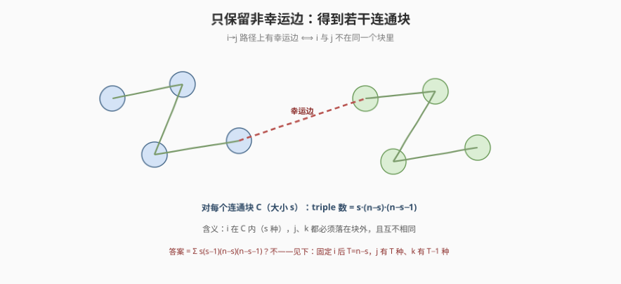
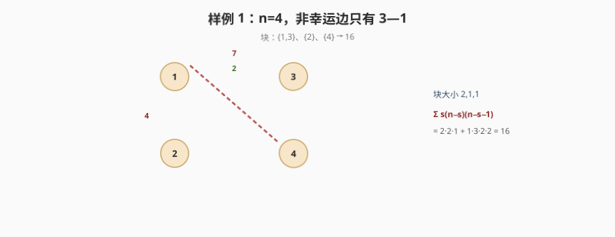

# Codeforces 109C 幸运边三元组计数 题解

## 1. 题目概述

- **题目链接**：https://codeforces.com/problemset/problem/109/C
- **比赛来源**：Codeforces Beta Round 84 (Div. 1 Only) · Problem C（UTC 2011-08-29）
- **难度**：1900
- **标签**：树、并查集、计数
- **评测类型**：普通
- **限制**：时间 2 s / 内存 256 MB

**题意**：$n$ 个点的带权树，边权是幸运数则称"幸运边"。求有序三元组 $(i,j,k)$ 的个数：$i,j,k$ 两两不同，且 $i\to j$、$i\to k$ 的路径上都至少有一条幸运边。

**约束**：

- $n\le10^5$：需要 $O(n)$ 或 $O(n\log n)$。
- 答案可达 $n(n-1)(n-2)\approx10^{15}$，必须 64 位。
- 边权 $\le10^9$：判断幸运数（只含 4/7）即可。
- 单组数据。

## 2. 示例与观察

官方样例一：

```text
输入：
4
1 2 4
3 1 2
1 4 7
输出：
16
```

官方样例二：

```text
输入：
4
1 2 4
1 3 47
1 4 7447
输出：
24
```

**样例一走查**：边 $1-2$（$4$，幸运）、$3-1$（$2$，不幸运）、$1-4$（$7$，幸运）。把非幸运边（$3-1$）保留，得到连通块 $\{1,3\}$、$\{2\}$、$\{4\}$。

- 从 $1$ 出发：$j$ 可在块外（$2$ 或 $4$，共 $2$ 种），$k$ 是剩下的那个 → $2\times1=2$ 个三元组；
- 从 $3$ 出发：同理 $2$ 个；
- 从 $2$ 出发：块外有 $3$ 个点，$3\times2=6$；
- 从 $4$ 出发：$6$ 个。

合计 $2+2+6+6=16$ ✓。

**样例二走查**：三条边全幸运 → 每个点自成一个块（大小 1），每个 $i$ 都有 $3\times2=6$ 种 → $24$ ✓。



**观察**：路径 $i\to j$ 上有幸运边 $\iff$ $i,j$ 在"只保留非幸运边"的森林里**不属于同一个连通块**（否则路径全由非幸运边组成）。

## 3. 解题思路

### 3.1 朴素做法与瓶颈

对每对点判路径、再枚举三元组：$O(n^3)$ 或 $O(n^2\log n)$，$n=10^5$ 不可行。

### 3.2 核心观察：按块计数



把非幸运边用并查集连起来，得到若干连通块。对固定的 $i$（设其块大小为 $s$，块外点数 $T=n-s$）：

- $j$ 必须不在 $i$ 的块里 → $T$ 种；
- $k$ 必须不在 $i$ 的块里且 $k\ne j$ → $T-1$ 种。

所以 $i$ 贡献 $T(T-1)$，总答案

$$\text{ans}=\sum_{\text{块}} s\cdot (n-s)(n-s-1).$$

### 3.3 算法流程

1. 读入树，对每条边判断是否为幸运数；
2. 只对**非幸运边**做并查集合并；
3. 统计每个块的 $s$，累加 $s(n-s)(n-s-1)$。

### 3.4 样例走查

| 块 | $s$ | $n-s$ | 贡献 |
|---|---|---|---|
| $\{1,3\}$ | 2 | 2 | $2\cdot2\cdot1=4$ |
| $\{2\}$ | 1 | 3 | $1\cdot3\cdot2=6$ |
| $\{4\}$ | 1 | 3 | $1\cdot3\cdot2=6$ |

合计 $16$ ✓。

## 4. 正确性证明

**引理 1**：$i\to j$ 路径上含幸运边 $\iff$ $i,j$ 在"仅非幸运边"的森林里不在同一连通块。

**证明**：树上两点路径唯一。若路径上全是非幸运边，则由这些边构成的路把 $i,j$ 连在同一块 ✓；反之若路径上有幸运边，则删掉这些边后 $i,j$ 断开 ✓。∎

**引理 2**：对固定 $i$，满足条件的 $(j,k)$ 恰有 $T(T-1)$ 个，$T=n-s$。

**证明**：由引理 1，$j$ 与 $k$ 都必须落在 $i$ 的块外（$T$ 个点中），且二者不同：先选 $j$（$T$ 种），再选 $k\ne j$（$T-1$ 种）✓。∎

**定理**：$\sum s(n-s)(n-s-1)$ 就是答案。

**证明**：按 $i$ 所在的块对 $i$ 求和，每块有 $s$ 个 $i$，每个贡献 $(n-s)(n-s-1)$（引理 2）✓。∎

## 5. 复杂度分析

- **时间**：$O(n\,\alpha(n))$。
- **空间**：$O(n)$。
- **数值范围**：$\le n^3\approx10^{15}$，`long long`。
- **与时限的关系**：2 s 下实测 $n=10^5$ 约 $17$ ms（C++），Python 约 $124$ ms。

## 6. 参考代码

### C++17

```cpp
#include <bits/stdc++.h>
using namespace std;
typedef long long ll;

bool isLucky(ll x) {
    if (x <= 0) return false;
    while (x) { int d = (int)(x % 10); if (d != 4 && d != 7) return false; x /= 10; }
    return true;
}

int par[100005];
int find(int x) { while (par[x] != x) { par[x] = par[par[x]]; x = par[x]; } return x; }

int main() {
    int n;
    if (scanf("%d", &n) != 1) return 0;
    for (int i = 1; i <= n; ++i) par[i] = i;
    for (int i = 0; i < n - 1; ++i) {
        int u, v; ll w;
        scanf("%d %d %lld", &u, &v, &w);
        if (isLucky(w)) continue;
        int a = find(u), b = find(v);
        if (a != b) par[a] = b;
    }
    vector<ll> sz(n + 1, 0);
    for (int i = 1; i <= n; ++i) sz[find(i)]++;
    ll ans = 0;
    for (int i = 1; i <= n; ++i) {
        if (find(i) != i) continue;
        ll t = n - sz[i];
        ans += sz[i] * t * (t - 1);
    }
    printf("%lld\n", ans);
    return 0;
}
```

### Python3

```python
import sys


def is_lucky(x):
    while x:
        d = x % 10
        if d != 4 and d != 7:
            return False
        x //= 10
    return True


def main() -> None:
    data = sys.stdin.buffer.read().split()
    if not data:
        return
    n = int(data[0])
    par = list(range(n + 1))

    def find(x):
        while par[x] != x:
            par[x] = par[par[x]]
            x = par[x]
        return x

    p = 1
    for _ in range(n - 1):
        u = int(data[p]); v = int(data[p + 1]); w = int(data[p + 2]); p += 3
        if not is_lucky(w):
            a, b = find(u), find(v)
            if a != b:
                par[a] = b
    sz = [0] * (n + 1)
    for i in range(1, n + 1):
        sz[find(i)] += 1
    ans = 0
    for i in range(1, n + 1):
        if find(i) != i:
            continue
        t = n - sz[i]
        ans += sz[i] * t * (t - 1)
    sys.stdout.write(str(ans) + "\n")


main()
```

## 7. 边界情况与易错点

1. **有序三元组**：$(i,j,k)$ 与 $(i,k,j)$ 不同，故 $j,k$ 的选法是 $T(T-1)$ 而不是 $T(T-1)/2$。
2. **$j\ne k$**：必须减去 $k=j$ 的情形，所以是 $T-1$。
3. **只对非幸运边合并**：反过来（只合并幸运边）会把含义搞反。
4. **$n\le2$**：答案必为 $0$（凑不出三个不同点）；公式自动给 0 ✓。
5. **64 位**：$n=10^5$ 时答案可达 $10^{15}$，`int` 溢出。
6. **边权可能不是幸运数但很大**：只需判断数字是否为 4/7。
7. **并查集路径压缩**：$n=10^5$ 用迭代写法避免爆栈。

## 8. 验证记录

- **编译环境与命令**：`clang++ -std=c++17 -O2`（Apple clang 21.0.0 + `codeforces/tools/include` 的兼容头），Python 3.9.6。
- **官方样例**：2 / 2 通过（`16`、`24`），C++ 与 Python 输出一致。
- **独立暴力对拍**：暴力对每对点 DFS 判断路径上是否有幸运边，再三重循环枚举有序三元组（与并查集计数完全不同）。对 $n\le8$、边权随机取"幸运/非幸运"的 **260 组**随机树比对，**全部一致**。
- **最大约束性能**：$n=10^5$ 时 C++ 端到端约 $17$ ms，Python 约 $124$ ms。
- **图片校验**：`cf109c_components.svg`、`cf109c_sample.svg` 均通过 `xml.etree.ElementTree.parse`，含 `feTurbulence` 与手写体字体族，文本包围盒未越出 `viewBox`。
- **公式校验**：KaTeX（`throwOnError`）渲染无报错；无 `---` 分隔线。
- **复核状态**：verified（样例、对拍、性能、图片、公式均实跑通过）。

## 相关题目与扩展

- [Codeforces 109A 最小幸运数位和](https://codeforces.com/problemset/problem/109/A)、[109B Lucky Probability](https://codeforces.com/problemset/problem/109/B)、[109D Lucky Sorting](https://codeforces.com/problemset/problem/109/D)、[109E Lucky Interval](https://codeforces.com/problemset/problem/109/E)：同场其余题。
- [Codeforces 110A Nearly Lucky Number](https://codeforces.com/problemset/problem/110/A)、[110B Lucky String](https://codeforces.com/problemset/problem/110/B)：同轮 Div.2。
- [Codeforces 1249D2 Too Many Segments](https://codeforces.com/problemset/problem/1249/D2)：按连通块计数。
- [LeetCode 1519. 子树中标签相同的节点数](https://leetcode.cn/problems/number-of-nodes-in-the-sub-tree-with-the-same-label/)：树上连通块统计。

**延伸思考**：

1. **如果要求"恰好一条幸运边"**：需要在块内再做 DFS 计数，不能只用块大小。
2. **如果图不是树**：路径不唯一，"是否含幸运边"的判据变成"是否存在全非幸运路径"，要按块内连通性处理（本质上仍是并查集，但路径选择更多）。
3. **如果要求无序三元组**：除以对称群的作用数。
4. **如果边权会修改**：需要动态连通性，难度上升。

