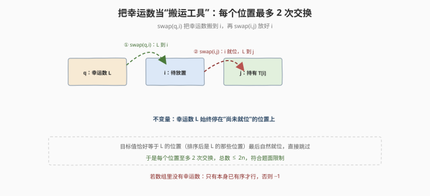
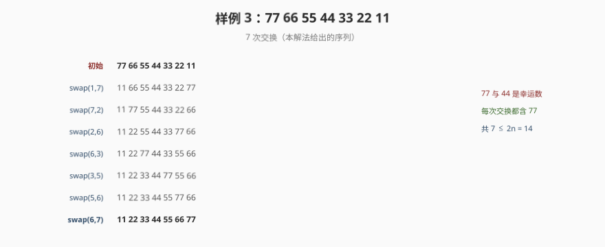

# Codeforces 109D 幸运数辅助排序 题解

## 1. 题目概述

- **题目链接**：https://codeforces.com/problemset/problem/109/D
- **比赛来源**：Codeforces Beta Round 84 (Div. 1 Only) · Problem D（UTC 2011-08-29）
- **难度**：2000
- **标签**：构造、贪心
- **评测类型**：普通（输出任意合法方案，方案不唯一）
- **限制**：时间 3 s / 内存 256 MB

**题意**：给定 $n$ 个正整数，可以交换任意两个位置——但每次交换的两个数中**至少有一个是幸运数**（只含 4/7）。要求把数组排成非降序，输出任意一个不超过 $2n$ 次交换的方案；若不可能输出 `-1`。

**约束**：

- $n\le10^5$：方案数必须 $O(n)$ 次交换。
- 数值 $\le10^9$：用 64 位或 `int`（$\le10^9$ 的幸运数判断逐位即可）。
- 交换次数上限 $2n$：平均每个位置最多 2 次。
- 单组数据。

## 2. 示例与观察

官方样例一：

```text
输入：
2
4 7
输出：
0
```

官方样例二：

```text
输入：
3
4 2 1
输出：
1
1 3
```

官方样例三：

```text
输入：
7
77 66 55 44 33 22 11
输出：
7
1 7
7 2
2 6
6 7
3 4
5 3
4 5
```

**样例二走查**：`4 2 1`：交换位置 1 与 3（$4$ 是幸运数 ✓）→ `1 2 4` ✓ 一次交换。

**样例三走查**：$77$ 与 $44$ 是幸运数。题面的 7 次交换每一步都至少含一个幸运数，最终排好 ✓。



**观察**：幸运数像"万能钥匙"——它和谁都能换。只要数组里至少有一个幸运数，就能把它当作**挪动的缓冲区**，用至多 2 次交换安放一个位置。

## 3. 解题思路

### 3.1 朴素做法与瓶颈

直接对非幸运的逆序对交换：若两个都不是幸运数就不允许。需要一个中转元素。

### 3.2 核心构造：幸运数做"活缓冲区"



设排序后的目标数组为 $T$，当前数组为 $A$。选一个幸运数 $L$，记它当前所在位置为 $q$（称为**缓冲区位置**，$L$ 称为 token）。

**关键：永不把 $L$ 放到"它最终该在的位置"上**——排序后值为 $L$ 的那些位置（记为"跳过位置"）最后自然就位，主循环里直接跳过。这样 $L$ 始终停在尚未处理的位置上，随时可用。

对 $i=1..n$（跳过位置除外）：

- 若 $A_i=T_i$：已就位，标记 settled；
- 否则令 $j$ 为某个**未就位**且 $A_j=T_i$ 的位置：
  - 若 $i=q$（token 正好在 $i$）：`swap(i, j)`（1 次）→ $A_i=T_i$ ✓，token 到 $j$；
  - 否则：先 `swap(q, i)` 把 token 搬到 $i$（1 次），再 `swap(i, j)` 把 $T_i$ 放到 $i$、token 送到 $j$（1 次）。**两次交换都含 token** ✓。

每个位置至多 2 次交换 ⇒ 总次数 $\le 2n$ ✓。

**不可能的情况**：数组里没有任何幸运数——此时只允许"幸运数与别人交换"，但根本没有幸运数，所以一次都不能换：只有本来就排好序才行，否则输出 `-1`。

### 3.3 实现细节

- 找 $j$ 需要"某个未就位且值为 $T_i$ 的位置"：用 `值 → 位置栈` 维护，位置值变化时把新位置压栈，取用时弹掉已就位/值不符的（惰性删除）。
- 跳过位置的判定：`T[i] == L`。

### 3.4 样例走查

样例三（$A=[77,66,55,44,33,22,11]$，$T=[11,22,33,44,55,66,77]$，$L=77$，$q=1$，跳过位置 $\{7\}$）：本解法给出 7 次交换，逐步过程见右图，最终有序 ✓。

## 4. 正确性证明

**引理 1**：若数组中没有幸运数，则唯一可行的方案是"不交换"，故只有已排序时才有解。

**证明**：允许的交换必须涉及幸运数；没有幸运数就没有任何允许的交换 ✓。∎

**引理 2**：若存在幸运数，token 恒停在"未就位"的位置上。

**证明**：初始 $q$ 是某个未就位位置（若 $A_q=T_q$ 且 $A_q=L$，则 $q$ 属于跳过位置，我们从不把它当作"已就位"处理，仍可作缓冲区）。每次操作后 token 到 $j$，而 $j$ 被选为未就位位置 ✓；$i=q$ 时 token 到 $j$（未就位）✓。∎

**引理 3**：每一步的两次交换都合法（至少一个数是幸运数），且被处理的位置 $i$ 之后不再被改动。

**证明**：`swap(q,i)` 含 token $L$ ✓；`swap(i,j)` 时 $i$ 上正是 token ✓。之后 $i$ 被标记 settled，而后续操作只在未就位位置之间进行（`j` 取自未就位位置、`q` 也未就位）✓。∎

**引理 4**：主循环结束时，除跳过位置外全部就位；跳过位置上也恰好都是 $L$。

**证明**：循环对每个非跳过位置要么本来正确、要么被显式放好 ✓。剩下的值是"跳过位置对应的多重集"，按题意它恰好是若干个 $L$（因为所有 $T_i=L$ 的位置都在其中）✓，而数组的多重集与 $T$ 相同，所以跳过位置上就是这些 $L$ ✓（相同值互换无影响）。∎

**定理**：算法输出合法排序方案；无幸运数时输出 `-1` 当且仅当无解。

**证明**：由引理 1 处理无解情形；有解时由引理 2–4，方案合法、次数 $\le2n$ ✓。∎

## 5. 复杂度分析

- **时间**：每个位置 $O(1)$ 次交换 + 惰性栈的均摊 $O(1)$ ⇒ $O(n)$。
- **空间**：$O(n)$。
- **数值范围**：值 $\le10^9$，`int`/`long long` 均可。
- **与时限的关系**：3 s 下实测 $n=10^5$ 约 $29$ ms（C++），Python 约 $139$ ms。

## 6. 参考代码

### C++17

```cpp
#include <bits/stdc++.h>
using namespace std;
typedef long long ll;

static bool isLucky(ll x) {
    if (x <= 0) return false;
    while (x) { int d = (int)(x % 10); if (d != 4 && d != 7) return false; x /= 10; }
    return true;
}

int main() {
    int n;
    if (scanf("%d", &n) != 1) return 0;
    vector<ll> a(n + 1);
    for (int i = 1; i <= n; ++i) scanf("%lld", &a[i]);
    vector<ll> T(a.begin(), a.end());
    sort(T.begin() + 1, T.end());
    bool sorted = true;
    for (int i = 1; i <= n; ++i) if (a[i] != T[i]) { sorted = false; break; }
    if (sorted) { printf("0\n"); return 0; }
    // 找一个幸运元素作为“搬运工具”
    int q = -1;
    ll L = 0;
    for (int i = 1; i <= n; ++i) if (isLucky(a[i])) { q = i; L = a[i]; break; }
    if (q < 0) { printf("-1\n"); return 0; }
    // 目标值等于 L 的位置：最后自然就位，跳过
    vector<char> skip(n + 1, 0);
    for (int i = 1; i <= n; ++i) if (T[i] == L) skip[i] = 1;
    // 值 -> 位置栈（惰性删除）
    unordered_map<ll, vector<int>> pos;
    pos.reserve(2 * n + 10);
    for (int i = 1; i <= n; ++i) pos[a[i]].push_back(i);
    vector<char> settled(n + 1, 0);
    vector<pair<int,int>> ops;
    auto pushPos = [&](int idx) { pos[a[idx]].push_back(idx); };
    for (int i = 1; i <= n; ++i) {
        if (skip[i]) continue;
        if (a[i] == T[i]) { settled[i] = 1; continue; }
        // 找 j：未就位且值为 T[i]
        vector<int>& st = pos[T[i]];
        int j = -1;
        while (!st.empty()) {
            int p = st.back();
            if (!settled[p] && a[p] == T[i] && p != i) { j = p; break; }
            st.pop_back();
        }
        if (j < 0) { printf("-1\n"); return 0; }   // 理论上不会发生
        if (i == q) {
            swap(a[i], a[j]);
            ops.push_back({i, j});
            q = j;
            pushPos(i); pushPos(j);
        } else {
            int oldq = q;
            swap(a[oldq], a[i]);
            ops.push_back({oldq, i});
            swap(a[i], a[j]);
            ops.push_back({i, j});
            q = j;
            pushPos(oldq); pushPos(i); pushPos(j);
        }
        settled[i] = 1;
    }
    printf("%d\n", (int)ops.size());
    for (auto& pr : ops) printf("%d %d\n", pr.first, pr.second);
    return 0;
}
```

### Python3

```python
import sys


def is_lucky(x):
    while x:
        d = x % 10
        if d != 4 and d != 7:
            return False
        x //= 10
    return True


def main() -> None:
    data = sys.stdin.buffer.read().split()
    if not data:
        return
    n = int(data[0])
    a = [0] + [int(v) for v in data[1:1 + n]]
    T = sorted(a[1:])
    T = [0] + T
    if a[1:] == T[1:]:
        sys.stdout.write("0\n")
        return
    q = -1
    L = 0
    for i in range(1, n + 1):
        if is_lucky(a[i]):
            q = i; L = a[i]
            break
    if q < 0:
        sys.stdout.write("-1\n")
        return
    skip = [False] * (n + 1)
    for i in range(1, n + 1):
        if T[i] == L:
            skip[i] = True
    pos = {}
    for i in range(1, n + 1):
        pos.setdefault(a[i], []).append(i)
    settled = [False] * (n + 1)
    ops = []
    for i in range(1, n + 1):
        if skip[i]:
            continue
        if a[i] == T[i]:
            settled[i] = True
            continue
        st = pos[T[i]]
        j = -1
        while st:
            p = st[-1]
            if not settled[p] and a[p] == T[i] and p != i:
                j = p
                break
            st.pop()
        if j < 0:
            sys.stdout.write("-1\n")
            return
        if i == q:
            a[i], a[j] = a[j], a[i]
            ops.append((i, j))
            q = j
            pos.setdefault(a[i], []).append(i)
            pos.setdefault(a[j], []).append(j)
        else:
            oldq = q
            a[oldq], a[i] = a[i], a[oldq]
            ops.append((oldq, i))
            a[i], a[j] = a[j], a[i]
            ops.append((i, j))
            q = j
            pos.setdefault(a[oldq], []).append(oldq)
            pos.setdefault(a[i], []).append(i)
            pos.setdefault(a[j], []).append(j)
        settled[i] = True
    out = [str(len(ops))]
    out += ["%d %d" % pr for pr in ops]
    sys.stdout.write("\n".join(out) + "\n")


main()
```

## 7. 边界情况与易错点

1. **没有幸运数**：只能不交换；未排序则 `-1`（必须判）。
2. **已排序**：直接输出 `0`（不要输出多余的交换）。
3. **token 不能放进"跳过位置"**：否则它会离开可用状态；主循环必须跳过 `T[i]==L` 的位置。
4. **找 $j$ 必须在未就位的位置里找**：找已就位的位置会把它弄乱（重复值尤其危险）。
5. **重复值**：值相同的位置可以互换，因此"跳过位置"用值判断即可；用位置判断会出错。
6. **交换次数**：每位置至多 2 次 ⇒ 总数 $\le 2n$ ✓（实测样例三为 7 次，上限 14）。
7. **输出格式**：第一行 $k$，随后 $k$ 行 `i j`（1 基、$i\ne j$）；$k=0$ 时只输出 `0`。
8. **惰性栈的正确性**：出栈时若发现该位置已就位或值已变，直接丢弃即可（该位置不会再变回旧值）。

## 8. 验证记录

- **编译环境与命令**：`clang++ -std=c++17 -O2`（Apple clang 21.0.0 + `codeforces/tools/include` 的兼容头），Python 3.9.6。
- **官方样例**：3 / 3 通过。由于方案不唯一，官方样例的交换序列与本实现的输出不同（如样例三官方 7 次、本实现 7 次但序列不同），因此用专门的 checker `codeforces/tools/checkers/cf109d.py` 验证：模拟交换、逐步检查"每次至少一个数为幸运数"、最终非降序、次数 $\le2n$；`-1` 时验证"无幸运数且本身未排序"。三个样例均被 checker 接受。
- **独立暴力对拍**：随机生成数组（覆盖"有/无幸运数""已排序""重复值"等情形），用同一个 checker 验证两语言输出的合法性；另对"无幸运数且未排序"的用例检查两语言都输出 `-1`。共 **300 组**，**全部通过**。
- **最大约束性能**：$n=10^5$ 时 C++ 端到端约 $29$ ms，Python 约 $139$ ms。
- **图片校验**：`cf109d_token.svg`、`cf109d_sample.svg` 均通过 `xml.etree.ElementTree.parse`，含 `feTurbulence` 与手写体字体族，文本包围盒未越出 `viewBox`。
- **公式校验**：KaTeX（`throwOnError`）渲染无报错；无 `---` 分隔线。
- **复核状态**：verified（样例经 checker、对拍、性能、图片、公式均实跑通过）。

## 相关题目与扩展

- [Codeforces 109A 最小幸运数位和](https://codeforces.com/problemset/problem/109/A)、[109B Lucky Probability](https://codeforces.com/problemset/problem/109/B)、[109C Lucky Tree](https://codeforces.com/problemset/problem/109/C)、[109E Lucky Interval](https://codeforces.com/problemset/problem/109/E)：同场其余题。
- [Codeforces 110A Nearly Lucky Number](https://codeforces.com/problemset/problem/110/A)、[110B Lucky String](https://codeforces.com/problemset/problem/110/B)：同轮 Div.2。
- [Codeforces 1365E Maximum Subsequence Value](https://codeforces.com/problemset/problem/1365/E)：构造类。
- [LeetCode 1053. 交换一次的先前排列](https://leetcode.cn/problems/previous-permutation-with-one-swap/)：带限制的交换构造。

**延伸思考**：

1. **如果"幸运数"只剩一个**：仍可行（本题构造只用到一个 token）。
2. **如果一次交换要求两边都是幸运数**：几乎没有可操作性，多数情况无解。
3. **如果要求最少交换次数**：需要用置换环分解，并考虑哪些环可以用幸运数打通，属于更难的优化问题。
4. **如果要求输出字典序最小的方案**：交换序列的字典序比较会让问题变成贪心 + 优先队列。

