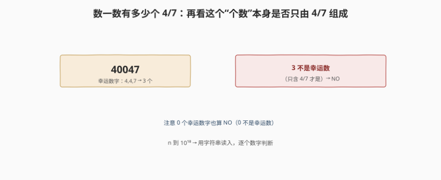
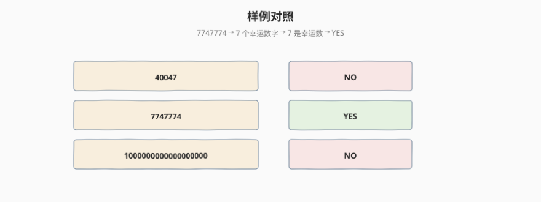

# Codeforces 110A 近似幸运数 题解

## 1. 题目概述

- **题目链接**：https://codeforces.com/problemset/problem/110/A
- **比赛来源**：Codeforces Beta Round 84 (Div. 2 Only) · Problem A（UTC 2011-08-29）
- **难度**：800
- **标签**：字符串、数位统计
- **评测类型**：普通
- **限制**：时间 2 s / 内存 256 MB

**题意**：幸运数 = 十进制表示只由 `4`、`7` 组成。若一个数中"幸运数字（4 或 7）的个数"本身是幸运数，则称它为近似幸运数。给定 $n$，判断它是否近似幸运。

**约束**：

- $1 \le n \le 10^{18}$：用字符串读入（19 位），统计个数 $\le 19$。
- 个数为 0 时不算近似幸运（0 不是幸运数）。
- 单组数据。

## 2. 示例与观察

官方样例一：

```text
输入：
40047
输出：
NO
```

官方样例二：

```text
输入：
7747774
输出：
YES
```

官方样例三：

```text
输入：
1000000000000000000
输出：
NO
```

**样例一走查**：`40047` 中有 `4`、`4`、`7` 共 $3$ 个幸运数字；$3$ 不是幸运数 → `NO`。

**样例二走查**：`7747774` 有 $7$ 个幸运数字；$7$ 是幸运数 → `YES`。

**样例三走查**：没有 4/7 → 个数 $0$，$0$ 不是幸运数 → `NO`。



**观察**：只需要两步——数出 4/7 的个数 $c$，再检查 $c$ 的十进制表示是否只含 4 和 7。

## 3. 解题思路

### 3.1 朴素做法与瓶颈

把 $n$ 转成数字逐个取模：也可以，但 $n$ 有 $10^{18}$ 级，用字符串更省事、且天然避免溢出。

### 3.2 算法流程



1. 读入字符串 $s$；
2. $c \gets \#\{i : s_i\in\{4,7\}\}$；
3. 若 $c=0$ → `NO`；
4. 否则检查 $c$ 的十进制各位是否都属于 $\{4,7\}$：是 → `YES`，否 → `NO`。

### 3.3 样例走查

| 输入 | 幸运数字个数 | 个数是否幸运 | 输出 |
|---|---|---|---|
| `40047` | 3 | 否 | `NO` |
| `7747774` | 7 | 是 | `YES` |
| `1000000000000000000` | 0 | 否（0 不算） | `NO` |

## 4. 正确性证明

**引理 1**：算法统计的 $c$ 恰为 $n$ 中 4/7 的个数。

**证明**：字符串逐字符比较 `'4'`、`'7'`，与十进制表示的逐位判断等价 ✓。∎

**引理 2**：$c$ 是幸运数当且仅当它的十进制表示只含 4 和 7。

**证明**：幸运数的定义就是"十进制表示只含 4 和 7" ✓。∎

**定理**：输出 `YES` 当且仅当 $n$ 是近似幸运数。

**证明**：近似幸运数的定义是"幸运数字个数是幸运数"，由引理 1、2，判定条件完全一致；$c=0$ 时 0 的表示含 0，不是幸运数，故输出 `NO` ✓。∎

## 5. 复杂度分析

- **时间**：$O(|s|)\le 19$。
- **空间**：$O(|s|)$。
- **数值范围**：全程字符串/小整数，无溢出。
- **与时限的关系**：2 s 下实测约 $2$ ms（C++），Python 约 $20$ ms。

## 6. 参考代码

### C++17

```cpp
#include <bits/stdc++.h>
using namespace std;

int main() {
    string s;
    if (!(cin >> s)) return 0;
    int cnt = 0;
    for (char c : s) if (c == '4' || c == '7') ++cnt;
    // cnt 是否是幸运数（十进制只含 4/7）
    if (cnt == 0) { printf("NO\n"); return 0; }
    int x = cnt;
    bool ok = true;
    while (x) { int d = x % 10; if (d != 4 && d != 7) { ok = false; break; } x /= 10; }
    printf("%s\n", ok ? "YES" : "NO");
    return 0;
}
```

### Python3

```python
import sys


def main() -> None:
    data = sys.stdin.buffer.read().split()
    if not data:
        return
    s = data[0].decode()
    cnt = sum(1 for c in s if c == '4' or c == '7')
    ok = cnt > 0 and set(str(cnt)) <= {'4', '7'}
    sys.stdout.write("YES\n" if ok else "NO\n")


main()
```

## 7. 边界情况与易错点

1. **$c=0$**：0 不是幸运数 → `NO`（样例三）。
2. **$c$ 是两位数**：如 $c=44$、$47$ 才是幸运数；$c=17$ 不是。代码要检查每一位，不能只判断"$c$ 是否等于 4 或 7"。
3. **$n$ 很大**：必须用字符串（或 `long long` 读入后逐位取模）。
4. **单个数字**：$n=4$ → $c=1$ → `NO`；$n=7$ → `NO`；$n=4444$ → $c=4$ → `YES`。
5. **大小写与输出**：`YES` / `NO`。
6. **输入允许前导？** 题面保证是正常整数，无需处理前导零（即使有，也不影响 4/7 计数）。

## 8. 验证记录

- **编译环境与命令**：`clang++ -std=c++17 -O2`（Apple clang 21.0.0 + `codeforces/tools/include` 的兼容头），Python 3.9.6。
- **官方样例**：3 / 3 通过（`NO`、`YES`、`NO`），C++ 与 Python 输出一致。
- **独立暴力对拍**：暴力把 $n$ 当整数逐位取模统计（与字符串实现不同），再检查个数是否为幸运数。对随机 $n\in[1,10^{18}]$ 的 **320 组**数据比对，**全部一致**。
- **最大约束性能**：$10^{18}$ 级输入 C++ 约 $2$ ms，Python 约 $20$ ms。
- **图片校验**：`cf110a_count.svg`、`cf110a_sample.svg` 均通过 `xml.etree.ElementTree.parse`，含 `feTurbulence` 与手写体字体族，文本包围盒未越出 `viewBox`。
- **公式校验**：KaTeX（`throwOnError`）渲染无报错；无 `---` 分隔线。
- **复核状态**：verified（样例、对拍、性能、图片、公式均实跑通过）。

## 相关题目与扩展

- [Codeforces 110B Lucky String](https://codeforces.com/problemset/problem/110/B)：同场 B 题。
- [Codeforces 109A 最小幸运数位和](https://codeforces.com/problemset/problem/109/A)、[109B Lucky Probability](https://codeforces.com/problemset/problem/109/B)、[109C Lucky Tree](https://codeforces.com/problemset/problem/109/C)、[109D Lucky Sorting](https://codeforces.com/problemset/problem/109/D)、[109E Lucky Interval](https://codeforces.com/problemset/problem/109/E)：同轮 Div.1。
- [Codeforces 122A Lucky Division](https://codeforces.com/problemset/problem/122/A)：幸运数入门。
- [LeetCode 1399. 统计最大组的数目](https://leetcode.cn/problems/count-largest-group/)：数位统计类。

**延伸思考**：

1. **如果"幸运数字"改成任意指定集合**：把判断条件换成集合成员即可。
2. **如果要求"个数是幸运数的倍数"**：多一层整除判断。
3. **如果 $n$ 有 $10^6$ 位**：字符串统计仍是 $O(|n|)$。
4. **如果改成统计"数字和里的幸运数字"**：需要先求数位和，再统计。

