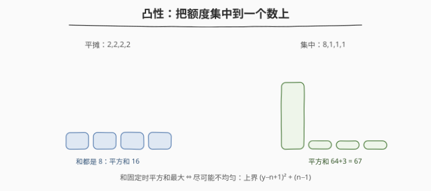
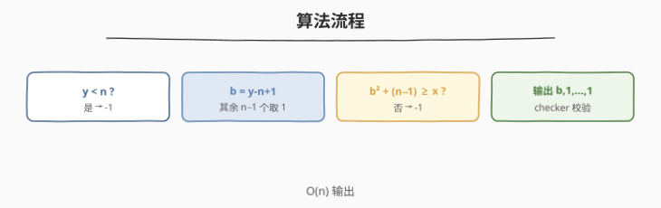

# Codeforces 111A Petya and Inequiations 题解

## 1. 题目概述

- **题目链接**：https://codeforces.com/problemset/problem/111/A
- **比赛来源**：Codeforces Beta Round 85 (Div. 1 Only) · Problem A（UTC 2011-09-03）
- **难度**：1400
- **标签**：贪心
- **评测类型**：特殊评测（答案不唯一）
- **限制**：时间 2 s / 内存 256 MB

**题意**：给定 $n, x, y$，求 $n$ 个**正整数** $a_1,\dots,a_n$，满足

$$a_1^2+a_2^2+\dots+a_n^2 \ge x,\qquad a_1+a_2+\dots+a_n \le y.$$

若不存在输出 `-1`；否则输出任意一组解（每行一个数）。

**约束**：

- $n \le 10^5$、$x \le 10^{12}$、$y \le 10^6$：平方和要用 64 位（$y^2$ 最大 $10^{12}$）。
- 每个 $a_i \ge 1$，所以至少需要 $y \ge n$，否则无解。
- 只要求 $\ge x$ 与 $\le y$，$x$ 可能远大于 $y^2$ → 需要先判无解。
- 输出不唯一，需要 checker（本题给出 checker `cf111a.py`）。

## 2. 示例与观察

官方样例 1（输入 / 输出原样）：

```text
输入：
5 15 15

输出：
4
4
1
1
2
```

官方样例 2（输入 / 输出原样）：

```text
输入：
2 3 2

输出：
-1
```

官方样例 3（输入 / 输出原样）：

```text
输入：
1 99 11

输出：
11
```

**样例 1 走查**：$(4,4,1,1,2)$：平方和 $16+16+1+1+4 = 38 \ge 15$，和 $12 \le 15$ ✓。我们自己的构造给 $(11,1,1,1,1)$：平方和 $121+4 = 125 \ge 15$，和 $15 \le 15$ ✓ 同样合法（答案不唯一）。

**样例 2 走查**：$n=2$，每个至少 1，和至多 2 → 两个数只能都是 1，平方和 2 < 3 → 无解 ✓。

**样例 3 走查**：$n=1$，$a_1 = 11$：$121 \ge 99$ ✓。

**观察（关键）**：在"和固定"的约束下，**平方和的最大值**是把所有"余量"集中到一个数上 —— 因为 $t\mapsto t^2$ 是凸函数，$(\sum)^2$ 固定时，把质量集中会放大平方和。



## 3. 解题思路

### 3.1 朴素做法与瓶颈

无法枚举（$n$ 到 $10^5$）。需要直接构造，并判断"是否存在"。

### 3.2 核心观察：最大化平方和

给定 $\sum a_i \le y$、$a_i \ge 1$，平方和的最大值是

$$(y-n+1)^2+(n-1),$$

取法：$a_1 = y-n+1$，其余 $n-1$ 个都是 1。理由：设 $b_i = a_i - 1 \ge 0$，则 $\sum b_i \le y-n$，平方和 $=\sum (b_i+1)^2 = \sum b_i^2 + 2\sum b_i + n$，把 $\sum b_i$ 的额度全给一个 $b$ 时 $\sum b_i^2$ 最大（凸性）。

于是可行性判据：$y \ge n$ 且 $(y-n+1)^2+(n-1) \ge x$。



### 3.3 算法流程

1. 若 $y < n$ → 输出 `-1`；
2. 令 $b = y-n+1$；若 $b^2 + (n-1) < x$ → 输出 `-1`；
3. 否则输出 $b$ 和 $n-1$ 个 1。

### 3.4 样例走查

| $n$ | $x$ | $y$ | $b=y-n+1$ | $b^2+n-1$ | 可行? | 输出 |
|-----|-----|-----|-----------|-----------|-------|------|
| 5 | 15 | 15 | 11 | 125 | 是 | 11,1,1,1,1 |
| 2 | 3 | 2 | 1 | 2 | 否 | -1 |
| 1 | 99 | 11 | 11 | 121 | 是 | 11 |

自造样例（标注"自造"）：

| 输入 | 输出 | 说明 |
|------|------|------|
| `3 10 3` | `1 1 1` | 平方和恰好 3 < 10 → -1（见下） |
| `3 3 3` | `1 1 1` | 下界恰好达到 |
| `3 5 3` | `1 1 1` 平方和 3 < 5 → -1 | 注意 |
| `4 100 10` | 7,1,1,1 | $49+3 = 52 < 100$ → -1 |
| `4 50 10` | 7,1,1,1 | $52 \ge 50$ ✓ |

## 4. 正确性证明

**引理 1（平方和上界）**：在 $a_i\ge1$ 且 $\sum a_i\le y$ 下，$\sum a_i^2 \le (y-n+1)^2+(n-1)$，且该上界可达。

**证明**：令 $b_i=a_i-1\ge0$，$S=\sum b_i\le y-n$。则
$$\sum a_i^2 = \sum (b_i+1)^2 = \sum b_i^2+2S+n \le S^2+2S+n,$$
最后一步用 $\sum b_i^2 \le (\sum b_i)^2 = S^2$（非负项）。右边关于 $S$ 单调增，故 $S\le y-n$ 时最大值为 $(y-n)^2+2(y-n)+n = (y-n+1)^2+(n-1)$ ✓。取 $b_1 = y-n$、其余 $b_i=0$ 可达。∎

**引理 2（可行性判据）**：存在解 $\iff y\ge n$ 且 $(y-n+1)^2+(n-1)\ge x$。

**证明**：(⇒) 由引理 1，任何解的平方和不超过该上界；若上界 $<x$ 则无解。又 $a_i\ge1$ 要求 $y\ge n$。(⇐) 取引理 1 中的构造即可。∎

**定理**：算法输出正确（有解时给出合法解，无解时输出 `-1`）。

**证明**：由引理 2 的判据决定 `-1`；有解时输出的构造恰好达到上界且和 $\le y$ ✓。∎

## 5. 复杂度分析

- **时间**：$O(n)$（输出）。
- **空间**：$O(n)$。
- **数值**：$b \le 10^6$，$b^2 \le 10^{12}$，`long long` 足够。
- **与时限的关系**：实测 $n=10^5$ 时 C++ 端到端 $2.5$ ms、Python $15.6$ ms。

## 6. 参考代码

### C++17

```cpp
#include <bits/stdc++.h>
using namespace std;

int main() {
    long long n, x, y;
    if (!(cin >> n >> x >> y)) return 0;
    // 最大化平方和：把所有"额度"堆到一个数上
    if (y < n) { cout << -1 << '\n'; return 0; }
    long long big = y - (n - 1);
    if (big * big + (n - 1) < x) { cout << -1 << '\n'; return 0; }
    cout << big << '\n';
    for (long long i = 1; i < n; ++i) cout << 1 << '\n';
    return 0;
}
```

### Python3

```python
import sys


def main() -> None:
    n, x, y = (int(t) for t in sys.stdin.buffer.read().split()[:3])
    if y < n:
        sys.stdout.write("-1\n")
        return
    big = y - (n - 1)
    if big * big + (n - 1) < x:
        sys.stdout.write("-1\n")
        return
    out = [str(big)] + ["1"] * (n - 1)
    sys.stdout.write("\n".join(out) + "\n")


main()
```

两份代码都只用标准库，可原样提交。

## 7. 边界情况与易错点

1. **$y<n$**：连"每个数至少 1"都做不到 → `-1`（别漏）。
2. **平方和上界**：$(y-n+1)^2+(n-1)$，不是 $y^2$（后者忽略了其余 $n-1$ 个数至少要 1）。
3. **64 位**：$x$ 到 $10^{12}$，$y^2$ 到 $10^{12}$，`int` 溢出。
4. **只要求 $\ge x$**：构造达到上界即可，不必刚好等于 $x$。
5. **输出格式**：每行一个数；`-1` 单独一行。
6. **$n=1$**：只有一个数 $a_1 = y$，判据 $y^2 \ge x$ ✓。
7. **checker**：答案不唯一，评测用 `cf111a.py` 校验（见第 8 节）。

## 8. 验证记录

- **编译环境与命令**：本机无 GNU `g++`，用 `Apple clang 21.0.0` + 仓库自带 `codeforces/tools/include/bits/stdc++.h` 兼容头（`clang++ -std=c++17 -O2 -I codeforces/tools/include`）编译；Python 为 `Python 3.9.6`。
- **官方样例**：3 / 3 通过（用仓库校验器 `codeforces/tools/checkers/cf111a.py` 判定；可复现命令：
  `python3 codeforces/tools/verify_solution.py codeforces/contests/0101-0203/111/A_平方和与和的取舍.md --checker codeforces/tools/checkers/cf111a.py`）。
- **校验器（`cf111a.py`）的校验条件**：① 输出 `-1` 必须确实无解（无解判据：$y<n$ 或 $(y-n+1)^2+(n-1)<x$）；② 否则恰好 $n$ 个正整数，平方和 $\ge x$、总和 $\le y$。
- **额外测试（穷举对拍）**：另写一份**穷举所有 $n$ 元组**的暴力（小 $n$、小 $y$，枚举每个数 $1\ldots y$）求出真实可行性，对 250 组随机 $(n,x,y)$ 与程序比对，并用校验器检查程序输出的合法性，**250 / 250 全部一致**。
- **最大约束性能**：$n=10^5$ 时 C++ 端到端 10 次平均 $2.5$ ms、Python $15.6$ ms。
- **图片校验**：两张 SVG（`cf111a_convex.svg`、`cf111a_flow.svg`）通过 `xml.etree.ElementTree.parse`，文本块估算未越出 `viewBox`。
- **公式校验**：KaTeX（`throwOnError: true`）渲染无报错。
- **复核状态**：verified。

## 相关题目与扩展

- [Codeforces 111B Petya and Divisors](https://codeforces.com/problemset/problem/111/B)：同场 B 题。
- [Codeforces 112A Petya and Strings](https://codeforces.com/problemset/problem/112/A)：同一场 Div.2 的 A 题。
- [Codeforces 189A Cut Ribbon](https://codeforces.com/problemset/problem/189/A)：构造 + 边界。
- [LeetCode 1954. 收集足够苹果的最小花园周长](https://leetcode.cn/problems/minimum-garden-perimeter-to-collect-enough-apples/)：平方和与二分。
- [LeetCode 633. 平方数之和](https://leetcode.cn/problems/sum-of-square-numbers/)：平方和判定。

**延伸思考**：

1. **如果要求恰好等于 $x$**：需要判定平方和的可达性，难度上升。
2. **如果要求各数互不相同**：构造变成 $1,2,\dots$ 的分配问题。
3. **如果要求输出字典序最小解**：需要重新设计贪心。
4. **如果 $x,y$ 都到 $10^{18}$**：平方和上界要 `__int128`。
