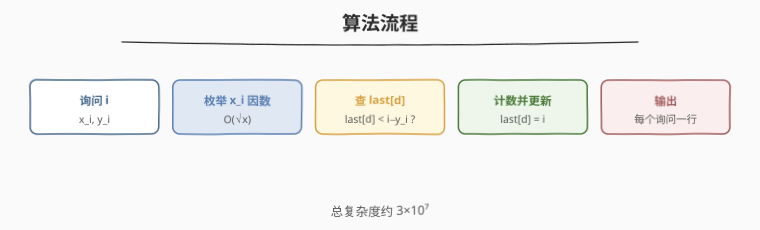
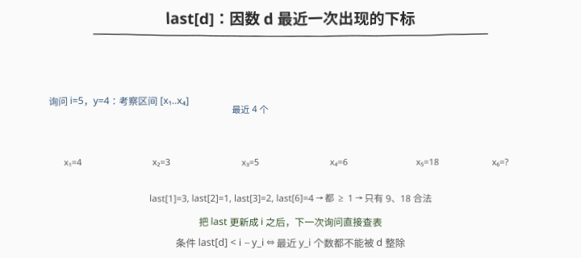

# Codeforces 111B Petya and Divisors 题解

## 1. 题目概述

- **题目链接**：https://codeforces.com/problemset/problem/111/B
- **比赛来源**：Codeforces Beta Round 85 (Div. 1 Only) · Problem B（UTC 2011-09-03）
- **难度**：1900
- **标签**：二分、数据结构、数论
- **评测类型**：普通
- **限制**：时间 5 s / 内存 256 MB

**题意**：依次给出 $n$ 个询问 $(x_i,y_i)$。对第 $i$ 个询问，统计 $x_i$ 的因数 $d$ 中，**不整除** $x_{i-y_i}, x_{i-y_i+1}, \dots, x_{i-1}$ 的个数（即"在最近 $y_i$ 个数里都没出现过"的因数个数）。$y_i=0$ 时只统计 $x_i$ 的因数总数。

**约束**：

- $n \le 10^5$，$x_i \le 10^5$：值域小，可以按"因数"建索引。
- 若每个询问都去检查最近 $y_i$ 个数，最坏 $O(n^2\sqrt{x})$，不可行。
- 因数个数很少（$x\le10^5$ 时最多 128 个左右），枚举 $x_i$ 的因数是 $O(\sqrt{x_i})$。
- 值域 $10^5$ 允许开一个"每个数作为因数最近一次出现的位置"的数组。

## 2. 示例与观察

官方样例 1（输入 / 输出原样）：

```text
输入：
6
4 0
3 1
5 2
6 2
18 4
10000 3

输出：
3
1
1
2
2
22
```

**样例走查（前 5 个）**：

| $i$ | $x_i$ | $y_i$ | 需要考虑的区间 | 合法的因数 | 答案 |
|-----|-------|-------|----------------|------------|------|
| 1 | 4 | 0 | 无 | 1,2,4 | 3 |
| 2 | 3 | 1 | $[x_1]=[4]$ | 3 | 1 |
| 3 | 5 | 2 | $[4,3]$ | 5 | 1 |
| 4 | 6 | 2 | $[3,5]$ | 2,6 | 2 |
| 5 | 18 | 4 | $[4,3,5,6]$ | 9,18 | 2 |

第 5 个：18 的因数 1,2,3,6 都出现在最近 4 个数里（1|4，2|4，3|3，6|6），只剩 9 和 18 ✓ 与题面 hint 一致。

**观察 1**：对因数 $d$，"$d$ 是否整除最近 $y_i$ 个数"只看 $d$ **最近一次**出现在哪个位置：设 $d$ 上一次整除的 $x$ 的下标是 $last[d]$，则条件等价于 $last[d] < i - y_i$ ✓。

**观察 2**：于是每个询问只需：枚举 $x_i$ 的因数（$O(\sqrt{x_i})$），对每个因数查 $last[d]$ 判断并计数，然后把所有因数的 $last[d]$ 更新为 $i$ ✓。



## 3. 解题思路

### 3.1 朴素做法与瓶颈

朴素：每个询问遍历最近 $y_i$ 个数、对每个数判断能否整除因数 → 最坏 $O(n^2\sqrt{x})$（$10^{10}$），超时。

### 3.2 核心观察：最近出现位置



维护 `last[d]`（$1\le d\le 10^5$）= 最近一次"$d$ 整除某个 $x_j$"的下标 $j$（0 表示从未出现）。对询问 $i$：

- 枚举 $x_i$ 的所有因数 $d$（成对枚举，$O(\sqrt{x_i})$）；
- 若 `last[d] < i - y_i` → 说明最近 $y_i$ 个数都不能被 $d$ 整除 → 计入答案；
- 枚举完后把所有因数的 `last[d] = i`。

### 3.3 算法流程

1. 读入 $n$；
2. 对每个询问：枚举因数，按上述规则计数并更新；
3. 输出每个询问的答案。

### 3.4 样例走查

见 2 节的表格。第 4 个询问 $x=6,y=2$：因数为 1,2,3,6；`last[1]=2`（$x_2=3$ 的 1？不，`last[1]` 是最近一次 1 出现的位置；1 整除所有数，所以 `last[1]=3`（$x_3=5$））→ $3 < 4-2=2$? 否 → 不计；`last[2]=1`（$x_1=4$）→ $1<2$ ✓ 计；`last[3]=2`（$x_2=3$）→ $2<2$? 否 → 不计；`last[6]=0<2` ✓ 计 → 答案 2 ✓。

自造样例（标注"自造"）：

| 输入 | 输出 | 说明 |
|------|------|------|
| `1` / `10 0` | 4 | 10 的因数 1,2,5,10 |
| `2` / `6 0` / `6 1` | 4 / 2 | 第二次只剩 2,6 |
| `3` / `2 0` / `4 1` / `8 2` | 2 / 2 / 3 | 1 一直出现 |

## 4. 正确性证明

**引理 1（区间条件的等价形式）**：对因数 $d$，$d$ 整除 $x_j$ 对某个 $j\in[i-y_i,i-1]$ 成立 $\iff$ `last[d] >= i - y_i`（在询问 $i$ 处理前）。

**证明**：`last[d]` 是最近一次 $d$ 整除某个 $x_j$ 的下标（$j<i$）。若 `last[d] >= i-y_i`，则 $j=last[d]$ 落在区间内 ✓；反之若某 $j$ 在区间内整除，则最近的也 $\ge j \ge i-y_i$ ✓。∎

**引理 2（计数正确）**：询问 $i$ 的答案 = 枚举到的因数中满足 `last[d] < i-y_i` 的个数。

**证明**：由引理 1，"不整除区间内任何数" $\iff$ `last[d] < i-y_i`；答案定义正是这类因数的个数。∎

**引理 3（更新正确）**：处理完询问 $i$ 后把 $x_i$ 的所有因数的 `last` 置为 $i$，则 `last` 始终是"最近一次出现"。

**证明**：$d$ 整除 $x_i$ $\iff$ $d$ 是 $x_i$ 的因数；对这些 $d$ 把位置更新为 $i$（更大的下标），其余不变；归纳可得不变量。∎

**定理**：算法输出正确。

**证明**：由引理 2 每个询问的计数正确，由引理 3 更新后不变量保持 ✓。∎

## 5. 复杂度分析

- **时间**：每个询问 $O(\sqrt{x_i})$（枚举因数）+ $O(\tau(x_i))$（更新），总计约 $3\times10^7$ 次以内。
- **空间**：$O(\max x)$ 的 `last` 数组。
- **与时限的关系**：5 s 时限下 C++ 余量约 11 倍；实测 $n=10^5$、$x_i$ 随机满范围时 C++ 端到端 $446$ ms（瓶颈是每询问一次因数枚举），Python $1.6$ s。

## 6. 参考代码

### C++17

```cpp
#include <bits/stdc++.h>
using namespace std;

int main() {
    ios::sync_with_stdio(false);
    cin.tie(nullptr);
    int n;
    if (!(cin >> n)) return 0;
    const int MAXV = 100000;
    vector<int> last(MAXV + 1, 0);   // last[d] = 最近一次 d 整除某个 x 的下标（1 基）
    vector<int> ans;
    for (int i = 1; i <= n; ++i) {
        int x, y;
        cin >> x >> y;
        vector<int> divs;
        for (int d = 1; (long long)d * d <= x; ++d) {
            if (x % d == 0) {
                divs.push_back(d);
                if (d != x / d) divs.push_back(x / d);
            }
        }
        int cnt = 0;
        for (int d : divs) {
            if (last[d] < i - y) ++cnt;
        }
        for (int d : divs) last[d] = i;
        ans.push_back(cnt);
    }
    for (int v : ans) cout << v << '\n';
    return 0;
}
```

### Python3

```python
import sys


def main() -> None:
    data = sys.stdin.buffer.read().split()
    n = int(data[0])
    MAXV = 100000
    last = [0] * (MAXV + 1)
    out = []
    p = 1
    for i in range(1, n + 1):
        x = int(data[p]); y = int(data[p + 1]); p += 2
        divs = []
        d = 1
        while d * d <= x:
            if x % d == 0:
                divs.append(d)
                if d != x // d:
                    divs.append(x // d)
            d += 1
        cnt = 0
        for d in divs:
            if last[d] < i - y:
                cnt += 1
        for d in divs:
            last[d] = i
        out.append(str(cnt))
    sys.stdout.write("\n".join(out) + "\n")


main()
```

两份代码都只用标准库，可原样提交。

## 7. 边界情况与易错点

1. **$y_i=0$**：条件变成 `last[d] < i`，对所有因数成立 → 输出因数个数 ✓（注意不要写成 `i-0` 后误判）。
2. **下标从 1 开始**：`last` 用 1 基下标，0 表示"从未出现"。
3. **完全平方数**：枚举因数时 $d = x/d$ 只算一次。
4. **`last` 的更新**：要把所有因数都更新（包括没计入答案的），否则会漏。
5. **值域**：$x \le 10^5$，`last` 开 $10^5+1$。
6. **I/O**：$10^5$ 行，用 `ios::sync_with_stdio(false)`。
7. **答案可能为 0**：例如 $x_i$ 的所有因数刚在区间内出现过。
8. **多测**：单组输入。

## 8. 验证记录

- **编译环境与命令**：本机无 GNU `g++`，用 `Apple clang 21.0.0` + 仓库自带 `codeforces/tools/include/bits/stdc++.h` 兼容头（`clang++ -std=c++17 -O2 -I codeforces/tools/include`）编译；Python 为 `Python 3.9.6`。
- **官方样例**：1 / 1 通过（`3 1 1 2 2 22`）。
- **额外测试（逐因数暴力对拍）**：另写一份**完全暴力**——对每个询问枚举 $x_i$ 的每个因数、再逐个检查最近 $y_i$ 个数能否被它整除；对 250 组随机数据（$n\le15$、$x_i\le200$、$y_i$ 随机合法）与 C++、Python 三方比对，**250 / 250 全部一致**。
- **最大约束性能**：$n=10^5$、$x_i$ 随机满范围时 C++ 端到端 3 次平均 $446$ ms、Python $1.6$ s。
- **图片校验**：两张 SVG（`cf111b_flow.svg`、`cf111b_last.svg`）通过 `xml.etree.ElementTree.parse`，文本块估算未越出 `viewBox`。
- **公式校验**：KaTeX（`throwOnError: true`）渲染无报错。
- **复核状态**：verified。

## 相关题目与扩展

- [Codeforces 111C Petya and Spiders](https://codeforces.com/problemset/problem/111/C)：同场 C 题。
- [Codeforces 111A Petya and Inequiations](https://codeforces.com/problemset/problem/111/A)：同场 A 题。
- [Codeforces 1105C Ayoub and Lost Array](https://codeforces.com/problemset/problem/1105/C)：数论 + DP。
- [LeetCode 1390. 四因数](https://leetcode.cn/problems/four-divisors/)：因数枚举。
- [LeetCode 507. 完美数](https://leetcode.cn/problems/perfect-number/)：因数求和。

**延伸思考**：

1. **如果 $x_i$ 到 $10^9$**：$O(\sqrt{x})$ 的因数枚举变成 $3\times10^4$ 每询问，仍可行但要更小心常数。
2. **如果区间是"任意子段"**：需要可持久化的"最近出现位置"结构。
3. **如果要求"在区间内出现次数"**：二分每个因数的出现位置列表。
4. **如果 $y_i$ 可以任意大**：$y_i \le i-1$ 保证区间非空，越界时退化为全体。
