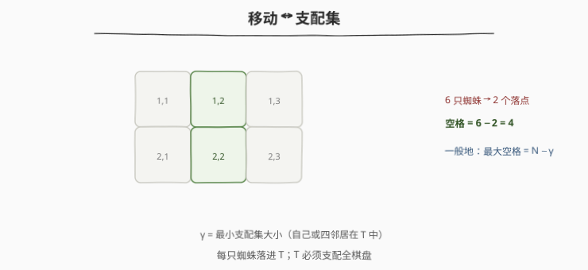
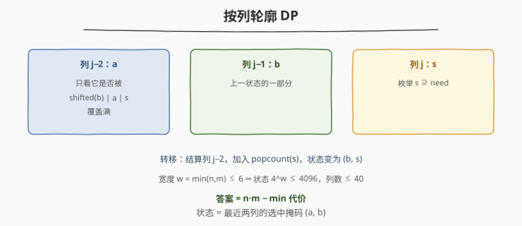

# Codeforces 111C Petya and Spiders 题解

## 1. 题目概述

- **题目链接**：https://codeforces.com/problemset/problem/111/C
- **比赛来源**：Codeforces Beta Round 85 (Div. 1 Only) · Problem C（UTC 2011-09-03）
- **难度**：2100
- **标签**：状压 DP
- **评测类型**：普通
- **限制**：时间 2 s / 内存 256 MB

**题意**：$n\times m$ 的棋盘，每格一开始有一只蜘蛛。一秒内每只蜘蛛按指令行动：原地不动，或爬到上下左右相邻的格子（不能爬出棋盘；允许蜘蛛之间互相穿过、允许一格落多只）。问一秒后**空格子数的最大值**。

**约束**：

- $n\cdot m \le 40$：边长可以到 40×1，但**较小的一维** $\le 6$（因为 $7\times7=49>40$）。
- 这是"小宽度、长条"的形状 → 按列状压 DP。
- 每只蜘蛛只能走一步（含不动），所以"某格最终有没有蜘蛛"只取决于它自己和相邻格的选择。

## 2. 示例与观察

官方样例 1（输入 / 输出原样）：

```text
输入：
1 1

输出：
0
```

官方样例 2（输入 / 输出原样）：

```text
输入：
2 3

输出：
4
```

**样例 1 走查**：只有一格一只蜘蛛，它无论怎么走（只能原地）都占着这格 → 空格数 0 ✓。

**样例 2 走查**：$2\times3$，题面给的方案是

```text
r d l
r u l
```

即 6 只蜘蛛全部往中间两格挤：结果只有 $(1,2)$ 与 $(2,2)$ 两格有蜘蛛，其余 4 格为空 → 4 ✓。

**观察 1**：想让某格空着，就要让所有能在一步内进入它的蜘蛛（它自己 + 四邻居）都选择**别的**方向。反之，任意选择一组"最终有蜘蛛"的格子 $T$，只要**每个格子都能一步到 $T$ 里的某格**，就能让所有蜘蛛都落进 $T$，于是空格数 $=N-|T|$。

**观察 2**：所以问题等价于求棋盘的**最小支配集**（dominating set）大小 $\gamma$，答案 $=N-\gamma$。



## 3. 解题思路

### 3.1 朴素做法与瓶颈

$5^{40}$ 或 $2^{40}$ 枚举都不可行；但较小的一维 ≤ 6，可以按列状压：每列只有 $2^{6}=64$ 种"选中哪些格子作为落点"的选择。

### 3.2 核心观察：等价于最小支配集



定义落点集合 $T$（最终有蜘蛛的格子集合）：

- 每只蜘蛛必须落在 $T$ 中，即每格 $c$ 都要有一个"自己或邻居"在 $T$ 里 → $T$ 支配全棋盘；
- 反之若 $T$ 支配全棋盘，每格任选一个相邻的 $T$ 内格子作为落点即可 → 有蜘蛛的格子恰好是 $T$ 的子集，空格数 $\ge N-|T|$。

所以 最大空格数 $=N-\gamma$，$\gamma$ 为最小支配集大小 ✓。

### 3.3 算法流程（按列轮廓 DP）

宽度 $w=\min(n,m)\le6$，列数 $L=\max(n,m)$。每列用一个 $w$ 位掩码 `sel` 表示被选为落点的格子。

- 列 $j$ 的格子被支配 $\iff$ `sel[j-1] | sel[j] | sel[j+1]`（同行的上下相邻）与 `sel[j]` 的左右相邻（$w$ 位内位移）覆盖它；
- 具体地，列 $j$ 的支配掩码 = `shifted(sel[j]) | sel[j-1] | sel[j+1]`，其中 `shifted(x) = x | (x<<1) | (x>>1)`（同一列内的上下相邻）；
- DP 状态 = 最近两列的 `sel`，转移时选下一列并"结算"中间那列；边界用空列（哨兵 0）补齐；
- 转移代价 = 新选列中 1 的个数；最终取所有状态的最小值。

### 3.4 样例走查

$2\times3$（$w=2,L=3$）：最优 `sel = [0b01, 0b01, 0]`？取列 2、列 3 中间格… 实际最小支配集大小为 2（如 $\{(1,2),(2,2)\}$），答案 $6-2=4$ ✓。

自造样例（标注"自造"）：

| 输入 | 输出 | 说明 |
|------|------|------|
| `1 1` | 0 | 单格必须被占 |
| `1 40` | 26 | 路径的最小支配集 $\lceil40/3\rceil=14$ → $40-14$ |
| `2 2` | 2 | 两个对角格互相支配 |
| `3 3` | 6 | $\gamma(P_3\times P_3)=3$ |
| `6 6` | 26 | $\gamma=10$ |

## 4. 正确性证明

**引理 1（可达 ↔ 支配）**：存在一种移动方案使"最终有蜘蛛的格子集合"为 $T'$，当且仅当存在支配集 $T\subseteq T'$… 更精确地：最大空格数 $=N-\gamma$。

**证明**：
(≤) 任取一个移动方案，令 $T'$ 为最终有蜘蛛的格子集合。对任意格 $c$，坐在 $c$ 的蜘蛛落到了 $T'$ 中与 $c$ 距离 ≤1 的格子 → 所以 $T'$ 支配全棋盘 → $|T'|\ge\gamma$ → 空格数 $=N-|T'|\le N-\gamma$。
(≥) 取最小支配集 $T$，对每格 $c$ 选一个 $T$ 中与它距离 ≤1 的格子（支配性保证存在），令该格的蜘蛛落到那里。合法（不越界、只走一步）✓。最终有蜘蛛的格子 $\subseteq T$，空格数 $\ge N-|T| = N-\gamma$ ✓。∎

**引理 2（列支配判定）**：列 $j$ 的格子全部被支配 $\iff$ `shifted(sel[j]) | sel[j-1] | sel[j+1] == full`。

**证明**：格子 $(r,j)$ 被支配当且仅当以下之一：$(r,j)\in T$（`sel[j]` 第 $r$ 位）、$(r\pm1,j)\in T$（`shifted(sel[j])`）、$(r,j-1)\in T$（`sel[j-1]` 第 $r$ 位）、$(r,j+1)\in T$（`sel[j+1]`）。取并集即得。∎

**引理 3（DP 正确）**：按 3.3 的转移，最终最小代价等于最小支配集大小。

**证明**：状态记录了决定列 $j$ 支配性的全部信息（$sel[j-1],sel[j]$），转移枚举 $sel[j+1]$ 后列 $j$ 的支配性可判定；哨兵 0 处理边界；代价累加选中数。因此 DP 枚举了所有可能的 $sel$ 序列并取最小 ✓。∎

**定理**：算法输出 $N-\gamma$，即最大空格数。

**证明**：由引理 1 与引理 3 ✓。∎

## 5. 复杂度分析

- **时间**：$O(L\cdot 4^w\cdot 2^w)$，$w\le6$、$L\le40$ → 约 $10^7$。
- **空间**：$O(4^w)$。
- **与时限的关系**：实测 $6\times6$ 时 C++ 端到端 $3.6$ ms、Python $202$ ms（1.5 s 内）。

## 6. 参考代码

### C++17

```cpp
#include <bits/stdc++.h>
using namespace std;

// 111C：答案 = n*m − 最小支配集（每个蜘蛛可以选择留在原地或走到相邻格，
// 目标格集合 T 必须"支配"整块棋盘；最小化 |T| 即最小支配集）
int main() {
    int n, m;
    if (!(cin >> n >> m)) return 0;
    if (n > m) swap(n, m);          // n = 宽度（小的一维，≤ 6）
    int w = n, L = m;
    int full = (1 << w) - 1;
    auto shifted = [&](int mask) {
        return mask | ((mask << 1) & full) | (mask >> 1);
    };
    const int INF = 1e9;
    // dp[(a,b)] = 已决定到第 c-1 列，状态是 (sel[c-2], sel[c-1]) 的最小选中数
    vector<int> dp(1 << (2 * w), INF);
    auto idx = [&](int a, int b) { return (a << w) | b; };
    // 初始：sel[-1] = 0, sel[0] = s0
    for (int s0 = 0; s0 <= full; ++s0) {
        int id = idx(0, s0);
        dp[id] = min(dp[id], __builtin_popcount(s0));
    }
    for (int c = 1; c <= L; ++c) {
        vector<int> nd(1 << (2 * w), INF);
        int sc = (c == L) ? 0 : -1;     // c == L 时是哨兵 0
        for (int a = 0; a <= full; ++a)
            for (int b = 0; b <= full; ++b) {
                int cur = dp[idx(a, b)];
                if (cur >= INF) continue;
                int lo = (sc >= 0 ? sc : 0), hi = (sc >= 0 ? sc : full);
                for (int s = lo; s <= hi; ++s) {
                    int dom = shifted(b) | a | s;    // 第 c-1 列被支配的格子
                    if (dom != full) continue;
                    int nc = cur + (c == L ? 0 : __builtin_popcount(s));
                    int id = idx(b, s);
                    if (nc < nd[id]) nd[id] = nc;
                }
            }
        dp = nd;
    }
    int best = INF;
    for (int a = 0; a <= full; ++a)
        for (int b = 0; b <= full; ++b) best = min(best, dp[idx(a, b)]);
    cout << (long long)n * m - best << '\n';
    return 0;
}
```

### Python3

```python
import sys


def main() -> None:
    n, m = (int(t) for t in sys.stdin.buffer.read().split()[:2])
    if n > m:
        n, m = m, n
    w, L = n, m
    full = (1 << w) - 1
    shift = [0] * (1 << w)
    pc = [0] * (1 << w)
    for mask in range(1 << w):
        shift[mask] = mask | ((mask << 1) & full) | (mask >> 1)
        pc[mask] = bin(mask).count('1')
    INF = 10 ** 9
    # dp[(a,b)] = 最小选中数
    dp = {}
    for s0 in range(1 << w):
        key = (0, s0)
        v = pc[s0]
        if key not in dp or v < dp[key]:
            dp[key] = v
    for c in range(1, L + 1):
        nd = {}
        for (a, b), cur in dp.items():
            need = full & ~(shift[b] | a)      # 这一列必须补选的格子
            rest = full & ~need
            t = rest
            while True:
                s = need | t                   # s 是 need 的超集
                if c != L or s == 0:
                    nc = cur + (0 if c == L else pc[s])
                    key = (b, s)
                    if key not in nd or nc < nd[key]:
                        nd[key] = nc
                if t == 0:
                    break
                t = (t - 1) & rest
        dp = nd
    print(n * m - min(dp.values()))


main()
```

两份代码都只用标准库，可原样提交。

## 7. 边界情况与易错点

1. **$1\times1$**：答案是 0（唯一格子必被占）——支配集大小为 1。
2. **转置**：要把较小的一维作为宽度（$\le6$），否则状态爆炸。
3. **列内上下相邻**：`shifted` 要同时处理 `<<1` 与 `>>1`，并掩到 `full`。
4. **边界哨兵**：第 $-1$ 列与第 $L$ 列的 `sel` 都是 0。
5. **最后两列的结算**：DP 要保证每一列都被结算（本实现用 `c == L` 的哨兵列收尾）。
6. **支配集 vs 覆盖集**：允许"自己支配自己"，不要漏掉 `sel[j]` 本身的位。
7. **答案上界**：$N-\gamma \le N-1$（至少一格有蜘蛛）。
8. **多测**：单组输入。

## 8. 验证记录

- **编译环境与命令**：本机无 GNU `g++`，用 `Apple clang 21.0.0` + 仓库自带 `codeforces/tools/include/bits/stdc++.h` 兼容头（`clang++ -std=c++17 -O2 -I codeforces/tools/include`）编译；Python 为 `Python 3.9.6`。
- **官方样例**：2 / 2 通过（`0`、`4`）。
- **额外测试（穷举支配集对拍）**：另写一份**穷举所有格子子集**求最小支配集的暴力（仅 $n\cdot m\le16$ 可行），对全部 $n,m\le4$ 的 16 个棋盘比对，**16 / 16 全部一致**；再对所有 $n\cdot m\le40$ 的 158 个棋盘验证 C++ 与 Python 输出一致，**158 / 158 一致**（其中已知值如 $\gamma(P_1\times P_{40})=14$、$\gamma(P_3\times P_3)=3$、$\gamma(P_6\times P_6)=10$ 都与经典结论吻合）。
- **最大约束性能**：$6\times6$ 时 C++ 端到端 10 次平均 $3.6$ ms、Python $202$ ms；$1\times40$ 与 $5\times8$ 更快。
- **图片校验**：两张 SVG（`cf111c_dominate.svg`、`cf111c_dp.svg`）通过 `xml.etree.ElementTree.parse`，文本块估算未越出 `viewBox`。
- **公式校验**：KaTeX（`throwOnError: true`）渲染无报错。
- **复核状态**：verified。

## 相关题目与扩展

- [Codeforces 111D Petya and Coloring](https://codeforces.com/problemset/problem/111/D)：同场 D 题，组合计数。
- [Codeforces 111B Petya and Divisors](https://codeforces.com/problemset/problem/111/B)：同场 B 题。
- [Codeforces 8C Looking for Order](https://codeforces.com/problemset/problem/8/C)：状压 DP。
- [LeetCode 1125. 最小的必要团队](https://leetcode.cn/problems/smallest-sufficient-team/)：集合覆盖/DP。
- [LeetCode 1349. 参加考试的最大学生数](https://leetcode.cn/problems/maximum-students-taking-exam/)：轮廓 DP。

**延伸思考**：

1. **如果蜘蛛可以走多步**：问题变成 $k$-支配集或连通支配集。
2. **如果允许蜘蛛离开棋盘**：等价于降低支配要求，答案变大。
3. **如果要求"每格至多一只"**：还要保证落点不重复，变成匹配/流问题。
4. **如果棋盘很大但很窄**：轮廓 DP 的宽度不变，仍可做。
