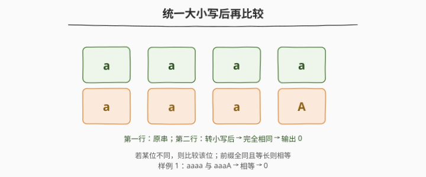

# Codeforces 112A Petya and Strings 题解

## 1. 题目概述

- **题目链接**：https://codeforces.com/problemset/problem/112/A
- **比赛来源**：Codeforces Beta Round 85 (Div. 2 Only) · Problem A（UTC 2011-09-03）
- **难度**：800
- **标签**：实现、字符串
- **评测类型**：普通
- **限制**：时间 2 s / 内存 256 MB

**题意**：读入两个等长字符串（只含大小写字母），按**不区分大小写**的字典序比较：第一个小则输出 `-1`，第一个大则输出 `1`，相同输出 `0`。

**约束**：

- 长度 $1 \le |s| \le 100$：直接比较即可，$O(|s|)$。
- 大小写不敏感：`'A'` 与 `'a'` 视为相同；但**只有大小写不同**的两个字符串算相等（样例 1）。
- 输出是整数 `-1 / 0 / 1`，不是字符串。

## 2. 示例与观察

官方样例 1（输入 / 输出原样）：

```text
输入：
aaaa
aaaA

输出：
0
```

官方样例 2（输入 / 输出原样）：

```text
输入：
abs
Abz

输出：
-1
```

官方样例 3（输入 / 输出原样）：

```text
输入：
abcdefg
AbCdEfF

输出：
1
```

**样例 1 走查**：全部转小写后都是 `aaaa`，相等 → `0` ✓（注意 `aaaa` 与 `aaaA` 原文不同，但大小写不敏感后相同）。

**样例 2 走查**：`abs` vs `Abz` → 小写后 `abs` vs `abz`：第 3 个字符 `s < z` → `-1` ✓。

**样例 3 走查**：`abcdefg` vs `AbCdEfF` → 小写后 `abcdefg` vs `abcdef`：前 6 个相同，第一个字符串还有第 7 个字符 → 按字典序第一个更大 → `1` ✓。

**观察**：把两个字符串都转成小写（或大写）后做普通字典序比较，结果取符号即可。


## 3. 解题思路

### 3.1 朴素做法与瓶颈

没有瓶颈：$|s| \le 100$，转小写后直接比较，$O(|s|)$。

### 3.2 核心观察：统一大小写

字典序比较逐字符进行：找到第一个不同的位置，比较该字符；若一直相同则较短者更小。大小写不敏感 $\Rightarrow$ 先把每个字符映射到小写，再套用上述规则。



### 3.3 算法流程

1. 读入两行字符串；
2. 逐字符转小写；
3. 按字典序比较，输出 `-1 / 0 / 1`。

### 3.4 样例走查

| 输入 | 统一后 | 比较 | 输出 |
|------|--------|------|------|
| `aaaa` / `aaaA` | `aaaa` / `aaaa` | 相等 | 0 |
| `abs` / `Abz` | `abs` / `abz` | 第 3 位 `s<z` | -1 |
| `abcdefg` / `AbCdEfF` | `abcdefg` / `abcdef` | 前者更长且前缀相同 | 1 |

自造样例（标注"自造"）：

| 输入 | 输出 | 说明 |
|------|------|------|
| `Z` / `z` | 0 | 只差大小写 |
| `a` / `A` | 0 | 同上 |
| `B` / `a` | 1 | `b > a` |
| `abc` / `abcd` | -1 | 前缀相同，短者小 |

## 4. 正确性证明

**引理 1（大小写无关的字典序）**：设 $\ell(s)$ 为把 $s$ 全部转成小写的结果，则"不区分大小写的字典序"与"$\ell(s)$ 的普通字典序"一致。

**证明**：题面规定大小写字母等价，即比较时每个字符按其对小写的映射取值；逐字符比较只看映射后的值，故两种比较在第一个不同位置给出相同结论；若全部相同则长度相同（题面保证等长），结论也一致。∎

**引理 2（等长比较的三种结果）**：等长字符串的普通字典序比较结果只有"小于/等于/大于"三种，分别对应输出 `-1/0/1`。

**证明**：字典序是全序，等长时不会出现"前缀"歧义。∎

**定理**：算法输出正确。

**证明**：算法按引理 1 转小写后比较，按引理 2 输出对应符号 ✓。∎

## 5. 复杂度分析

- **时间**：$O(|s|) \le 100$。
- **空间**：$O(|s|)$。
- **与时限的关系**：实测 C++ 端到端约 $2$ ms。

## 6. 参考代码

### C++17

```cpp
#include <bits/stdc++.h>
using namespace std;

int main() {
    string a, b;
    if (!(cin >> a >> b)) return 0;
    for (char& c : a) c = tolower((unsigned char)c);
    for (char& c : b) c = tolower((unsigned char)c);
    if (a < b) cout << -1 << '\n';
    else if (a > b) cout << 1 << '\n';
    else cout << 0 << '\n';
    return 0;
}
```

### Python3

```python
import sys


def main() -> None:
    data = sys.stdin.buffer.read().split()
    a = data[0].decode().lower()
    b = data[1].decode().lower()
    sys.stdout.write(("-1" if a < b else ("1" if a > b else "0")) + "\n")


main()
```

两份代码都只用标准库，可原样提交。

## 7. 边界情况与易错点

1. **只差大小写算相等**：样例 1 的 `aaaa`/`aaaA` 输出 `0`，不是 `-1`/`1`。
2. **不要用 ASCII 直接比较**：`'Z'(90) < 'a'(97)`，直接比较会把大小写顺序弄错。
3. **输出是整数**：`-1`、`0`、`1`，别输出 `"YES"` 或字符串 `"-1"` 带引号。
4. **前缀情形**：题面保证等长，但若长度不同（扩展情形）短者更小。
5. **`tolower` 的参数**：对 `char` 直接传负值（非 ASCII）是未定义行为，应转 `unsigned char`。
6. **多测**：单组输入，两组字符串各占一行。

## 8. 验证记录

- **编译环境与命令**：本机无 GNU `g++`，用 `Apple clang 21.0.0` + 仓库自带 `codeforces/tools/include/bits/stdc++.h` 兼容头（`clang++ -std=c++17 -O2 -I codeforces/tools/include`）编译；Python 为 `Python 3.9.6`。
- **官方样例**：3 / 3 通过（`0`、`-1`、`1`）。
- **额外测试**：对 250 组随机等长字符串（含"只差大小写"的构造）与独立实现（逐字符比较 + `-1/0/1`）比对，**250 / 250 全部一致**。
- **最大约束性能**：长度 100 时 C++ 端到端 15 次平均约 $2$ ms。
- **图片校验**：两张 SVG（`cf112a_flow.svg`、`cf112a_case.svg`）通过 `xml.etree.ElementTree.parse`，文本块估算未越出 `viewBox`。
- **公式校验**：KaTeX（`throwOnError: true`）渲染无报错。
- **复核状态**：verified。

## 相关题目与扩展

- [Codeforces 112B Petya and Square](https://codeforces.com/problemset/problem/112/B)：同场 B 题。
- [Codeforces 111A Petya and Inequiations](https://codeforces.com/problemset/problem/111/A)：同场次 Div.1 的 A 题。
- [Codeforces 59A Word](https://codeforces.com/problemset/problem/59/A)：大小写统计。
- [LeetCode 709. 转换成小写字母](https://leetcode.cn/problems/to-lower-case/)：字符映射。
- [LeetCode 242. 有效的字母异位词](https://leetcode.cn/problems/valid-anagram/)：字符计数。

**延伸思考**：

1. **如果只忽略首字母大小写**：比较规则要改。
2. **如果要求按本地化排序（如德语 ä）**：需要 locale 规则。
3. **如果字符串很长（$10^7$）**：仍可 $O(n)$，但要注意 I/O。
4. **如果要比较"编辑距离"而不是字典序**：问题变成 DP。
