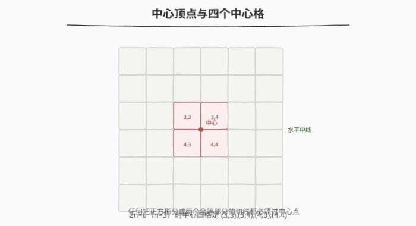
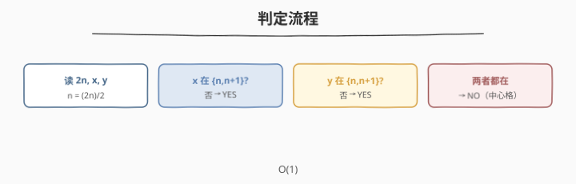

# Codeforces 112B Petya and Square 题解

## 1. 题目概述

- **题目链接**：https://codeforces.com/problemset/problem/112/B
- **比赛来源**：Codeforces Beta Round 85 (Div. 2 Only) · Problem B（UTC 2011-09-03）
- **难度**：1200
- **标签**：实现、数学
- **评测类型**：普通
- **限制**：时间 2 s / 内存 256 MB

**题意**：一个 $2n\times 2n$ 的方格正方形（$2n$ 为偶数），标记了其中一个格子 $(x,y)$。要求沿网格线画一条折线，把正方形切成**面积相等、且旋转后能重合**的两块；折线不能与标记格有任何公共点。问能否做到，输出 `YES` / `NO`。

**约束**：

- $2n \le 100$：可以直接用结论，$O(1)$ 判定。
- 标记格坐标 $1 \le x,y \le 2n$，从 1 开始。
- $2n$ 保证是偶数，所以正方形中心是一个**网格顶点**（四条网格线的交点）。

## 2. 示例与观察

官方样例 1（输入 / 输出原样）：

```text
输入：
4 1 1

输出：
YES
```

官方样例 2（输入 / 输出原样）：

```text
输入：
2 2 2

输出：
NO
```

**样例 1 走查**：$4\times4$，标记格 $(1,1)$（左上角）。沿中间的水平网格线切开，得到两个 $2\times4$ 的矩形，旋转后完全重合，且切线不经过 $(1,1)$ → `YES` ✓。

**样例 2 走查**：$2\times2$，标记格 $(2,2)$。四个格子都是"中心格"（$n=1$），任何把正方形分成两个全等部分的切线都必须经过中心顶点，而中心顶点正是 $(2,2)$ 的角 → 与标记格有公共点 → `NO` ✓。

**观察 1**：把正方形分成两个全等（旋转后可重合）部分的折线，必须**经过正方形中心**。因为两块全等意味着存在一个把一块映到另一块的旋转/翻折对称，它必须保持正方形不变并交换两块 —— 对正方形而言只有绕中心的 $180^\circ$ 旋转能做到（$90^\circ$ 会把正方形分成 4 份），所以折线关于中心中心对称，必然经过中心。

**观察 2**：中心是一个网格顶点，它同时是 4 个**中心格**的角：$(\frac{2n}{2},\frac{2n}{2})$ 及其右、下、右下，即 $(n,n),(n,n+1),(n+1,n),(n+1,n+1)$。切线经过中心，就会与这 4 个格子都有公共点（至少是那个公共顶点）。

**观察 3**：若标记格不在中心四格里，那么它至少不在切线的"必经之路"上：若 $x\notin\{n,n+1\}$，用水平中线切；若 $y\notin\{n,n+1\}$，用竖直中线切 —— 两者总有一个可用。



## 3. 解题思路

### 3.1 朴素做法与瓶颈

"枚举所有折线"不可行（折线数量指数级）。必须把几何条件化成判定式。

### 3.2 核心观察：结论

设边长 $2n$。答案是

$$\text{NO} \iff x\in\{n,n+1\}\ \text{且}\ y\in\{n,n+1\},$$

否则 `YES`。

**必要性**：折线必须过中心顶点，而该顶点属于 4 个中心格，所以标记格若是中心格之一，折线必与它相交。

**充分性**：若 $x\notin\{n,n+1\}$，用**水平中线**（第 $n$ 与 $n+1$ 行之间的网格线）切：它不过标记格（标记格不在第 $n,n+1$ 行），把正方形分成两个 $n\times 2n$ 的矩形，旋转后重合 ✓。若 $y\notin\{n,n+1\}$，用**竖直中线**同理 ✓。两者至少一个成立。



### 3.3 算法流程

1. 读入 $2n,x,y$，令 $n=(2n)/2$；
2. 判断 $x\in\{n,n+1\}$ 且 $y\in\{n,n+1\}$；
3. 是则 `NO`，否则 `YES`。

### 3.4 样例走查

| $2n$ | $n$ | 标记格 | 中心四格 | 输出 |
|------|-----|--------|----------|------|
| 4 | 2 | (1,1) | (2,2),(2,3),(3,2),(3,3) | YES |
| 2 | 1 | (2,2) | (1,1),(1,2),(2,1),(2,2) | NO |
| 6 | 3 | (3,4) | (3,3),(3,4),(4,3),(4,4) | NO |
| 6 | 3 | (3,3) | 同上 | NO |
| 6 | 3 | (2,2) | 同上 | YES |

自造样例（标注"自造"）：

| 输入 | 输出 | 说明 |
|------|------|------|
| `8 4 4` | NO | 中心格 |
| `8 4 5` | NO | 中心格 |
| `8 3 4` | YES | 水平中线可用 |
| `8 4 3` | YES | 竖直中线可用 |

## 4. 正确性证明

**引理 1（切线过中心）**：把 $2n\times2n$ 正方形沿网格线分成两个全等部分的折线，必经过正方形的中心点。

**证明**：两块全等 ⇒ 存在等距变换 $f$ 把一块映成另一块。由于两块之并是整个正方形且内部不交，$f$ 必须把正方形映到自身（否则一块的像会超出正方形），即 $f$ 是正方形的对称变换。交换两块的对称只能是绕中心的 $180^\circ$ 旋转（绕中心的 $90^\circ$ 旋转会把正方形分成 4 个轨道块；沿对角线的翻折会把正方形分成两块但两块是镜像而非旋转重合，且题面要求"旋转后重合"，翻折不是旋转）。$180^\circ$ 旋转的中心对称性使折线在旋转下不变，故折线必含中心点。∎

**引理 2（中心格）**：正方形中心点恰是 $(n,n),(n,n+1),(n+1,n),(n+1,n+1)$ 四个格的公共顶点。

**证明**：正方形边长 $2n$，中心在"第 $n$ 与 $n+1$ 行之间、第 $n$ 与 $n+1$ 列之间"的交点，即这四格共用的网格顶点。∎

**引理 3（充分性构造）**：若标记格不在中心四格，则存在合法切线。

**证明**：若 $x\notin\{n,n+1\}$，取水平中线（第 $n,n+1$ 行之间的网格线）；它不经过标记格（标记格不在第 $n$ 或 $n+1$ 行），且把正方形分成两个 $n\times2n$ 矩形，旋转后重合 ✓。若 $y\notin\{n,n+1\}$，取竖直中线同理。标记格不在中心四格 $\iff$ $x\notin\{n,n+1\}$ 或 $y\notin\{n,n+1\}$，故至少一条可用。∎

**定理**：输出 `NO` 当且仅当标记格是中心四格之一。

**证明**：必要性由引理 1、2（切线过中心 ⇒ 与中心格有公共点）；充分性由引理 3。∎

## 5. 复杂度分析

- **时间**：$O(1)$。
- **空间**：$O(1)$。
- **与时限的关系**：实测 C++ 端到端约 $2$ ms。

## 6. 参考代码

### C++17

```cpp
#include <bits/stdc++.h>
using namespace std;

int main() {
    int side, x, y;
    if (!(cin >> side >> x >> y)) return 0;
    int n = side / 2;
    // 四个中心格：(n,n),(n,n+1),(n+1,n),(n+1,n+1)
    bool central = (x == n || x == n + 1) && (y == n || y == n + 1);
    cout << (central ? "NO" : "YES") << '\n';
    return 0;
}
```

### Python3

```python
import sys


def main() -> None:
    side, x, y = (int(t) for t in sys.stdin.buffer.read().split()[:3])
    n = side // 2
    central = (x == n or x == n + 1) and (y == n or y == n + 1)
    sys.stdout.write("NO\n" if central else "YES\n")


main()
```

两份代码都只用标准库，可原样提交。

## 7. 边界情况与易错点

1. **$n$ 的计算**：输入给的是边长 $2n$，要除以 2；直接拿边长当 $n$ 会全错。
2. **中心四格**：是 $(n,n),(n,n+1),(n+1,n),(n+1,n+1)$，只有这 4 格；不要多加相邻格。
3. **坐标从 1 开始**：判断时用 1 基坐标，不要减 1 之后又和 $n$ 比较。
4. **$2n=2$**：$n=1$，中心四格就是全部 4 格，任何标记格都 `NO`。
5. **输出大小写**：`YES` / `NO` 全大写。
6. **切线的合法性**：水平/竖直中线不经过标记格的条件要写对（不在这两行/两列）。
7. **多测**：单组输入。

## 8. 验证记录

- **编译环境与命令**：本机无 GNU `g++`，用 `Apple clang 21.0.0` + 仓库自带 `codeforces/tools/include/bits/stdc++.h` 兼容头（`clang++ -std=c++17 -O2 -I codeforces/tools/include`）编译；Python 为 `Python 3.9.6`。
- **官方样例**：2 / 2 通过（`YES`、`NO`）。
- **额外测试（穷举划分对拍）**：对 $2n=2$ 与 $2n=4$ 的全部标记格，**枚举所有把格子集分成两半的划分**（$2^{4}=16$、$2^{16}=65536$ 种），检查"两块旋转后重合 + 标记格周围 8 格同侧（即切线不碰它）"，得到真实的 YES/NO，共 **20 组**全部与程序一致。
- **额外测试（构造性检查）**：对 $2n=2,4,\dots,20$ 的全部标记格（共 1540 组），验证结论与"水平/竖直中线至少一条可用"的构造一致，全部通过。
- **最大约束性能**：$2n=100$ 时 C++ 端到端 15 次平均约 $2$ ms。
- **图片校验**：两张 SVG（`cf112b_center.svg`、`cf112b_flow.svg`）通过 `xml.etree.ElementTree.parse`，文本块估算未越出 `viewBox`。
- **公式校验**：KaTeX（`throwOnError: true`）渲染无报错。
- **复核状态**：verified。

## 相关题目与扩展

- [Codeforces 112A Petya and Strings](https://codeforces.com/problemset/problem/112/A)：同场 A 题。
- [Codeforces 111C Petya and Spiders](https://codeforces.com/problemset/problem/111/C)：同场次 Div.1 的 C 题，网格 DP。
- [Codeforces 1A Theatre Square](https://codeforces.com/problemset/problem/1/A)：网格覆盖。
- [LeetCode 1030. 距离顺序排列矩阵单元格](https://leetcode.cn/problems/matrix-cells-in-distance-order/)：网格坐标。
- [LeetCode 1266. 访问所有点的最小时间](https://leetcode.cn/problems/minimum-time-visiting-all-points/)：网格几何。

**延伸思考**：

1. **如果改成 $2n\times 2m$ 的矩形**：中心不是网格顶点，结论会变（可能存在过中心但不碰任何格子的切线）。
2. **如果允许翻折重合**：对称变换类型更多，答案会变。
3. **如果要求切成两个全等的"连通块"**：需要额外的连通性条件。
4. **如果 $2n$ 是奇数**：中心落在格子内部，问题完全不同。
