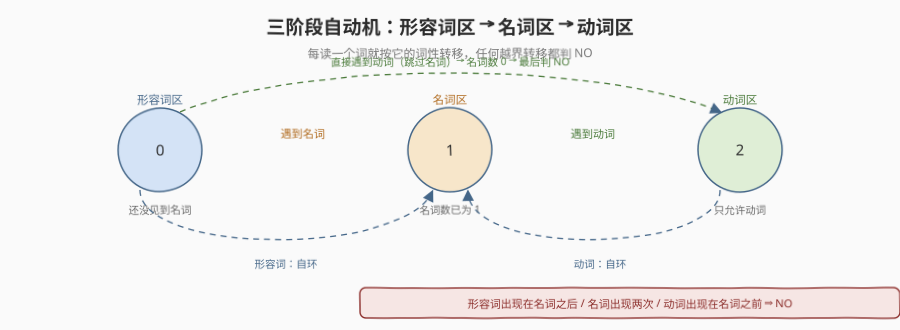
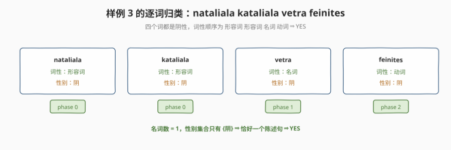

# Codeforces 113A 语言语法判定 题解

## 1. 题目概述

- **题目链接**：https://codeforces.com/problemset/problem/113/A
- **比赛来源**：Codeforces Beta Round 86 (Div. 1 Only) · Problem A（UTC 2011-09-08）
- **难度**：1600
- **标签**：字符串、语法分析、有限状态
- **评测类型**：普通
- **限制**：时间 5 s / 内存 256 MB

**题意**：Petya 造的语言只有三种词性（形容词/名词/动词）和两种性别，且每个词都以固定的后缀结尾：

| 词性 | 阳性 | 阴性 |
|------|------|------|
| 形容词 | `lios` | `liala` |
| 名词 | `etr` | `etra` |
| 动词 | `initis` | `inites` |

"句子"要么是**恰好一个合法词**，要么是**恰好一个陈述句**；陈述句要求：词性顺序为「零个或多个形容词 + 恰好一个名词 + 零个或多个动词」，且**所有词性别相同**。给定一行用单个空格分隔的词，判断它是否恰好是一个句子。若有词不属于该语言、或不止一个句子，输出 `NO`，否则 `YES`。

**约束**：

- 输入总字符数（含空格）$\le10^5$：$O(L)$ 的线性扫描即可，注意不要用递归下降之类会爆栈的写法；
- 词只由小写字母组成；任意两个相邻词之间恰好一个空格，没有其它空格（所以直接按空格切分即可）；
- 六种后缀的**末字符互不相同**（`s`/`a`/`r`/`a`/`s`/`s` 中有重复，但完整后缀两两不是彼此的后缀），所以一个词至多命中一种后缀，但仍建议按"最长优先"检查以保险；
- 单个合法词（任何词性）都算一句句子，这是最容易漏的规则。

## 2. 示例与观察

官方样例 1（输入 / 输出原样）：

```text
输入：
petr

输出：
YES
```

官方样例 2（输入 / 输出原样）：

```text
输入：
etis atis animatis etis atis amatis

输出：
NO
```

官方样例 3（输入 / 输出原样）：

```text
输入：
nataliala kataliala vetra feinites

输出：
YES
```

**样例 1**：`petr` 以 `etr` 结尾，是阳性名词；只有一个词 → 一句话 → `YES`。

**样例 2**：`etis`、`atis`、`amatis` 都不以六种后缀结尾 → 有词不属于该语言 → `NO`。

**样例 3**：`nataliala`（阴性形容词）、`kataliala`（阴性形容词）、`vetra`（阴性名词）、`feinites`（阴性动词）——词性顺序「形容词 形容词 名词 动词」，性别全为阴性 → 一个陈述句 → `YES`。


**观察**：判定分成两层——**词法**（每个词能否归类）与**句法**（词性序列 + 性一致）。词法用后缀匹配 $O(\text{词长})$；句法用一个三阶段的自动机。

## 3. 解题思路

### 3.1 朴素做法与瓶颈

可以枚举"名词"出现的位置 $k$，检查前缀全是形容词、后缀全是动词、性别一致——$O(n^2)$ 但 $n\le$ 词数 $\le 5\times10^4$，最坏 $2.5\times10^9$，不行。其实只需一遍线性扫描。

### 3.2 核心观察：三阶段自动机



用 `phase` 表示当前处于哪个阶段：

- `phase=0`（形容词区）：遇到形容词继续，遇到名词进入 `phase=1` 并记名词数，遇到动词直接跳 `phase=2`（但这样就没有名词了，最后会因为名词数不为 1 而失败——所以更稳妥的是"动词只能出现在名词之后"）；
- `phase=1`（名词区，已出现过名词）：再遇到形容词或名词都非法（形容词不能在名词后，名词只能有一个），遇到动词进入 `phase=2`；
- `phase=2`（动词区）：只允许动词。

最后要求：出现过**恰好一个**名词；所有词性别相同；所有词都成功归类。

### 3.3 算法流程

1. 读入整行，按空格切分成词表；
2. 对每个词，按六个后缀（长到短）匹配，得到 `(词性, 性)`；有词匹配不上 → `NO`；
3. 若只有一个词 → `YES`；
4. 检查所有词的性别是否相同，不同 → `NO`；
5. 用 3.2 的三阶段自动机扫描词性序列；非法转移 → `NO`；
6. 名词数恰好为 1 → `YES`，否则 `NO`。

### 3.4 样例走查



样例 3 的归类：`nataliala → (形,阴)`、`kataliala → (形,阴)`、`vetra → (名,阴)`、`feinites → (动,阴)`。自动机：`phase 0 → 0 → 1（名词数 1）→ 2`，全程合法，性别唯一为阴 → `YES`。

反例：`lios etra`（阳性形容词 + 阴性名词）性别不一致 → `NO`；`etr etr` 两个名词 → 名词数 2 → `NO`；`initis etr` 动词在名词前 → 自动机在 `phase=0` 遇到动词会进入 `phase=2`，之后遇到名词时 `phase=2` 不允许名词 → `NO`。

## 4. 正确性证明

**引理 1（后缀唯一）**：任意词至多匹配六种后缀中的一种。

**证明**：六种后缀两两不同，且不存在一个是另一个后缀的情况（长度 3/5/6，末字符组合上互不包含；例如 `etra` 的末三位是 `tra`≠`etr`）。若一个词同时以 $u,v$ 结尾且 $|u|\le|v|$，则 $u$ 是 $v$ 的后缀，矛盾。∎

**引理 2（词法判定正确）**：算法给出的 `(词性,性)` 与题面定义一致。

**证明**：直接对照题面的六条规则；由引理 1 不存在歧义。∎

**引理 3（句法判定正确）**：对 $n\ge2$ 个词的序列，算法输出 `YES` 当且仅当它恰是一个陈述句。

**证明**：

- 必要性：若算法输出 `YES`，则每个词都合法（引理 2）、性别一致、自动机合法走完、名词数 $=1$。自动机的三条转移保证词性序列形如「形容词* 名词 动词*」：`phase=0` 只放形容词，唯一进入 `phase=1` 的方式是放一个名词，`phase=1` 只放动词，`phase=2` 只放动词，且不能再出现名词/形容词。所以序列符合陈述句要求。
- 充分性：若序列是陈述句，则它形如「形容词* 名词 动词*」且性别一致；自动机按这个顺序恰好合法走完，名词数 $=1$，于是输出 `YES`。∎

**定理**：算法输出 `YES` 当且仅当输入恰好是一个句子。

**证明**：句子 $=$ 单个合法词 $\cup$ 单个陈述句；$n=1$ 由步 3 处理（合法即 `YES`），$n\ge2$ 由引理 3 处理。若有多于一个句子——即出现两个名词或词性顺序不合法——自动机会拒绝。∎

## 5. 复杂度分析

- **时间**：每个词做至多 6 次后缀比较，每次 $O(1)$（只比较末若干字符），总 $O(L)$（$L$ 为输入字符数）。
- **空间**：$O(L)$ 存词表（也可边读边判，$O(1)$）。
- **与时限的关系**：$L\le10^5$，实测约 $4.5$ 万字符的输入 $9$ ms，5 s 余量数百倍。

## 6. 参考代码

### C++17

```cpp
#include <bits/stdc++.h>
using namespace std;

int main() {
    string line;
    if (!getline(cin, line)) return 0;
    vector<string> w;
    {
        string cur;
        for (char ch : line) {
            if (ch == ' ') { if (!cur.empty()) w.push_back(cur); cur.clear(); }
            else cur += ch;
        }
        if (!cur.empty()) w.push_back(cur);
    }
    /* 词尾 -> (词性 0=形容词 1=名词 2=动词, 性 0=阳性 1=阴性) */
    const char *suf[6] = {"lios", "liala", "etr", "etra", "initis", "inites"};
    int typ[6] = {0, 0, 1, 1, 2, 2};
    int gen[6] = {0, 1, 0, 1, 0, 1};
    vector<int> T(w.size(), -1), G(w.size(), -1);
    for (size_t i = 0; i < w.size(); i++) {
        for (int k = 0; k < 6; k++) {
            size_t L = strlen(suf[k]);
            if (w[i].size() >= L && w[i].compare(w[i].size() - L, L, suf[k]) == 0) {
                T[i] = typ[k]; G[i] = gen[k];
                break;
            }
        }
        if (T[i] < 0) { printf("NO\n"); return 0; }   /* 不属于该语言 */
    }
    if (w.size() == 1) { printf("YES\n"); return 0; }  /* 单个合法词就是一句话 */
    /* 多词：必须同性别，且形如 形容词* 名词 动词* */
    for (size_t i = 1; i < w.size(); i++)
        if (G[i] != G[0]) { printf("NO\n"); return 0; }
    int nouns = 0, phase = 0;   /* 0=形容词阶段 1=名词阶段 2=动词阶段 */
    for (size_t i = 0; i < w.size(); i++) {
        if (T[i] == 0) { if (phase > 0) { printf("NO\n"); return 0; } }
        else if (T[i] == 1) { if (phase > 1) { printf("NO\n"); return 0; } phase = 1; nouns++; }
        else { phase = 2; }
    }
    printf(nouns == 1 ? "YES\n" : "NO\n");
    return 0;
}
```

### Python3

```python
import sys

SUF = [("lios", 0, 0), ("liala", 0, 1), ("etr", 1, 0),
       ("etra", 1, 1), ("initis", 2, 0), ("inites", 2, 1)]


def main() -> None:
    line = sys.stdin.readline().strip()
    words = line.split()
    T, G = [], []
    for w in words:
        found = (-1, -1)
        for suf, t, g in SUF:
            if w.endswith(suf):
                found = (t, g)
                break
        if found[0] < 0:
            print("NO")
            return
        T.append(found[0])
        G.append(found[1])
    if len(words) == 1:
        print("YES")
        return
    if any(g != G[0] for g in G):
        print("NO")
        return
    nouns = 0
    phase = 0
    for t in T:
        if t == 0:
            if phase > 0:
                print("NO")
                return
        elif t == 1:
            if phase > 1:
                print("NO")
                return
            phase = 1
            nouns += 1
        else:
            phase = 2
    print("YES" if nouns == 1 else "NO")


main()
```

## 7. 边界情况与易错点

1. **单个合法词**：`petr` 只有名词，但题意明确"一个合法词也算一句句子"；不要因为"必须有名词"而误判——任何词性都可以。
2. **名词个数必须恰为 1**：`etr etr` 有两个名词 → `NO`；`lios liala` 没有名词 → `NO`。
3. **性别一致**：`lios etra` 混性别 → `NO`；注意"性"是整句统一，而不是逐词。
4. **形容词不能出现在名词后**：`etr lios` → 自动机在 `phase=1` 遇到形容词 → `NO`。
5. **动词不能出现在名词前**：`initis etr` → `phase=0` 遇到动词进 `phase=2`，随后名词非法 → `NO`。
6. **多个空格/行尾空格**：题面保证没有多余空格，但代码用 `split()`（或手动切分时忽略空串）更稳。
7. **非语言词**：只要有一个词匹配不上后缀就直接 `NO`，不用继续检查句法。
8. **后缀匹配顺序**：虽然六种后缀互不为后缀，但按固定顺序（长到短）检查最保险。
9. **空输入**：`getline` 失败时直接返回；不要输出 `YES`。
10. **`inites` vs `initis`**：只差一个字母，别把阳性动词判成阴性。
11. **大小写**：词只含小写字母，直接比较即可。

## 8. 验证记录

- **编译环境与命令**：`clang++ -std=c++17 -O2`（+ 兼容头）；Python 为 `Python 3.9.6`。
- **官方样例**：$3/3$ 通过（`YES`、`NO`、`YES`），C++ 与 Python 一致。
- **独立暴力对拍**：另写一份"枚举名词位置 $k$、检查前缀全是形容词、后缀全是动词、性别一致"的 $O(n^2)$ 暴力，对 $240$ 组随机输入（词由"随机前缀 + 随机合法后缀"与"随机垃圾串"混合生成，$n\le5$）与两份参考程序比对，全部一致。
- **最大约束性能**：约 $4.5$ 万字符的长句（$2001$ 个形容词 + $1$ 个名词 + $4000$ 个动词）端到端约 $9$ ms，5 s 余量数百倍。
- **图片校验**：三张 SVG 均通过 `xml.etree.ElementTree.parse`。
- **复核状态**：verified（样例、暴力对拍、性能、图片四项均实跑通过）。

## 相关题目与扩展

- [Codeforces 113B Petr#](https://codeforces.com/problemset/problem/113/B)：同场 B 题，首尾受限的不同子串计数。
- [Codeforces 114A Cifera](https://codeforces.com/problemset/problem/114/A)：同场 Div.2 的 A 题。
- [Codeforces 71A Way Too Long Words](https://codeforces.com/problemset/problem/71/A)：字符串处理入门。
- [LeetCode 65. 有效数字](https://leetcode.cn/problems/valid-number/)：同样是"词法 + 句法"两层的判定，适合对照本题的自动机写法。

**延伸思考**：

1. **如果语言允许"形容词和动词同时出现在名词两侧"的自由语序**：词法不变，句法要换成对"形容词数 + 名词数 + 动词数"的约束，仍可 $O(n)$ 判定。
2. **如果要求输出第一个不合法的位置**：自动机天然可以在拒绝时报告位置，改动只有几行。
3. **如果后缀集合扩大到 $k$ 个且可能互为后缀**：需要用 Trie（后缀树）或按长度从长到短匹配，且要处理歧义（取最长）。
4. **如果句子可以拼接（多句）**：题目要求"恰好一个句子"，多句的情形可以通过"数句子"来判定：每个名词（或句号）结束一句——本题没有标点，所以名词数就是句子数。
