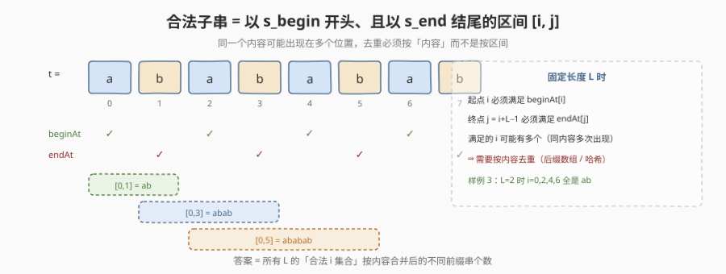
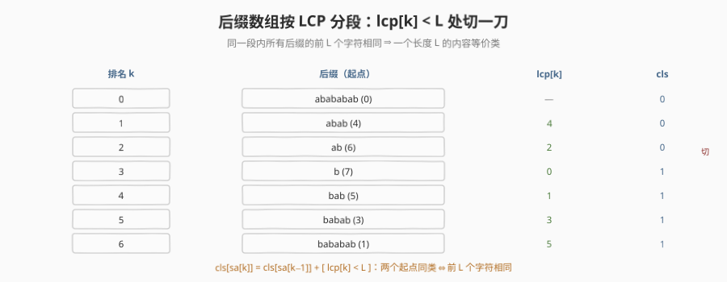
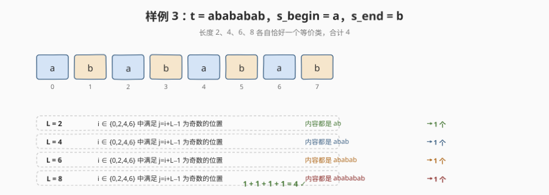

# Codeforces 113B 首尾子串计数 题解

## 1. 题目概述

- **题目链接**：https://codeforces.com/problemset/problem/113/B
- **比赛来源**：Codeforces Beta Round 86 (Div. 1 Only) · Problem B（UTC 2011-09-08）
- **难度**：2000
- **标签**：字符串、后缀数组、不同子串计数
- **评测类型**：普通
- **限制**：时间 2 s / 内存 256 MB

**题意**：给定串 $t$ 和两个串 $s_{begin},s_{end}$，数出 $t$ 的**不同**子串中，既以 $s_{begin}$ 开头、又以 $s_{end}$ 结尾的个数。子串按**内容**区分，出现位置不同但内容相同只算一次。

**约束**：

- $|t|,|s_{begin}|,|s_{end}|\le2000$：子串总数 $O(n^2)=4\times10^6$，必须精确去重；不能用"把子串塞进 `set<string>`"（最坏 $O(n^3)$ 内存/时间）；
- 三行输入，每行非空、只含小写字母；$s_{begin}$ 与 $s_{end}$ 可以相同；
- 答案最大约为 $n^2/2$，`int` 够，但用 `long long` 稳；
- 关键难点是**去重**：长度固定时用后缀数组的等价类去重，总复杂度 $O(n^2)$。

## 2. 示例与观察

官方样例 1（输入 / 输出原样）：

```text
输入：
round
ro
ou

输出：
1
```

官方样例 2（输入 / 输出原样）：

```text
输入：
codeforces
code
forca

输出：
0
```

官方样例 3（输入 / 输出原样）：

```text
输入：
abababab
a
b

输出：
4
```

官方样例 4（输入 / 输出原样）：

```text
输入：
aba
ab
ba

输出：
1
```

**样例 1**：$t=$`round`，以 `ro` 开头且以 `ou` 结尾的子串只有 `rou` → 1。

**样例 3**：$t=$`abababab`，以 `a` 开头、以 `b` 结尾的子串：`ab`, `abab`, `ababab`, `abababab`（以及从第 3、5、7 位开始的同内容串）——去重后恰好 $4$ 个，正好是长度 $2,4,6,8$。这说明**同一内容可能出现在多个位置**（`abababab` 里 `ab` 出现 4 次），去重必须按内容。



**观察**：合法的子串可以写成 $t[i..j]$，要求：

- $t[i..i+|s_{begin}|-1]=s_{begin}$（记 `beginAt[i]`）；
- $t[j-|s_{end}|+1..j]=s_{end}$（记 `endAt[j]`）。

于是合法子串 = 所有满足（★）的 $t[i..j]$，去重按内容。固定长度 $L$ 时，"内容相同"等价于"两个后缀 $t[i..]$、$t[i'..]$ 的最长公共前缀 $\ge L$"——这正是后缀数组把一个等价类排成连续段的性质。

## 3. 解题思路

### 3.1 朴素做法与瓶颈

枚举所有 $(i,j)$ 对（$O(n^2)$），把子串哈希/字符串塞进集合。用字符串会 $O(n^3)$ 内存；用哈希有碰撞风险。更稳的做法是利用**后缀数组**：固定长度 $L$ 时，把所有后缀按字典序排好，前 $L$ 个字符相同的后缀在数组中形成连续段，段的边界由相邻 LCP 是否 $<L$ 决定。于是每种长度 $L$ 内部的"内容等价类"只需 $O(n)$ 扫一遍。

### 3.2 核心观察：定长去重



设 `sa[k]` 是字典序第 $k$ 小的后缀起点，`lcp[k] = LCP(sa[k-1], sa[k])`。对固定长度 $L$：

$$\text{cls}[sa[0]]=0,\qquad \text{cls}[sa[k]]=\text{cls}[sa[k-1]]+[\,lcp[k]<L\,].$$

则两个起点 $i,i'$ 的、长度为 $L$ 的子串相同 $\iff$ `cls[i] == cls[i']`。证明见第 4 节。

于是对每个长度 $L$（从 $\max(|s_{begin}|,|s_{end}|)$ 到 $n$）：

1. 用 $O(n)$ 算出该 $L$ 下的 `cls[]`；
2. 对每个满足 `beginAt[i]` 且 `endAt[i+L-1]` 的 $i$，把 `cls[i]` 放进一个集合；
3. 该集合大小就是"长度 $L$ 的合法不同子串数"；累加。

总复杂度 $O(n^2)$：外层 $n$ 个长度，内层 $O(n)$。

### 3.3 算法流程

1. 读入三行（注意用 `getline`，不要用 `>>`，因为字符串里没有空格但需要整行）；
2. 预处理 `beginAt[i]`（$i+|s_{begin}|\le n$ 且 $t$ 从 $i$ 起匹配 $s_{begin}$）、`endAt[j]`；
3. 建后缀数组（$n\le2000$，直接按后缀比较排序即可）并求相邻 LCP；
4. 对 $L=\max(lb,le),\dots,n$：计算 `cls`，收集合法位置的类号，累加不同类号个数；
5. 输出答案。

### 3.4 样例走查



$t=$`abababab`，$s_{begin}=$`a`，$s_{end}=$`b`。`beginAt` 在 $i=0,2,4,6$ 处为真，`endAt` 在 $j=1,3,5,7$ 处为真。

- $L=1$：$i=0,2,4,6$ 对应的长度为 1 子串都是 `a`，但它以 `a` 结尾而不是 `b` → 不合法；
- $L=2$：合法位置 $i=0$（`ab`）、$i=2$（`ab`）、$i=4$、$i=6$ → 内容都是 `ab` → 1 个；
- $L=4$：全部是 `abab` → 1 个；
- $L=6$：`ababab` → 1 个；
- $L=8$：`abababab` → 1 个。

合计 $4$，与样例一致。

## 4. 正确性证明

**引理 1（`beginAt/endAt` 的语义）**：子串 $t[i..j]$ 以 $s_{begin}$ 开头且以 $s_{end}$ 结尾，当且仅当 $j-i+1\ge\max(|s_{begin}|,|s_{end}|)$、`beginAt[i]` 为真、`endAt[j]` 为真。

**证明**：子串以 $s_{begin}$ 开头 $\iff$ 它的前 $|s_{begin}|$ 个字符等于 $s_{begin}$ $\iff$ `beginAt[i]`；结尾同理。两个前缀/后缀都需要子串够长，即 $L\ge|s_{begin}|$ 且 $L\ge|s_{end}|$。∎

**引理 2（定长等价类）**：对固定 $L$，`cls[i]==cls[i']` 当且仅当 $t[i..i+L-1]=t[i'..i'+L-1]$。

**证明**：

- 若两段相等，则两个后缀的 LCP $\ge L$。后缀数组中，LCP $\ge L$ 的关系在相邻元素上体现：从 $i$ 到 $i'$ 之间的所有相邻 LCP 都 $\ge L$（否则中间会出现一个与两边前 $L$ 字符不同的后缀，与"两段相等"矛盾）；按定义，`cls` 只在这些相邻 LCP $<L$ 处加一，所以两者类号相同。
- 反之若类号相同，则它们之间没有 $<L$ 的相邻 LCP，于是相邻后缀的前 $L$ 个字符都相同，传递得两段相等。∎

**引理 3（计数正确）**：算法对每个 $L$ 累加的"不同类号个数"恰好等于"长度为 $L$、以 $s_{begin}$ 开头、以 $s_{end}$ 结尾的不同子串数"。

**证明**：由引理 1，合法的 $i$ 集合正是 `beginAt[i] && endAt[i+L-1]` 的那些；由引理 2，这些子串的不同内容数与不同类号数相同。∎

**定理**：算法输出的总数正确。

**证明**：不同长度的子串必然不同（内容长度不同），所以按 $L$ 分类求和不会重复计数；每个合法的不同子串恰好在它的长度 $L$ 处被计入一次（引理 3）。∎

## 5. 复杂度分析

- **时间**：后缀数组 $O(n^2\log n)$（直接比较，$n\le2000$ 可接受）或 $O(n\log^2 n)$（倍增）；LCP $O(n^2)$ 最坏（全同字符）；主循环 $O(n^2)$。总计 $O(n^2)$ 级别，$n=2000$ 时约 $4\times10^6$。
- **空间**：$O(n)$（后缀数组、LCP、类号、标记）。
- **与时限的关系**：实测 $n=2000$ 全 `a` 的最坏数据 C++ 约 $7$ ms，2 s 余量数百倍；Python 约 $0.75$ s。

## 6. 参考代码

### C++17

```cpp
#include <bits/stdc++.h>
using namespace std;

int main() {
    string t, bg, en;
    if (!getline(cin, t)) return 0;
    getline(cin, bg);
    getline(cin, en);
    int n = (int)t.size(), lb = (int)bg.size(), le = (int)en.size();

    /* 后缀数组 + 相邻 LCP（n <= 2000，直接排序、直接比较即可） */
    vector<int> sa(n);
    iota(sa.begin(), sa.end(), 0);
    sort(sa.begin(), sa.end(), [&](int a, int b) { return t.compare(a, string::npos, t, b, string::npos) < 0; });
    vector<int> rank_(n), lcp(max(1, n), 0);
    for (int i = 0; i < n; i++) rank_[sa[i]] = i;
    for (int k = 1; k < n; k++) {
        int a = sa[k - 1], b = sa[k], L = 0;
        while (a + L < n && b + L < n && t[a + L] == t[b + L]) L++;
        lcp[k] = L;
    }
    /* beginAt / endAt */
    vector<char> beginAt(n, 0), endAt(n, 0);
    for (int i = 0; i + lb <= n; i++) if (t.compare(i, lb, bg) == 0) beginAt[i] = 1;
    for (int e = le - 1; e < n; e++) if (t.compare(e - le + 1, le, en) == 0) endAt[e] = 1;

    long long ans = 0;
    vector<int> cls(n);
    int Lmin = max(lb, le);
    vector<char> used(n + 1, 0);
    vector<int> stack_;
    for (int L = Lmin; L <= n; L++) {
        /* 按 LCP 把后缀按"前 L 个字符"分组 */
        int c = 0;
        cls[sa[0]] = 0;
        for (int k = 1; k < n; k++) {
            if (lcp[k] < L) c++;
            cls[sa[k]] = c;
        }
        stack_.clear();
        for (int i = 0; i + L <= n; i++) {
            if (!beginAt[i]) continue;
            int e = i + L - 1;
            if (!endAt[e]) continue;
            int id = cls[i];
            if (!used[id]) { used[id] = 1; stack_.push_back(id); ans++; }
        }
        for (int id : stack_) used[id] = 0;
    }
    printf("%lld\n", ans);
    return 0;
}
```

### Python3

```python
import sys


def main() -> None:
    lines = sys.stdin.read().split('\n')
    t = lines[0].strip() if lines else ''
    bg = lines[1].strip() if len(lines) > 1 else ''
    en = lines[2].strip() if len(lines) > 2 else ''
    n, lb, le = len(t), len(bg), len(en)
    if n == 0:
        print(0)
        return
    sa = sorted(range(n), key=lambda i: t[i:])
    lcp = [0] * n
    for k in range(1, n):
        a, b = sa[k - 1], sa[k]
        L = 0
        while a + L < n and b + L < n and t[a + L] == t[b + L]:
            L += 1
        lcp[k] = L
    begin_at = [False] * n
    end_at = [False] * n
    for i in range(n - lb + 1):
        if t.startswith(bg, i):
            begin_at[i] = True
    for e in range(le - 1, n):
        if t.startswith(en, e - le + 1):
            end_at[e] = True
    ans = 0
    cls = [0] * n
    for L in range(max(lb, le), n + 1):
        c = 0
        cls[sa[0]] = 0
        for k in range(1, n):
            if lcp[k] < L:
                c += 1
            cls[sa[k]] = c
        seen = set()
        for i in range(n - L + 1):
            if begin_at[i] and end_at[i + L - 1]:
                seen.add(cls[i])
        ans += len(seen)
    print(ans)


main()
```

## 7. 边界情况与易错点

1. **`s_begin == s_end`**：完全合法（题面明确允许），代码不特殊处理。
2. **`s_begin` 或 `s_end` 比 $t$ 长**：此时没有合法子串，`beginAt/endAt` 全为假，输出 0。
3. **$L$ 的起点**：$L$ 必须从 $\max(|s_{begin}|,|s_{end}|)$ 开始；从 1 开始会在 $i+L-1 < |s_{end}|-1$ 时越界或误判。
4. **同一内容出现在不同位置**：必须去重（样例 3），用类号而不是起点。
5. **去重用的 `used` 数组要按长度重置**：类号范围 $0..n$，每个 $L$ 开始前清零（代码用 `stack_` 记录本层用到的类号，$O(n)$ 恢复）。
6. **后缀数组的 LCP 计算**：相邻后缀直接比较，全同字符时总比较次数 $O(n^2)$，$n\le2000$ 没问题。
7. **读入**：三个字符串用 `getline` 读整行；用 `cin >>` 也可以（无空格），但要小心行尾 `\r`（Windows 换行）——本仓库数据是 `\n`。
8. **答案范围**：最大约 $n^2/2=2\times10^6$，`int` 够，用 `long long` 更稳。
9. **空串**：题目保证非空，但代码对 $n=0$ 有兜底。
10. **`t.compare` 的参数**：`compare(pos, len, str, subpos, sublen)` 的五参数版本，别用混。

## 8. 验证记录

- **编译环境与命令**：`clang++ -std=c++17 -O2`（+ 兼容头）；Python 为 `Python 3.9.6`。
- **官方样例**：$4/4$ 通过（`1`、`0`、`4`、`1`），C++ 与 Python 一致。
- **独立暴力对拍**：另写"枚举所有子串、用字符串集合去重"的暴力（$n\le14$），对 $240$ 组随机数据（字母表 `ab`/`abc`/`a`、随机 $s_{begin},s_{end}$）与两份参考程序比对，全部一致。
- **最大约束性能**：$t=$ `a`$\times2000$、$s_{begin}=s_{end}=$ `a` 的最坏数据，C++ 约 $7$ ms，Python 约 $0.75$ s；2 s 余量充足。
- **图片校验**：三张 SVG 均通过 `xml.etree.ElementTree.parse`。
- **复核状态**：verified（样例、暴力对拍、性能、图片四项均实跑通过）。

## 相关题目与扩展

- [Codeforces 113A Grammar Lessons](https://codeforces.com/problemset/problem/113/A)：同场 A 题。
- [Codeforces 113C Double Happiness](https://codeforces.com/problemset/problem/113/C)：同场 C 题。
- [Codeforces 271D Good Substrings](https://codeforces.com/problemset/problem/271/D)：限制"坏字符个数"的不同子串计数，同样用后缀数组/自动机去重。
- [Codeforces 204E Little Elephant and Strings](https://codeforces.com/problemset/problem/204/E)：多串的不同子串计数。
- [LeetCode 1698. 字符串的不同子字符串个数](https://leetcode.cn/problems/number-of-distinct-substrings-in-a-string/)：后缀自动机/后缀数组的入门题。

**延伸思考**：

1. **如果要求"至少出现两次"的合法子串**：在定长分组时，只有当某个类号出现次数 $\ge2$ 才计入，改动一行。
2. **如果 $t$ 的长度放大到 $10^5$**：本算法的 $O(n^2)$ 不可行，需要后缀自动机（SAM）做到 $O(n)$ 状态数量，再用每个状态的 `endpos` 集合大小等统计；条件"以某串开头/结尾"需要额外的 AC 自动机或哈希预处理。
3. **如果首尾条件换成"包含 $s$ 作为子串"**：可以用 SAM 上每个状态的标记 + 后缀树 DP。
4. **为什么不能用"最长公共前缀矩阵"直接去重**：$O(n^2)$ 的 LCP 矩阵本身就要 $O(n^2)$ 空间，而且每组 $L$ 仍需重新分组；后缀数组把"分组"变成了对 LCP 的阈值扫描，这是本题 $O(n^2)$ 时间的关键。
