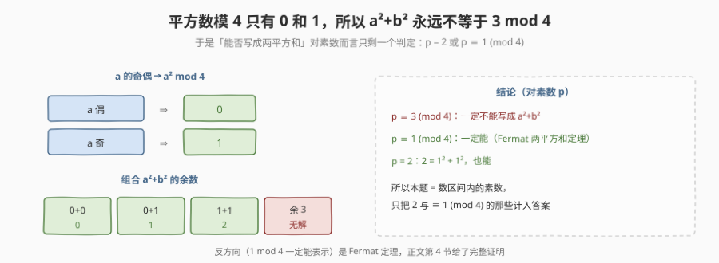
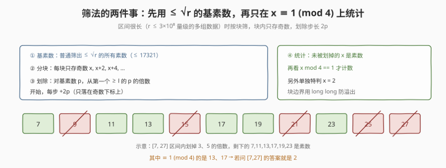
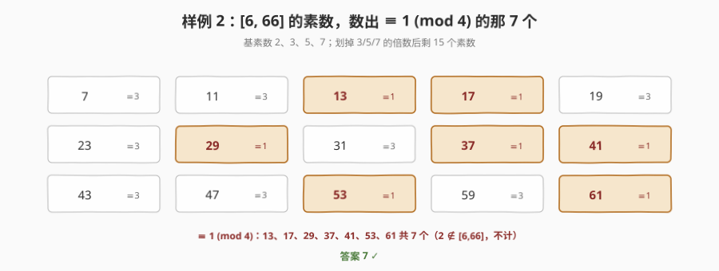

# Codeforces 113C 双喜幸运日 题解

## 1. 题目概述

- **题目链接**：https://codeforces.com/problemset/problem/113/C
- **比赛来源**：Codeforces Beta Round 86 (Div. 1 Only) · Problem C（UTC 2011-09-08）
- **难度**：2200
- **标签**：数论、素数、两平方和定理、分段筛
- **评测类型**：普通
- **限制**：时间 3 s / 内存 128 MB

**题意**：Peter 的幸运数是**素数**；Bob 的幸运数是能写成 $t=a^2+b^2$（$a,b$ 为**正整数**）的数。问区间 $[l,r]$ 中有多少个整数同时是两人的幸运数，即有多少个素数能表示成两个正整数平方和。

**约束**：

- $1\le l\le r\le3\times10^8$：区间长度可达 $3\times10^8$，必须用筛法而不是逐个数试除；
- 内存只有 128 MB：不能用 $3\times10^8$ 个 `int` 的数组，但按 1 字节/数、或奇偶压缩后只有几十 MB；
- 关键是**两平方和定理**：$p$ 是两平方和 $\iff p=2$ 或 $p\equiv1\pmod4$，把"枚举 $a,b$"的 $O(r)$ 判定变成常数时间判定；
- 答案最大约 $8\times10^6$，`int` 够。

## 2. 示例与观察

官方样例 1（输入 / 输出原样）：

```text
输入：
3 5

输出：
1
```

官方样例 2（输入 / 输出原样）：

```text
输入：
6 66

输出：
7
```

**样例 1**：区间内素数 $3,5$。$3\equiv3\pmod4$ → 不能表示（$3=1+1+1$ 不行，$a^2+b^2\in\{2,5,8,\dots\}$ 中没有 3）；$5=1^2+2^2$ ✓ → 答案 1。

**样例 2**：$[6,66]$ 中 $\equiv1\pmod4$ 的素数：$13,17,29,37,41,53,61$ 共 $7$ 个；$2$ 不在区间内 → 答案 7。



**观察**：平方数模 4 只能是 $0$ 或 $1$，所以 $a^2+b^2\bmod4\in\{0,1,2\}$，**永远不等于 3**。反过来，$p\equiv1\pmod4$ 的素数一定可以写成两平方和（Fermat 定理），$p=2=1^2+1^2$ 也可以。

## 3. 解题思路

### 3.1 朴素做法与瓶颈

- 对区间内每个数试除判素：$3\times10^8$ 个数 × 试除到 $\sqrt{}$ → 太慢；
- 对每个素数枚举 $a$ 判 $p-a^2$ 是否平方：素数约 $1.6\times10^7$ 个，每个再 $\sqrt{p}\approx1.7\times10^4$ 次 → $2.7\times10^{11}$，不可行；
- 正确路线：**定理把判定变成"看模 4"**，然后只需要**筛出区间内的素数**。

### 3.2 核心观察：两平方和定理

**定理（Fermat 两平方和）**：素数 $p$ 能写成 $p=a^2+b^2$（整数 $a,b$）当且仅当 $p=2$ 或 $p\equiv1\pmod4$。进一步，当 $p$ 是素数时 $a,b$ 都非零，所以"整数"与"正整数"版本等价。

**必要性**：平方模 4 只有 $0,1$，故 $a^2+b^2\bmod4\in\{0,1,2\}$；若 $p$ 是奇素数且 $p\equiv3\pmod4$，则不可能。

**充分性**（可写进题解的简证）：

1. $p\equiv1\pmod4$ 时 $\frac{p-1}{2}$ 是偶数，由欧拉判别法 $\left(\frac{-1}{p}\right)=(-1)^{(p-1)/2}=1$，故存在 $x$ 使 $x^2\equiv-1\pmod p$；
2. 取 $k=\lfloor\sqrt p\rfloor$，考虑 $(k+1)^2>p$ 个数对 $(u,v)$（$0\le u,v\le k$）对应的 $ux-v \bmod p$；由抽屉原理存在两组不同 $(u_1,v_1),(u_2,v_2)$ 同余，令 $a=|u_1-u_2|$、$b=|v_1-v_2|$，则 $a,b\le k$ 且 $a\equiv xb\pmod p$，于是 $a^2+b^2\equiv x^2b^2+b^2\equiv0\pmod p$；
3. 又 $0<a^2+b^2\le2k^2<2p$，故 $a^2+b^2=p$（不能是 $0$：否则 $a=b=0$，两组相同，矛盾）。

于是"判定"只需看 $p\bmod4$。



### 3.3 算法流程

1. 读入 $l,r$（保证 $l\le r$）；
2. 答案初始化：若 $l\le2\le r$，$2=1^2+1^2$ 计入；
3. 用普通筛求出 $\le\sqrt r$（$\le17321$）的所有素数作为"基素数"；
4. **分段筛**：把 $[\max(l,3),r]$ 按块（奇数压缩）扫描，对每个基素数 $p$ 在块内划掉 $p$ 的倍数；
5. 每个块内，统计未划掉且 $\equiv1\pmod4$ 的奇数个数，累加；
6. 输出答案。

实现要点：块内只存奇数（$x$ 与 $x+2$ 相邻），划掉时步长为 $2p$；统计时只取 $x\equiv1\pmod4$ 的那些下标（构成步长 2 的等差数列）。

### 3.4 样例走查



$[6,66]$：基素数为 $2,3,5,7$。奇数 $7,9,\dots,65$ 中划掉 $3,5,7$ 的倍数后剩下素数 $7,11,13,17,19,23,29,31,37,41,43,47,53,59,61$；其中 $\equiv1\pmod4$ 的是 $13,17,29,37,41,53,61$ 共 7 个，与样例一致。

## 4. 正确性证明

**引理 1（必要性）**：若素数 $p=a^2+b^2$，则 $p=2$ 或 $p\equiv1\pmod4$。

**证明**：平方模 4 为 $0$ 或 $1$，故 $a^2+b^2\bmod4\in\{0,1,2\}$。若 $p$ 为奇素数，$p\bmod4\in\{1,3\}$，只有 $1$ 可行；$p\equiv0\pmod4$ 只可能是 $p=2$。∎

**引理 2（充分性）**：若 $p\equiv1\pmod4$ 为素数，则存在正整数 $a,b$ 使 $p=a^2+b^2$。

**证明**：见 3.2 的三步（欧拉判别法 + 抽屉原理 + 界 $a^2+b^2<2p$）。$a,b$ 均非零，因为 $a^2+b^2=p$ 且 $p$ 不是完全平方数。∎

**引理 3（$p=2$）**：$2=1^2+1^2$，且 $a,b\ge1$。

**证明**：直接验证。∎

**定理**：算法输出等于 $[l,r]$ 中"既是素数又能写成两正整数平方和"的整数个数。

**证明**：由引理 1、2、3，这样的素数恰为 $\{2\}\cup\{p\text{ 素数}:p\equiv1\pmod4\}$。算法第 2 步处理 $2$；第 4、5 步用分段筛正确找出区间内全部奇素数（标准筛法：每个合数 $x\le r$ 都有素因子 $\le\sqrt r$，会被对应基素数划掉，且素数不会被划掉），再从中筛出 $\equiv1\pmod4$ 的，正好是所求集合。∎

## 5. 复杂度分析

- **时间**：基素数筛 $O(\sqrt r\log\log r)$；分段筛 $O((r-l+1)\log\log r)$，因为区间长度可变，最坏 $3\times10^8$ 时约 $2$ 亿次标记，实测 $0.22$ s。
- **空间**：基素数表 $O(\sqrt r)$；块大小 $2^{20}$ 个数 → 每块 $2^{19}$ 字节（奇数压缩）$\approx0.5$ MB，共 $O(1)$ 额外空间，远小于 128 MB。
- **数值**：$r\le3\times10^8$，`long long` 足够；块坐标用 `long long` 防溢出（$l+p$ 之类）。
- **与时限的关系**：最坏 $[1,3\times10^8]$ 实测 C++ $0.22$ s、Python $0.43$ s（Python 用 `bytearray` 切片标记）。

## 6. 参考代码

### C++17

```cpp
#include <bits/stdc++.h>
using namespace std;

int main() {
    long long l, r;
    if (scanf("%lld %lld", &l, &r) != 2) return 0;
    if (l > r) swap(l, r);
    long long ans = 0;
    if (l <= 2 && 2 <= r) ans++;            /* 2 = 1^2 + 1^2 */
    long long lo = max(l, 3LL) | 1LL;       /* 从奇数开始 */
    if (lo > r) { printf("%lld\n", ans); return 0; }

    long long lim = (long long)sqrtl((long double)r) + 2;
    vector<char> small(lim + 1, 1);
    small[0] = small[1] = 0;
    for (long long i = 2; i <= lim; i++)
        if (small[i])
            for (long long j = i * i; j <= lim; j += i) small[j] = 0;
    vector<long long> primes;
    for (long long i = 2; i <= lim; i++) if (small[i]) primes.push_back(i);

    const long long CHUNK = 1 << 20;
    vector<char> mark;
    for (long long base = lo; base <= r; base += CHUNK * 2) {
        long long hi = min(r, base + CHUNK * 2 - 1);
        long long cnt = (hi - base) / 2 + 1;       /* 奇数个数 */
        mark.assign(cnt, 0);
        for (long long p : primes) {
            if (p == 2) continue;
            if (p * p > hi) break;
            long long start = max(p * p, ((base + p - 1) / p) * p);
            if ((start & 1) == 0) start += p;
            for (long long x = start; x <= hi; x += 2 * p)
                mark[(x - base) >> 1] = 1;
        }
        for (long long i = 0; i < cnt; i++) {
            if (mark[i]) continue;
            long long x = base + 2 * i;
            if (x >= l && (x & 3) == 1) ans++;
        }
    }
    printf("%lld\n", ans);
    return 0;
}
```

### Python3

```python
import sys


def main() -> None:
    data = sys.stdin.buffer.read().split()
    if not data:
        return
    l, r = int(data[0]), int(data[1])
    if l > r:
        l, r = r, l
    ans = 0
    if l <= 2 <= r:
        ans += 1                      # 2 = 1^2 + 1^2
    lo = max(l, 3)
    if lo % 2 == 0:
        lo += 1
    if lo > r:
        print(ans)
        return
    lim = int(r ** 0.5) + 2
    sieve = bytearray([1]) * (lim + 1)
    sieve[0:2] = b'\x00\x00'
    for i in range(2, lim + 1):
        if sieve[i]:
            sieve[i * i::i] = bytearray(len(range(i * i, lim + 1, i)))
    primes = [i for i in range(2, lim + 1) if sieve[i]]

    CHUNK = 1 << 20
    base = lo
    while base <= r:
        hi = min(r, base + 2 * CHUNK - 1)
        cnt = (hi - base) // 2 + 1
        mark = bytearray(cnt)
        for p in primes:
            if p == 2:
                continue
            if p * p > hi:
                break
            start = max(p * p, ((base + p - 1) // p) * p)
            if start % 2 == 0:
                start += p
            step = 2 * p
            first = (start - base) // 2
            if first < cnt:
                mark[first::step // 2] = b'\x01' * len(range(first, cnt, step // 2))
        # 只有 x ≡ 1 (mod 4) 的奇数才可能被计入：这些下标构成 step=2 的等差数列
        i0 = 0 if base % 4 == 1 else 1
        ans += mark[i0::2].count(0)
        base += 2 * CHUNK
    print(ans)


main()
```

## 7. 边界情况与易错点

1. **$p=2$**：唯一偶素数，$2=1^2+1^2$ ✓，要单独计入（不只统计 $\equiv1\bmod4$ 的奇数）。
2. **$l=r$**：区间只有一个数，要能正确判断；$l=r=2$ 输出 1，$l=r=1$ 输出 0（1 不是素数）。
3. **$l>r$**：题面保证 $l\le r$，但代码仍做了一次交换以防万一。
4. **$1$ 不是素数**：块内统计要跳过 $x=1$；代码从 $\max(l,3)$ 开始，天然避开。
5. **块边界**：块首是偶数时要 +1 变奇数；块内下标 `(x-base)/2` 必须整除。
6. **基素数上界**：$\lfloor\sqrt r\rfloor$ 要留余量（`+2`），且 `p*p > hi` 时提前 `break`（基素数递增）。
7. **起点取 $\max(p^2,\lceil base/p\rceil p)$**：小于 $p^2$ 的倍数已被更小的素数划掉；从 $p^2$ 开始能少做无用功。
8. **内存**：不要开 $3\times10^8$ 的 `int` 数组（1.2 GB）；按块 + 奇偶压缩后只有几百 KB。
9. **`long long`**：$p\cdot p$ 在 $p\le17321$ 时不溢出，但块坐标 `base + 2*CHUNK` 接近 $3\times10^8$，用 `long long` 更安全。
10. **Python 的计数**：不要用 Python 循环逐个数（$3\times10^8$ 次会超时），要用 `mark[i0::2].count(0)` 让 C 层完成。

## 8. 验证记录

- **编译环境与命令**：`clang++ -std=c++17 -O2`（+ 兼容头）；Python 为 `Python 3.9.6`。
- **官方样例**：$2/2$ 通过（`1`、`7`），C++ 与 Python 一致。
- **独立暴力对拍**：另写暴力——对区间内每个数用试除法判素，再枚举 $a=1..\lfloor\sqrt n\rfloor$ 检查 $n-a^2$ 是否为完全平方（**不使用**两平方和定理），对 $240$ 组随机小区间（$l\le500$，长度 $\le400$）与两份参考程序比对，全部一致——这同时独立验证了定理本身。
- **最大约束性能**：$[1,3\times10^8]$ 全区间，C++ 约 $0.22$ s、Python 约 $0.43$ s，结果 $8\,125\,719$（两份实现一致）。
- **图片校验**：三张 SVG 均通过 `xml.etree.ElementTree.parse`。
- **复核状态**：verified（样例、暴力对拍、性能、图片四项均实跑通过）。

## 相关题目与扩展

- [Codeforces 113B Petr#](https://codeforces.com/problemset/problem/113/B)：同场 B 题，字符串去重计数。
- [Codeforces 113D Museum](https://codeforces.com/problemset/problem/113/D)：同场 D 题，随机游走 + 线性方程组。
- [Codeforces 17A Noldbach problem](https://codeforces.com/problemset/problem/17/A)：素数 + 相邻素数和的判定。
- [LeetCode 204. 计数质数](https://leetcode.cn/problems/count-primes/)：筛法入门。
- [Luogu P3383 线性筛素数](https://www.luogu.com.cn/problem/P3383)：线性筛模板。

**延伸思考**：

1. **如果要求"$t=a^2+b^2$ 且 $a<b$"**：$p\equiv1\pmod4$ 时表示基本唯一（不计顺序与符号），$a=b$ 只在 $p=2$ 出现，所以答案几乎不变，只需把 $p=2$ 排除。
2. **如果要求三个平方和**：由 Legendre 三平方和定理，$n$ 不能表示成三平方和当且仅当 $n=4^a(8b+7)$，判定同样是常数时间。
3. **如果区间上界放大到 $10^{11}$**：分段筛仍可行，但需要 $O(\sqrt r)=3\times10^5$ 的基素数，时间约 $O((r-l)\log\log r)$ 不变；若要数"全部素数"则需 Meissel-Lehmer 之类的算法。
4. **为什么必须用定理**：直接对每个素数枚举 $a$ 是 $O(\pi(r)\sqrt r)\approx2.7\times10^{11}$，而定理把这一步变成一次取模，是整个解法能在 3 s 内跑完的根本原因。
