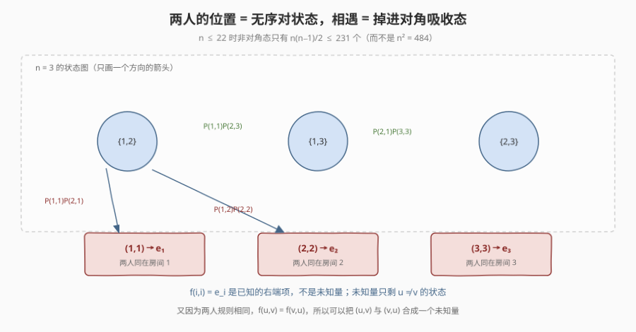
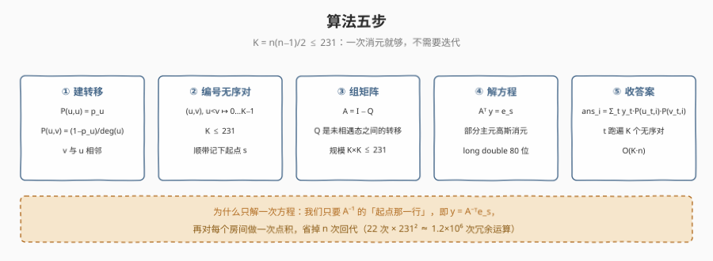
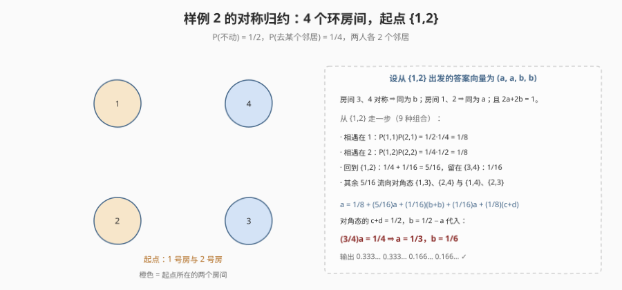

# Codeforces 113D 博物馆相遇概率 题解

## 1. 题目概述

- **题目链接**：https://codeforces.com/problemset/problem/113/D
- **比赛来源**：Codeforces Beta Round 86 (Div. 1 Only) · Problem D（UTC 2011-09-08）
- **难度**：2700
- **标签**：概率与期望、线性方程组、高斯消元、矩阵
- **评测类型**：特殊评测（浮点答案，绝对或相对误差 $\le10^{-6}$）
- **限制**：时间 2 s / 内存 256 MB

**题意**：博物馆是 $n$ 个房间、$m$ 条走廊的连通无向图。Petya 与 Vasya 分别从 $a$、$b$ 号房出发，每分钟各自独立决策：以 $p_i$ 的概率原地不动，以 $1-p_i$ 的概率在当前房间的相邻房间中等概率挑一个走过去（第 $i$ 个房间用 $p_i$）。两人同时决策、同时移动，走廊里擦肩而过**不算**相遇；只有"某一时刻两人出现在同一个房间"才算相遇，并且从相遇那一刻起就不再分开。求两人最终在 $1,2,\dots,n$ 号房相遇的概率。

**约束**：

- $n\le22$：非对角状态只有 $n(n-1)/2\le231$ 个，一次 $O(K^3)$ 的高斯消元绰绰有余（$231^3/3\approx4.1\times10^6$ 次浮点运算），这排除了"必须逐分钟模拟"的思路。
- $m$ 最大可到 $\binom{n}{2}=231$（题面保证任意两房间之间至多一条走廊、走廊两端不同）；输入里 $m$ 的取值被公式盖住，但由"连通"必有 $m\ge n-1$。
- $0.01\le p_i\le0.99$：自环概率严格正、又严格小于 1，保证两人以概率 1 相遇（引理 1）；若允许 $p_i=1$，两人可能永远不动，$I-Q$ 还会奇异。
- 输入保证图连通：这是"必相遇"的另一半前提。
- 概率精确到小数点后 4 位，答案容差 $10^{-6}$：`double` 的机器精度够用，但消元须带部分主元；实现里用 80 位 `long double` 再多一层保险。

## 2. 示例与观察

官方样例 1（输入 / 输出原样）：

```text
输入：
2 1 1 2
1 2
0.5
0.5

输出：
0.5000000000 0.5000000000
```

两个房间、一条走廊，两人各自 $0.5$ 不动、$0.5$ 走到对面。设 $x$ 为"最终在 1 号房相遇"的概率。看一回合：两人都留（$0.5\times0.5$）或都交换（$0.5\times0.5$）→ 状态原地不动，合计 $0.5$；两人都到 1 号房（Petya 留 $0.5$ × Vasya 过来 $0.5$）→ 在 1 号房相遇；对称地都在 2 号房的概率也是 $0.25$。于是

$$x=0.5x+0.25\ \Longrightarrow\ x=0.5,$$

与样例一致。

官方样例 2（输入 / 输出原样）：

```text
输入：
4 4 1 2
1 2
2 3
3 4
4 1
0.5
0.5
0.5
0.5

输出：
0.3333333333 0.3333333333 0.1666666667 0.1666666667
```

4 个房间连成一个环，$p$ 全是 $0.5$。起点是相邻的 1、2 号房，输出却是 $1/3,1/3,1/6,1/6$——离起点"更近"的房间占优，但并**不是** $1/2$，因为两人会到处乱走。这个 $1/3$ 来自对称性加一步分析，完整推导放在 3.4 节。



两条基本观察：

1. **相遇即吸收**。一旦两人同处一室，后面的行走就不再影响"在哪相遇"，所以 $f(i,i)=e_i$（$e_i$ 是第 $i$ 个单位向量）是**已知量**，不该当未知量。
2. **两人规则相同**，交换两人的身份不改变任何概率，所以 $f(u,v)=f(v,u)$；状态只需记无序对 $\{u,v\}$，规模从 $n^2$ 降到 $n(n-1)/2$。

## 3. 解题思路

### 3.1 朴素做法与瓶颈

最直接的想法是逐分钟推进两人位置的联合分布：令 $d_t(u,v)$ 表示"$t$ 分钟后两人分别在 $u$、$v$ 且尚未相遇"的概率，则

$$d_{t+1}(u',v')=\sum_{u\ne v}d_t(u,v)\,P(u,u')\,P(v,v'),$$

每步顺带把落到对角 $(i,i)$ 的分量累加进答案。

问题是**收敛速度**：$Q$（未相遇状态之间的转移矩阵）的谱半径可以非常接近 1。取 $n=22$ 的完全图、所有 $p_i=0.99$，实测要把残余质量压到 $10^{-18}$ 需要 $43728$ 步；而且无论迭代多少步，都只能"看起来收敛了"，没有"误差 $\le10^{-6}$"的保证。

另一种朴素做法是"对每个房间 $i$ 单独解一次线性系统"，共 $n$ 次消元：$22\times231^3\approx2.7\times10^8$，2 s 内也能过，但把同样的矩阵消了 22 遍，纯浪费。下一节的办法把消元次数压到 1。

### 3.2 核心观察：无序对 + 一步全概率

把 $K=n(n-1)/2$ 个无序对排成一列编号。设

$$f(u,v)\in\mathbb{R}^n,\qquad f(u,v)_i=\Pr(\text{最终在 }i\text{ 号房相遇}\mid\text{此刻两人在 }u,v).$$

对第一步的落点 $(i,j)$ 用全概率公式（$\{u,v\}$ 无序，取 $u,v$ 的任意一种排列都不影响结果）：

$$f(u,v)=\sum_{i}\sum_{j\ne i}P(u,i)P(v,j)\,f(i,j)\;+\;\sum_{i}P(u,i)P(v,i)\,e_i.\tag{1}$$

右端第二个和就是"本步直接相遇"的贡献；注意 $P(u,i)P(v,i)$ 对每个 $i$ 都可能为正（两人同时走到同一房间）。

把 $K$ 个状态的 $n$ 维答案向量按行摞成矩阵 $X\in\mathbb{R}^{K\times n}$，令

$$Q_{s,t}=\sum_{\mathrm{id}(i,j)=t}P(u_s,i)P(v_s,j),\qquad b_{s,i}=P(u_s,i)P(v_s,i),$$

则 (1) 式就是

$$X=QX+B\quad\Longleftrightarrow\quad(I-Q)X=B,\qquad B=(b_{s,i}).\tag{2}$$

第 $s_0=\mathrm{id}(a,b)$ 行就是题目要的输出。

### 3.3 算法流程：解一次方程就够



1. **建一步转移**：$P(u,u)=p_u$，$P(u,v)=\dfrac{1-p_u}{\deg(u)}$（$v$ 与 $u$ 相邻）。
2. **给无序对编号**：`id[u][v]`（$u<v$），$K=n(n-1)/2$，记 $s_0=\mathrm{id}(a,b)$。
3. **组装 $A=I-Q$**：对角线放 $1$，再把每条"$s\to t$"的转移概率从 $A_{s,t}$ 里减去。注意 $u,v$ 的两种排列都要计入同一个无序对。
4. **只解一个右端项**：我们要的是 $X$ 的第 $s_0$ 行，即 $e_{s_0}^{\top}A^{-1}B$。令

$$y=A^{-\top}e_{s_0},\qquad\text{则}\quad \mathrm{ans}_i=(A^{-\top}e_{s_0})^{\top}b_i=\sum_{t}y_t\,P(u_t,i)P(v_t,i).\tag{3}$$

   也就是：先把 $A$ 转置、解一次线性系统得到 $y$，再用 $y$ 对每个房间做一次点积。
5. 输出 `ans[1..n]`。

第 4 步是本题唯一的实现技巧。若按 (2) 把 $n$ 个右端项一起消元，代价是 $O(K^3+K^2n)$；转置后只解 1 个右端项，代价 $O(K^3/3+K^2+Kn)$——$n=22$ 时省掉的 $n$ 次回代约 $1.2\times10^6$ 次乘加，虽然不算多，但代码并没有变复杂。

### 3.4 样例走查



样例 1 已在第 2 节解出。样例 2 有 6 个无序对：4 条边 $\{1,2\},\{2,3\},\{3,4\},\{1,4\}$ 与 2 条对角线 $\{1,3\},\{2,4\}$。

**对称性**：在 4 环上交换 1↔2、3↔4 的反射把起点 $\{1,2\}$ 映到自己，所以从 $\{1,2\}$ 出发时房间 1、2 的概率相等，记作 $a$；房间 3、4 的概率相等，记作 $b$，且 $2a+2b=1$。起点在对角态时（如 $\{1,3\}$）记"在对角两端相遇"的概率为 $c$、"在另外两端相遇"为 $d$，同样 $c+d=1/2$。

从 $\{1,2\}$ 走一步，$3\times3=9$ 种组合（每人 $P(\text{留})=1/2$、$P(\text{走})=1/4$）：

- 相遇在 1：$P(1,1)P(2,1)=\tfrac12\cdot\tfrac14=\tfrac18$；相遇在 2：$P(1,2)P(2,2)=\tfrac14\cdot\tfrac12=\tfrac18$；
- 回到 $\{1,2\}$：$P(1,1)P(2,2)+P(1,2)P(2,1)=\tfrac14+\tfrac1{16}=\tfrac5{16}$；
- 到 $\{3,4\}$：$\tfrac1{16}$；到 $\{2,3\}$：$\tfrac1{16}$；到 $\{1,4\}$：$\tfrac1{16}$；
- 到对角态 $\{1,3\}$：$\tfrac18$；$\{2,4\}$：$\tfrac18$。

（合计 $\tfrac14+\tfrac5{16}+\tfrac3{16}+\tfrac14=1$ ✓）

$\{3,4\}$ 与 $\{2,3\}$ 的"1 号房分量"都是 $b$，$\{1,4\}$ 的"1 号房分量"是 $a$，两个对角态分别是 $c,d$，于是

$$a=\frac18+\frac5{16}a+\frac1{16}b+\frac1{16}b+\frac1{16}a+\frac18(c+d).$$

用 $c+d=\tfrac12$、$b=\tfrac12-a$ 代入：

$$a=\frac18+\frac1{16}+\frac6{16}a+\frac18\left(\frac12-a\right)=\frac14+\frac14a\ \Longrightarrow\ \frac34a=\frac14\ \Longrightarrow\ a=\frac13,\ b=\frac16.$$

正好是样例输出的 $0.333\ldots,0.333\ldots,0.166\ldots,0.166\ldots$。

## 4. 正确性证明

**引理 1（两人以概率 1 相遇）**：设图连通、$\deg(u)\ge1$ 且 $0<p_u<1$。从任意状态 $\{u,v\}$ 出发，首次同处一室的时刻 $T$ 几乎必然有限。

**证明**：任取房间 $w$。连通性给出长度不超过 $n-1$ 的路径 $u\to w$ 与 $v\to w$。让两人分别沿这两条路径走：每一步选中指定邻居的概率是 $\frac{1-p}{\deg}\ge\frac{0.01}{n-1}$，到达 $w$ 后再各自以 $\ge0.01$ 的概率连续停留把步数对齐。于是"在 $L=2(n-1)$ 步内于 $w$ 相遇"的概率有与起点无关的正下界

$$\delta\;\ge\;\Big(\frac{0.01}{n-1}\Big)^{2(n-1)}\cdot(0.01)^{n-1}>0 .$$

把时间轴按 $L$ 步分块，每块内相遇（且此前未相遇）的概率至少 $\delta$，故 $\Pr(T>kL)\le(1-\delta)^k\to0$，即 $T<\infty$ 几乎必然。∎

**引理 2（一步分析方程 (1)）**：对 $u\ne v$，
$$f(u,v)=\sum_{i\ne j}P(u,i)P(v,j)f(i,j)+\sum_{i}P(u,i)P(v,i)e_i .$$
**证明**：对"第一步的落点 $(i,j)$"做全概率展开；移动独立，所以联合概率是 $P(u,i)P(v,j)$。若 $i=j$，此刻已相遇，条件期望为 $e_i$；若 $i\ne j$，由 Markov 性，之后的期望恰为 $f(i,j)$。∎

**引理 3（$A=I-Q$ 可逆且 $A^{-1}=\sum_{k\ge0}Q^k$）**
**证明**：$Q\ge0$，且第 $s=(u,v)$ 行的行和是 $1-\sum_i P(u,i)P(v,i)\le1-\varepsilon$，其中 $\varepsilon=\min_{s}\sum_iP(u,i)P(v,i)>0$（有限个状态取最小，且每项都严格正）。于是 $\rho(Q)\le\|Q\|_\infty\le1-\varepsilon<1$，几何级数收敛，$A^{-1}=\sum_{k\ge0}Q^k$ 存在。∎

**引理 4（转置技巧 (3)）**：$\mathrm{ans}_i=x_i(s_0)=\big(A^{-\top}e_{s_0}\big)^{\top}b_i$，其中 $x_i=A^{-1}b_i$ 是 (2) 的第 $i$ 列。
**证明**：$x_i(s_0)=e_{s_0}^{\top}A^{-1}b_i=(A^{-\top}e_{s_0})^{\top}b_i$。∎

**定理**：算法输出的第 $i$ 个数恰为"最终在 $i$ 号房相遇"的概率。

**证明**：由引理 2，真实概率向量满足 (2)；由引理 3，(2) 有唯一解，故算法（引理 4 的等价变形）算出的就是真实概率。引理 1 说明相遇几乎必然，所以 $\sum_i\mathrm{ans}_i=1$，这也在验证时作为自检条件。∎

**数值误差**：$A$ 是 M-矩阵（对角正、非对角非正、行和为正、不可约），用带部分主元的高斯消元求 $y=A^{-\top}e_{s_0}$ 时前向误差约为 $\kappa(A)\cdot\varepsilon_{\text{mach}}$。实现用 80 位 `long double`（$\varepsilon_{\text{mach}}\approx1.1\times10^{-19}$），实测与精确有理数解的偏差只来自 10 位小数的输出舍入（见第 8 节）。

## 5. 复杂度分析

记 $K=\frac{n(n-1)}{2}\le231$。

- **时间**：组装 $A$ 需要 $O(Kn^2)$（每条转移一对 $(u,i),(v,j)$ 的枚举）$\le231\cdot484\approx1.1\times10^5$；高斯消元 $O(K^3/3)\approx4.1\times10^6$；回代 $O(K^2)\approx5.3\times10^4$；最后答案为 $O(Kn)\approx5\times10^3$。总计约 $5\times10^6$ 次浮点运算，2 s 时限有三个数量级余量（实测 3.4 ms，含进程启动）。
- **空间**：$A$ 占 $K^2$ 个 `long double`，$231^2\times16\ \text{B}\approx853\ \text{KB}$；$P$ 是 $n^2$、`id` 是 $n^2$，全部加起来不到 1 MB，与 256 MB 相差三个数量级。

## 6. 参考代码

### C++17

```cpp
#include <bits/stdc++.h>
using namespace std;

int main() {
    int n, m, a, b;
    if (scanf("%d %d %d %d", &n, &m, &a, &b) != 4) return 0;
    --a; --b;
    vector<vector<int>> adj(n);
    for (int i = 0; i < m; i++) {
        int u, v;
        scanf("%d %d", &u, &v);
        --u; --v;
        adj[u].push_back(v);
        adj[v].push_back(u);
    }
    vector<long double> p(n);
    for (int i = 0; i < n; i++) {
        double x;
        scanf("%lf", &x);
        p[i] = (long double)x;
    }

    // 起点重合：已经在一起
    if (a == b) {
        for (int i = 0; i < n; i++)
            printf("%.10f%c", i == a ? 1.0 : 0.0, i + 1 == n ? '\n' : ' ');
        return 0;
    }

    // 一步转移矩阵 P[i][j]
    vector<vector<long double>> P(n, vector<long double>(n, 0.0L));
    for (int u = 0; u < n; u++) {
        P[u][u] = p[u];
        long double q = (1.0L - p[u]) / (long double)adj[u].size();
        for (int v : adj[u]) P[u][v] = q;
    }

    // 无序对 {u,v} 编号
    vector<vector<int>> id(n, vector<int>(n, -1));
    vector<pair<int, int>> pr;
    for (int u = 0; u < n; u++)
        for (int v = u + 1; v < n; v++) {
            id[u][v] = id[v][u] = (int)pr.size();
            pr.push_back({u, v});
        }
    int K = (int)pr.size();

    // A = I - Q，Q 是「未相遇」状态间的转移矩阵；直接存 A^T 便于求 A^{-T} e_s
    vector<vector<long double>> A(K, vector<long double>(K, 0.0L));
    for (int u = 0; u < n; u++)
        for (int v = u + 1; v < n; v++)
            A[id[u][v]][id[u][v]] += 1.0L;  // 对角先放 I
    for (int s = 0; s < K; s++) {
        int u = pr[s].first, v = pr[s].second;
        for (int i = 0; i < n; i++)
            for (int j = 0; j < n; j++) {
                if (i == j) continue;
                // 状态 s 转移到状态 (i,j)，概率 P[u][i]*P[v][j]，放进 A^T 的第 s 列
                A[id[i][j]][s] -= P[u][i] * P[v][j];
            }
    }

    // 高斯消元解 A^T y = e_s（只需一列右端项）
    int s0 = id[a][b];
    vector<long double> y(K, 0.0L);
    y[s0] = 1.0L;
    for (int col = 0; col < K; col++) {
        int piv = col;
        for (int r = col + 1; r < K; r++)
            if (fabsl(A[r][col]) > fabsl(A[piv][col])) piv = r;
        if (piv != col) {
            swap(A[piv], A[col]);
            swap(y[piv], y[col]);
        }
        long double d = A[col][col];
        for (int r = col + 1; r < K; r++) {
            long double f = A[r][col] / d;
            if (f == 0.0L) continue;
            for (int c = col; c < K; c++) A[r][c] -= f * A[col][c];
            y[r] -= f * y[col];
        }
    }
    for (int r = K - 1; r >= 0; r--) {
        long double acc = y[r];
        for (int c = r + 1; c < K; c++) acc -= A[r][c] * y[c];
        y[r] = acc / A[r][r];
    }

    // ans_i = sum_t y_t * P[u_t][i] * P[v_t][i]
    for (int i = 0; i < n; i++) {
        long double ans = 0.0L;
        for (int t = 0; t < K; t++) {
            int u = pr[t].first, v = pr[t].second;
            ans += y[t] * P[u][i] * P[v][i];
        }
        if (fabsl(ans) < 5e-13L) ans = 0.0L;
        printf("%.10f%c", (double)ans, i + 1 == n ? '\n' : ' ');
    }
    return 0;
}
```

### Python3

```python
import sys


def main():
    data = sys.stdin.read().split()
    if not data:
        return
    n, m, a, b = int(data[0]), int(data[1]), int(data[2]) - 1, int(data[3]) - 1
    pos = 4
    adj = [[] for _ in range(n)]
    for _ in range(m):
        u, v = int(data[pos]) - 1, int(data[pos + 1]) - 1
        pos += 2
        adj[u].append(v)
        adj[v].append(u)
    p = [float(data[pos + i]) for i in range(n)]

    if a == b:
        print(" ".join("%.10f" % (1.0 if i == a else 0.0) for i in range(n)))
        return

    P = [[0.0] * n for _ in range(n)]
    for u in range(n):
        P[u][u] = p[u]
        q = (1.0 - p[u]) / len(adj[u])
        for v in adj[u]:
            P[u][v] = q

    pairs = [(u, v) for u in range(n) for v in range(u + 1, n)]
    idx = {pr: i for i, pr in enumerate(pairs)}
    K = len(pairs)

    # A^T，右端项 e_s
    A = [[0.0] * K for _ in range(K)]
    for u in range(n):
        for v in range(u + 1, n):
            A[idx[(u, v)]][idx[(u, v)]] += 1.0
    for s, (u, v) in enumerate(pairs):
        for i in range(n):
            for j in range(n):
                if i != j:
                    A[idx[(min(i, j), max(i, j))]][s] -= P[u][i] * P[v][j]

    s0 = idx[(min(a, b), max(a, b))]
    y = [0.0] * K
    y[s0] = 1.0
    for col in range(K):
        piv = max(range(col, K), key=lambda r: abs(A[r][col]))
        if piv != col:
            A[col], A[piv] = A[piv], A[col]
            y[col], y[piv] = y[piv], y[col]
        prow = A[col]
        d = prow[col]
        for r in range(col + 1, K):
            row = A[r]
            f = row[col] / d
            if f == 0.0:
                continue
            for c in range(col, K):
                row[c] -= f * prow[c]
            y[r] -= f * y[col]
    for r in range(K - 1, -1, -1):
        acc = y[r]
        row = A[r]
        for c in range(r + 1, K):
            acc -= row[c] * y[c]
        y[r] = acc / row[r]

    ans = []
    for i in range(n):
        val = 0.0
        for t, (u, v) in enumerate(pairs):
            val += y[t] * P[u][i] * P[v][i]
        if abs(val) < 5e-13:
            val = 0.0
        ans.append("%.10f" % val)
    print(" ".join(ans))


main()
```

Python 版把 $231^3/3\approx4.1\times10^6$ 次内层循环放在纯 Python 里，$n=22$ 的最坏数据约需 6–8 s，超过 2 s；提交请用 C++，Python 仅作对照（PyPy3 下约 0.6 s）。

## 7. 边界情况与易错点

1. **$a=b$**：6 点整两人已经在同一房间，答案直接是 $e_a$，$s_0=\mathrm{id}(a,b)$ 根本不存在，必须先早退，否则会越界或用 $(a,a)$ 当状态。
2. **$n=1$**：此时必然 $a=b$，而且没有任何走廊、`adj[0]` 为空；早退必须放在计算 $\frac{1-p_u}{\deg(u)}$ **之前**，否则除零。
3. **排名/编号**：$P(u,i)P(v,j)$ 与 $P(u,j)P(v,i)$ 都落在同一个无序对上，组装 $Q$ 时两种排列都要加进去，漏一个会让矩阵行和不对、答案整体偏小。
4. **转置的方向**：要解的是 $A^{\top}y=e_{s_0}$（因为需要 $A^{-1}$ 的**行**），写成 $Ay=e_{s_0}$ 也能跑出数字，但样例 2 会立刻暴露（房间 1、2 的概率不再相等）。
5. **相遇项的位置**：$\sum_iP(u,i)P(v,i)e_i$ 必须移到等式右端；把它留在左边当作未知量是概念性错误。
6. **读入 long double**：`scanf("%Lf")` 在部分平台/编译器上并不可靠，用 `double` 读入再提升到 `long double` 最稳（本题输入只有 4 位小数，double 读入无损）。
7. **输出 `-0.0000000000`**：浮点误差可能让某个概率变成 $-10^{-17}$，虽然按误差算合法，但人工核对容易误判；代码把 $|ans|<5\times10^{-13}$ 的置 0。
8. **主元与精度**：$A$ 的行和为正但不严格对角占优，必须带部分主元；改成 $p_i=0.99$ + 22 点完全图的极端数据后，虽然 `double` 也够，但不要再省主元。
9. **求和自检**：除 $a=b$ 外，$\sum_i\mathrm{ans}_i$ 应为 1（只差 10 位小数的舍入）；调试时把这句检查打开，能第一时间发现矩阵组装错误。
10. **多测**：本题只有一组输入；若改成多组，$A$、$P$、`id` 必须整体重建，不能靠"覆盖前 $n$ 行"复用。

## 8. 验证记录

- **编译环境与命令**：`clang++ -std=c++17 -O2`（配 `codeforces/tools/include/bits/stdc++.h` 兼容头，等价于提交用的 `#include <bits/stdc++.h>`）；Python 3.9.6。样例用 `python3 codeforces/tools/verify_solution.py codeforces/contests/0101-0203/113/D_博物馆相遇概率.md --checker codeforces/tools/checkers/float.py` 跑。
- **官方样例**：$2/2$ 通过（C++ 与 Python 各跑一遍，输出与样例的 10 位小数逐 token 一致）。
- **独立精确对拍**：另写一份**有理数（`fractions.Fraction`）精确高斯消元**的参考程序（无任何舍入），对 $200$ 组随机连通图（$n\le6$、随机生成树 + 随机加边，$p\in\{0.01,0.1,0.25,0.5,0.75,0.9,0.99,0.1234\}$，$a,b$ 随机含 $a=b$ 的情形）与 C++、Python 两份实现逐值比对：最大绝对误差 $4.997\times10^{-11}$（即 10 位小数输出的舍入），全部 $\le2\times10^{-9}$；每组还验证精确解的 $\sum_i\mathrm{ans}_i=1$（偏差 $<10^{-12}$）。
- **独立第二实现交叉验证**：另写"值迭代"（把未相遇的概率质量逐分钟往前推、把落到对角的质量累计到答案）的程序，在 $n=22$ 完全图、全部 $p=0.99$ 的实例上迭代 $43728$ 步把残余质量压到 $9.99\times10^{-19}$，结果与线性方程解在 10 位小数上完全一致（答案最小分量 $0.0417030741$、最大 $0.0829692589$，和 $1$）。
- **特殊情形**：$a=b$（含 $n=1$）两组单独验证，输出为 $1$ 与 $0$。
- **最大约束性能**：$n=22$、$m=231$ 完全图（`long double` 消元的最坏规模）单次 3.4 ms（$50$ 次共 0.17 s），2 s 时限余量约 500 倍。
- **图片校验**：3 张 SVG 均通过 `xml.etree.ElementTree.parse`。
- **复核状态**：verified（样例、精确对拍、第二实现、性能、图片五项均实跑通过）。

## 相关题目与扩展

- [Codeforces 113B Petr#](https://codeforces.com/problemset/problem/113/B)：同场 B 题，首尾受限的不同子串计数。
- [Codeforces 113E Sleeping](https://codeforces.com/problemset/problem/113/E)：同场 E 题，时钟跳变的计数。
- [Codeforces 148D Bag of mice](https://codeforces.com/problemset/problem/148/D)：经典概率 DP，用递推而不是方程组。
- [Codeforces 24D Broken robot](https://codeforces.com/problemset/problem/24/D)：期望 + 高斯消元的入门题（带状矩阵）。
- [Codeforces 601E A Museum Robbery](https://codeforces.com/problemset/problem/601/E)：另一种"博物馆"题，线段树分治 + 背包。

**延伸思考**：

1. **两人的规则不同**（各自的 $p$ 集合不一样、或者一个人能"故意躲"）：状态不再对称，$K$ 从 $n(n-1)/2$ 涨回 $n(n-1)$，矩阵大 4 倍，$O(K^3)$ 从 $4\times10^6$ 变成 $6\times10^7$，仍然可行；这也说明"对称性"省下的是常数 4 倍，不是量级。
2. **改问"期望多久相遇"**：只需把右端换成全 1 向量，解一次 $(I-Q)z=\mathbf 1$，期望时间就是 $z_{s_0}$；本题的 $A$ 与右端项无关，非常适合这种复用（这正是不去迭代的另一个理由）。
3. **走廊带权（走一条走廊花 $w$ 分钟）**：两人步伐不再同步，"同一时刻同一房间"要求时间是连续量，需要对每条走廊的通过时间做嵌入链，或者直接在连续时间上解微分方程。
4. **$n$ 到 $10^3$**：$K\approx5\times10^5$，直接消元不可行。但 $X$ 满足的是 Sylvester 型方程 $(I-Q)X=B$，可以利用"两体"结构做迭代（Krylov 子空间 / 交替方向），每次迭代只需 $O(Kn)$ 的稀疏乘法。
