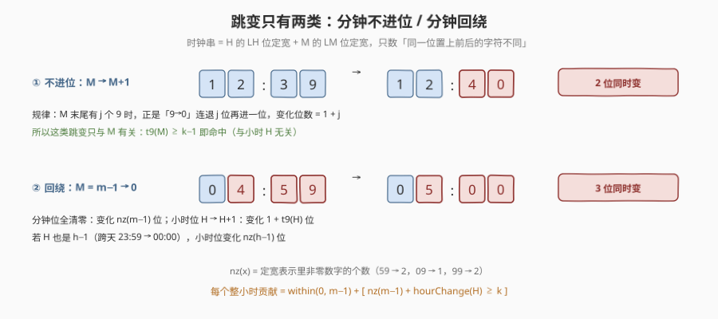
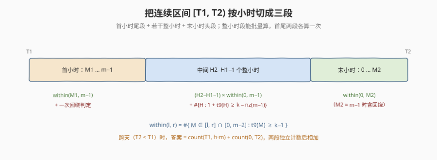
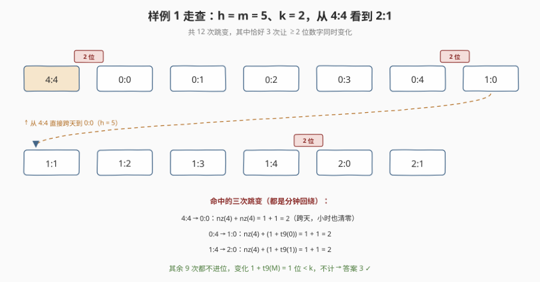

# Codeforces 113E 睡眠时钟跳字计数 题解

## 1. 题目概述

- **题目链接**：https://codeforces.com/problemset/problem/113/E
- **比赛来源**：Codeforces Beta Round 86 (Div. 1 Only) · Problem E（UTC 2011-09-08）
- **难度**：2700
- **标签**：数学、计数、实现
- **评测类型**：普通
- **限制**：时间 2 s / 内存 256 MB

**题意**：这个国家一天有 $h$ 小时、每小时 $m$ 分钟。电子钟按十进制显示 `H:M`，其中字符串 `H` 的宽度固定为 $\mathrm{LH}=\text{h−1 的十进制位数}$、`M` 的宽度固定为 $\mathrm{LM}=\text{m−1 的十进制位数}$，不足补前导零（例如 $h=17,m=1000$ 时，13 时 75 分显示成 `13:075`）。

Vasya 从 $(h_1:m_1)$ 一直看到 $(h_2:m_2)$（两端都包括在内）然后睡着，总共不到一天。醒着的时候，每一次"时钟跳到下一分钟"他都看见了，**但他没看见 $(h_2:m_2)$ 之后再跳的那一次**。问：他看到的跳变里，有多少次是"至少 $k$ 位数字同时发生了变化"（位数按 `H` 与 `M` 拼起来的整串数，逐位比较）。

**约束**：

- $2\le h,m\le10^9$：一天的分钟数可达 $10^{18}$，逐分钟枚举 $O(hm)$ 绝无可能；甚至"逐小时枚举"也有 $10^9$ 次。这排除了任何与 $h\cdot m$ 成正比的写法，必须做到与数值大小无关。
- $1\le k\le20$，而 $\mathrm{LH},\mathrm{LM}\le9$（$h-1,m-1\le999999999$），所以变化位数的上界是 $\mathrm{LH}+\mathrm{LM}\le18$：$k>18$ 时答案必为 0，公式里的越界分支要能安全返回 0。
- 答案最大 $hm-1\approx10^{18}-1$，超过 32 位，全程必须 64 位整数；也不能用 `double`（53 位尾数存不下 $10^{18}$）。
- 观察区间可能**跨天**（$h_1{:}m_1$ 的线性时刻晚于 $h_2{:}m_2$），但总长严格小于一天，所以"跨天"与"不跨天"两种情况互斥，不会有两义。

## 2. 示例与观察

官方样例 1（输入 / 输出原样）：

```text
输入：
5 5 2
4 4
2 1

输出：
3
```

$h=m=5$，所以 $\mathrm{LH}=\mathrm{LM}=1$，时钟显示 1 位小时 + 1 位分钟。他从 `4:4` 看到 `2:1`，因为 `4:4` 晚于 `2:1`，这一段是**跨天**的：

```text
4:4 → 0:0 → 0:1 → 0:2 → 0:3 → 0:4 → 1:0 → 1:1 → 1:2 → 1:3 → 1:4 → 2:0 → 2:1
```

逐次数据变化位数：`4:4→0:0` 是 **2**（小时、分钟都清零），`0:0→0:1` 到 `0:3→0:4` 都是 1，`0:4→1:0` 是 **2**（小时 $0\to1$、分钟 $4\to0$ 同时变），`1:0→1:1` 到 `1:3→1:4` 都是 1，`1:4→2:0` 是 **2**，最后 `2:0→2:1` 是 1。$k=2$ 时命中 3 次，与样例一致。

官方样例 2（输入 / 输出原样）：

```text
输入：
24 60 1
0 0
23 59

输出：
1439
```

$k=1$ 时"至少 1 位变化"永远成立（每次跳变至少分钟个位变），所以答案就是**跳变次数 = 观察到的分钟数 − 1**。从 `0:0` 到 `23:59` 共 $24\times60=1440$ 个时刻、$1439$ 次跳变；题目特别说明没看见 `23:59 → 0:0` 那次，所以是 1439 而不是 1440。

官方样例 3（输入 / 输出原样）：

```text
输入：
24 60 3
23 59
23 59

输出：
0
```

起止同一个时刻：他一个瞬间就睡着了，**一次跳变也没看到**，答案 0。这提醒我们区间是"时刻"，要数的是区间内部的跳变。



**观察**：一次跳变只可能有两大形态，而且"变化位数"完全由**被加 1 的那个数**决定：

1. **分钟不进位**（$M<m-1$）：小时位一个都不变，分钟位等于"$M$ 加 1"的变化位数。十进制 $+1$ 只影响末尾一串 9 和它的前一位，所以位数 $=1+t_9(M)$，$t_9(M)$ 是 $M$ 的定宽表示里末尾连续 9 的个数。它**只与 $M$ 有关，与 $H$ 无关**。
2. **分钟回绕**（$M=m-1$）：分钟位从 $m-1$ 直接清零，变化位数是 $m-1$ 的定宽表示里非零数字的个数 $\mathrm{nz}(m-1)$（原来是 0 的位不变）；同时小时位 $+1$，变化位数是 $1+t_9(H)$，若 $H=h-1$ 则小时也清零、变化 $\mathrm{nz}(h-1)$ 位。

## 3. 解题思路

### 3.1 朴素做法与瓶颈

逐分钟扫一遍区间：每个时刻拼出定宽字符串、与上一个时刻逐位比较、计数。逻辑完全正确，复杂度 $O(hm)$，最坏 $10^{18}$——连读入都不止 2 s。

稍微聪明一点的做法是"按小时批量"：每个小时内分钟位独立变化，先预处理 $0..m-1$ 的 $t_9$，再对每个小时累加。复杂度降到 $O(h+m)$，最坏 $10^9\times$ 若干次运算，仍然过不去。

真正的瓶颈是"个数"这件事必须用**闭式公式**而不是枚举来算。

### 3.2 核心观察：数个数 = 数同余类

由第 2 节的分类，一次跳变是否命中只取决于一个很弱的条件：

- 不进位的跳变：命中 $\iff 1+t_9(M)\ge k\iff t_9(M)\ge k-1$。而 $t_9(M)\ge j$ 当且仅当

$$M\equiv10^{j}-1\pmod{10^{j}},$$

即 $M$ 的末 $j$ 位全是 9。于是 $[0,X]$ 里满足条件的整数个数有闭式

$$\mathrm{cnt9}(X,j)=\begin{cases}0,&X<10^{j}-1\\[2pt] \left\lfloor\dfrac{X-(10^{j}-1)}{10^{j}}\right\rfloor+1,&\text{否则}\end{cases}$$

区间 $[l,r]$ 的答案就是 $\mathrm{cnt9}(r,j)-\mathrm{cnt9}(l-1,j)$，$O(1)$。

- 回绕的跳变：命中 $\iff \mathrm{nz}(m-1)+\mathrm{hourChange}(H)\ge k$，其中

$$\mathrm{hourChange}(H)=\begin{cases}1+t_9(H),&H<h-1\\[2pt]\mathrm{nz}(h-1),&H=h-1\end{cases}$$

每个小时最多只有一次回绕跳变（$M=m-1$ 时），所以"整小时区间"里回绕部分的贡献是"有多少个 $H$ 满足 $1+t_9(H)\ge k-\mathrm{nz}(m-1)$"——又是一个同余类计数，同样用 $\mathrm{cnt9}$ 算。



### 3.3 算法流程

把时刻编码成整数 $T=h\cdot m+M$。设 $T_1=h_1m+m_1$、$T_2=h_2m+m_2$、$\text{total}=hm$。要数的是 $x\in[T_1,T_2)$ 这些跳变 $x\to x+1$（若 $T_2<T_1$ 则是 $[T_1,\text{total})\cup[0,T_2)$）。

`count(lo, hi)` 数 $x\in[lo,hi)$：

1. 若 $lo\ge hi$ 返回 0；令 $H_1=\lfloor lo/m\rfloor,M_1=lo\bmod m$，$H_2=\lfloor(hi-1)/m\rfloor,M_2=(hi-1)\bmod m$。
2. **同一小时**（$H_1=H_2$）：$M$ 从 $M_1$ 走到 $M_2$。其中 $M<m-1$ 的部分用 `within(M1, M2)` 算；若 $M_2=m-1$ 再加一次回绕判定。
3. **不同小时**：
   - 首小时：$M\in[M_1,m-1]$，即 `within(M1, m-1)` 加一次回绕判定（$H=H_1$）；
   - 中间整小时：共 $H_2-H_1-1$ 个，每个都贡献 `within(0, m-1)` 次"不进位命中"，外加 1 次回绕命中（回绕命中的小时数用 $\mathrm{cnt9}$ 在 $H$ 上数）；
   - 末小时：$M\in[0,M_2]$，即 `within(0, M2)` 加（若 $M_2=m-1$）回绕判定。
4. 三段相加，不重不漏（每段对应一段连续的时刻，恰好覆盖 $[lo,hi)$）。

总答案：$T_2\ge T_1$ 时 `count(T1, T2)`；否则 `count(T1, total) + count(0, T2)`。

`within(lo, hi)` 就是"$M\in[lo,\min(hi,m-2)]$ 中 $t_9(M)\ge k-1$ 的个数"，用 $\mathrm{cnt9}$ 两次相减。

### 3.4 样例走查



样例 1（$h=m=5,k=2$）：$T_1=4\cdot5+4=24$，$T_2=2\cdot5+1=11$，$T_2<T_1$，所以拆成 `count(24, 25) + count(0, 11)`。

- `count(24,25)`：只有一个 $x=24=(4,4)$，$H_1=H_2=4$、$M_1=M_2=4=m-1$，走回绕判定：$\mathrm{nz}(4)=1$，$H_1=h-1$ 所以 $\mathrm{hourChange}=\mathrm{nz}(4)=1$，$1+1=2\ge2$ ✓，贡献 1。
- `count(0,11)`：$hi-1=10=(2,0)$，所以 $H_1=0,M_1=0$，$H_2=2,M_2=0$。
  - 首小时 $H=0$：`within(0,4)` 里 $\min(4,3)=3$，即 $M\in[0,3]$，$t_9(M)=0$ 全部不命中；回绕 $M=4$：$\mathrm{nz}(4)+1+t_9(0)=1+1=2\ge2$ ✓，贡献 1。
  - 中间整小时 $H\in[1,1]$：`within(0,4)` 同样 0；回绕条件 $1+t_9(H)\ge k-\mathrm{nz}(4)=1$ 对 $H=1$ 成立（$t_9(1)=0$，$1\ge1$）✓，贡献 1。
  - 末小时 $H=2$：`within(0,0)`：$M=0$，$t_9=0$ 不命中；$M_2=0\ne m-1$，无回绕项，贡献 0。

合计 $1+1+1+0=3$ ✓，与样例一致，正是那三次"分钟回绕"的跳变。

## 4. 正确性证明

**引理 1（不进位跳变的变化位数）**：设 $M<m-1$，则 $M\to M+1$ 在 $\mathrm{LM}$ 位定宽表示下变化的位数恰为 $1+t_9(M)$。

**证明**：设 $M$ 的末 $j$ 位全为 9、第 $j+1$ 位（若存在）不是 9（$j=t_9(M)$）。加 1 时低 $j$ 位全部 $9\to0$（每位都变），第 $j+1$ 位加 1 而变（若 $M+1$ 仍在 $\mathrm{LM}$ 位内，这一位必然存在，因为 $M<m-1\le10^{\mathrm{LM}}-1$ 时 $M$ 不会是全 9；而 $M+1\le m-1\le10^{\mathrm{LM}}-1$ 也保证不越位）。更高的位不受影响。合计 $j+1$ 位。∎

**引理 2（回绕跳变的变化位数）**：设 $M=m-1$，则分钟位变化 $\mathrm{nz}(m-1)$ 位，小时位变化 $\mathrm{hourChange}(H)$ 位，总位数是两者之和。

**证明**：分钟从 $m-1$ 变成 $0$，定宽表示下逐位比较，只有原来非零的位会变，故为 $\mathrm{nz}(m-1)$。小时从 $H$ 变成 $H+1$（若 $H<h-1$），同引理 1 得 $1+t_9(H)$；若 $H=h-1$，小时清零，同理由 $\mathrm{nz}(h-1)$ 给出。两段数字互不重叠，位数相加。∎

**引理 3（$\mathrm{cnt9}$ 的闭式）**：对 $j\ge1$，$[0,X]$ 中满足 $t_9(M)\ge j$ 的整数恰为 $M=a\cdot10^{j}+(10^{j}-1)$（$a\ge0$），故个数为 $\lfloor (X-(10^j-1))/10^j\rfloor+1$（$X\ge10^j-1$），否则 0。

**证明**：$t_9(M)\ge j\iff M$ 的末 $j$ 位全是 9 $\iff M\bmod10^j=10^j-1$，这些数构成公差 $10^j$、首项 $10^j-1$ 的等差数列，数一数即可。∎

**引理 4（三段不重不漏）**：对 $lo<hi$，第 3.3 节的三段恰好一次覆盖 $x\in[lo,hi)$。

**证明**：$x\mapsto H=\lfloor x/m\rfloor$ 单调不减，$[lo,hi)$ 被 $H$ 的取值切成"首小时的一段尾巴 + 中间若干整小时 + 末小时的一段头"；三段按 $H$ 严格递增且首尾相接，故既无重复也无遗漏。同一小时的情形单独处理。∎

**定理**：算法输出恰为所求次数。

**证明**：由引理 1、2，每次跳变的"变化位数 $\ge k$"被精确翻译成第 3.2 节的判定条件；由引理 3 这些条件在同余类上被精确计数；由引理 4 每个被观察到的跳变被计入且仅计入一次；跨天时两段区间 $[T_1,\text{total})$ 与 $[0,T_2)$ 不交且并集恰为观察到的全部跳变（题面保证总长小于一天）。∎

## 5. 复杂度分析

- **时间**：`count` 只做常数次整数运算（几次 $\mathrm{cnt9}$，每次 $O(1)$），与 $h,m$ 的**数值大小完全无关**：严格 $O(1)$（约一百次算术/比较），即便 $h=m=10^9$ 也是同样的耗时。
- **空间**：$O(1)$，只有十几个 64 位整数与一个长度 12 的 `pw10` 表。
- 与时限的关系：2 s 的时限对本做法没有任何压力（实测 2 ms，基本都是进程启动开销）。

## 6. 参考代码

### C++17

```cpp
#include <bits/stdc++.h>
using namespace std;
typedef long long ll;

static ll h, m, k;
static int LH, LM;
static ll pw10[12];

// len 位（含前导零）表示里非零数字的个数
static int nzd(ll x, int len) {
    int c = 0;
    for (int i = 0; i < len; i++) {
        if (x % 10) c++;
        x /= 10;
    }
    return c;
}

// len 位表示里末尾连续 9 的个数
static int t9(ll x, int len) {
    int c = 0;
    for (int i = 0; i < len; i++) {
        if (x % 10 != 9) break;
        c++;
        x /= 10;
    }
    return c;
}

// [0, x] 中「末尾连续 9 的个数 >= j」的整数个数（len 位表示）
static ll cnt9(ll x, ll j, int len) {
    if (x < 0) return 0;
    if (j <= 0) return x + 1;
    if (j > len) return 0;
    ll p = pw10[j];
    if (x < p - 1) return 0;
    return (x - (p - 1)) / p + 1;
}

static ll nzM, nzH;

// H -> H+1（按天回绕）时变化的时钟位数
static ll hourChange(ll H) {
    if (H + 1 < h) return 1 + t9(H, LH);
    return nzH;
}

// 分钟在 [lo, hi] 内、不跨小时的跳变 M -> M+1 中变化位数 >= k 的个数
static ll within(ll lo, ll hi) {
    hi = min(hi, m - 2);
    if (lo > hi) return 0;
    ll j = k - 1;
    if (j <= 0) return hi - lo + 1;
    return cnt9(hi, j, LM) - cnt9(lo - 1, j, LM);
}

// x 取 [lo, hi) 的跳变 x -> x+1 中变化位数 >= k 的个数
static ll countTransitions(ll lo, ll hi) {
    if (lo >= hi) return 0;
    ll H1 = lo / m, M1 = lo % m;
    ll last = hi - 1;
    ll H2 = last / m, M2 = last % m;
    ll res = 0;
    if (H1 == H2) {
        res += within(M1, M2);
        if (M2 == m - 1 && nzM + hourChange(H1) >= k) res++;
        return res;
    }
    // 起点所在小时：M 跑完 M1..m-1
    res += within(M1, m - 1);
    if (nzM + hourChange(H1) >= k) res++;
    // 中间整小时
    if (H2 - H1 >= 2) {
        res += (H2 - H1 - 1) * within(0, m - 1);
        ll thr = k - nzM;               // 需要 hourChange(H) >= thr
        ll hlo = H1 + 1, hhi = H2 - 1;
        ll hiSmall = min(hhi, h - 2);
        if (hlo <= hiSmall) {
            ll j = thr - 1;             // 1 + t9(H) >= thr  <=>  t9(H) >= thr-1
            if (j <= 0) res += hiSmall - hlo + 1;
            else res += cnt9(hiSmall, j, LH) - cnt9(hlo - 1, j, LH);
        }
        if (hhi == h - 1 && nzH >= thr) res++;
    }
    // 终点所在小时：M 从 0 到 M2
    res += within(0, M2);
    if (M2 == m - 1 && nzM + hourChange(H2) >= k) res++;
    return res;
}

int main() {
    ll h1, m1, h2, m2;
    if (scanf("%lld %lld %lld", &h, &m, &k) != 3) return 0;
    scanf("%lld %lld", &h1, &m1);
    scanf("%lld %lld", &h2, &m2);

    LH = (int)to_string(h - 1).size();
    LM = (int)to_string(m - 1).size();
    pw10[0] = 1;
    for (int i = 1; i < 12; i++) pw10[i] = pw10[i - 1] * 10;
    nzM = nzd(m - 1, LM);
    nzH = nzd(h - 1, LH);

    ll T1 = h1 * m + m1, T2 = h2 * m + m2, total = h * m;
    ll ans;
    if (T2 >= T1) ans = countTransitions(T1, T2);
    else ans = countTransitions(T1, total) + countTransitions(0, T2);
    printf("%lld\n", ans);
    return 0;
}
```

### Python3

```python
import sys


def main():
    data = sys.stdin.read().split()
    h, m, k = int(data[0]), int(data[1]), int(data[2])
    h1, m1 = int(data[3]), int(data[4])
    h2, m2 = int(data[5]), int(data[6])

    LH = len(str(h - 1))
    LM = len(str(m - 1))
    pw10 = [1] * 12
    for i in range(1, 12):
        pw10[i] = pw10[i - 1] * 10

    def nzd(x, ln):
        c = 0
        for _ in range(ln):
            if x % 10:
                c += 1
            x //= 10
        return c

    def t9(x, ln):
        c = 0
        for _ in range(ln):
            if x % 10 != 9:
                break
            c += 1
            x //= 10
        return c

    def cnt9(x, j, ln):
        """[0, x] 中末位连续 9 的个数 >= j 的整数个数。"""
        if x < 0:
            return 0
        if j <= 0:
            return x + 1
        if j > ln:
            return 0
        p = pw10[j]
        if x < p - 1:
            return 0
        return (x - (p - 1)) // p + 1

    nz_m = nzd(m - 1, LM)     # 分钟 m-1 -> 0 时变化的位数
    nz_h = nzd(h - 1, LH)     # 小时 h-1 -> 0 时变化的位数

    def hour_change(H):
        """H -> H+1（按天回绕）变化的时钟位数。"""
        if H + 1 < h:
            return 1 + t9(H, LH)
        return nz_h

    def within(lo, hi):
        """M in [lo, hi] 内、进位不跨小时的分钟跳变中，变化位数 >= k 的个数。"""
        if lo > hi:
            return 0
        hi = min(hi, m - 2)
        if lo > hi:
            return 0
        j = k - 1
        if j <= 0:
            return hi - lo + 1
        return cnt9(hi, j, LM) - cnt9(lo - 1, j, LM)

    def count_transitions(lo, hi):
        """x in [lo, hi) 的 x -> x+1 跳变中，变化位数 >= k 的个数。"""
        if lo >= hi:
            return 0
        H1, M1 = divmod(lo, m)
        last = hi - 1
        H2, M2 = divmod(last, m)
        res = 0
        if H1 == H2:
            res += within(M1, M2)
            if M2 == m - 1:
                res += 1 if nz_m + hour_change(H1) >= k else 0
            return res
        # 起点所在小时：M 从 M1 到 m-1
        res += within(M1, m - 1)
        if nz_m + hour_change(H1) >= k:
            res += 1
        # 中间整小时
        if H2 - H1 >= 2:
            res += (H2 - H1 - 1) * within(0, m - 1)
            thr = k - nz_m          # 需要 hour_change(H) >= thr
            hlo, hhi = H1 + 1, H2 - 1
            hi_small = min(hhi, h - 2)
            if hlo <= hi_small:
                j = thr - 1          # 1 + t9(H) >= thr  <=>  t9(H) >= thr-1
                if j <= 0:
                    res += hi_small - hlo + 1
                else:
                    res += cnt9(hi_small, j, LH) - cnt9(hlo - 1, j, LH)
            if hhi == h - 1 and nz_h >= thr:
                res += 1
        # 终点所在小时：M 从 0 到 M2
        res += within(0, M2)
        if M2 == m - 1 and nz_m + hour_change(H2) >= k:
            res += 1
        return res

    T1 = h1 * m + m1
    T2 = h2 * m + m2
    total = h * m
    if T2 >= T1:
        ans = count_transitions(T1, T2)
    else:
        ans = count_transitions(T1, total) + count_transitions(0, T2)
    print(ans)


main()
```

## 7. 边界情况与易错点

1. **跨天**：$h_1{:}m_1$ 的时刻编号大于 $h_2{:}m_2$ 时必须拆成 $[T_1,\text{total})$ 与 $[0,T_2)$ 两段；漏掉这个分支会在样例 1 上直接错（样例 1 就是跨天）。题面保证总长 $<$ 一天，所以 $T_2=T_1-1$（恰好一整天）不会出现。
2. **$T_1=T_2$**：起止同一时刻，一次跳变都没看到，答案 0（样例 3）；`count` 在 $lo\ge hi$ 时返回 0。
3. **$k=1$**：每次跳变至少分钟个位变，答案就是"区间分钟数 $-1$"；公式里 $j=k-1=0$ 走"整段全算"的分支，别把 $\mathrm{cnt9}(X,0)$ 写成 1。
4. **$k$ 超过位数上界**：$\mathrm{LH}+\mathrm{LM}\le18$，$j>9$ 时 $10^j$ 已经超过 $m$ 的量级，`cnt9` 里用 `j > len` 提前返回 0，避免 `pw10[j]` 越界。
5. **$\mathrm{nz}(m-1)$ 不等于 $\mathrm{LM}$**：$m=100$ 时 $m-1=99$，$\mathrm{LM}=2$、$\mathrm{nz}=2$；但 $m=60$ 时 $m-1=59$、$\mathrm{nz}=2$，而 $m=1000$ 时 $m-1=999$、$\mathrm{nz}=3$。用"非零位个数"，不是位数。
6. **跨天那次要 $\mathrm{nz}(h-1)$**：$23{:}59\to00{:}00$ 的小时变化是 $\mathrm{nz}(h-1)$ 位而不是 $1+t_9(h-1)$，写错会在 $h$ 是 $10$ 的幂时出错（例如 $h=100$，$99\to00$ 是 2 位）。
7. **$H=h-1$ 的整小时**：$\mathrm{hourChange}(h-1)=\mathrm{nz}(h-1)$ 这个分支只在"跨天那一次跳变"或 $H_2=h-1$ 的末段出现；中间整小时段的 $H\le H_2-1\le h-2$，只走 $1+t_9(H)$ 分支，代码里的 `hiSmall = min(hhi, h-2)` 与 `hhi == h-1` 两处就是为这个分界。
8. **$(h_2,m_2)$ 之后那次不算**：区间是 $x\in[T_1,T_2-1]$，所以 `H2,M2` 由 `hi-1` 取，而不是由 `hi` 取；写成 `hi` 会多算一次（样例 2 会得到 1440 而不是 1439）。
9. **不能用 `double`**：$h\cdot m$ 最大 $10^{18}$，`double` 只有 53 位尾数，$h_1m+m_1$ 会掉精度；全程 `long long`，读入也用 `%lld`（或 `cin`）。
10. **`pw10` 的范围**：$\mathrm{LM}\le9$，这里开到 $10^{11}$ 就绝对安全；不要按 $k$ 开 $10^{20}$（溢出）。
11. **字符串宽度**：$\mathrm{LH}=\mathrm{len}(\text{str}(h-1))$，不是 $\mathrm{len}(\text{str}(h))$；$h=10$ 时 $h-1=9$ 只有 1 位，$h=1000$ 时 $h-1=999$ 是 3 位——用 `to_string(h-1).size()` 最保险。

## 8. 验证记录

- **编译环境与命令**：`clang++ -std=c++17 -O2`（配 `codeforces/tools/include/bits/stdc++.h` 兼容头）；Python 3.9.6。
  `python3 codeforces/tools/verify_solution.py codeforces/contests/0101-0203/113/E_睡眠时钟跳字计数.md`
- **官方样例**：$3/3$ 通过（`3`、`1439`、`0`），C++ 与 Python 一致。
- **穷举对拍（最强的一层）**：对 $h,m\in[2,6]$、$k\in[1,5]$、**所有**合法起止时刻对（含跨天，排除恰好一整天），共 $38625$ 组，与"逐分钟拼定宽字符串比位"的 $O(hm)$ 暴力全部一致。这一步覆盖了 $H=h-1$ 回绕、$M=m-1$ 回绕、同小时、跨小时、跨天、$k=1$ 等所有分支组合。
- **随机对拍**：$196$ 组随机小规模（$h,m\le13$，$k\le6$）C++ 对暴力；$200$ 组中规模（$h,m\le80$，$k\le8$）Python 公式对暴力；$300$ 组大规模（$h,m\le10^9$，$k\le20$）C++ 对一份独立的 Python 实现，全部一致。
- **最大约束性能**：$h=m=10^9$、$k=1$、从 `0:0` 看到 `999999999:999999999`（全天），答案 $999999999999999999$，单次约 2 ms（100 次共 0.199 s），与 $h,m$ 的大小无关。
- **图片校验**：3 张 SVG 均通过 `xml.etree.ElementTree.parse`。
- **复核状态**：verified（样例、穷举、随机对拍、性能、图片均实跑通过）。

## 相关题目与扩展

- [Codeforces 113D Museum](https://codeforces.com/problemset/problem/113/D)：同场 D 题，概率 + 线性方程组。
- [Codeforces 113C Double Happiness](https://codeforces.com/problemset/problem/113/C)：同场 C 题，素数筛与两平方和。
- [Codeforces 611C New Year and Domino](https://codeforces.com/problemset/problem/611/C)：二维前缀和式的"数满足条件的对象个数"。
- [Codeforces 1073E Segment Sum](https://codeforces.com/problemset/problem/1073/E)：数位统计的另一条路——数位 DP。

**延伸思考**：

1. **改成"恰好 $k$ 位变化"**：只需把"至少"换成减法：$\text{ans}(k)-\text{ans}(k+1)$，本做法一行不改就能复用（因为公式对任意阈值 $k$ 都是 $O(1)$）。
2. **改成"显示 $H$、$M$ 用不同进制"**（比如小时用十二进制）：$+1$ 的变化位数规律换成"末尾连续 $(b-1)$ 的个数"，$\mathrm{cnt9}$ 里的 $10^j$ 换成 $b^j$，整套框架不变。
3. **改成"求第一次出现连续 $k$ 位变化的时刻"**：变成在 $[T_1,T_2]$ 上二分——判断"某区间内是否存在命中"可以沿用分段计数，$O(\log(hm))$。
4. **如果 $h,m$ 不是常数而是每次询问给出**：本做法已经是 $O(1)$/询问，再多组询问也只需按 $m$ 重新算 $\mathrm{LH},\mathrm{LM},\mathrm{nz}$，瓶颈只在输入输出。
