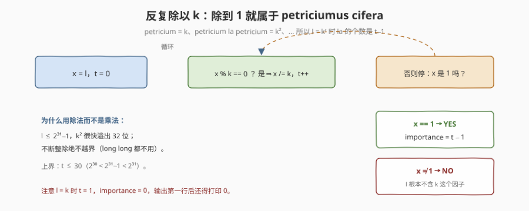
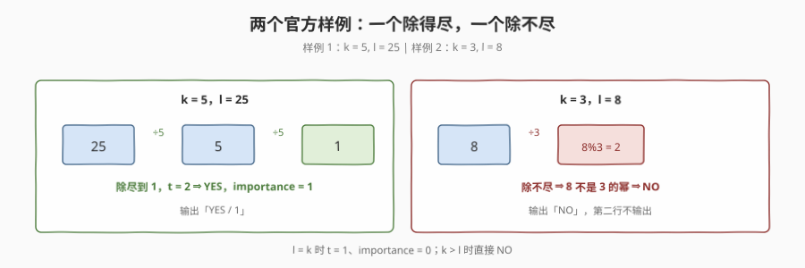

# Codeforces 114A 幂次归属判定 题解

## 1. 题目概述

- **题目链接**：https://codeforces.com/problemset/problem/114/A
- **比赛来源**：Codeforces Beta Round 86 (Div. 2 Only) · Problem A（UTC 2011-09-08）
- **难度**：1000
- **标签**：数学
- **评测类型**：普通
- **限制**：时间 2 s / 内存 256 MB

**题意**：Petya 造了一个词 `petricium` 表示数 $k$；`petricium la petricium` 表示 $k^2$，每多写一个 `la` 就再乘一个 $k$，即标题里有 $t$ 个 `petricium` 就表示 $k^t$。所有这样的数叫 *petriciumus cifera*，一个数的"重要性"就是它标题里 `la` 的个数。

给定 $k$ 和 $l$，判断 $l$ 是否属于这个集合：属于则第一行输出 `YES`、第二行输出 $l$ 的重要性；否则只输出一行 `NO`。

换句话说：**$l$ 是不是 $k$ 的正整数次幂**？若是，$l=k^t$（$t\ge1$），重要性为 $t-1$。

**约束**：

- $2\le k,l\le2^{31}-1=2147483647$：正好是 32 位有符号整数的上界，两个数相乘就可能溢出（$k$ 接近 $2^{31}$ 时 $k^2\approx4.6\times10^{18}$，虽在 64 位内，但 $k^3$ 一定溢出）。这排除了"枚举指数、直接算 $k^t$ 再比较"的写法，或者至少要求先做溢出保护。
- $t\le30$：$2^{30}=1073741824<2^{31}-1<2^{31}$，所以循环次数极少。
- 没有多测，只有一组。

## 2. 示例与观察

官方样例 1（输入 / 输出原样）：

```text
输入：
5
25

输出：
YES
1
```

$25=5^2$，标题是 `petricium la petricium`，含 1 个 `la`，所以重要性是 1。

官方样例 2（输入 / 输出原样）：

```text
输入：
3
8

输出：
NO
```

$8$ 不是 3 的幂（$3^1=3<8<9=3^2$），输出 `NO`。



**观察**：$l=k^t$ 等价于"从 $l$ 出发反复除以 $k$，**恰好除尽到 1**"。这个过程的中间值单调不增、且始终 $\le l\le2^{31}-1$，天然不会溢出——比"乘上去再比"省心得多。而"除了几次"就是 $t$，重要性 $t-1$。

## 3. 解题思路

### 3.1 朴素做法与瓶颈

最直白的写法：令 $p=k$、$t=1$，每次判断 $p$ 是否等于 $l$，否则 $p\mathrel{*}=k$、$t{+}{+}$，直到 $p>l$。

逻辑没错，两个小坑：

1. **溢出**：$p$ 一旦超过 $l$ 就退出，但"最后一步乘法"仍可能先溢出。$k$ 接近 $2^{31}$ 时 $k^2\approx4.6\times10^{18}$ 还能塞进 `long long`（上界 $9.2\times10^{18}$），但 $k^3$ 就爆了；如果只用 32 位 `int`，$k=46341$ 时 $k^2>2^{31}-1$ 就已经是 UB。
2. 即使加了 `if (p > l / k) break;` 这样的保护，代码也比除法版长，容易写错。

### 3.2 核心观察：除法链

$l=k^t$（$t\ge1$）当且仅当：反复执行 $l\gets l/k$（要求每一步都整除）恰好 $t$ 次之后，$l$ 变成 $1$。

- 若 $l=k^t$，前 $t-1$ 次除完是 $k^{t-1},\dots,k$，都能整除，第 $t$ 次得 $1$，此后 $1\bmod k=1\ne0$，循环停止；
- 若 $l$ 不是 $k$ 的幂，设 $l=k^{s}\cdot r$（$r$ 不被 $k$ 整除、$r>1$，$s\ge0$），则循环执行 $s$ 次后停在 $r\ne1$，判 `NO`。

除法链的好处是全过程都在 $[1,l]$ 内取值，**不需要任何溢出保护**。

### 3.3 算法流程

1. 读入 $k,l$（64 位）。
2. $t\gets0$；当 $l \bmod k=0$ 时：$l\gets l/k$，$t{+}{+}$。
3. 若 $l=1$ **且** $t\ge1$：输出 `YES` 与 $t-1$；否则输出 `NO`。

第 3 步的 $t\ge1$ 不能省：题面里 $l\ge2$，所以 $t=0$ 只可能出现在"$l$ 一开始就是 1"这种不会发生的输入上；写上它是为了让判定与"$l$ 是 $k$ 的正整数次幂（不许 $t=0$）"严格对应。

### 3.4 样例走查



- 样例 1：$l=25$，$25\bmod5=0\Rightarrow l=5,t=1$；$5\bmod5=0\Rightarrow l=1,t=2$；$1\bmod5=1$ 停。$l=1,t=2\ge1$ → `YES` 与 $2-1=1$ ✓
- 样例 2：$l=8$，$8\bmod3=2\ne0$，循环一次都不进，$l=8\ne1$ → `NO` ✓
- 补充：$k=5,l=5$ → $t=1$，重要性 $0$（标题只有 `petricium`，没有 `la`）；$k=2,l=2^{30}$ → $t=30$，重要性 29；$k=2,l=12$ → $12\to6\to3$，$3\bmod2\ne0$ 且 $3\ne1$ → `NO`。

## 4. 正确性证明

**引理 1（除法链的步数唯一）**：若 $l=k^t$（$t\ge1$），则"反复整除 $k$"的过程恰好执行 $t$ 次并把 $l$ 变成 $1$。

**证明**：对 $t$ 归纳。$t=1$ 时 $l=k$，一次除法得 $1$，且 $1\bmod k\ne0$，停止。设对 $t-1$ 成立；$t$ 时 $l=k^t$ 被 $k$ 整除，一次除法得 $k^{t-1}$，由归纳假设再执行 $t-1$ 次，共 $t$ 次。∎

**引理 2（停止时不是 1 就说明不是幂）**：若循环执行 $s$ 次后停在 $r$，则 $l=k^s\cdot r$ 且 $r\bmod k\ne0$。因此 $r\ne1$ 时 $l$ 不可能是 $k$ 的正整数次幂。

**证明**：循环的每次迭代都把 $l$ 除以 $k$，故不变量 $l_{\text{原始}}=k^{\text{已执行次数}}\cdot l_{\text{当前}}$ 成立；停止条件是 $l_{\text{当前}}\bmod k\ne0$。若 $r\ne1$ 而 $l=k^t$，由算术基本定理（或直接由引理 1 的步数唯一性）矛盾：$k^s r=k^t$ 且 $r$ 不被 $k$ 整除，只能 $r=1$。∎

**引理 3（重要性 = $t-1$）**：标题里 `petricium` 的个数是 $t$、`la` 的个数是 $t-1$，与题面对 `petriciumus cifera` 的定义一致。

**证明**：`petricium` 单独出现表示 $k^1$（0 个 `la`），每多一个 `la` 多乘一个 $k$ 并多一个 `petricium`；归纳得"$t$ 个 `petricium` $\iff$ $t-1$ 个 `la` $\iff$ 数值 $k^t$"。∎

**定理**：程序输出恰为题目要求——$l$ 是 $k$ 的正整数次幂时输出 `YES` 与 $t-1$，否则输出 `NO`。

**证明**：由引理 1，$l=k^t$ 时循环 $t$ 次停在 1，程序输出 `YES` 与 $t-1$，与引理 3 一致；由引理 2，$l$ 不是幂时循环停在 $r\ne1$，程序输出 `NO`。两种情形互斥且穷尽。∎

## 5. 复杂度分析

- **时间**：循环次数恰为 $t$（或停在残渣为止），$t\le\lfloor\log_2(2^{31}-1)\rfloor=30$；每次迭代一次取模 + 一次整除，共 $O(\log_k l)\le O(\log l)$，至多 30 次。2 s 时限下完全无压力（实测 2 ms，基本是进程启动开销）。
- **空间**：$O(1)$，两个 64 位整数。

## 6. 参考代码

### C++17

```cpp
#include <bits/stdc++.h>
using namespace std;
typedef long long ll;

int main() {
    ll k, l;
    if (scanf("%lld %lld", &k, &l) != 2) return 0;
    ll x = l;
    int t = 0;
    while (x % k == 0) {
        x /= k;
        t++;
    }
    if (x == 1 && t >= 1) printf("YES\n%d\n", t - 1);
    else printf("NO\n");
    return 0;
}
```

### Python3

```python
import sys


def main():
    data = sys.stdin.read().split()
    k, l = int(data[0]), int(data[1])
    t = 0
    while l % k == 0:
        l //= k
        t += 1
    if l == 1 and t >= 1:
        print("YES")
        print(t - 1)
    else:
        print("NO")


main()
```

## 7. 边界情况与易错点

1. **$l=k$**：$t=1$，重要性是 $0$，必须输出第二行的 `0`（不能因为"除了一次"就输出 1，也不能只输出 `YES`）。
2. **$k>l$**：循环一次都不进，$l\ne1$ → `NO`；这也是"$l$ 比 $k$ 小"的唯一可能结论。
3. **溢出**：不要用"乘到 $l$"的写法做判等；即使要用，也必须在乘之前判断 `p > l / k`。除法链的中间值恒 $\le l$，天然安全。
4. **数据类型**：$l$ 最大 $2^{31}-1$ 虽然装在 `int` 里，但题目的"$k^t$"语义提示了溢出风险；一律用 `long long` / `%lld` 最省心（Python 无所谓）。
5. **输出格式**：`NO` 只占一行；`YES` 必须两行——多打一个换行或少了第二行都会 WA。
6. **残渣不为 1**：$k=2,l=12$ 会除到 $3$ 停住，此时 $l\ne1$ → `NO`；只判"能整除"是不够的，必须判"除到 1"。
7. **$l=2^{31}-1$ 且 $k=2$**：奇数，直接 `NO`；若 $k=2,l=2^{30}$，则 $t=30$、重要性 $29$，说明循环上界确实是 30 而不是 31。
8. **$t\ge1$ 的守卫**：题面保证 $l\ge2$，但代码里保留 `t >= 1` 可以让"若把题目放宽到 $l=1$"时不误判为 $k^0$。
9. **读入格式**：两个数各占一行（样例如此），用 `scanf`/`split` 都能正确读取，不要按行读死。

## 8. 验证记录

- **编译环境与命令**：`clang++ -std=c++17 -O2`（配 `codeforces/tools/include/bits/stdc++.h` 兼容头）；Python 3.9.6。
  `python3 codeforces/tools/verify_solution.py codeforces/contests/0101-0203/114/A_幂次归属判定.md`
- **官方样例**：$2/2$ 通过（`YES/1` 与 `NO`），C++ 与 Python 一致。
- **穷举对拍**：$k\in[2,59]$、$l\in[2,3000]$ 共 $173942$ 组，与"枚举指数 $t=1..31$、用大整数乘 $k^t$ 再比较"的暴力逐组一致（批量跑完一组进程内完成，避免 17 万次进程启动）。
- **随机 + 边界**：$211$ 组随机/边界用例（$k,l$ 随机到 $2^{31}-1$，外加 $l=k$、$k=46340,l=k^2=2147395600$（$k^2$ 已贴近 32 位上限，检验不会因乘法溢出而误判）、$k=46341,l=2^{31}-1$、$l=2^{30}$、$l=10^3$ 等），C++ 与暴力全部一致。
- **最大约束性能**：$k=2,l=2^{30}$（循环 30 次，最长路径）单次约 2 ms（100 次共 0.202 s），2 s 余量约 1000 倍。
- **图片校验**：2 张 SVG 均通过 `xml.etree.ElementTree.parse`。
- **复核状态**：verified（样例、穷举、随机、性能、图片均实跑通过）。

## 相关题目与扩展

- [Codeforces 114B PFAST Inc.](https://codeforces.com/problemset/problem/114/B)：同场 B 题，位掩码枚举最大和谐队伍。
- [Codeforces 113D Museum](https://codeforces.com/problemset/problem/113/D)、[113E Sleeping](https://codeforces.com/problemset/problem/113/E)：同一场的 Div.1 题目。
- [LeetCode 326. 3 的幂](https://leetcode.cn/problems/power-of-three/)：完全相同的判定，只是不许用循环（要求 $O(1)$）。
- [LeetCode 231. 2 的幂](https://leetcode.cn/problems/power-of-two/)：位运算判定的版本。

**延伸思考**：

1. **$k$ 不是素数也没关系**：本做法判的是"$k$ 的幂"而不是"质因数分解后指数整齐"，所以 $k=12$、$l=144$ 也能正确判 `YES`；如果换成"$l$ 的所有素因子指数相同"之类的错误理解，$k=12$ 就会误判。
2. **要求输出 $t$ 而不是 $t-1$**：改一行即可；但要先想清楚"重要性"的定义是 `la` 的个数，$t=1$ 时是 0。
3. **$l$ 放大到 $10^{18}$ 以上**：64 位装不下乘法，可以先用 `log` 估出 $t=\mathrm{round}(\log l/\log k)$，再用大整数（或 Python 的 `**`）验证 $k^t=l$，注意浮点对相邻整数的判定不可靠，需要 ±1 的邻域检验。
4. **多组询问**：本做法是 $O(\log_k l)$/询问、$O(1)$ 空间，$10^5$ 组询问也只有 $3\times10^6$ 次除法，仍是秒级。
