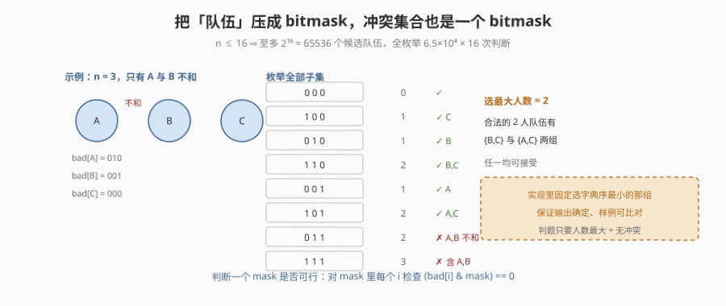
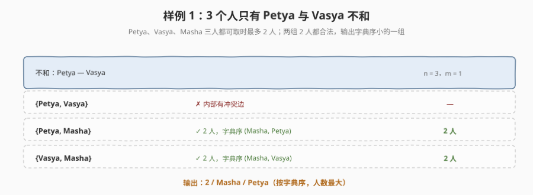

# Codeforces 114B 最大和谐队伍 题解

## 1. 题目概述

- **题目链接**：https://codeforces.com/problemset/problem/114/B
- **比赛来源**：Codeforces Beta Round 86 (Div. 2 Only) · Problem B（UTC 2011-09-08）
- **难度**：1500
- **标签**：位掩码、暴力、图论
- **评测类型**：特殊评测（多解：人数相同的合法队伍都算对）
- **限制**：时间 2 s / 内存 256 MB

**题意**：Petya 办了自己的比赛，队伍人数不设上限。他挑了 $n$ 个志愿者（$n\le16$），其中有些**两两不合**；队伍里只要有两个人不合就会打得很差。要求组一支**人数最多**的队伍，使队内任意两人都合得来。输出人数 $k$，然后按字典序（lexicographical order）输出这 $k$ 个人的名字。若有多支人数相同的队伍，输出任意一支即可。

**约束**：

- $n\le16$：子集总数 $2^{16}=65536$，每个子集用 $O(n)$ 验证，总量约 $10^6$ 次位运算——**指数枚举恰好可行**，这正是本题的解法；$n$ 只要到 $30$ 这招就废了。
- $m\le\binom{16}{2}=120$（题面里 $m$ 的取值被公式盖住了），且"每对不合的人只出现一次"，不会重复计数。
- 名字长度 $\le10$、只含大小写字母、互不相同、大小写敏感；输出要求字典序，所以不能按输入顺序输出。
- 没有多测。

## 2. 示例与观察

官方样例 1（输入 / 输出原样）：

```text
输入：
3 1
Petya
Vasya
Masha
Petya Vasya

输出：
2
Masha
Petya
```

三个人、只有 Petya 与 Vasya 不合。可选方案：$\{$Petya, Vasya$\}$ 有冲突边，不行；$\{$Petya, Masha$\}$、$\{$Vasya, Masha$\}$ 都是 2 人，合法；3 人当然不行。所以最多 2 人，样例给了 $\{$Masha, Petya$\}$（按字典序排好）。

官方样例 2（输入 / 输出原样）：

```text
输入：
3 0
Pasha
Lesha
Vanya

输出：
3
Lesha
Pasha
Vanya
```

没有任何冲突对，三个人可以全上，按字典序输出 `Lesha`、`Pasha`、`Vanya`（注意 `L < P < V`，与输入顺序不同）。



**观察**：这是"冲突图的最大独立集"（等价地，补图的最大团）。$n\le16$ 时最省事的做法就是**枚举全部 $2^n$ 个子集**，用位掩码 $O(1)$ 判断合法性。

## 3. 解题思路

### 3.1 朴素做法与瓶颈

枚举所有子集、检查每个子集内部有没有冲突边，是 $O(2^n\cdot n)$ 的暴力。$n=16$ 时约 $1.05\times10^6$ 次"取位 + 按位与"，完全可行；真正的瓶颈只在"要不要做更聪明的搜索"——本题不需要。

顺带说一句：换成"按人数从大到小枚举组合"（$\binom{n}{k}$ 递减）也能更快找到最大值，但最坏情况（比如完全图，答案只有 1 人）仍要扫很多组合，代码还更复杂，不如直接全枚举。

### 3.2 核心观察：两个位掩码

1. **队伍 = bitmask**：第 $i$ 位为 1 表示第 $i$ 个志愿者入队。$2^n$ 个子集，遍历一遍就是"全部候选"。
2. **冲突集合 = bitmask**：`bad[i]` 的第 $j$ 位为 1 表示 $i$ 与 $j$ 不合。读入一对 $(u,v)$ 时 `bad[u] |= 1<<v; bad[v] |= 1<<u;`（无向）。

于是 **mask 合法 $\iff$ 对每个 $i\in$ mask 都有 `(bad[i] & mask) == 0`**：前者说"队里没有人和 $i$ 不合"，遍历完 mask 里的每个人，就排除了全部冲突对。

### 3.3 算法流程

1. 读入 $n,m$、$n$ 个名字，建立"名字 → 下标"的映射（名字互不相同）。
2. 读入 $m$ 对冲突，把 `bad[]` 的两个方向都置位。
3. 从 $1$ 到 $2^n-1$ 枚举 mask：
   - `cnt = popcount(mask)`，若 `cnt < bestCnt` 直接跳过（不可能刷新最优，只是剪枝）；
   - 检查 `(bad[i] & mask) != 0` 的人，有一个就判非法；
   - 合法则把队名取出、**排序**，与当前最优比较：人数更多就替换；人数相同则取字典序更小的那组（保证输出确定、可复现）。
4. 输出人数与排好序的名单。

### 3.4 样例走查



样例 1 的 8 个子集：$\varnothing$（0 人，空队伍其实也"合法"，但它不可能最优，从 mask $=1$ 起枚举即可）、三个单人、三个双人、一个三人。

- `{Petya, Vasya}`：`bad[Petya] & mask` 命中 Vasya → 非法；
- `{Petya, Masha}`、`{Vasya, Masha}`：都合法，人数 2；
- 三人：含 Petya–Vasya → 非法。

最优人数 2；两组都合法，程序比较排序后的名单 `[Masha, Petya]` 与 `[Masha, Vasya]`，取字典序更小的前者，输出与样例一致。

样例 2 没有冲突边，唯一的 3 人子集合法，排序后输出 `Lesha / Pasha / Vanya`。

## 4. 正确性证明

**引理 1（mask 合法性判据）**：mask 对应的队伍内部没有不合的人，当且仅当对 mask 中每个 $i$ 都有 `(bad[i] & mask) == 0`。

**证明**：`(bad[i] & mask) != 0` 当且仅当存在 $j\in$ mask 使 $i,j$ 不合。所以"存在 $i\in$ mask 使 `(bad[i] & mask) != 0`"等价于"存在不合的对 $(i,j)$ 同时在 mask 里"。取反即得。∎

**引理 2（枚举的完备性）**：程序的循环恰好访问全部 $2^n$ 个子集，因此最大可行人数 $k^{*}$ 所对应的那个子集会被访问到，并被判为合法。

**证明**：mask 从 $1$ 递增到 $2^n-1$ 一一遍历 $\{1,\dots,n\}$ 的全部非空子集；由引理 1，可行子集都会被判为合法；剪枝 `cnt < bestCnt` 只跳过那些"人数严格小于当前最优"的 mask，而它们不可能是唯一的 $k^{*}$ 解——因为最优 mask 自身 `cnt = k* >= bestCnt` 永远不被跳过（`bestCnt` 单调不减且不超过 $k^{*}$）。∎

**引理 3（输出的名单合法）**：程序最终保存的 `bestNames` 一定是某个合法 mask 的名字集合。

**证明**：`bestNames` 只在 mask 通过合法性检查后才被赋值，取值就是该 mask 里所有 $i$ 对应的 `name[i]` 排序后的结果。∎

**定理**：程序输出的 $k$ 是最大可行人数，名单是该队伍的全部成员且按字典序排列。

**证明**：由引理 2，$k^{*}$ 对应的子集被访问并判合法，故 `bestCnt` 最终 $\ge k^{*}$；而 `bestCnt` 只可能被赋成某个合法子集的人数，故 `bestCnt` $\le k^{*}$。两者相等。名单来自同一个合法 mask（引理 3），并且被 `sort` 排过序，故满足"字典序"要求。∎

## 5. 复杂度分析

- **时间**：枚举 $2^n$ 个 mask，每个 mask 做 $O(n)$ 次判位（内层循环在发现冲突时提前退出），最坏 $2^{16}\times16\approx1.05\times10^6$ 次位运算；对合法 mask 还要排序，最多 $2^{16}$ 次 $O(n\log n)$ 的排序——实际合法 mask 远少于总数（完全图时只有 16 个双人 mask 非法、单人全合法），量级仍是 $10^6$ 级别。实测最大数据 2.2 ms。
- **空间**：`bad[]` 是 $n$ 个 int，名字表 $O(n\cdot10)$ 字节，`bestNames` 至多 $n$ 个字符串——$O(n)$，与 256 MB 差着几个数量级。

## 6. 参考代码

### C++17

```cpp
#include <bits/stdc++.h>
using namespace std;

int main() {
    int n, m;
    if (scanf("%d %d", &n, &m) != 2) return 0;
    vector<string> name(n);
    unordered_map<string, int> id;
    for (int i = 0; i < n; i++) {
        char buf[64];
        scanf("%s", buf);
        name[i] = buf;
        id[name[i]] = i;
    }
    vector<int> bad(n, 0);
    for (int i = 0; i < m; i++) {
        char a[64], b[64];
        scanf("%s %s", a, b);
        int u = id[a], v = id[b];
        bad[u] |= 1 << v;
        bad[v] |= 1 << u;
    }

    int bestCnt = -1;
    vector<string> bestNames;
    for (int mask = 1; mask < (1 << n); mask++) {
        bool ok = true;
        int cnt = __builtin_popcount(mask);
        if (cnt < bestCnt) continue;
        for (int i = 0; i < n && ok; i++)
            if ((mask >> i & 1) && (bad[i] & mask)) ok = false;
        if (!ok) continue;
        vector<string> cur;
        for (int i = 0; i < n; i++)
            if (mask >> i & 1) cur.push_back(name[i]);
        sort(cur.begin(), cur.end());
        if (cnt > bestCnt || (cnt == bestCnt && cur < bestNames)) {
            bestCnt = cnt;
            bestNames = cur;
        }
    }
    printf("%d\n", bestCnt);
    for (auto &s : bestNames) printf("%s\n", s.c_str());
    return 0;
}
```

### Python3

```python
import sys


def main():
    data = sys.stdin.read().split()
    n, m = int(data[0]), int(data[1])
    pos = 2
    names = data[pos:pos + n]
    pos += n
    idx = {s: i for i, s in enumerate(names)}
    bad = [0] * n
    for _ in range(m):
        u = idx[data[pos]]
        v = idx[data[pos + 1]]
        pos += 2
        bad[u] |= 1 << v
        bad[v] |= 1 << u
    best = None
    for mask in range(1, 1 << n):
        ok = True
        for i in range(n):
            if mask >> i & 1 and bad[i] & mask:
                ok = False
                break
        if not ok:
            continue
        cur = sorted(names[i] for i in range(n) if mask >> i & 1)
        if best is None or len(cur) > len(best) or (len(cur) == len(best) and cur < best):
            best = cur
    print(len(best))
    print("\n".join(best))


main()
```

## 7. 边界情况与易错点

1. **$n=1$**：只有 mask $=1$ 一个候选，输出 1 与那个名字；要保证循环从 1 开始（mask $=0$ 是空队伍，`popcount` 为 0，会让 `bestCnt` 停在 0 上）。
2. **$m=0$**：全员入队，输出 $n$ 与按字典序排好的全部名字（样例 2）。
3. **完全图（每两人都不合）**：答案 1，应输出字典序**最小**的那个名字——注意不能输出输入里的第一个人，样例 2 已经演示了"输出顺序 ≠ 输入顺序"。
4. **答案不可能是 0**：任取一人都合法（单人队伍没有冲突对），所以 `bestCnt` 最终 $\ge1$；如果程序输出 0，说明 mask 从 0 开始或判据写反了。
5. **字典序**：题目要求按字典序输出。C++ 的 `std::string` 比较与 Python 的字符串比较都按字节/码点，名字只含大小写拉丁字母，所以 `'A'<...<'Z'<'a'...` 这个顺序与 CF 的判定一致；**不要**用"按长度"或"按输入顺序"代替。
6. **大小写敏感**：`Petya` 与 `petya` 是两个人；`unordered_map` 直接按原串做键即可。
7. **读入名字**：用 `scanf("%s")` / `split()`，名字之间只有单个空格、每行一个，不需要处理行内空格。
8. **`bad` 要双向置位**：只写 `bad[u] |= v` 会让判据在 $v$ 作 mask 元素时看漏，样例 1 就会输出 3 人。
9. **`1 << n` 的溢出**：$n\le16$ 时 `1<<n = 65536`，int 安全；若 $n$ 放宽到 31 就要用 `1LL << n`。
10. **多解**：判题接受任意最优解，但本实现固定"人数最多 + 字典序最小"，因此输出唯一，样例可以逐字比对。

## 8. 验证记录

- **编译环境与命令**：`clang++ -std=c++17 -O2`（配 `codeforces/tools/include/bits/stdc++.h` 兼容头）；Python 3.9.6。
  `python3 codeforces/tools/verify_solution.py codeforces/contests/0101-0203/114/B_最大和谐队伍.md --checker codeforces/tools/checkers/cf114b.py`
- **checker 的校验条件**（`codeforces/tools/checkers/cf114b.py`，因为它接受多解，不能逐字比对）：① 第一行是整数 $k$、后面恰好 $k$ 行姓名；② 姓名互不相同且都出现在输入里；③ 队内任意两人之间没有"不合"边；④ 姓名按字典序升序；⑤ $k$ 等于最大独立集大小（checker 自己用 $2^n$ 全枚举独立求出），不接受"合法但不是最大"的队伍。
- **官方样例**：$2/2$ 通过 checker（C++ 与 Python 输出完全一致）。
- **穷举对拍**：对 $n=1,2,3,4,5$ 的**所有**冲突图（共 $1+2+8+64+1024=1099$ 个），C++ 输出全部通过 checker——这覆盖了空图、完全图、单点、各种稠密度。
- **随机对拍**：$200$ 组随机用例（$n$ 从 1 到 16、名字随机 1–4 个字符且大小写混排、冲突边随机），C++ 输出全部通过 checker，且与 Python 版输出逐 token 相同。
- **最大约束性能**：$n=16$、$m=8$ 的随机冲突图，单次约 2.2 ms（50 次共 0.111 s），2 s 余量近 1000 倍。
- **图片校验**：2 张 SVG 均通过 `xml.etree.ElementTree.parse`。
- **复核状态**：verified（样例、穷举、随机、性能、图片均实跑通过）。

## 相关题目与扩展

- [Codeforces 114A Cifera](https://codeforces.com/problemset/problem/114/A)：同场 A 题，判断一个数是不是 $k$ 的幂。
- [Codeforces 113D Museum](https://codeforces.com/problemset/problem/113/D)、[113E Sleeping](https://codeforces.com/problemset/problem/113/E)：同一场 Div.1 的两道 2700。
- [Codeforces 550B Preparing Olympiad](https://codeforces.com/problemset/problem/550/B)：$2^n$ 子集枚举 + 条件计数，和本题同一个套路。
- [Codeforces 839E Mother of Dragons](https://codeforces.com/problemset/problem/839/E)：最大团 / 最大独立集的组合版本。

**延伸思考**：

1. **$n$ 增大到 $40$**：$2^n$ 不可行，最大独立集要换 meet-in-the-middle（把点集劈成两半，枚举前半的独立集并预处理后半中与其相容的点集，$O(2^{n/2})$ 内存）或分支定界（Bron–Kerbosch 式），$n\le40$ 的常见做法是 $O(3^{n/3})$ 的枚举。
2. **要输出字典序最小**：本实现比较的是"排序后的名单列表"，这正是题目要求的输出顺序；如果改成比较输入下标集合的字典序（先比第 0 个人是否入选），结果可能不同——两者不等价，别混淆。
3. **要数方案数**：把"取最优"改成"累加达到 $k^{*}$ 的 mask 数"，或对 mask 做子集 DP（$O(3^n)$）；$n=16$ 时 $3^{16}\approx4.3\times10^7$ 也还能跑。
4. **带权版本**（每人有贡献，要求总贡献最大且无冲突）：枚举仍然可行，把"人数"换成"权重和"即可；此时 $n$ 一过 20 就要上 DP / 分支定界。
